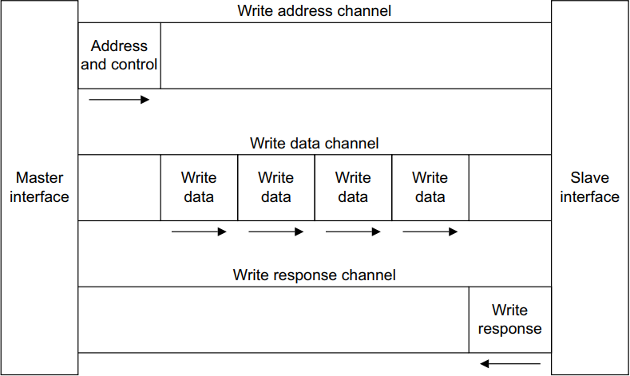

# hyw-zero.github.io

ZERO 的个人博客，记录编程、Linux、Python、C++、前端与数字IC 相关的学习笔记。基于 **Hexo + NexT** 构建，部署在 GitHub Pages。

- 线上地址：<https://hyw-zero.github.io/>
- 源码分支：`hexo`（当前分支）
- 部署分支：`master`（由 `hexo deploy` 自动生成，请勿直接修改）

## 技术栈

| 组件 | 说明 |
| --- | --- |
| [Hexo](https://hexo.io/) 8.1.2 | 静态博客生成器 |
| [NexT](https://theme-next.js.org/) 8.29.1 | 主题（Gemini 布局 + 自定义深色样式） |
| hexo-renderer-marked | Markdown 渲染，开启原生图片懒加载 |
| sharp | 构建期图片压缩与 WebP 转换 |
| hexo-deployer-git | 通过 SSH 推送到 GitHub Pages |

## 主要特性

- 深色主题、中文排版与响应式布局，移动端重新适配
- 文章图片自动生成 640px / 原宽两档 WebP，支持 `srcset` 按屏幕取图
- 原图完整保留，点击图片仍可通过 Fancybox 查看原画质
- 背景图使用 59KB 的 WebP，首屏更轻
- Live2D 看板娘、点击爱心、网易云音乐播放器
- 本地搜索、字数统计、阅读时长、文章目录、相关文章
- 文章级版权声明与「本文结束」签名

## 目录结构

```text
.
├─ _config.yml               # Hexo 站点配置、图片优化配置
├─ _config.next.yml          # NexT 主题配置（菜单、头像、代码块等）
├─ package.json              # 依赖与 npm 脚本
├─ scripts/
│  └─ image-optimizer.js     # 构建期图片优化脚本
├─ source/
│  ├─ _posts/                # 文章（一篇 .md 对应一个同名资源目录）
│  ├─ _data/
│  │  ├─ styles.styl         # 自定义样式（深色主题、布局、移动端）
│  │  ├─ variables.styl      # 字体等 Stylus 变量
│  │  ├─ body-end.njk        # 页面底部注入：Live2D、爱心、音乐播放器
│  │  └─ post-body-end.njk   # 文章底部注入：版权声明
│  ├─ images/                # 站点图片：背景、微信/支付宝收款码等
│  ├─ uploads/               # 文章中引用的公共图片
│  ├─ js/                    # 自定义脚本
│  └─ fonts/                 # 自托管字体（JetBrains Mono）
├─ public/                   # 生成结果（已忽略，不提交）
└─ .image-cache/             # WebP 缓存（已忽略，可安全删除）
```

## 环境要求

- Node.js **>= 20.19.0**（见 `package.json` 的 `engines`）
- npm 与 Git
- 部署需要本机已配置可访问 GitHub 的 SSH Key

## 快速开始

换电脑后重新拉取博客源码：

```bash
git clone -b hexo https://github.com/hyw-zero/hyw-zero.github.io.git
cd hyw-zero.github.io
npm install
```

> `npm install` 会安装开发依赖 `sharp`，用于构建期图片优化。若使用 `--omit=dev`，优化脚本会自动跳过，站点仍可正常生成，只是图片不会被转换。

启动本地预览：

```bash
npx hexo server
# 或 npm run server
```

打开 <http://localhost:4000> 即可。

> 注意：`hexo server` 在内存中渲染页面，看不到图片优化后的 `srcset`。需要验证优化效果时，先 `npx hexo generate`，再运行 `npx hexo server --static`，访问的是 `public/` 中的真实产物。

## 写文章

新建文章：

```bash
npx hexo new post "文章标题"
```

站点开启了 `post_asset_folder: true`，会同时创建 `source/_posts/文章标题/` 目录。图片有两种放置方式：

1. **公共图片**：放到 `source/uploads/`，文中用绝对路径引用：

   ```markdown
   
   ```

2. **文章专属图片**：放到同名资源目录，使用 `asset_img` 标签：

   ```markdown
   
   ```

文章头部示例：

```yaml
---
title: 'AMBA总线（3）—— AXI协议'
date: 2023-05-04 21:27:00
categories:
  - AMBA
tags:
  - AMBA
  - AXI
---
```

## 图片优化

`scripts/image-optimizer.js` 会在 `hexo generate` 结束时自动执行：

1. 扫描 `public/` 下的 PNG / JPG / GIF（跳过 `images/`、头像、过小图片）；
2. 在每张原图旁生成 `<名称>-w640.webp`、`<名称>-w1280.webp`（GIF 转为动态 WebP）；
3. 重写 HTML 中的 ``：

```html

```

- **原图不会被修改或删除**；`data-src` 让 Fancybox 放大时加载原图。
- 若 WebP 体积没有比原图小 5% 以上，则回退使用原图，避免「越压越大」。
- 未被最终 `srcset` 引用的变体会在构建时清理。
- 生成结果缓存于 `.image-cache/`，`hexo clean` 后重建通常只需十几秒；首次无缓存构建需要几分钟。

相关配置位于 `_config.yml`：

```yaml
image_optimizer:
  enable: true
  widths: [640, 1280]  # 生成的宽度档位
  quality: 82          # WebP 质量（静态图）
  gif_quality: 60      # WebP 质量（动态 GIF）
  min_width: 300       # 小于该宽度不处理
  min_bytes: 8192      # 小于该体积不处理
  concurrency: 4       # 并行编码数量
```

想强制重新编码图片时，删除 `.image-cache/` 后重新生成即可。

## 构建与部署

```bash
npx hexo clean
npx hexo generate
npx hexo deploy
```

或使用 npm 脚本：

```bash
npm run clean
npm run build
npm run deploy
```

部署配置在 `_config.yml` 末尾：

```yaml
deploy:
  type: git
  repo: git@github.com:hyw-zero/hyw-zero.github.io.git
  branch: master
```

`hexo deploy` 只负责推送已生成的 `public/`。**修改文章或图片后，必须先 `hexo generate`，再部署**；否则线上仍是旧内容。

## 自定义

| 文件 | 用途 |
| --- | --- |
| `_config.yml` | 站点信息、URL、文章目录、图片优化、部署 |
| `_config.next.yml` | NexT 主题：菜单、头像、社交链接、代码高亮、Fancybox、本地搜索 |
| `source/_data/styles.styl` | 深色配色、文章排版、背景、移动端适配 |
| `source/_data/variables.styl` | 字体栈等变量 |
| `source/_data/body-end.njk` | Live2D、点击爱心、音乐播放器注入 |
| `source/_data/post-body-end.njk` | 文章底部版权声明 |
| `source/js/live2d-autoload.js` | Live2D 加载逻辑 |

`source/_data/` 下的文件会覆盖主题默认值，升级 NexT 时无需改动 `node_modules`。

## 常见问题

**本地预览没有 `srcset` / WebP？**
`hexo server` 不落盘。改用：

```bash
npx hexo generate
npx hexo server --static
```

**图片没有被优化？**
检查图片是否满足 `min_width`、`min_bytes`；修改过配置后建议 `npx hexo clean`。首次构建较慢属于正常现象。

**`sharp` 安装失败？**
确认 Node 版本为 20 LTS 及以上，然后重试 `npm install`；必要时执行 `npm rebuild sharp`。

**部署成功但线上还是旧图？**
GitHub Pages 与浏览器都有缓存，先 `Ctrl + F5` 强制刷新；再确认 `master` 分支已包含最新提交。

## 分支说明

| 分支 | 内容 | 是否手改 |
| --- | --- | --- |
| `hexo` | Hexo 源码、文章、主题配置 | ✅ 日常修改 |
| `master` | 生成的静态站点（GitHub Pages） | ❌ 由部署自动覆盖 |

## 致谢

- [Hexo](https://hexo.io/)
- [NexT](https://theme-next.js.org/)
- 文章为原创学习笔记，转载请注明出处。
