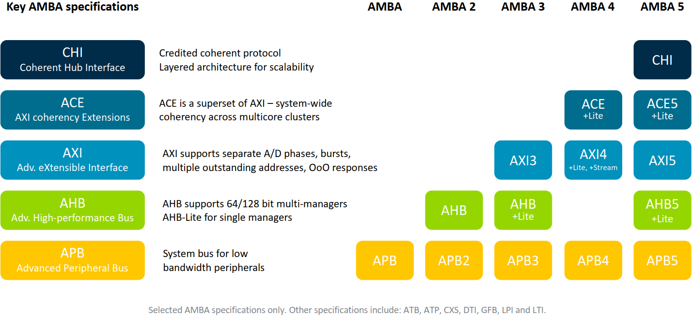

ARM 公司推出了 AMBA 系列总线，一直迭代至今，不断丰富扩展内容，常用的 AMBA 协议各个版本的变化如下所示：

在我刚入职时，指导人让我前 2 个星期什么都不用干，甚至不用登陆 Linux 系统，就在电脑上硬看 APB、AHB、AXI 数据手册。那时我连基本的握手、互联的概念都没有，看完后虽有收获，但非常流于表面。现在工作了一小段时间，打算再看一遍 AMBA 数据手册，希望把边边角角都给扫到。

AMBA 学习资料主要是 ARM 官方文档，见 [https://www.arm.com/architecture/system-architectures/amba/amba-specifications](https://www.arm.com/architecture/system-architectures/amba/amba-specifications) ，这里罗列了 AMBA 的所有 PDF 数据手册，都可以免登录免费下载。甚至可以逛逛 ARM 的 AMBA 官方论坛，看看别人都提了哪些问题，见 [https://community.arm.com/support-forums/f/soc-design-and-simulation-forum/tags/AMBA](https://community.arm.com/support-forums/f/soc-design-and-simulation-forum/tags/AMBA) 。

我的计划是翻译式的学习 AMBA 手册，难理解的地方加上自己的理解。不理解的直接原文翻译或跳过，日后理解了再补上。翻译式的学习似乎很蠢，但可以确保我脑子里至少流过了所有知识点，也可以检查我对 AMBA 的认知是否和协议不符合。

AMBA 系列的协议众多，我目前只用到了 APB、AHB、AXI 和 ATB，这些是肯定要更新完的。后面还有 ACE、CHI、ATP、CXS、DTI、GFB、LPI、LTI 等，只有看时间是否充足或者项目是否用到，再决定要不要完整学习了。

BUS、Clock、SDC、UPF、Python、DFT......学海无涯啊

---

> 原文：[AMBA总线（0）—— 学习导论](https://www.cnblogs.com/xianyuIC/p/15013543.html)（博客园 · 咸鱼IC）
