APB是最简单的AMBA总线了，功耗很低，它多用于低速外围设备和访问寄存器。相比AHB和AXI，有几个很不一样的点：

-   <strong>最快只能背靠背（back to back）传输，至少2个周期传输一个数据，PSEL起来然后PENABLE起来。</strong>  
    -   背靠背传输，即连续传输，这笔传输传完，紧挨着下一个Cycle就可以开始下一笔传输。
-   <strong>不能Pipeline传输、Burst传输、Outstanding传输，数据有效时，其地址必然是当前数据的对应地址。</strong>
    -   pipeline传输，即流水式传输，指当前传输的结束Cycle可以是下一笔传输的起始Cycle，起到无缝衔接。
    -   burst传输，即只需指定起始地址和突发长度，即可自动对后面连续地址进行操作，无需提供连续地址。
    -   outstanding传输，即不需要等待读写数据完成，即可继续提供下一笔传输的命令和地址，提高传输效率。
-   <strong>不能读写同时传输，因为其读写地址是共用的。（AHB也不能读写同时传输）</strong>
-   <strong>不能仲裁，因为是单主多从协议。典型的APB协议包括唯一的APB桥作为Master，而所有的APB模块都是APB slave。</strong>

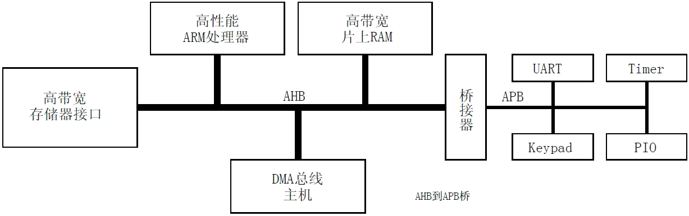

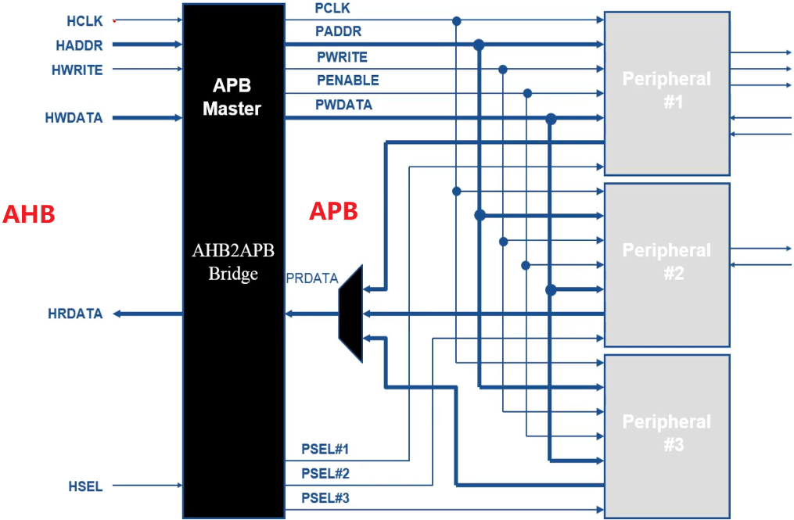

## 1 前言

### 1.2 APB 版本

1998年发布的 *APB Specification Rev E* 现已过时，并被以下三个修订版所取代：

-   AMBA2 APB Specification（即所谓APB2）
-   AMBA3 APB Protocol Specification v1.0（即所谓APB3）
-   AMBA APB Protocol Specification v2.0/Issue C（即所谓APB4）
-   AMBA APB Protocol Specification Issue D/E（即所谓APB5）

#### 1.2.1 AMBA2 APB Specification（APB2）

AMBA2 APB 规范详见*AMBA2 APB Specification Rev2(ARM IHI 0011A)。*

该规范定义了接口信号、基本的读写传输以及APB的两个组件APB bridge和APB slave。

规范的这个版本被称为APB2。

#### 1.2.2 AMBA3 APB Protocol Specification v1.0（APB3）

AMBA3 APB Protocol Specification v1.0定义了以下附加功能：

-   等待状态。参见*Transfers。*
-   错误报告。参见*Error response。*

以下接口信号支持此功能：

-   <strong>PREADY</strong> 准备就绪的信号，表示APB传输完成。
-   <strong>PSLVERR</strong> 传输失败的错误信号。

规范的这个版本被称为APB3。

#### 1.2.3 AMBA APB Protocol Specification v2.0（Issue C, APB4）

AMBA APB Protocol Specification v2.0定义了以下附加功能：

-   事务的保护。参见*Protection unit support*。
-   稀疏数据传输。参见*Write strobes*。

以下接口信号支持此功能：

-   <strong>PPROT</strong> 一种保护信号，用于支持非安全事务和安全事务。
-   <strong>PSTRB</strong> 一种写掩码信号，用于在写数据总线上实现稀疏数据传输。

规范的这个版本被称为APB4。

#### 1.2.4 AMBA APB Specification (Issue D/E, APB5）

AMBA APB Protocol Specification issue D/E 定义了以下附加功能：

-   <strong>PWAKEUP</strong> 信号。
-   <strong>User</strong> 信号。
-   <strong>Parity protection and check</strong> 信号。
-   <strong><em>Reaml Management Extension</em> (RME)</strong> 支持。(issue E)

规范的这个版本被称为APB5。

## 2 APB信号

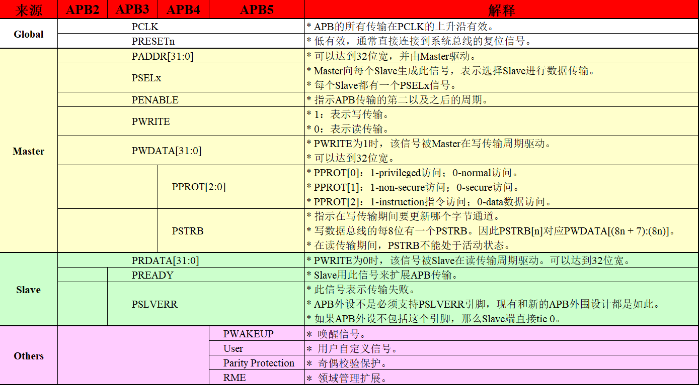

### 2.1 数据总线

-   APB协议有两个独立的数据总线，一个用于读取数据，一个用于写入数据。
-   总线可以达到32位宽。
-   由于总线没有各自的握手信号，因此数据传输不可能同时发生在两个总线上。

## 3 APB传输

### 3.1 写传输

介绍写传输的几种类型：

-   没有等待状态。
-   具有等待状态。

#### 3.1.1 没有等待状态

图3-1表示没有等待传输的基本写传输。

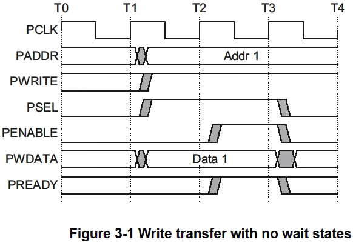

T1时，写传输开始于地址PADDR、写数据PWDATA、写信号PWRITE、选择信号PSEL，寄存在PCLK上升沿。这称为写传输的起始阶段。

T2时，使能信号PENABLE和准备信号PREADY寄存在PCLK上升沿。

当断言时，PENABLE表示传输的访问阶段的开始。

当断言时，PREADY表示Slave可以在PCLK的下一个上升边完成传输。

地址PADDR、写数据PWDATA和控制信号都保持有效，直到传输在访问阶段的T3完成结束。

使能信号PENABLE在传输结束时被撤销。

选择信号PSEL也被去断言，除非在此传输之后立即有另一个传输到同一Slave。

下图给出了burst写的例子：

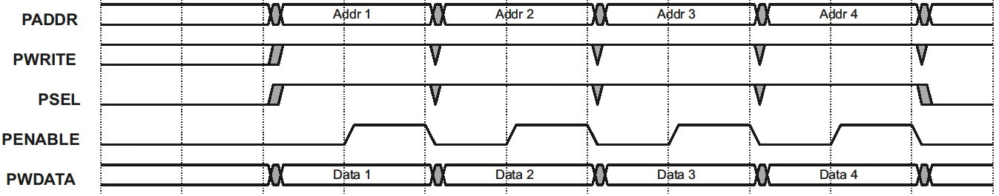

#### 3.1.2 具有等待状态

图3-2在显示了如何在访问阶段使用PREADY信号扩展传输。当PENABLE为高，而Slave驱动PREADY为低时扩展传输。其他信号保持不变，而PREADY保持低。

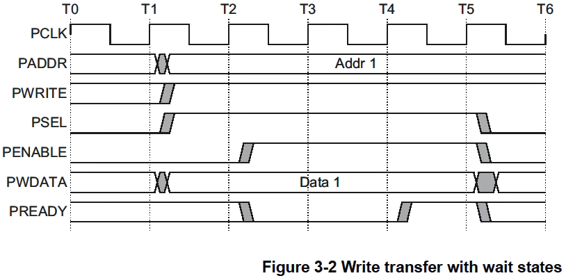

当PENABLE为低时，PREADY可以取任何值。这确保了具有固定两个周期访问的外围设备可以让PREADY tie1。

<strong>——注意 ————</strong>

建议地址和写信号在传输后不要立即改变，而是保持稳定，直到发生另一次访问。这能降低功耗。

### 3.2 写掩码

写掩码信号PSTRB在写数据总线上实现稀疏数据传输。

每个写掩码信号对应于写数据总线的一个字节。当断言为高时，写掩码指示写数据总线的相应字节通道包含有效信息。写数据总线的每8位都有一个写掩码，因此PSTRB\[n\]对应于PWDATA\[(8n +7):(8n)\]。

在32位数据总线上，这种关系如图3-3所示。

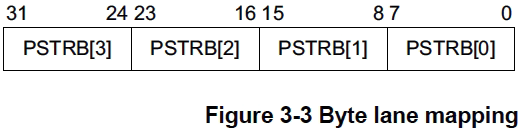

<strong>——注意——</strong>

读传输时，Master必须驱动PSTRB的所有位为低。

### 3.3 读传输

本节介绍两种类型的读传输：

-   没有等待状态。
-   具有等待状态。

#### 3.3.1 没有等待状态

如图3-4所示。地址、写、选择和使能信号的时序和前文<strong><写传输></strong>中描述的一样。

Slave必须在读传输结束之前提供数据。

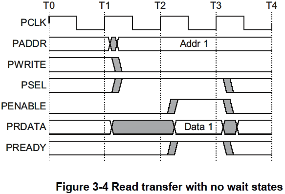

下图给出了burst读的例子。

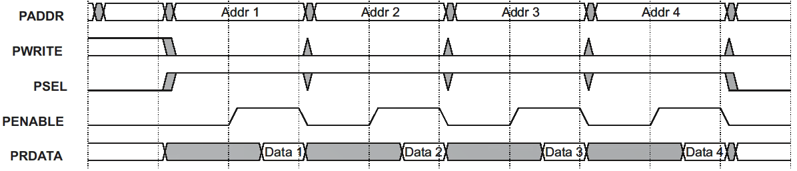

#### 3.3.2 具有等待状态

图3-5显示了PREADY信号如何扩展传输。如果PREADY在访问阶段被驱动为低，则传输将被扩展。

该协议确保其他信号在额外的周期内保持不变。

图3-5显示了使用PREADY信号添加两个周期。然而，你可以添加从0开始的任何数量的额外周期。

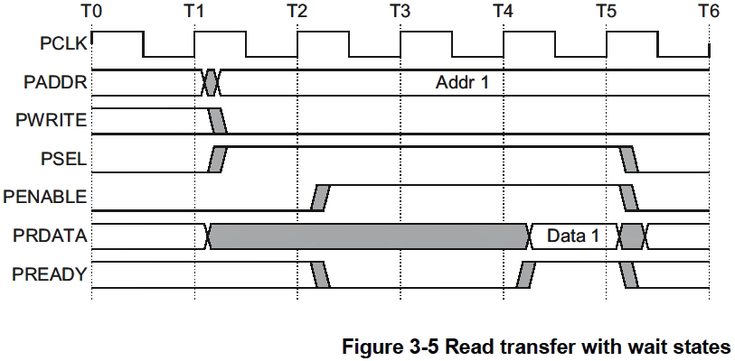

### 3.4 错误响应

可以使用PSLVERR指示APB传输上的错误条件。读和写事务都可能发生错误。

当PSEL、PENABLE和PREADY均为高时，PSLVERR仅在APB传输的最后一个周期中被认为有效。

建议（但非强制）在当PSEL、PENABLE或PREADY中的任何一个为低时，即未进行采样时驱动PSLVERR为低。

接收到错误事务可能（也可能没有）改变了Slave的状态，这是特定于外围设备的，两者都是可以接受的。当写事务收到一个错误时，这并不意味着外围设备中的寄存器没有更新。接收到错误读事务可能返回无效数据，但没有要求Slave要驱动data总线为全0。

APB外设不需要支持PSLVERR引脚，现有的和新的APB外围设计都是如此。如果外设没有这个引脚，那么Slave的合适输入为Tie 0。

#### 3.4.1 写传输

图3-6给出了一个写传输失败并报错的例子。

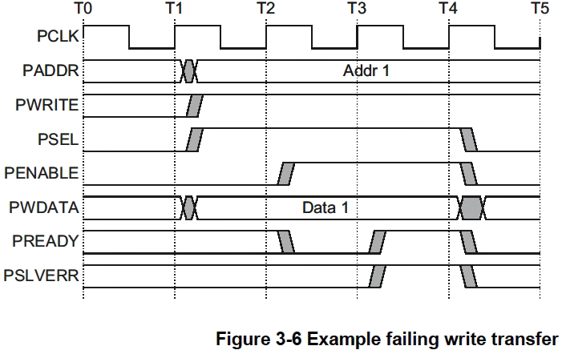

#### 3.4.2 读传输

读传输也可以在错误响应后完成，这表明没有有效的读数据可用。

如图3-7所示，读传输完成后出现错误响应。

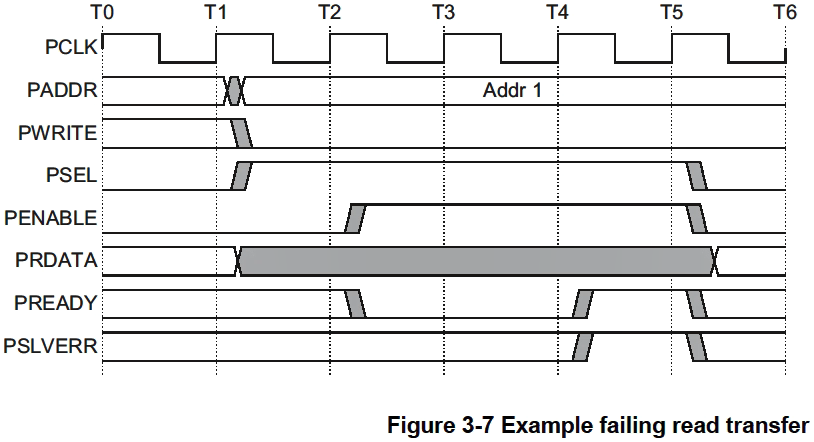

#### 3.4.3 PSLAVERR映射

当桥接时：

<strong>从AXI到APB，</strong>PSLVERR被映射回RRESP/BRESP =SLVERR。这是通过将PSLVERR映射到用于读取的AXI信号的RRESP\[1\]（对于读）和BRESP\[1\]（对于写）来实现的。

<strong>从AHB到APB，</strong>PSLVERR被映射回HRESP = ERROR（对于读和写）。这是通过将PSLVERR映射到AHB信号的HRESP\[0\]来实现的。

### 3.5 保护单元的支持

为了支持复杂的系统设计，通常需要系统中的互连和其他设备提供防止非法交易的保护。对于APB接口，这种保护由PPROT\[2:0\]信号提供。

访问保护的三个级别是：

<strong>（1）Normal或Privileged，PPROT\[0\]</strong>

-   0表示正常访问
-   1表示特权访问。

这被一些Master用来表示它们的处理模式。Privileged处理模式通常在系统中具有更高级别的访问权限。

<strong>（2）Secure或non-Secure，PPROT\[1\]</strong>

-   0表示安全访问
-   1表示非安全访问。

这用于需要在处理模式之间进行更大程度区分的系统。

<strong>——注意 ————</strong>

这个位的配置是这样的：当它为1时，事务被认为是非安全的；当它为0时，事务被认为是安全的。

<strong>（3）Data or Instruction，PPROT\[2\]</strong>

-   0表示数据访问
-   1表示指令访问。

该位表示该事务是数据访问还是指令访问。

<strong>——注意————</strong>

此指示只是作为提示，并非在所有情况下都是准确的。例如里面事务包含指令和数据项的混合。默认情况下，建议将访问标记为数据访问，除非明确知道它是指令访问。

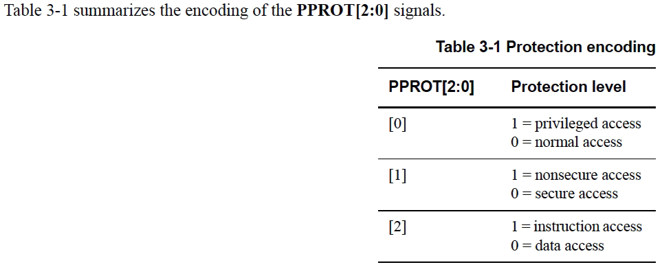

<strong>——注意————</strong>

PPROT的主要用途是作为安全或非安全事务的标识符。

使用PPROT\[0\]和PPROT\[2\]标识符的不同解释是可以接受的。

## 4 APB运行阶段

### 4.1 运行阶段

图4-1表示APB的运行活动。

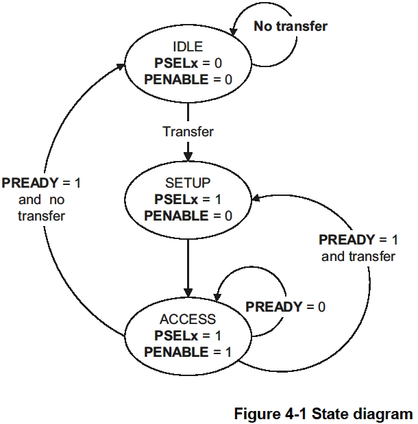

状态机通过以下状态运行：

<strong>（1）IDLE</strong>

这是APB的默认状态。

<strong>（2）SETUP</strong>

当需要传输时，总线进入SETUP状态，在该状态下，将断言适当的选择信号PSELx。总线只在一个时钟周期内保持SETUP状态，并且总是移动到时钟的下一个上升沿的ACCESS状态。

<strong>（3）ACCESS</strong>

使能信号PENABLE在ACCESS状态下被断言。地址、写、选择、写数据信号必须在从SETUP状态转换到ACCESS状态的过程中保持稳定。

从ACCESS状态的退出由Slave的PREADY信号控制：

-   如果PREADY被slave保持为低，那么外围总线仍然处于ACCESS状态。
-   如果PREADY被slave驱动为高，那么ACCESS状态将退出，如果不需要更多的传输，总线将返回IDLE状态。或者如果接下来发生另一个传输，总线直接移动到SETUP状态。

## 5 APB读写设计

随着时代的进步，SOC 设计中大多采用 AXI 总线进行数据的高速读写，而 APB 总线往往用于寄存器配置，下面设计一个模拟 APB 读写寄存器文件的设计。

整个逻辑框图如下所示：

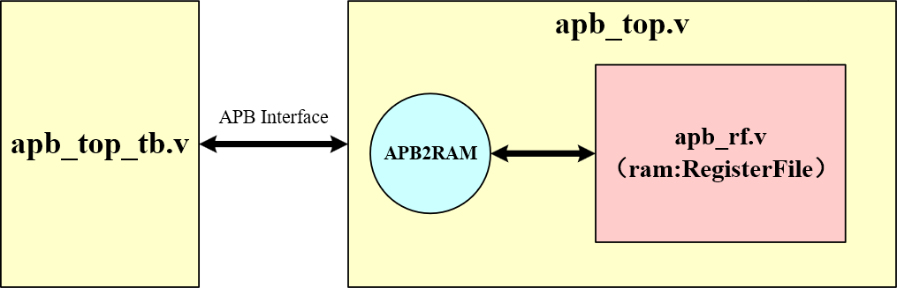

各个模块的功能如下所示：

-   apb\_top\_tb：testbench文件，用于模拟APB接口，提供必要的激励。
-   apb\_top：APB设计文件，内部包含APB时序转RAM读写时序，可以对寄存器文件 apb\_rf.v 中进行读写操作。
-   apb\_rf：寄存器文件，本质是个RAM，用于存放寄存器，实际综合会成为一个真实的RAM。

### 5.1 apb\_rf

SOC设计中包含大量的寄存器控制信号，例如某个功能开关不希望定死，于是就会外接寄存器进行控制。又或者希望实时读取某个模块的状态，于是外接到只读寄存器中，方便软件读取。

这里我们模拟三个寄存器，他们的功能如下所示：

```bash
1、寄存器 alarm
bit[0] : 为1时开启报警功能，为0时关闭报警功能。可读可写。
bit[15:0]：报警阈值，达到该阈值后才会报警。可读可写。

2、寄存器 run
bit[0]：为1时开始运行。可读可写。
bit[1]：为1时结束运行。可读可写。

3、寄存器 status
bit[4:0]：模块运行状态。只读
```

这些寄存器要写在 ram 中必须要有一个单独模块，我们一般叫做 config 文件或者 register file。该文件会提供 ram 读写接口，还会根据寄存器实际内容，在接口上加入一些输入或输出信号。根据上面描述，我们可以制作如下的 apb\_rf.v 文件。

```verilog
//**************************************************************************
// *** 名称 : apb_rf.v
// *** 作者 : xianyu_FPGA
// *** 博客 : https://www.cnblogs.com/xianyuIC/
// *** 日期 : 2023年4月
// *** 描述 : 寄存器文件
//**************************************************************************

module apb_rf(
//========================< port >==========================================
//system --------------------------------------------
input                       pclk_i                  ,
input                       prst_n_i                ,
//ram -----------------------------------------------
input                       ram_wr                  ,
input                       ram_rd                  ,
input       [15:0]          ram_addr                ,
input       [31:0]          ram_wdata               ,
output  reg [31:0]          ram_rdata               ,
//---------------------------------------------------
//register output
output  reg                 alarm_int               ,
output  reg [15:0]          alarm_value             ,
output  reg                 run_start               ,
output  reg                 run_stop                ,
//register input
input       [ 4:0]          status
);
//========================< signal >========================================
wire                        wr_alarm                ;
wire                        wr_run                  ;
//==========================================================================
//==    write enable
//==========================================================================
assign wr_alarm = ram_wr & (ram_addr == 16'h0);
assign wr_run   = ram_wr & (ram_addr == 16'h4);
//==========================================================================
//==    write data
//==========================================================================
always @(posedge pclk_i or negedge prst_n_i) begin
    if(!prst_n_i) begin
        alarm_int   <= 1'b0;
        alarm_value <= 16'h0;
    end
    else if(wr_alarm) begin
        alarm_int   <= ram_wdata[    0];
        alarm_value <= ram_wdata[16: 1];
    end
end

always @(posedge pclk_i or negedge prst_n_i) begin
    if(!prst_n_i) begin
        run_start   <= 1'b0;
        run_stop    <= 1'b0;
    end
    else if(wr_run) begin
        run_start <= ram_wdata[0];
        run_stop  <= ram_wdata[1];
    end
end
//==========================================================================
//==    read data
//==========================================================================
always @(*) begin
    if(ram_rd)
        case(ram_addr)
            //reg alarm
            16'h0: begin
                    ram_rdata[    0] = alarm_int;
                    ram_rdata[16: 1] = alarm_value;
            end
            //reg run
            16'h4: begin
                    ram_rdata[0] = run_start;
                    ram_rdata[1] = run_stop;
            end
            //reg status
            16'h8: begin
                    ram_rdata[4:0] = status;
            end
            default: ram_rdata[31:0] = 32'h0;
        endcase
    else
        ram_rdata = 32'h0;
end

endmodule
```

### <strong>5.2 apb\_top</strong>

APB 接口无法直接对 RAM 进行读写操作，因此需要一个 APB 转 RAM 的设计，这里建立一个 apb\_top.v 文件，将 apb\_rf.v 文件包起来，同时加入 APB 转 RAM 设计。可以看到这个 apb\_top 接口完全就是 APB 接口了，可以看成是一个 APB Slave。

```verilog
//**************************************************************************
// *** 名称 : apb_top.v
// *** 作者 : xianyu_FPGA
// *** 博客 : https://www.cnblogs.com/xianyuIC/
// *** 日期 : 2023年4月
// *** 描述 : APB读写RAM寄存器
//**************************************************************************

module apb_top(
//========================< port >==========================================
input                       pclk_i                  ,
input                       prst_n_i                ,
//---------------------------------------------------
input       [15:0]          paddr_i                 ,
input                       pwrite_i                ,
input                       psel_i                  ,
input                       penable_i               ,
input       [31:0]          pwdata_i                ,
output reg  [31:0]          prdata_o                ,
output                      pready_o                ,
output                      pslverr_o
);
//========================< signal >========================================
wire                        ram_wr                  ;
wire                        ram_rd                  ;
wire    [15:0]              ram_addr                ;
wire    [31:0]              ram_wdata               ;
wire    [31:0]              ram_rdata               ;
//---------------------------------------------------
wire                        alarm_int               ;
wire    [15:0]              alarm_value             ;
wire                        run_start               ;
wire                        run_stop                ;
//wire    [ 4:0]            status                  ;
//==========================================================================
//==    APB trans to RAM
//==========================================================================
assign ram_wdata = pwdata_i;
assign ram_addr  = paddr_i;
assign ram_wr    =  pwrite_i & psel_i & penable_i;
assign ram_rd    = ~pwrite_i & psel_i & ~penable_i;

always @(posedge pclk_i or negedge prst_n_i) begin
    if(!prst_n_i)
        prdata_o <= 32'h0;
    else if(ram_rd)
        prdata_o <= ram_rdata;
end
    
assign pready_o = 1'b1;
//==========================================================================
//==    APB register
//==========================================================================
apb_rf u_apb_rf
(
    .pclk_i                 (pclk_i                 ),  //I
    .prst_n_i               (prst_n_i               ),  //I
    //ram -------------------------------------------
    .ram_wr                 (ram_wr                 ),  //I
    .ram_rd                 (ram_rd                 ),  //I
    .ram_addr               (ram_addr               ),  //I
    .ram_wdata              (ram_wdata              ),  //I
    .ram_rdata              (ram_rdata              ),  //O
    //register output -------------------------------
    .alarm_int              (alarm_int              ),  //O
    .alarm_value            (alarm_value            ),  //O
    .run_start              (run_start              ),  //O
    .run_stop               (run_stop               ),  //O
    //register input --------------------------------
    .status                 (5'd4                   )   //I
);

endmodule
```

### <strong>5.3 apb\_top\_tb</strong>

最后是激励部分，由于 apb\_top 模块可以看成是一个 APB slave 接口，那么这个 apb\_top\_tb 文件就可以看成是一个上游的 APB Master。我们根据 APB 时序，对上面的 3 个寄存器进行读写操作。

```verilog
//**************************************************************************
// *** 名称 : apb_top_tb.v
// *** 作者 : xianyu_FPGA
// *** 博客 : https://www.cnblogs.com/xianyuIC/
// *** 日期 : 2023年4月
// *** 描述 : APB读写激励
//**************************************************************************
`timescale 1ns/1ps  //时间精度
`define    Clock 20 //时钟周期
 
module apb_top_tb;
//========================< signal >========================================
reg                         pclk_i                  ;
reg                         prst_n_i                ;
//---------------------------------------------------
reg  [15:0]                 paddr_i                 ;
reg                         pwrite_i                ;
reg                         psel_i                  ;
reg                         penable_i               ;
reg  [31:0]                 pwdata_i                ;
wire [31:0]                 prdata_o                ;
wire                        pready_o                ;
wire                        pslverr_o               ;
//---------------------------------------------------
reg  [31:0]                 rdata                   ;
//==========================================================================
//==    instantiation
//==========================================================================
apb_top u_apb_top
(
    .pclk_i                 (pclk_i                 ),
    .prst_n_i               (prst_n_i               ),
    //-----------------------------------------------
    .paddr_i                (paddr_i                ),
    .pwrite_i               (pwrite_i               ),
    .psel_i                 (psel_i                 ),
    .penable_i              (penable_i              ),
    .pwdata_i               (pwdata_i               ),
    .prdata_o               (prdata_o               ),
    .pready_o               (pready_o               ),
    .pslverr_o              (pslverr_o              )
);
//==========================================================================
//==    clock and reset
//==========================================================================
initial begin
    pclk_i = 1;
    forever
        #(`Clock/2) pclk_i = ~pclk_i;
end

initial begin
    paddr_i    = 0;
    pwrite_i   = 0;
    psel_i     = 0;
    penable_i  = 0;
    pwdata_i   = 0;
    prst_n_i   = 0;
    repeat(10) @(negedge pclk_i);
    prst_n_i   = 1;
end
//==========================================================================
//==    fsdb
//==========================================================================
/*
initial begin
  $fsdbDumpfile("apb_tb.fsdb");
  $fsdbDumpvars;
  $fsdbDumpMDA;
end
*/
//==========================================================================
//==    task: apb_wr apb_rd
//==========================================================================
task apb_wr;
    input [15:0] addr;
    input [31:0] data;
    begin
        @(posedge pclk_i)
        paddr_i   = addr;
        pwrite_i  = 1;
        pwdata_i  = data;
        psel_i    = 1;
        penable_i = 0;
        
        @(posedge pclk_i)
        penable_i = 1;
        
        @(posedge pclk_i)
        pwrite_i  = 0;
        psel_i    = 0;
        penable_i = 0;
    end
endtask

task apb_rd;
    input [15:0] addr;
    output[31:0] data;
    begin
        @(posedge pclk_i)
        paddr_i   = addr;
        psel_i    = 1;
        penable_i = 0;
        
        @(posedge pclk_i)
        penable_i = 1;
        
        @(posedge pclk_i)
        psel_i    = 0;
        penable_i = 0;
        data = prdata_o;
    end
endtask
//==========================================================================
//==    main test
//==========================================================================
initial begin
    wait(prst_n_i);
    $display("\nAPB test begin! @%t\n",$time);
    
    repeat(10) @(negedge pclk_i);
    apb_wr(16'h0000, 32'h31);
    apb_wr(16'h0004, 32'h1);
 
    apb_rd(16'h0008, rdata);
    repeat(10) @(negedge pclk_i);
    $display("\nAPB test end! @%t\n",$time);

    $finish;
end
 
endmodule
```

### <strong>5.4 仿真结果</strong>

如果有 Verdi 可以用 VCS/IRUN 等编译工具对这些代码进行编译，生成 fsdb 文件给 Verdi 用。这里还是用以前的老办法，采用 Modelsim 进行仿真，结果如下所示：

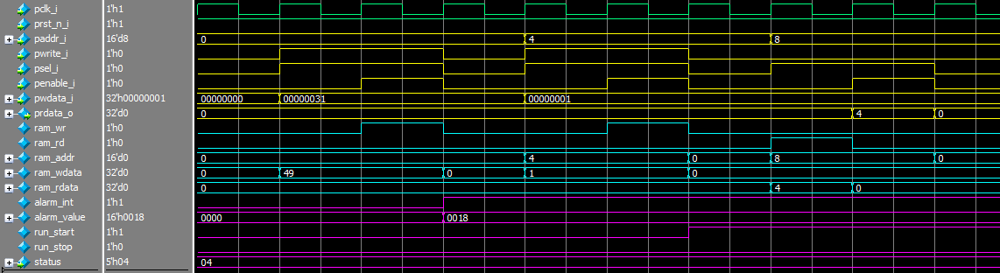

从波形中可以看出，两次写和一次读符合 APB 数据手册。根据寄存器写入情况，apb\_rf 模块中的相应信号也进行了变化。

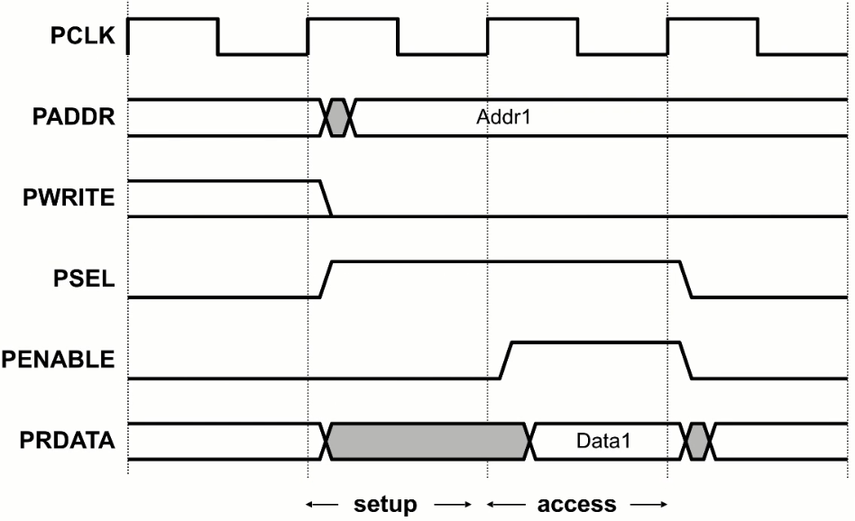

参考资料：

\[1\] ARM官方数据手册：[https://www.arm.com/architecture/system-architectures/amba/amba-specifications](https://www.arm.com/architecture/system-architectures/amba/amba-specifications)

\[2\] 芯王国：[https://blog.csdn.net/weixin\_40377195/article/details/124899571](https://blog.csdn.net/weixin_40377195/article/details/124899571)

---

> 原文：[AMBA总线（1）—— APB协议](https://www.cnblogs.com/xianyuIC/p/17279209.html)（博客园 · 咸鱼IC）
