前面学习APB总线时，由于内容不多就直接将APB4手册翻译了下。到了AHB总线再这样学习就不好了，一是逐句翻译太累人，二是原文翻译过来划不清重点。因此AHB总线以学习笔记的形式记录下来，但其实大多数也就是手册的翻译和理解。

## 1 AHB特点

AHB协议相比APB协议更加复杂，性能更加优越，手册上也清楚写明了它的特点：高性能、流水线、突发、多主机、分段传输，原文如下所示：

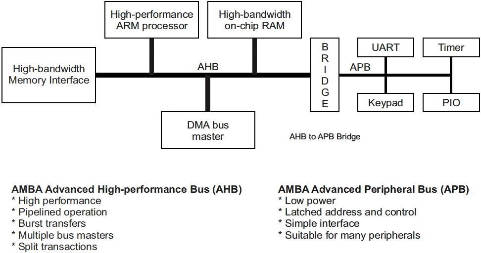

注意这是AHB2中的描述，到了AHB-lite和AHB5中，AHB协议本身不再支持多主机操作，也去除了仲裁相关的若干信号，但可通过添加Multi-layer interconnect组件实现多主机功能。也不再支持分段传输Split，去除了HSPLITx信号。因此和APB相比，最大的不同是AHB支持流水线操作和突发操作。

## 2 AHB版本变化

目前AHB协议有AHB2、AHB-lite、AHB5协议，AHB-lite的变化是在AHB2的基础上做了减法，而AHB5的变化是在AHB-lite的基础上做了加法。实际使用时可能不会分得太清，系统中需要某些信号可能就直接加上去了，不需要的可能直接就删除了，并不会太严格的说这是第几代AHB协议。但本着学习的目的，我还是想做下三代AHB协议的对比。

### 2.1 AHB信号对比

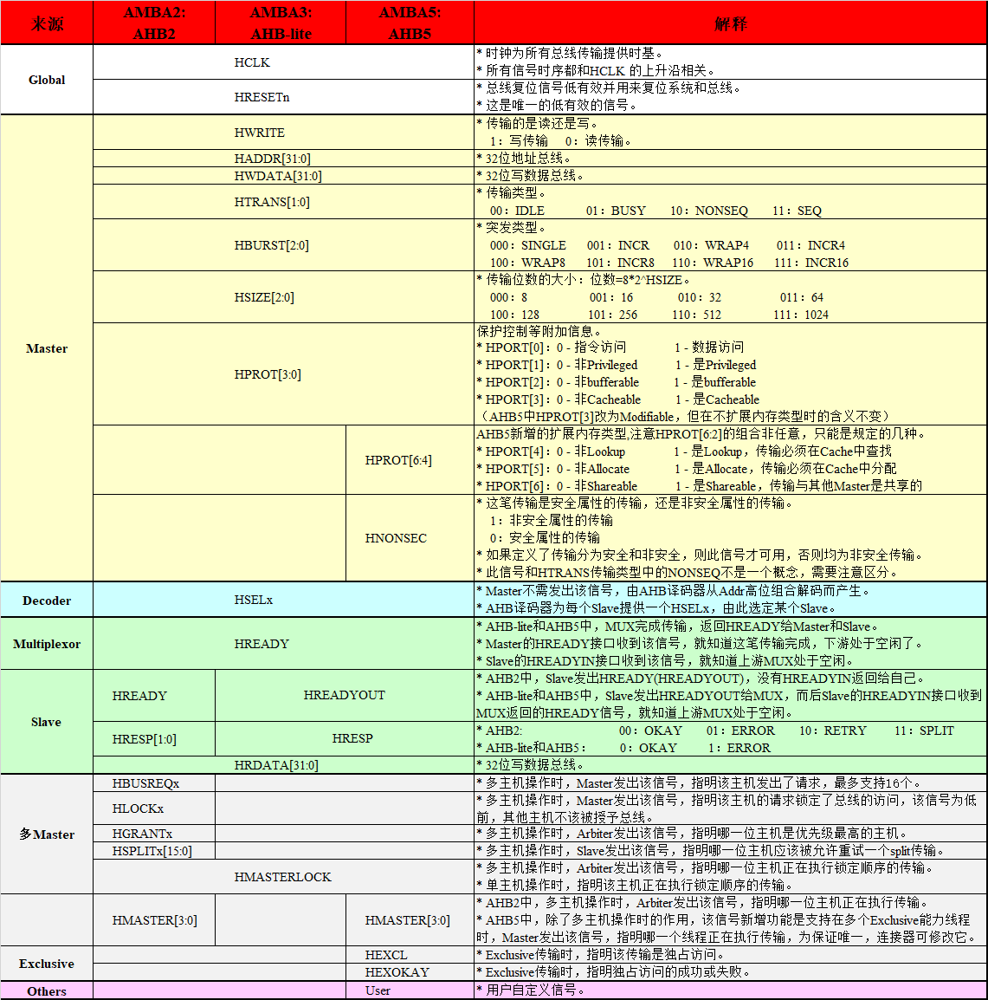

### 2.2 AHB2到AHB-lite

AHB2到AHB-lite的变化较大，架构都变了。

#### （1）AHB2架构

AHB2架构支持多Master操作，因此架构中有一个Arbiter和三个mux。

-   Arbiter用于仲裁哪一个Master占据线权。因此AHB2协议中有一类Arbiter信号，如HBUSREQx、HLOCKx、HGRANTx、HSPLITx、HMASTERLOCK、HMASTER。
-   mux是多路选择器，Addr mux和Write Data mux由Arbiter信号来确定选择，而Read mux由Decoder来确定选择。

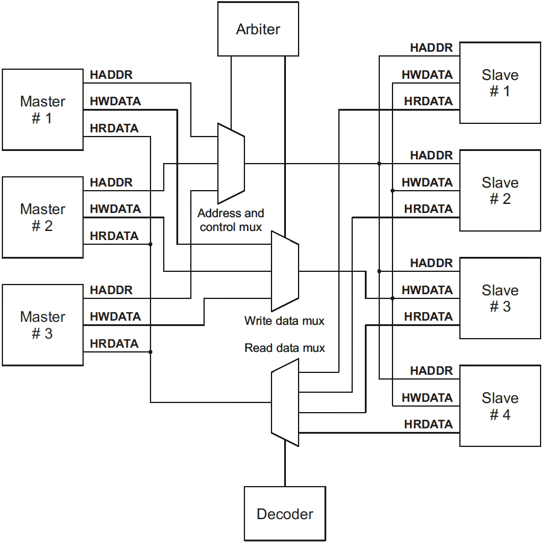

#### （2）AHB-lite架构

AHB-lite在AHB2的基础上进行了简化，去除了Arbiter和其控制的Addr mux、Write mux。原先Arbiter的那些信号也就大多去除了，只留下了HMASTERLOCK信号，该信号作用是指明该主机正在执行锁定顺序的传输。

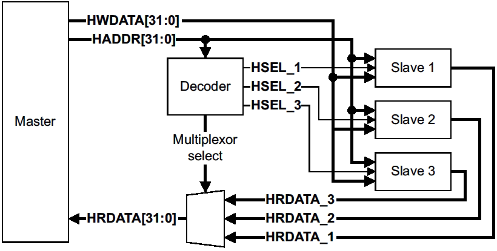

#### （3）多Master的AHB-lite

AHB-lite架构本身不再支持多主机操作，但不意味着AHB-lite无法实现多Master。协议中提供了多Master操作方案，即添加一个Multi-layer interconnect组件来实现多个Master和Slave的互联。

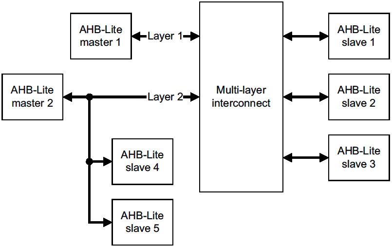

### 2.3 AHB-lite到AHB5

AHB-lite到AHB5的变化不大，和APB的升级类似，AHB5的升级是为了适应SOC需求，新增了一些信号罢了。详细可以看上面的信号对比表格。

## 3 AHB传输

### 3.1 AHB基本传输

AHB基本传输包括2个部分：

-   地址相位：持续一个周期；
-   数据相位：无反压时持续一个周期，HREADY信号反压时需要维持多个周期。

#### （1）无等待传输（无反压）

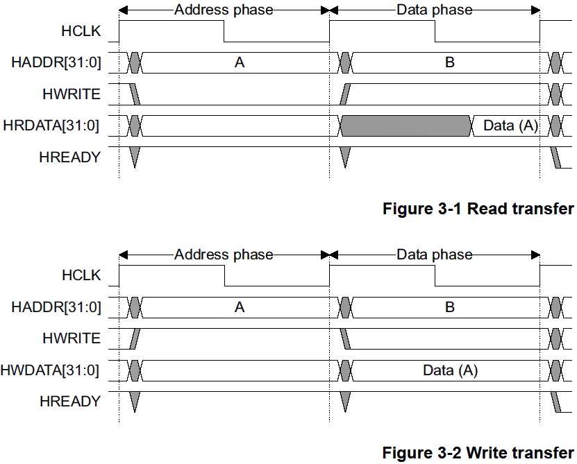

#### （2）有等待传输（有反压）

所谓反压就是下游未把HREADY拉高，表示忙碌，因此这笔数据传输不下去，只能维持着，直到HREADY拉高，表示这笔数据传输下去了。在反压时，地址周期需要保持，因此也叫等待传输。

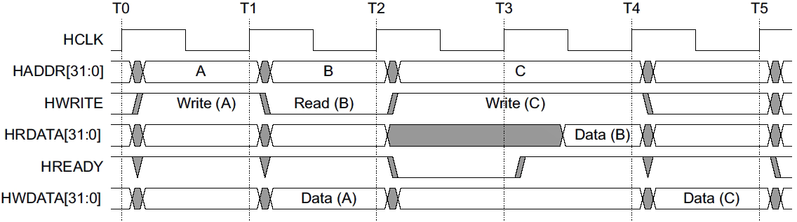

-   A传输和C传输都是0等待周期，地址相位在T1时刻被采样后，T2时刻写数据就有效。
-   B传输是1等待周期，地址相位在T2时刻被采样后，T3时刻HREADY为低，这笔传输需要维持住。
-   C传输在T3时刻给出，但B传输未完成，T4时刻才完成，所以C传输也是等到T4时刻生效，这便是等待造成的副作用。

（AXI协议中新增outstanding功能，无需等待上一笔数据传输完，就可以发下一笔传输的命令）

### 3.2 AHB传输类型HTRANS

AHB传输类型分为4类，由HTRANS\[1:0\]控制，如下所示：

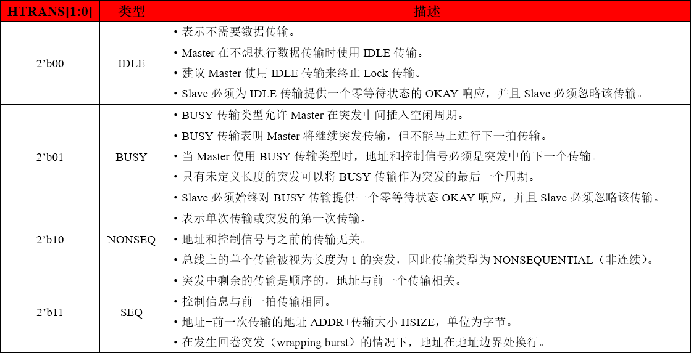

下图展示了HTRANS的使用：

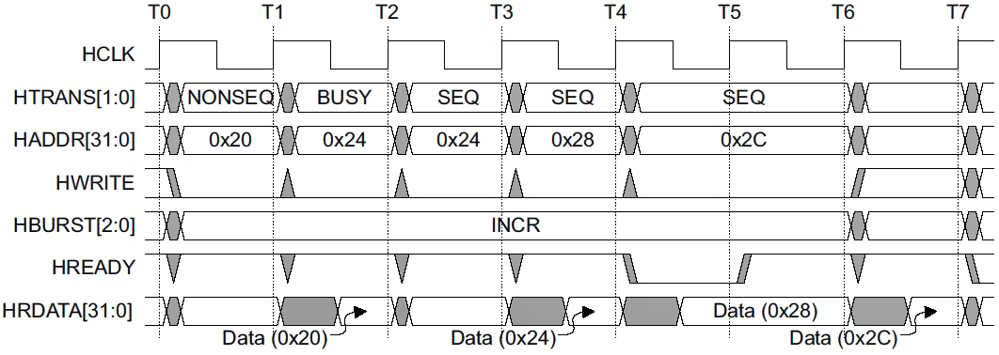

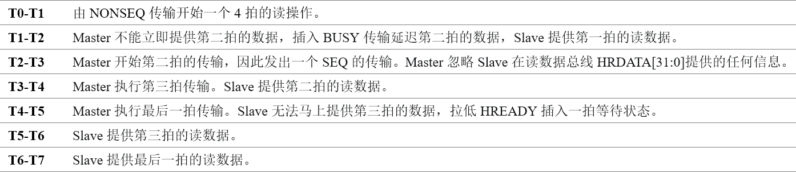

### 3.3 AHB锁定传输HLOCK

如果Master需要锁定访问，则它必须置位HMASTLOCK信号，这个信号指示给所有Slave：当前传输不可被打断，必须在任何其他的传输执行之前执行此传输！

典型的锁定传输用在保持信号的完整性，确保在微处理器SWP指令期间Slave不执行其他操作。下图展示了HMASTLOCK信号在SWP指令中的例子。

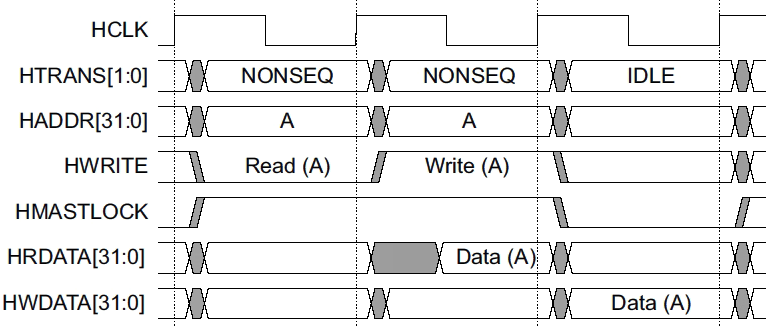

<strong>——注意——</strong>

-   在一个锁定传输后，建议Master插入一拍IDLE传输。
-   大部分Slave不必实现HMASTLOCK，因为它们只能按照接收的请求顺序进行传输。但是在包含多个Master的系统中，例如Muli-Port Memory Controller，Slave可以被多个Master访问，则必须实现HMASTLOCK功能。

### 3.4 AHB传输大小HSIZE

HSIZE\[2:0\]信号指示了一个数据传输的大小，如下表所示：

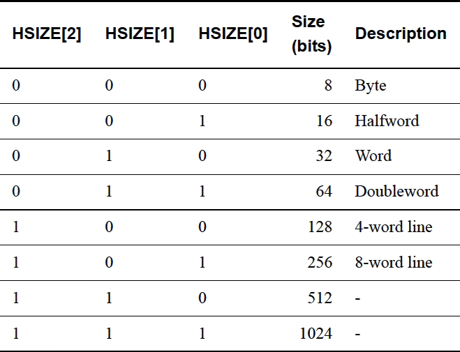

<strong>——注意——</strong>

-   HSIZE设置的传输大小必须≤数据总线的位宽。例如32位数据总线只能配置为b000、b001、b010。
-   HSIZE信号和HBURST信号共同决定了Wrap Burst传输的地址边界。
-   HSIZE信号和HADDR总线保持严格的相同时序，但是在Burst传输期间必须保持常值。

### 3.5 AHB突发传输HBURST

#### （1）突发类型

AHB突发传输分为单拍突发、未定长度突发、固定长度突发，固定长度突发包括INCR突发（递增）和WRAP突发（回卷），长度有4拍、8拍和16拍。

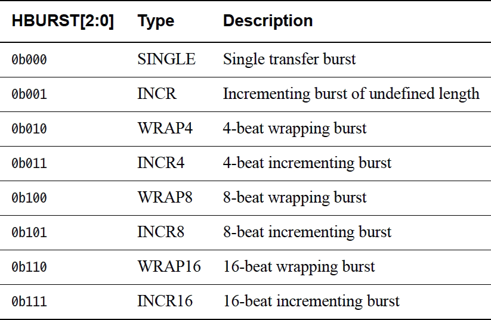

-   <strong>FIXED传输：</strong>所有传输都会写在同一个地址中。主要应用在[FIFO](https://so.csdn.net/so/search?q=FIFO&spm=1001.2101.3001.7020)的传输中，因为FIFO为先入先出，只需要往同一个地址写数据即可。（AXI中存在FIXED传输）
-   <strong>INCR突发：</strong>访问顺序的位置，并且突发中每拍地址都是前一个地址的递增。
-   <strong>WRAP突发：</strong>在一定长度后跨越地址边界，就会回卷到起始地址。主要应用在Cache操作中，因为cache是按照cache line进行操作，采用wrap传输可以方便的实现从内存中取回整个cache line。
    -   地址边界指的是HBURST拍数\*HSIZE大小，与后面说的“HSIZE地址边界”不一样。
    -   一个传输HBURST为WRAP4，HSIZE为word（4 Byte），那它会在16 Byte边界上发生回卷。如果突发的起始地址是0x34，那么它的传输地址变化是：0x34、0x38、0x3C、0x30。

根据上面表格，如果要实现单次传输，Master能够使用下面两种方式：

-   Single transfer burst
-   Incrementing burst of 1 length。

#### （2）地址对齐

<strong>a) AHB协议在突发时必须地址对齐。</strong>

-   -   例如word传输表示每次传输的数据量是32 bit，每个地址能存放8 bit数据，因此传输一个32 bit数据就需要消耗4个地址，二进制描述就是消耗HADDR\[1:0\]。所谓对齐到地址边界，就是说HADDR的值的低2bit必须是0，即HADDR\[1:0\] = 2’b00，转成16进制就是只允许HADDR的最低位为0、4、8、C（很多寄存器地址也都是048C的地址顺序），word传输也是实际工作中最常用到的SIZE。
    -   如果是16bit的half-word传输，同理传输一个16bit数据就需要消耗2个地址，二进制描述就是消耗HADDR\[0\]，转成16进制就是只允许HADDR的最低位为0、2、4、6、8、a、c、e。
    -   IDLE传输的地址也最好对齐，否则在仿真时，监视器可能会报warning。

<strong>——注意——</strong>

-   APB不能突发传输，因此没有对齐和非对齐的说法，或者认为支持非突发的非对齐操作。
-   AHB要实现非对齐操作，不能使用突发传输，可以采用非突发的单拍传输。
-   AXI也有突发传输，并且通过掩码方式实现了突发传输中的非对齐操作。

<strong>b) AHB协议中，Master禁止跨越lKB地址边界的递增突发。</strong>

-   -   因为slave在设计的时候是以1KB为单位的，如果跨过了1KB就有可能访问到另一个slave。
    -   AXI协议中进制跨越4KB地址边界，也是为了避免一笔burst交易访问两个slave（每个slave的地址空间是4K/1K对齐的），4K对齐最大原因是系统中定义一个page大小是4K，而所谓的4K边界是指低12bit为0的地址。

#### （3）INCR传输：未定长度

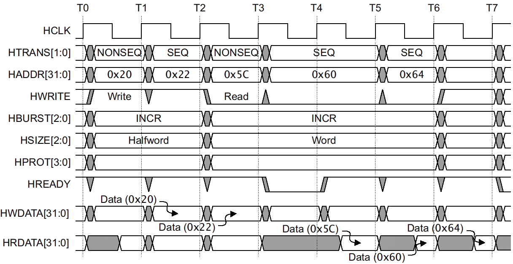

-   第一个突发是写传输，包括2拍“half-word”传输，起始地址为0x20，地址递增为2。
-   第二个突发是读传输，包括3拍“word”传输，起始地址为0x5C，地址递增为4。

#### （4）INCR传输：固定长度

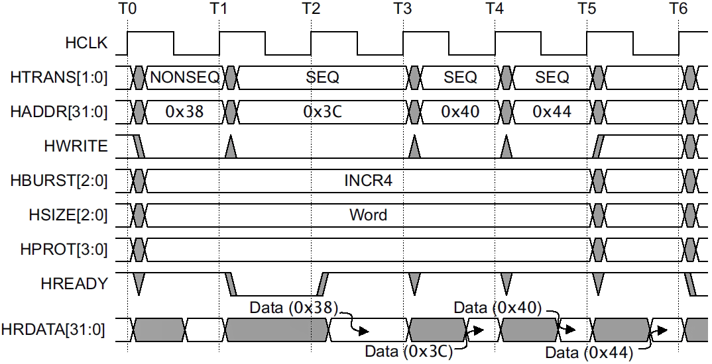

这是一个4拍递增的读传输，在第1拍传输插入了1拍等待状态。

#### （5）WRAP传输

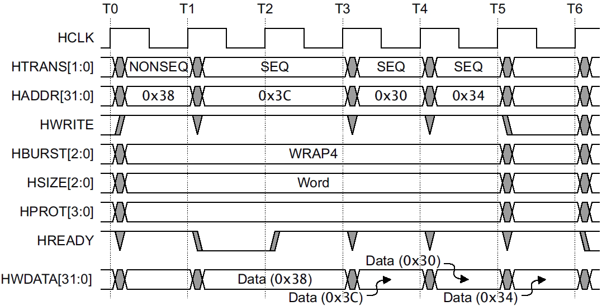

这是一个4拍回卷的写传输，地址在16字节边界回卷，所以在地址0x3C后下一拍地址是0x30。

#### （6）突发终止1：BUSY后的突发终止

在一个burst启动后，当Master需要更多的时间准备下一拍传输时，它可以插入BUSY传输。对于未定义长度的突发类型INCR, Master可以插入BUSY传输，然后再判断没有更多的数据要传输了。在这种情况下, Master可以再发起NONSEQ或者IDLE传输来终止INCR传输。

协议不允许Master用BUSY传输终止固定长度的突发传输：

-   INCR4、INCR8、INCR16
-   WRAP4、WRAP8、WRAP16

这些固定长度的burst必须由一个SEQ传输终止。Master不允许在SINGLE突发传输后立刻发起一个BUSY传输。SINGLE突发后必须是一个IDLE或者NONSEQ传输。

#### （7）突发终止2：提前的突发终止

Burst可以在以下情况被终止：

-   Slave error response错误响应
    -     如果Slave提供了ERROR响应，则Master必须取消掉剩下的传输，但这并不是强制要求, Master仍然可以继续传输完剩下的内容。如果Master没有完成Burst，当它再次访问相应的Slave时没有必要重新发起之前的Burst。例如Master只完成了8拍burst的3拍传输，当它再次访问对应的Slave时不需要完成剩下的5拍传输。
-   多层互连的终止
    -     尽管Master不允许提前终止一个Burst传输, Slave必须设计为burst传输完成之前就一直可以正常工作。在一个多Master系统中包含多层互连组件，它可以终止Burst传输，这样另一个Master可以获得Slave的访问权。当这种情况发生时，Slave必须终止前一个Master的Burst操作，然后马上响应新的Master的访问。

### 3.6 AHB错误响应HRESP

在Master开始一个传输之后，Slave控制这个传输的进程，Master不能取消已经开始的传输。当Slave被访问时必须提供响应来指示传输的状态，传输状态由HRESP信号提供。如下表所示：

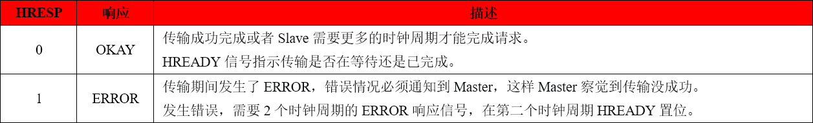

完整的传输响应是HRESP和HREADY信号的组合，如下表所示：

这意味着Slave可以用以下三种方式完成总线传输：

-   立即完成传输。
-   插入一个或多个等待状态，为完成传输提供足够的时间。
-   发送错误响应来指示传输失败。

#### （1）传输完成

成功完成传输，通过置位HREADY为高电平并且HRESP状态为OKEY。

#### （2）传输挂起

通常Slave使用HREADY信号来插入适当数量的等待状态在数据相位中，等到HREADY信号为高电平并且响应OKAY，指示成功完成了传输。当Slave在完成响应之前插入若干等待状态，它必须驱动HRESP为OKAY。

<strong>——注意——</strong>

-   通常Slave在它撤销占用总线之前，要预先确定它要插入的等待状态数量，这样就可以计算访问总线的延时。
-   建议Slave不要插入超过16拍等待时间，防止单一访问操作长期占用总线。但是在某些设备这个建议不适用，例如boot ROM，这种设备通常用来做系统启动，超过16拍的等待状态对整个系统性能而言是微不足道的。

#### （3）错误响应

-   Slave使用ERROR响应指示传输的一些错误情况，在试图写访问一个只读存储器时，这通常表示保护错误。
-   OKEY响应只需要一个时钟周期，ERROR响应需要两个周期。
-   发起第一个ERROR响应，Slave驱动HRESP为高电平指示ERROR，同事驱动HREADY为低将传输扩展一个时钟周期。
-   在下一个时钟周期，HREADY驱动为高电平来结束传输，HRESP继续驱动为高电平来指示错误。

因为总线的流水线特性，所以要求这种两个时钟周期的响应机制。当Slave开始发出一个ERROR响应的时候，下一个传输的地址已经发布在总线上,这种两周期响应机制为Master提供了足够的时间通过驱动HTRANS\[1:0\]为IDLE状态来取消下一拍总线访问。如果Slave需要超过两个时钟周期的时间提供ERROR响应信号，则从传输开始需要额外插入等待状态。此时 HREADY为低电平，响应必须驱动为OKAY。

一个ERROR 响应的传输如下图所示：

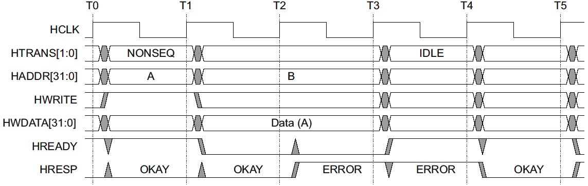

当 Slave 响应了 ERROR 响应，Master 可以取消掉一个 Burst 中剩余的传输。然而这并不是严格的要求，Master 仍然可以继续 Burst 的剩余传输。

#### （4）AHB2的HRESP信号

AHB-lite和AHB5中的HRESP信号只有1bit，而AHB2中的HRESP信号有2bit，如下表所示：

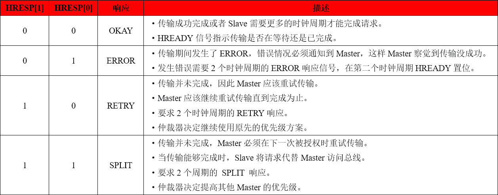

AHB-lite和AHB5都取消了仲裁器，平时工作中也没有用过RETRY和SPLIT场景，就不多说了。

## 4 AHB特殊概念

### 4.1 AHB保护控制HPROT

#### （1）AHB2和AHB-lite

保护控制信号HPROT\[3:0\]提供总线访问的附加信息，初衷是方便实现多种级别的保护。当总线传输为以下场景时，保护信号可以起到作用：

-   指令访问还是数据访问。
-   特权模式访问还是用户模式访问.

对于带MMU单元的Master，保护信号也可以指示当前访问是否是Cacheable或者Bufferable。

下表列出了HPROT信号编码：

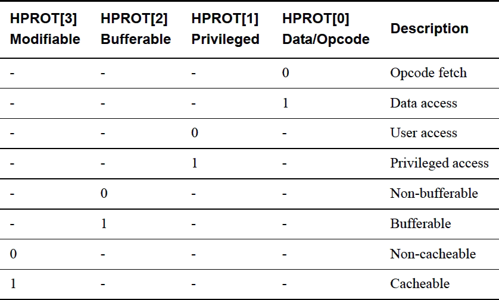

<strong>——注意——</strong>

很多Master不具备产生准确保护信号的能力，如果Master不支持产生精确的保护信号，那么建议：

-   Master设置HPROT为4'b0011给相应的non-cacheable、non-bufferable、privileged、data访问。
-   Slave不使用HPROT信号，除非有绝对的需要。

HPROT控制信号和地址总线有完全一样的时序，但是它们在一个Burst传输中必须保持不变。

#### （2）AHB5

AHB5定义了Extended\_Memory\_Types属性。此属性定义接口是否支持本节中描述的扩展内存类型。如果未定义此属性，则接口不支持扩展内存类型。AHB5增加了额外的HPROT信号，并为每种内存类型提供了更详细的需求列表。

<strong>——注意——</strong>

HPROT\[3\]在之前版本的名称是Cacheable，现在改为Modifiable，但其定义不变。

HPROT每个位的含义如下表所示：

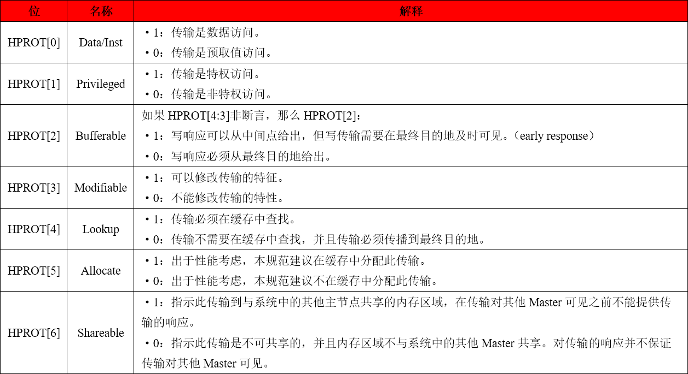

下面是关于HPROT保护控制信号的附加信息，以及这些信号如何与不同的内存类型相关。HPROT\[6:2\]信号与内存类型的对应关系如下表所示。表中未显示的位组合是不允许的。

-   “内存类型E”后缀表示允许早期写响应。
-   “内存类型En”后缀表示不允许提前写响应，写响应必须来自最终目的地。

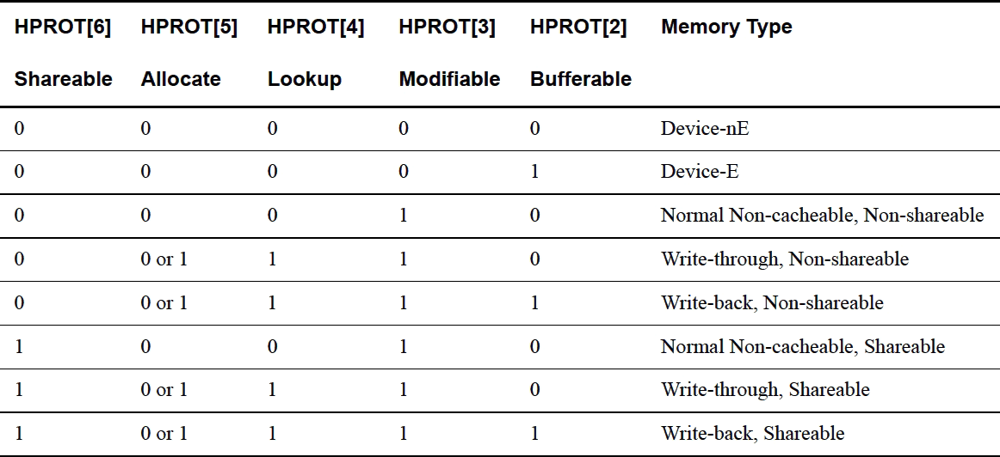

#### （3）HPROT\[3:0\]转HPROT\[6:0\]

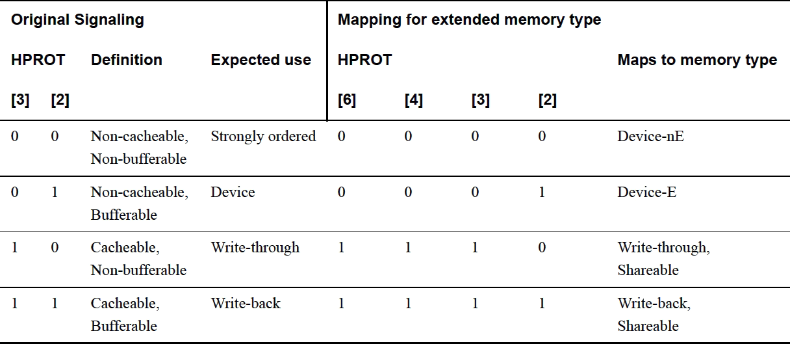

#### （4）HPROT\[6:0\]转HPROT\[3:0\]

当在只包含HPROT\[3:0\]的系统中使用支持HPROT\[6:0\]的组件时，可以删除高阶HPROT位。但请注意这种方法会导致Write-through映射到Non-cacheable内存。然而可以使用替代方案，特别是如果提供了额外信息来确定更合适的映射。

### 4.2 AHB安全传输Secure

AHB5定义了Secure\_Transfers属性。此属性定义接口是否支持安全传输和非安全传输的概念。如果未定义此属性，则接口不支持安全传输。

支持安全传输的接口有一个附加信号HNONSEC，注意它的定义是1表示非安全传输。

-   HNONSEC=1：指示非安全传输。
-   HNONSEC=0：指示安全传输。

HNONSEC是一个地址相位信号，具有与HADDR相同的有效性约束。在不支持安全传输的组件之间进行接口时必须小心。

### 4.3 AHB独占传输Exclusive

AHB5定义了Exclusive\_Transfers属性。此属性定义接口是否支持独占传输的概念。如果未定义此属性，则接口不支持独占传输。独占传输提供了一种支持semaphore-type操作的机制。独占访问序列是来自单个Master的独占传输序列，操作步骤如下：

1.从一个地址执行独占读传输。

2.根据从独占读获得的数据值计算要存储到该地址的新数据值。

3.在独占读和独占写之间可以有其他非独占传输。

4.使用新的数据值对相同的地址执行独占写传输：

-   如果独占读传输之后没有其他Master写到该位置，则独占写传输成功并更新内存。
-   如果在独占读传输之后，另一个Master已写入该位置，独占写传输将失败，内存位置不会更新。

5.对独占写传输的响应指示传输是成功还是失败。

这个序列确保内存位置仅在存储到内存的点上，该位置仍然拥有用于计算要写入到该位置的新值的相同值时才会更新。如果独占写传输失败，则预计Master将重复整个独占访问序列。在独占读传输后，同一Master对相同或重叠位置的更新是否会导致相关的独占写传输成功或失败，这是实现所定义的（IMPLEMENTATION DEFINED）。

实际工作未遇到过独占传输，我的理解是独占传输a在先读后写的过程中，不允许独占传输b横插一脚（但允许非独占的正常传输），所以称为独占。

### 4.4 AHB原子访问Atomicity

Exclusive还能勉强理解一点点，这个Atomicity是完全理解不了，溜~

## 5 数据总线问题

### 5.1 大小端传输（Endianness）

AHB同时小端系统，支持两种大端数据存储方法。AHB5引入了Endian属性来定义支持哪种形式的大端序数据访问。

#### 

#### （1）小端序

小端序即低位地址存放数据的低位。例如数据32’h1A2B3C4D从地址0x0000开始以小端序存放，读地址时先读0x0000，读到的是数据的低位。如下所示：

AHB5协议中的解释如下所示：

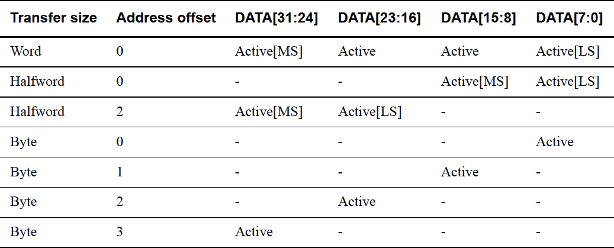

#### （2）大端序

大端序即低位地址存放数据的高位。例如数据32’h1A2B3C4D从地址0x0000开始以大端序存放，读地址时先读0x0000，读到的是数据的高位。这符合人类习惯，大多数传输用的都是这种序列。如下所示：

大端序分为BE8和BE32，这主要体现在数据位宽小于总线位宽的情况上，AHB5的解释表格如下所示：

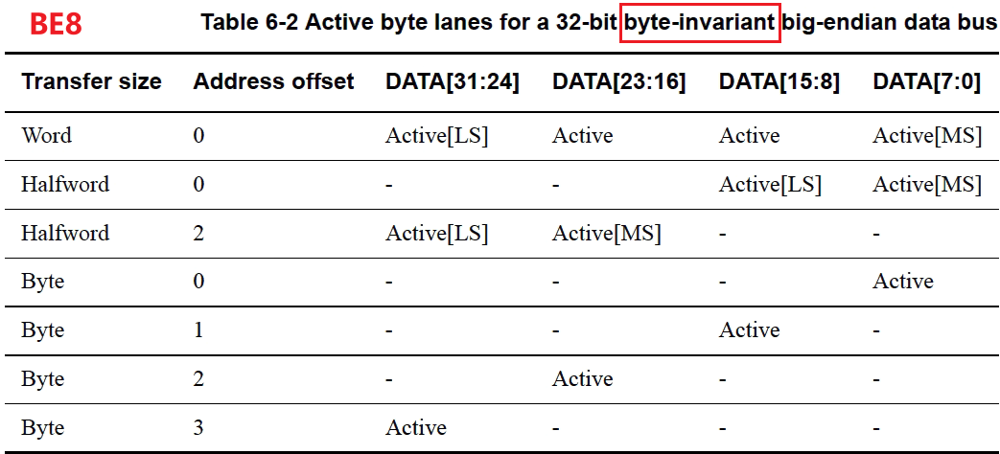

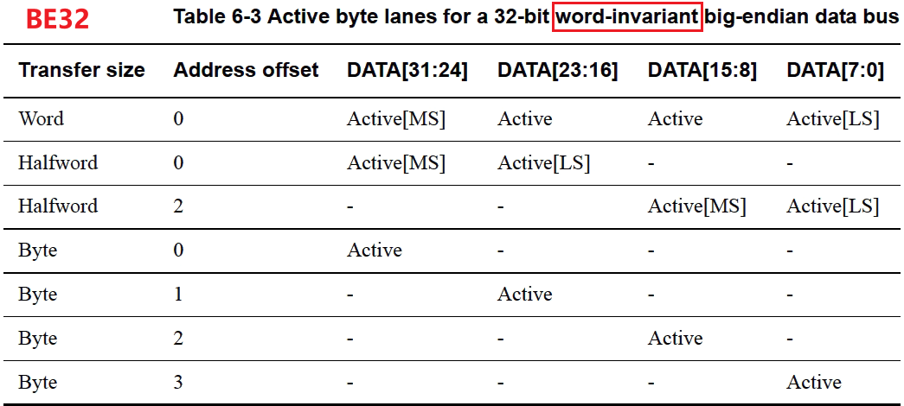

### 5.2 宽bus窄数据

对于比总线宽度更窄的传输，例如32位总线上的16位传输：

-   写传输：Master只需要驱动适当的字节通道，Slave从正确的字节通道中选择写入数据。
-   读传输：Slave只需要在活动字节通道上提供有效数据，Master从正确的字节通道中选择数据。

<strong>——注意——</strong>

反过来窄bus宽数据一般是不允许的，Master不能访问更窄的bus，除非在Master中包含某种机制来限制Master尝试传输的宽度。当HSIZE表示的宽度大于它所连接的数据总线时，Master绝对不能尝试传输。

### 5.2 宽bus窄Slave

下图显示了如何将最初设计用于32位数据总线的Slave模块，被64位数据总线访问。这只需要添加外部逻辑，而不需要任何内部设计更改，因此该技术适用于硬宏单元。

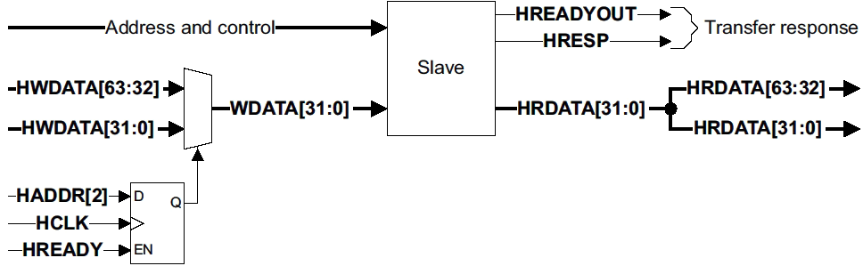

对于输出，当将窄bus转换为宽bus时执行以下操作之一：

-   如图所示复制宽bus两端的数据。
-   使用额外的逻辑来确保只更改了总线的适当的一半，这将降低功耗。

Slave只能接受与它的自然接口一样宽的传输，如果Master尝试传输超出了Slave所能支持的范围，那么Slave器可以使用ERROR传输响应。

### 5.3 窄bus宽Slave

通过使用外部逻辑，预先设计或导入的Slave可以适应更窄的数据总线。下图所示为在窄bus上实现宽Slave。

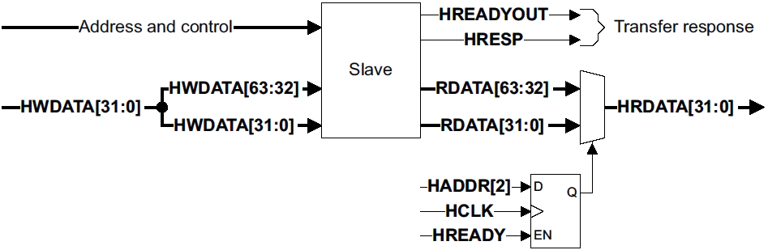

## 6 其他一些问题

### 6.1 什么是User信号

AHB5手册的最后一章是User信号，分为HAUSER、HWUSER、HRUSER三组，但协议开头就说：“通常本规范建议不使用User信号。AHB协议没有定义这些信号的功能，如果两个组件以不兼容的方式使用相同的User信号，就会导致互操作性问题。”啊这……在章节后面，手册又说道：“建议在互连上包含User信号，但是没有要求在Master或Slave上包含它们。该规范建议互连组件包括对User信号的支持，以便它们可以在Master和Slave之间传递。用户User信号的宽度是实现自定义的，对于每个通道可以是不同的。”

User信号其实就是用户自定义的信号，但又想随着总线往下传。AHB本身不是必须包含User信号，内部没有设计User传递的时序，如果用户贸然用，那需要重新设计这部分时序了。因此手册建议互联上用，事实上很多Bus IP都支持添加一些User信号，使得Master的一些额外信息可以顺利随着AMBA时序传递给Slave。这些额外信息是项目上自定义的，可以是Master编号、QoS值、特殊标识符等。

### 6.2 消失的Split传输

Split传输存在于AHB2中，其含义是根据Slave的响应来分离Master的操作，从而给Slave提供地址和合适的数据，提高了总线的总体使用率。当传输产生时，如果Slave认为传输的执行将占据大量的时钟周期，那么Slave记录MasterID号（HMASTER），发出一个SPLIT响应，该信号提示Arbiter降低此Master的优先权，移交总线给其他Master，避免占着茅坑不拉屎的情况。直到Slave表示它准备好了数据，可以完成传输，Slave就根据MasterID号用HSPLITx断言适当的位，Arbiter就再授权给该Master，Master则再尝试发起访问，结束这次Split传输。

由于这种情况比较少见，后续的AHB协议又删除了Arbiter模块，不再支持多Master操作，因此Split传输也就消失了。

### 6.3 HREADYIN作用

不管是AHB2还是AHB-lite/AHB5，Slave都需要向上游返回HREADYOUT（AHB2中信号名是HREADY）。AHB的传输分为地址相位和数据相位，HREADYOUT信号是Slave用来对数据相位的扩展。Slave在忙碌时，比如说还在处理上一笔数据或者准备下一笔数据，那么表明Slave还没有完全准备好下一笔传输，于是就拉低HREADYOUT信号告知上游：“搞不赢了，你再坚持会儿！”由此上游数据就要扩展，即保持住，直到Slave准备好这次的传输，HREADYOUT拉高，上游数据才算真正到达Slave端，也就不需要继续保持数据了。而到了AHB-lite/AHB5中，Slave除了向上游mux发出HREADYOUT信号，自己还会接收到mux返回的HREADYIN信号，如下所示。

 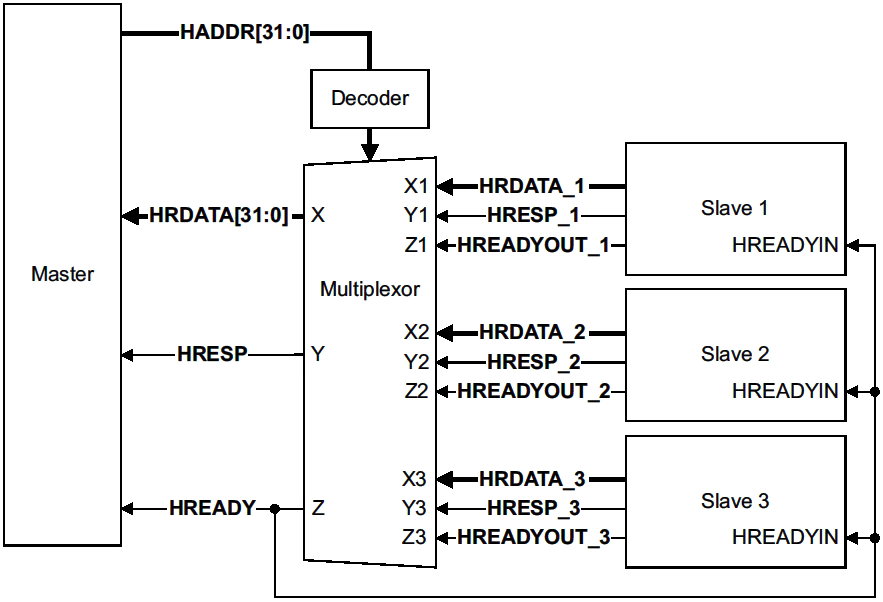

<strong>（1）单Slave情况</strong>

单Slave情况包括两种，一是系统本身就一个Slave，二是系统本身有多个Slave，但传输是连续对同一个Slave进行突发读写。单Slave情况下的HREADYIN并无意义，Slave的HREADYIN收到的就是自己发出的HREADYOUT。

<strong>（2）多Slave情况</strong>

多Slave情况下，多个Slave发出的HREADYOUT信号到mux，mux进行译码后输出HREADY信号，该信号既给Master也返回给所有Slave。HREADYIN信号的设计主要是有利于Pipeline操作（上一笔传输的数据阶段和下一笔传输的地址阶段可以同时），例如Master先发出对Slave1的读操作，Slave1没有准备好数据，于是将数据相位扩展，HREADYOUT\_1为低。此时Master又发出对Slave2的读操作，而Slave2本身是ready的状态，HREADYOUT\_2为高。Mux会对所有Slave发出的HREADYOUT进行译码，然后才返回HREADY给Master，由于Slave1的HREADYOUT\_1为低，所以HREADY也为低，对Slave1的访问实际还没有完成，对Slave2的访问更是没有完成。可是如果没有HREADYIN设计，那Slave2不知道啊，它自己是准备好了的，也发出了HREADY\_OUT2为高，它就误以为自己这次访问成功了，这就造成了误操作。

现在有HREADYIN设计，Mux的HREADY传给Master也传给所有Slave。那么上面例子中的Slave2收到HREADYIN为低，就知道上游有访问还没有完成，必须保持住自己的HREADYOUT信号，只有自己发出的HREADYOUT和收到的HREADYIN同时为高，才不会误判当前的系统状态。由于HREADYIN的设计，也使得Slave可以通过HREADYOUT反压其他Slave。

<strong>（3）AHB2为什么没有HREADYIN</strong>

工作中我没有遇到过没有HREADYIN的原始AHB2协议，不太清楚为什么它没有设计HREADYIN，或许是AHB2中有仲裁器来占据总线？或者这是AHB2协议的缺陷？

<strong>（4）APB为什么没有HREADYIN</strong>

APB协议很多情况下也是一主多从，但是APB协议不支持Pipeline传输，只有上一笔传输完全结束，下一笔传输才可以开始，所以没有上面提到的问题。

<strong>（5）AXI为什么没有HREADYIN</strong>

AXI协议中是多通道设计，不管是Master还是Slave，不管是读还是写，不管是request还是response，都有ready和valid信号，这些设计也可以解决上面提到的问题。

### 6.4 Default Master

AHB2原生支持多Master，每个系统必须包含一个Default Master，如果所有其他Master不能使用总线时则该Master被授予总线。当被授予总线时，Default Master必须只能执行IDLE传输。如果没有Master请求总线，那么Arbiter可以将总线授予给Default Master，或者访问总线延时较低的Master将因此受益而被授予总线。授予Default Master访问总线也为确保在总线上没有新的传输开始提供了一个有用的机制，并且也是预先进入低功耗操作模式的有用步骤。如果其他所有Master都在等待 SPLIT 传输完成时，Default Master必须被授予总线。

后续AHB协议原生不再支持多Master，因此也就没有了Default Master的概念。

### 6.5 Default Slave

系统中不包含完全填充的地址映射时，应该实现一个额外的Default Slave，以便在访问任何不存在的地址位置时提供响应。如果试图对一个不存在的地址位置进行NONSEQUENTIAL或SEQUENTIAL传输，那么Default Slave应该提供一个ERROR响应。IDLE或BUSY传输到不存在的位置应该导致零等待状态ok响应。通常Default Slave功能将作为中央地址解码器的一部分实现。

在很多总线互联IP中也都有Default Slave的概念，用于处理意外情况。

参考资料：

\[1\] ARM官方数据手册：[https://www.arm.com/architecture/system-architectures/amba/amba-specifications](https://www.arm.com/architecture/system-architectures/amba/amba-specifications)

---

> 原文：[AMBA总线（2）—— AHB协议](https://www.cnblogs.com/xianyuIC/p/17301009.html)（博客园 · 咸鱼IC）
