## 1 AXI基本概述

AMBA3版本推出了AXI协议，它支持高性能、高频率的系统设计，其主要特点如下所示：

-   分离的地址/控制和数据阶段。
-   通过字节选通方式支持非对齐的数据传输。
-   使用基于突发的事务，只需起始地址发出。（Burst不得跨4KB边界，防止跨越Slave边界）
-   单独的读写数据通道，这可以提供低成本的直接内存访问(DMA)。
-   支持发布多个超前地址（outstanding）。
-   支持完成乱序事务（out-of-order）。
-   易于添加register stage来达到时序收敛。
-   AXI协议包括涵盖低功耗操作的可选扩展信号。

AXI协议是基于突发的，并定义了五个独立的事务通道。地址通道携带着控制信息，用于描述传输数据的性质。五个独立通道都由一组信息信号、以及提供双向握手机制的VALID和READY信号组成。

-   Master使用VALID信号来显示信道上的addr、data或ctrl信息何时可用。
-   Slave使用READY信号来显示它何时可以接受信息。
-   读数据通道和写数据通道还包括LAST信号，以指示事务中最后数据项的传输。

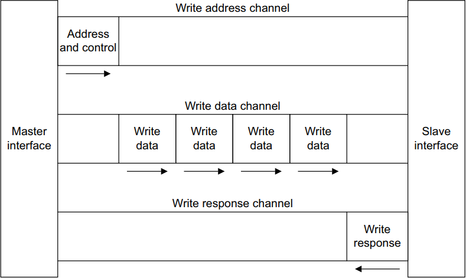

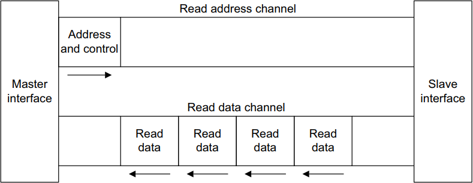

五个通道的特点如下所示：

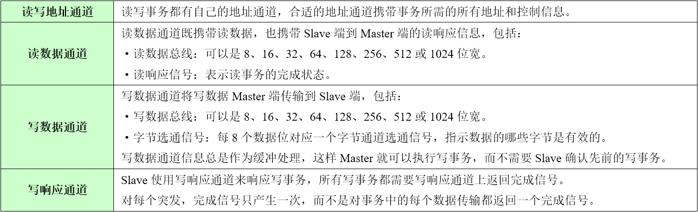

一个典型的系统由许多Master和Slave组成，通过某种形式的互连连接在一起，如下图所示。

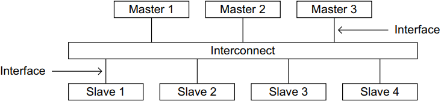

<strong>Register slices</strong>

每个AXI通道只在一个方向上传输信息，并且该体系结构不需要通道之间有任何固定的关系。这意味着Register slices几乎可以在任何通道的任何点插入，代价是额外的延迟周期。

注意：Register slice的使用会造成：

-   在延迟和最大操作频率之间需要做权衡。
-   处理器和高性能内存之间的直接、快速连接，但对于性能不太关键的外设，其较长路径使用简单的Register slices来隔离。

<strong>术语说明</strong>

-   AXI总线上所需操作的完整集合构成了AXI Transaction（事务）。
    -   <strong>Transaction（事务）：</strong>一个AXI主机发起一个AXI Transaction（事务）来与一个AXI从机通信。通常事务需要在多个通道上的主机和从机之间交换信息。所需的信息交换的完整集合形成了Transaction（事务）。
-   任何所需的有效载荷数据都作为AXI Burst（突发）传输。
    -   <strong>Burst（突发）：</strong>在AXI事务中，有效负载数据在单个Burst（突发）中传输，该Burst（突发）可以包含多个Beats（拍），或者单独的数据传输。
-   一个突发可以包含多个数据传输，或称为AXI Beats（拍）。
    -   <strong>Beats（拍）：</strong>AXI Burst（突发）中的单个数据的传输。

## 2 AXI信号列表

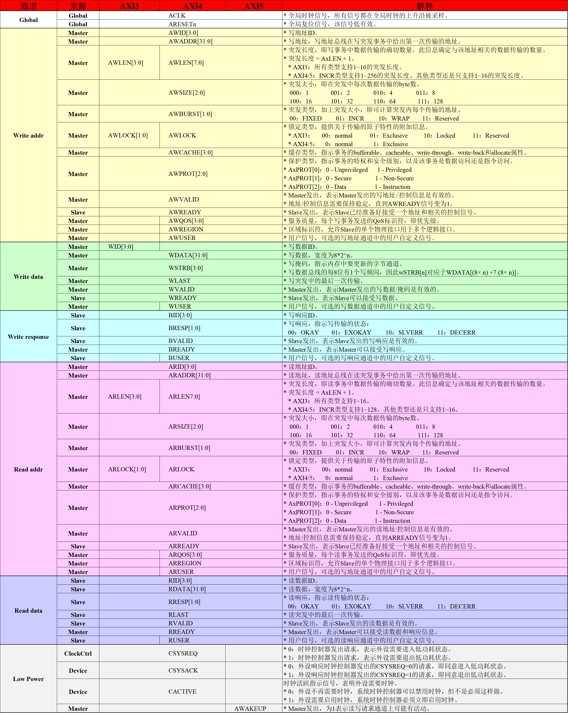

## 3 AXI握手机制

本章描述了在单个Master和Slave之间的基本AXI协议事务需求。

### 3.1 握手过程

所有五个事务通道，都使用相同的VALID/READY握手过程来传输地址、数据和控制信息。这种双向流控制机制意味着Master和Slave都可以控制信息的移动速率。传输只发生在VALID和READY信号都是1的时候。

-   源端产生VALID=1信号：表示地址、数据或控制信息可用。
-   终端生成READY=1信号：表示可以接受该信息。

<strong>（1）VALID等READY</strong>

注意，源端拉高VALID后必须保持住，直到终端拉高READY，在T3时刻完成握手。

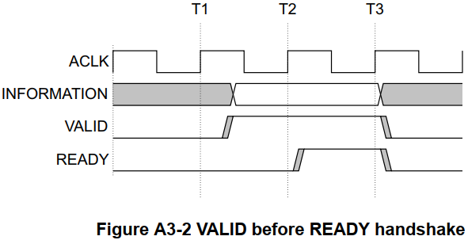

<strong>（2）READY等VALID</strong>

注意，终端拉高READY后可以取消拉高，不必一直保持到完成握手。

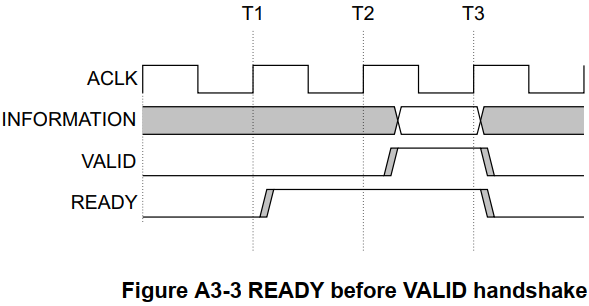

<strong>（3）VALID和READY同时</strong>

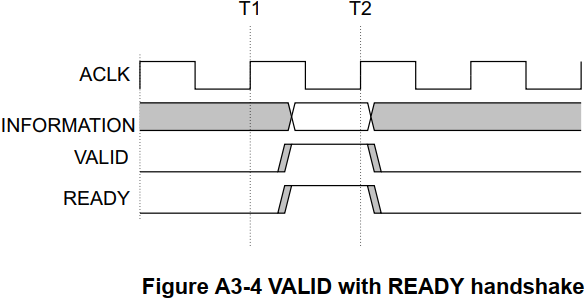

### 3.2 握手依赖

握手依赖包括不同通道之间的依赖关系、以及同一通道中不同信号之间的依赖关系。首先记住一点：VALID和READY之间没有依赖关系，谁先谁后都可以，但是源端拉高VALID后必须保持住，直到终端拉高READY。

下面给出握手依赖关系，单箭头指向表示不依赖，双箭头指向的信号必须依赖前者。

<strong>（1）AXI读事务</strong>

-   必须先有读地址，再有读数据。
-   从机发送突发传输中的最后一拍读传输时，必须拉高RLAST。

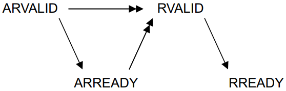

<strong>（2）AXI3写事务</strong>

-   可以先有写数据，再有写地址。
-   必须先有写数据，再有写响应。
-   主机发送突发传输中的最后一拍写传输时，必须拉高WLAST。

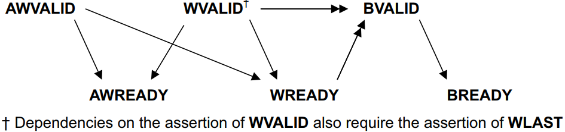

<strong>（3）AXI4写事务</strong>

-   可以先有写数据，再有写地址。
-   必须先有写地址和写数据，再有写响应。（与AXI3不同）
-   主机发送突发传输中的最后一拍写传输时，必须拉高WLAST。

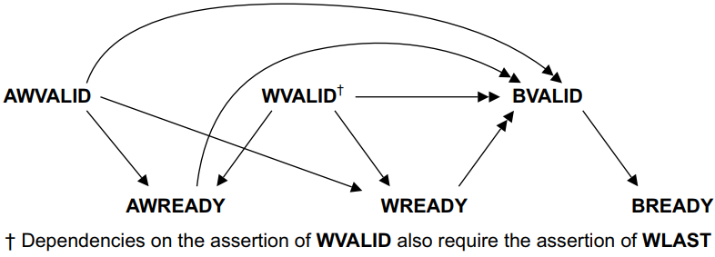

### 3.3 遗留问题

上面写道，接受所有写数据并在接受地址之前提供写响应的AXI3 Slave与AXI4不兼容。将一个AXI3遗留Slave转换为AXI4需要添加一个Wrapper，以确保在Slave接受了适当的地址之后才提供返回的写响应。

注意：强烈建议任何新的AXI3 Slave实现都包含这个额外的依赖项。

任何AXI3 Master 都符合AXI4写响应要求。

## 4 AXI信号说明

-   AXI 协议基于 Burst，Master 通过驱动第一个字节的地址来开始每个 burst；
-   AXI 协议的Burst 不能跨越4KB 边界。

### 4.1 AxLEN

AxLEN表示突发长度，即读写事务中数据传输的确切数量，此信息确定与该地址相关的数据传输的数量。突发长度的计算公式是：突发长度=AxLEN+1。AXI3和AXI4/5的突发长度最大值略有不同，如下所示：

-   AXI3：所有突发类型都支持1~16的突发长度。
-   AXI4/5：INCR突发类型支持1~256的突发长度，其他类型还是只支持1~16的突发长度。

AXI有以下规则来管理突发的使用：

-   对于WRAP类型突发，突发长度必须为2、4、8或16。
-   突发不能跨越4KB地址边界。（page大小为4K，4KB 边界即addr\[11:0\]=0的地址)
-   不支持提前终止突发。
    -   <strong>注意：</strong>没有任何组件可以提前终止突发，然而为了减少写突发中的数据传输数量，Master可以通过取消所有WSTRB来禁用进一步的写。这种情况下Master必须在突发中完成剩余的传输（但是写的数据无效）。在读突发中，Master可以丢弃读取的数据，但它也必须完成突发中的所有传输。
    -   <strong>注意：</strong>丢弃不需要的读数据可能导致访问读敏感设备（如FIFO）时丢失数据。当访问这样的设备时，Master必须使用与所需数据传输的大小完全匹配的突发长度。

在AXI4/5中，具有INCR突发类型和长度大于16的事务可以转换为多个较小的突发，即使事务属性表明该事务是不可修改的。（请参阅关于CACHE内存属性的更改。）这种情况下，生成的突发必须保留与原始交易相同的事务特征，但是注意这些事务的突发长度被减少了，突发地址也被适当地调整了。

<strong>注意：</strong>为了实现AXI3兼容性或者保证QoS性能，需要能够将较长的突发分解为多个较短的突发。

### 4.2 AxSIZE

AxSIZE表示突发大小，即在突发中每次数据传输的byte数。

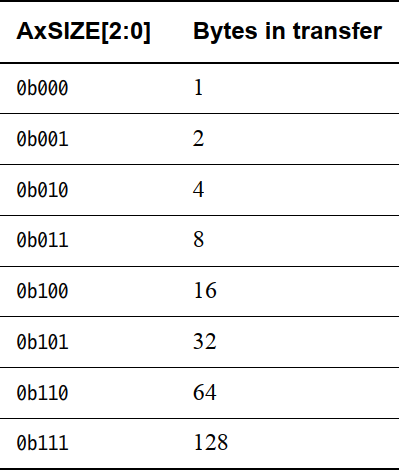

如果AXI总线大于突发大小，AXI接口必须从传输地址中确定：每次传输使用数据总线的哪个字节通道。（参见后面《AXI读写结构》。）

AxSIZE表示的数据宽度不能超过有效的数据总线宽度，例如awsize=1，表示每次传输16bit，这也意味着有效的数据总线宽度是16，那么即便wdata位宽是32bit，wstrb也不能是诸如“1001"，而只能是”0000，0001，0010，0011，0100，0110，0100，1000，1100“等组合。

实际上，AXI4 尽管支持同一beat内的稀疏传输，即wstrb里的1不要求连续，但是实际从机实现困难，一般会拆开，还有就是这个1必须出现在 awsize 规定的总线宽度内。

### 4.3 AxBURST

AXI协议定义了3种突发类型。

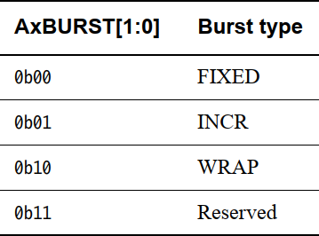

<strong>（1）FIXED</strong>

-   该地址在每次传输中都是相同的。
-   有效的字节通道对于突发中的所有节拍（beat）都是恒定的。然而在这些字节通道中，对于突发中的每个节拍，断言了WSTRB的实际字节可能是不同的。

这种突发类型用于重复访问同一位置，例如在加载或清空FIFO时。

<strong>（2）INCR</strong>

-   突发中每次传输的地址都是前一次传输地址的增量。
-   增量值取决于传输的大小。例如在一个大小为4Byte的突发中，每个传输的地址是前一个地址加4。

这种突发类型用于访问普通顺序内存。

<strong>（3）WRAP</strong>

WRAP突发类似于INCR突发，不同之处在于如果达到了地址上限，地址就会回卷到较小的地址。以下限制适用于WRAP突发：

-   起始地址必须与每次传输的大小一致。
-   突发的长度必须为2、4、8或16次传输。

这种突发类型用于缓存线路访问。

### 4.4 xRESP

-   对于读事务，Slave可以在一次突发中对不同拍的传输发出不同的响应信号。
    -   例如在16次读传输的突发事务中，Slave可能会为其中15次传输返回OKAY响应，并为其中1次传输返回SLVERR响应。
-   对于写事务，Slave为整个突发事务中发出单个响应信号，而不是为突发事务中的每个数据传输。

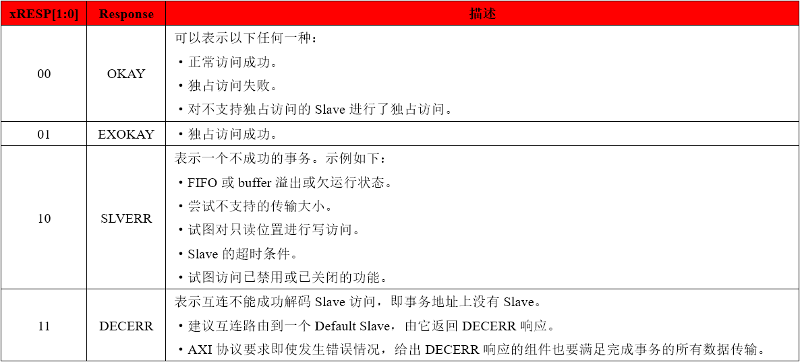

<strong>注意：</strong>协议规定即使报告了错误，也必须执行所需数量的数据传输。例如Slave要求了8个读传输，但Slave有错误情况，也必须执行8个数据传输，每个都有一个错误响应。如果Slave给出一个错误响应，不会取消突发的剩余部分。

### 4.5 AxCACHE

<strong>（1）AXI3内存属性</strong>

<strong>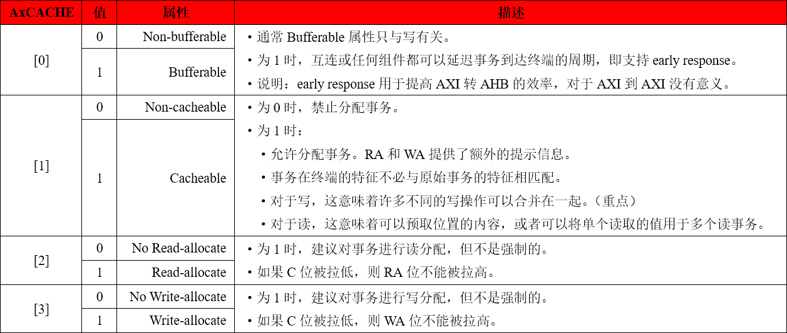</strong>

<strong>（2）AXI4/5内存属性</strong>

AXI4/5内存属性进行了以下更改：

-   AxCACHE\[1\]位被改名为Modifiable位。（改名是为更好地描述所需的功能，实际的功能没有改变）
-   排序需求是为Non-modifiable事务定义的。
-   Read-allocate和Write-allocate的含义被更新。

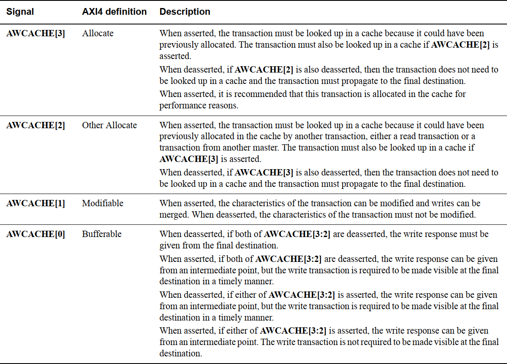

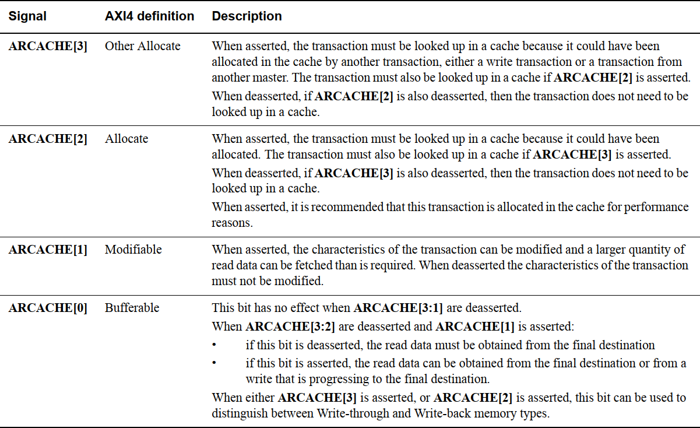

更多详细描述见原版AXI4/5数据手册。

<strong>（3）Memory类型</strong>

AxCACHE还可以编码来标识内存类型，AXI3和AXI4/5对此略有不同。下表显示了首选的AXI4/5值，括号中是合法的AXI3值。

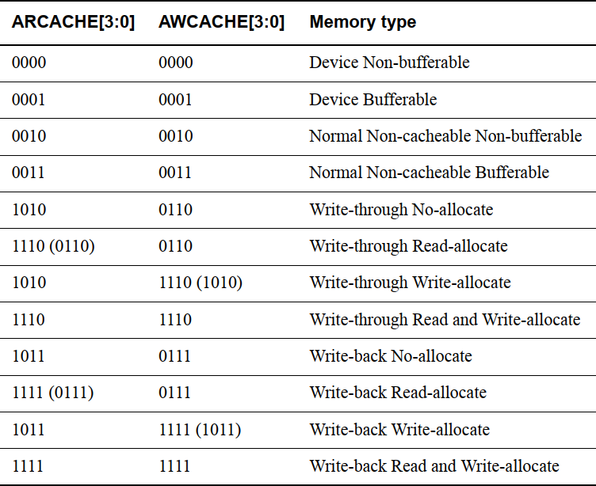

<strong>注意：</strong>

-   相同的存储器类型可以在读通道和写通道上具有不同的编码。
-   这提供了与AXI3 AxCACHE定义的向后兼容性。
-   在AXI4/5中，为特定内存类型使用多个AxCACHE值是合法的。

更多详细描述见原版AXI4/5数据手册。

<strong>（4）遗留问题</strong>

AXI4/5引入了处理某些AxCACHE内存属性的附加要求。在AXI4/5中，对同一Slave使用相同ID的所有设备事务必须按照彼此的顺序进行排序。

<strong>注意：</strong>

-   这不是AXI3的明确要求。任何依赖于此行为的AXI4组件都不能连接到不显示此行为的AXI3互连。
-   ARM相信大多数实现的AXI3互连都支持所需的AXI4行为。

强烈建议任何新的AXI3设计都实现AXI4/5需求。对于AxCACHE位名和内存类型名，AXI4/5需要使用新的术语。AXI3组件可以使用AXI3或AXI4/5名称。

### 4.6 AxPROT

AXI提供访问权限的信号，可用于防止非法交易。

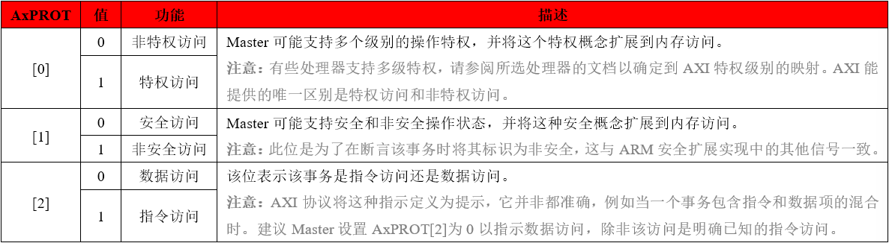

### 4.7 AxLOCK

AxLOCK信号涉及到原子访问的相关特性，AxLOCK代表的事务类型有Exclusive独占访问和Locked锁定访问。AXI4/5不再支持锁定访问，因为大多数组件不需要锁定事务，且这对互联复杂性和QoS都有影响。

<strong>（1）AXI3原子访问</strong>

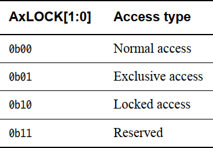

<strong>（2）AXI4/5原子访问</strong>

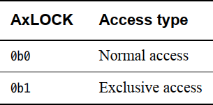

<strong>（3）遗留问题</strong>

AXI3的锁定事务转换到AXI4时，按照以下方式进行转换：

-   AxLOCK\[1:0\] = 0b10转换为普通事务，即AxLOCK= 0b0。

建议任何执行这种转换的组件（通常是一个互连），要包含一个可选的机制来检测和标记这种转换已经发生。如果执行这种转换，任何不能正确操作的组件都不能在AXI4/5环境中使用。

<strong>注意：</strong>对于许多使用锁定事务的遗留情况，例如执行SwP指令，可能需要对软件进行更改，以防止使用任何强制锁定事务的指令。

## 5 AXI顺序模型

### 5.1 事务ID

AXI协议包括AXI ID事务标识符。Master可以使用它们来标识必须按顺序返回的单独事务。具有给定ID值的所有事务必须保持有序，但是对于具有不同ID值的事务的排序没有限制。这意味着单个物理端口可以通过充当多个逻辑端口来支持乱序事务，每个逻辑端口按顺序处理其事务。通过使用ID，Master可以发出事务，而不必等待先前的事务完成。这可以提高系统性能，因为它支持并行处理事务。

<strong>注意：</strong>

-   使用ID不是必须的，Master和Slave一次可以处理一个事务，这意味着事务按照发布的顺序进行处理。
-   Slave需要响应合适的BID或RID，以对应从Master接收到的ID。

5个事务通道都有自己的事务ID，如下表所示：

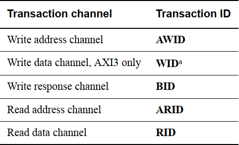

Master可以使用AWID和ARID事务ID来指示其排序需求。传输排序规则如下：

-   来自不同Master的事务没有排序限制，它们可以以任何顺序完成。
-   来自同一Master但具有不同ID值的事务没有排序限制，它们可以以任何顺序完成。
-   具有相同ARID值的读事务序列的数据传输，Slave必须按照Master发出地址的顺序返回。
-   具有相同AWID值的写事务序列的数据传输，Slave必须按照Maste发出地址的顺序完成。
-   在使用AWID和ARID的公共值的读写事务之间没有排序限制。
-   AXI互联可以扩展事务ID值。

<strong>注意：</strong>AXI互联通过扩展事务ID值，可以不担心多Master发出相同ID值，因为互联可以附加ID上去，使得每个Master使用的ID值是唯一的，也因此造成Slave的ID比Master更宽。RID和BID返回给Master时，互联将移除掉附加ID。

### 5.2 Outstanding超前传输

AHB和AXI都支持突发传输，但AXI还支持Outstanding超前传输，这便是AXI总线能够实现高性能传输的原因之一。Outstanding传输是指Master发出命令后，不必等待数据全写完或者全读回就可以发起下一笔命令。Outstanding深度是指Master发出的正在进行的命令数量，显然这需要Master和Slave准备更大的buffer来保存这些命令信息。

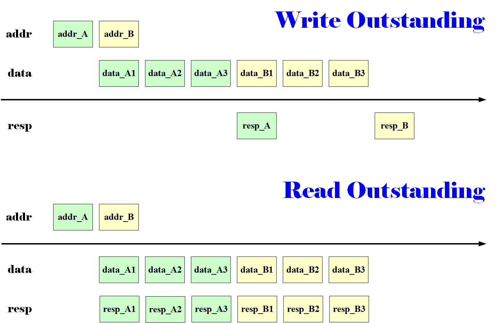

### 5.3 Out-of-order乱序传输

AXI拥有事务ID，因此支持Out-of-order乱序传输，Out-of-order传输是指后发送的命令对应的<strong>响应</strong>可以先回来，注意必须是不同ID之间，相同ID之间不能乱序传输数据。

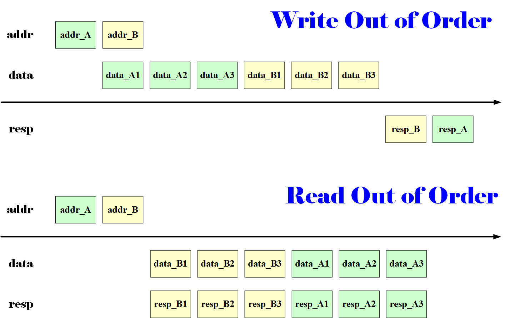

乱序传输存在读数据重排序深度的问题，读数据重排序深度是指Slave中可以重排序的暂挂地址的数量。按顺序处理所有事务的Slave的读数据重排序深度为1。读数据重排序深度是一个静态值，必须由Slave的设计者指定。

<strong>注意：</strong>没有一种机制可以让Master确定Slave的读数据重排序深度。（所以发的太多会造成反压）

### 5.4 Interleaving交错传输

AXI拥有事务ID，因此支持Interleaving交错传输，Interleaving传输是指不同命令的<strong>数据</strong>之间可以插队重排，注意必须是不同ID之间，相同ID之间不能交错传输数据。

<strong>注意：</strong>对于支持写数据交错的Slave，它接收每个事务的第一个数据项的顺序必须与它接收事务地址的顺序相同。

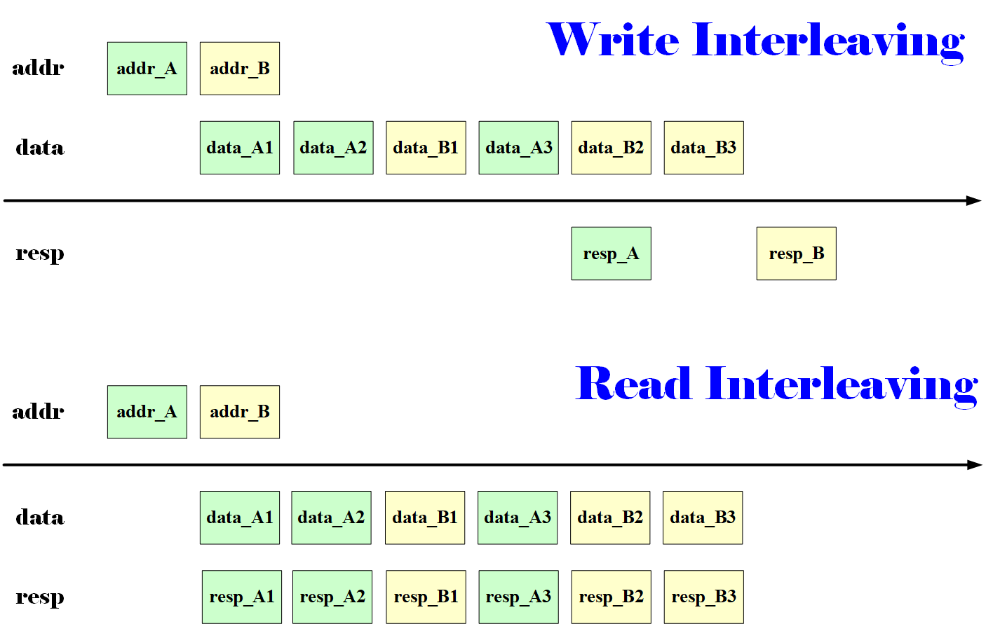

与读数据重排序深度类似的，有写数据交错深度，写数据交错深度是指一个Slave可以接收交错数据的地址数。

<strong>注意：</strong>没有一种机制可以让Master确定Slave是否支持写数据交错。（做BUS的人应该事先知晓）

<strong>AXI4/5取消了WID</strong>

AXI4/5协议中没有了WID，不再支持写交织，事务的所有写数据必须在写数据通道上的传输中连续提供（不得交织）。

### 5.3 遗留问题

AXI4/5中取消了WID，为支持协议的兼容性，有以下建议：

-   任何支持写交错的AXI3 Master，都必须支持将写交错深度设置为1，以兼容不支持写交错的Slave。
-   任何AXI3 Slave都可以接受非交错的写数据，因此对AXI3 Slave不存在遗留问题。

最后，再来个大图吧：

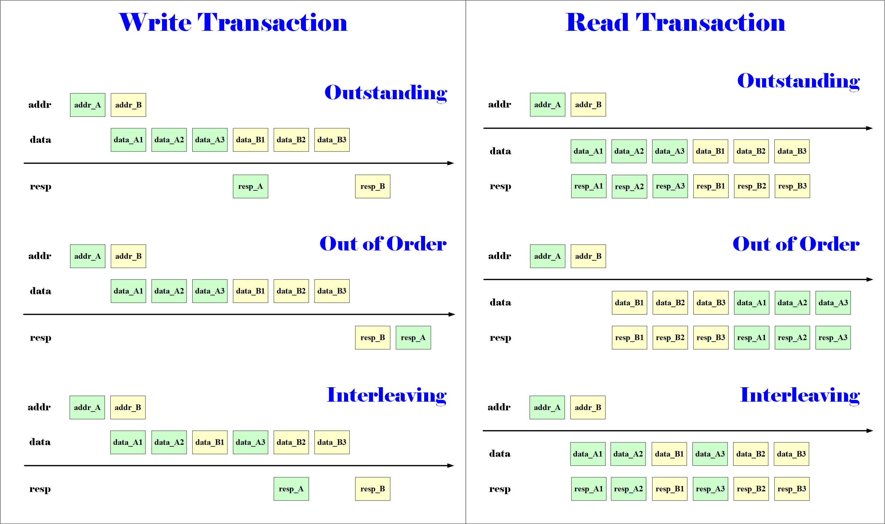

## 6 AXI读写结构

### 6.1 WSTRB写选通

写选通信号WSTRB允许在写数据总线上进行稀疏数据传输。每个写选通信号对应写数据总线上的一个字节。当写选通断言时，表示写数据总线上对应的字节通道中包含将被更新到memory的有效信息。写数据总线上每 8 位具有一个写选通位，因此 WSTRB\[n\]对应WDATA\[(8n)+7 : (8n)\]。下图展示了一个 64bit 数据总线上的这种关系。

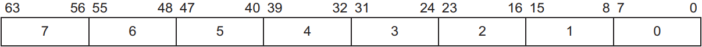

Master必须确保只有包含有效数据的字节通道，其对应的写选通信号才会被拉高。当WVALID为0时，WSTRB可以取任何值，尽管建议它们要么被驱动为0，要么保持在之前的值。

### 6.2 窄带传输

当Master发起一个传输，其数据宽度小于数据总线宽度时，由地址和控制信息决定传输使用哪些字节通道，在INCR或WRAP突发中，突发的每拍（beat）使用不同的字节通道WSTRB。在FIXED突发中，每拍使用相同的字节通道。

下图带阴影的单元格表示没有传输的字节。

<strong>（1）案例1：32bit总线传8bit数据</strong>

下图表示这笔传输的突发有5个传输，传输的起始地址为0，每次传输8位，在32位总线上进行，突发类型为INCR。

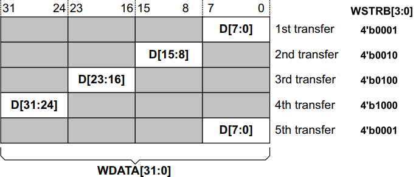

<strong>（2）案例2：64bit总线传32bit数据</strong>

下图表示这笔传输的突发有3次传输，起始地址为4，每次传输为32位，在64位总线上进行。

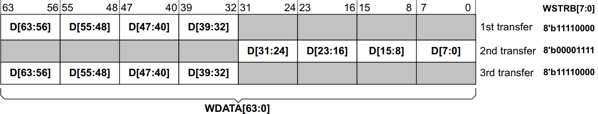

### 6.3 字节不变性

为了在单个内存空间中访问混合端序（mixed-endian）的数据结构，AXI协议使用字节不变的端序模式。字节不变端序意思是：一个传输到给定地址的字节，会在相同的数据总线信号线上，向相同的地址位置传送一个数据的 8-bits。

-   只有一种传输宽度的组件必须将其字节通道连接到数据总线中合适的字节通道上。

-   支持多种传输宽度的组件可以具有更复杂的接口来转换非“字节不变性”的接口。

-   大部分小端模式的组件可以直接连接到一个“字节不变性”接口上。

-   仅支持大端传输的组件则要有一个用于“字节不变性”操作的转换功能。

<strong>（1）案例1：大端传输</strong>

下图显示了一个大端“字节不变性”的例子。在这个结构中：

-   数据的MSB是0x0A，存储在寄存器中的MSB位置；
-   数据的MSB存储在地址最低的内存位置；
-   其他数据字节按重要程度递减的顺序定位。

（操作时读写地址顺序是ABCD，因此先执行\[31:24\]位的数据0x0A，顺序执行到\[7:0\]的数据0x0D）

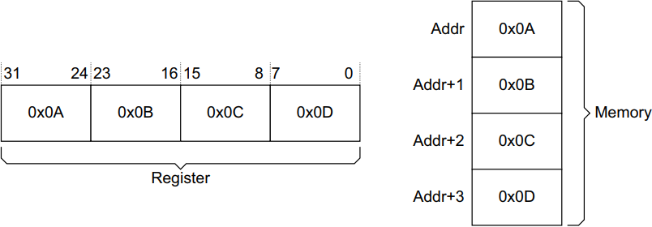

<strong>（2）案例2：小端传输</strong>

下图显示了一个小端“字节不变性”的例子。在这个结构中：

-   数据的LSB是0x0D，存储在寄存器中的LSB位置。
-   数据的LSB存储在地址最低的内存位置。
-   其他数据字节按重要性递增的顺序排列。

（操作时读写地址顺序是DCBA，因此先执行\[7:0\]的数据0x0D，顺序执行到\[31:24\]位的数据0x0A）

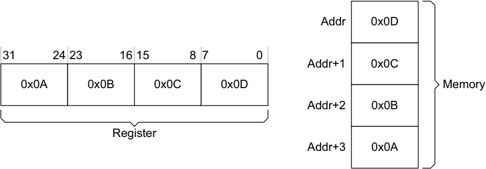

<strong>（3）案例3：混合传输</strong>

“字节不变性”确保大端和小端结构可以在单个内存空间中共存而不会损坏。下图显示了一个需要“字节不变性”访问的例子，其报头字段使用小端序，而有效负载使用大端序。

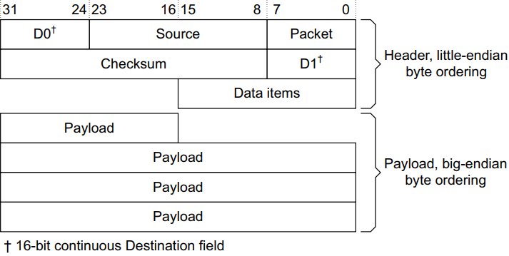

在这个结构中，Data items是一个两字节的小端序元素，这意味着它的最低地址是它的LSB。“字节不变性”的使用确保了负载的大端位访问不会破坏小端位元素。

### 6.4 非对齐传输

AXI协议使用基于突发的寻址，意思是每个事物都包含若干个数据传输。通常来说每个数据传输都会对齐到传输大小。例如一个 32-bit 宽的传输通常会对齐到 4-byte 边界。但是在某些时候会期望在非对齐的地址开始一个突发。

AXI支持不对齐传输，对于任何由大于1byte的数据传输组成的突发，访问的第一个byte可能与自然地址边界不对齐。例如起始字节地址为0x1002的32bit数据包，就没有与自然的32bit地址边界对齐。Master可以：

-   使用低位地址线来表示未对齐的起始地址，低位地址线上的信息必须和字节选通WSTRB的信息一致。
-   提供一个对齐的地址，再使用字节选通WSTRB来确定使用哪个字节通道。（先对齐再选通的方式）

<strong>注意：</strong>Slave不需要根据来自Master的任何对齐信息采取特殊的操作。

<strong>（1）案例1：32bit地址传32bit数据</strong>

图中的每一行表示一次传输，阴影单元格表示未传输的字节。

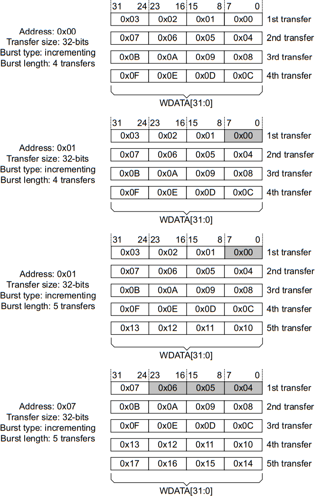

<strong>（2）案例2：64bit地址传32bit数据</strong>

图中的每一行表示一次传输，阴影单元格表示未传输的字节。

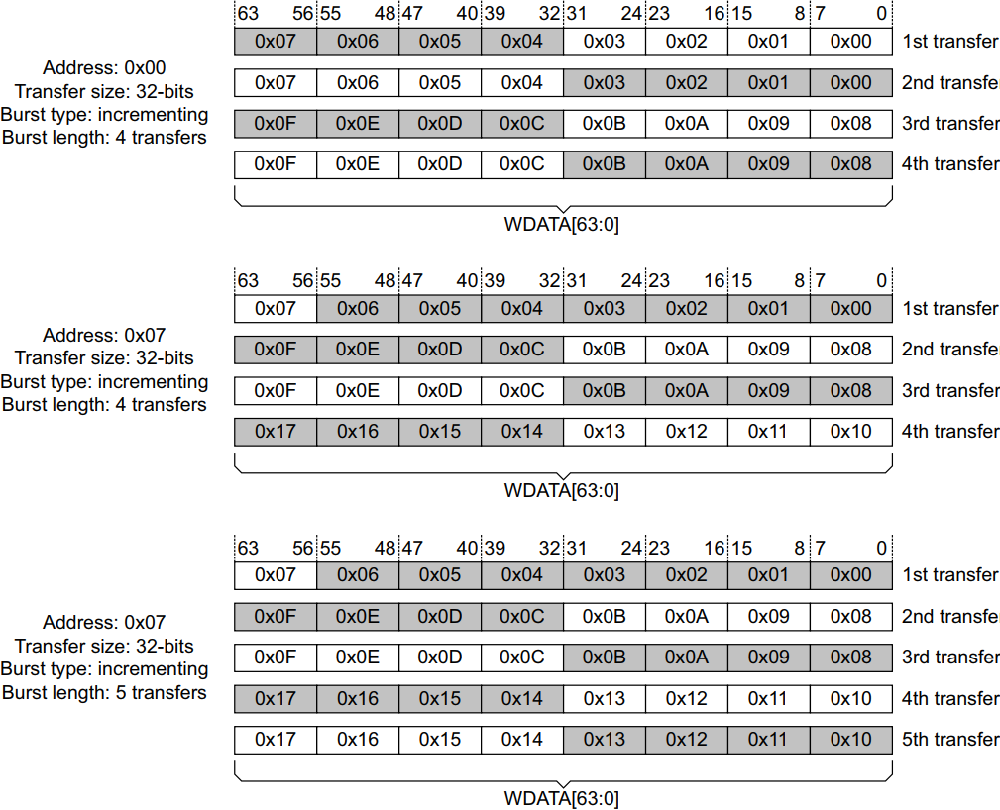

<strong>（3）案例3：WRAP对齐传输</strong>

下图显示了在64位总线上具有对齐的32位传输的WRAP突发的示例。

图中的每一行表示一次传输，阴影单元格表示未传输的字节。

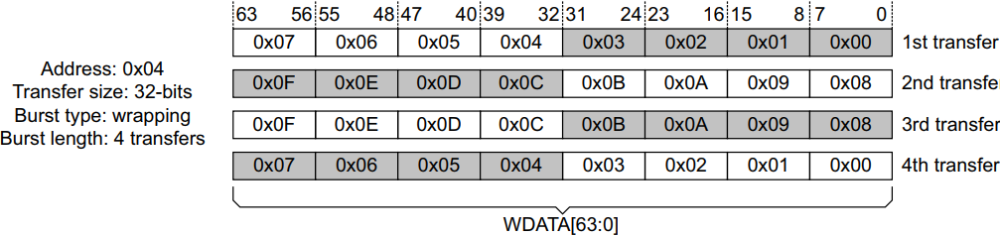

<strong>个人理解：</strong>

非对齐传输和窄带传输的处理方式差不多，都可以先往前填数据，使得变成对齐传输，再利用WSTRB选通信号去掉前面填的数据，从而实现AXI数据传输。实际上，AXI4 尽管支持同一beat内的稀疏传输，即wstrb里的1不要求连续，但是实际从机实现困难，一般会拆开。还有就是这个1必须出现在 awsize 规定的总线宽度内。

## 7 AXI低功耗信号

低功耗接口是AXI协议的可选扩展，针对两种不同类型的外设：

-   任何没有电源关闭顺序的外设，并且可以指示其时钟何时可以关闭。
-   任何需要断电顺序的外设，并且只在进入低功耗状态后才能关闭时钟。外设需要来自系统时钟控制器的指示，以表明何时启动断电序列，并且必须在进入低功耗状态时发出信号。

### 7.1 低功耗接口

在工作中，我们习惯把AXI的低功耗接口信号称之为C-channel信号。

-   对于具有上下电顺序的外设，时钟控制器发出请求后才会进入低功耗状态，协议提供了请求/确认握手信号。
-   对于没有上下电顺序的外设，CACTIVE是所需要的唯一的时钟控制信号。

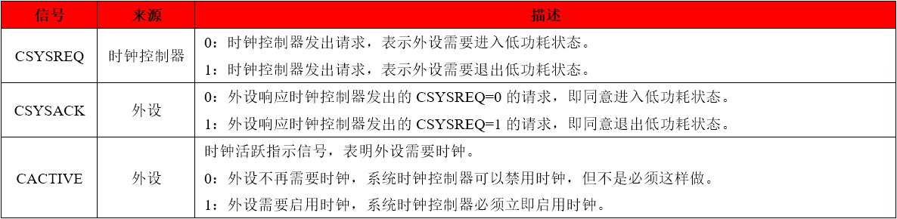

### 7.2 低功耗时钟控制

<strong>（1）时钟控制器发起退出低功耗状态</strong>

-   进入时：时钟控制器拉低CSYSREQ，外设执行下电序列，顺序拉低CACTIVE和CSYSACK。
-   退出时：时钟控制器拉高CSYSREQ，外设执行上电序列，顺序拉高CACTIVE和CSYSACK。

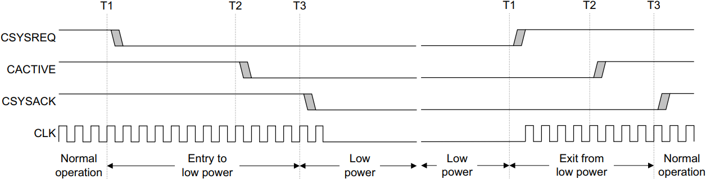

时钟控制器拉低CSYSREQ信号请求进入低功耗状态，但是外设通过保持CACTIVE信号为高来拒绝请求：

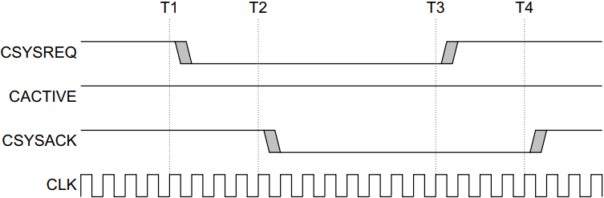

<strong>（2）外设发起退出低功耗状态</strong>

-   进入时：外设拉低CACTIVE，然后时钟控制器拉低CSYSREQ，最后外设拉低CSYSACK。
-   退出时：外设拉高CACTIVE，然后时钟控制器拉高CSYSREQ，最后外设拉高CSYSACK。

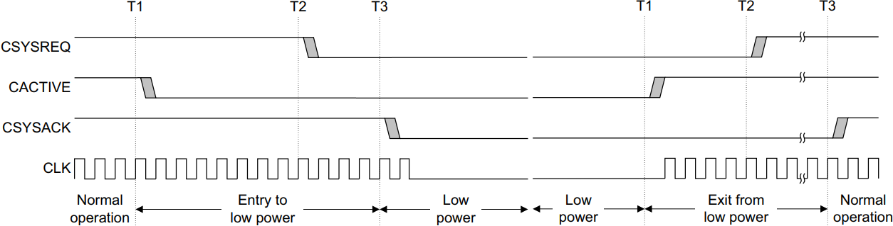

外设拉低CACTIVE信号请求进入低功耗状态，但是时钟控制器通过保持CSYSREQ信号为高来拒绝请求：

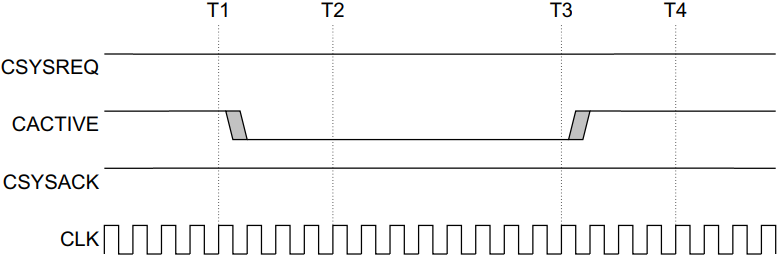

### 7.3 低功耗域的组合外设

系统时钟控制器可以将多个不同的外设组合到同一个低功耗时钟域中。然后如果遵循以下规则，它可以像处理单个外设一样处理时钟域：

-   时钟域CACTIVE信号是时钟域内所有外设CACTIVE信号的逻辑或，这意味着只有当所有外设都指示可以禁用时钟时，系统时钟控制器才能禁用时钟。
-   系统时钟控制器必须使用单个CSYSREQ信号，该信号被路由到时钟域中的所有外设。
-   产生时钟域CSYSACK信号的过程如下：
    -   CSYSACK的下降沿发生在域中最后一个外设的CSYSACK信号的下降沿上。
    -   CSYSACK的上升沿发生在域中最后一个外设的CSYSACK信号的上升沿上。

（如果路径上有多个不同时钟域，时钟的唤醒跟随数据顺序，得一层层向下传递，那么会造成时钟开启的时间大于数据到来的时间，从而造成数据的delay，这时可以用上游的时钟唤醒信号，直接唤醒下游时钟。）

### 7.4 AXI5的低功耗信号

AXI5中取消了上面说的C-channel信号，但是存在AWAKEUP唤醒信号，感觉比较像是可以用作低功耗设计的信号。AWAKEUP信号用于指示有与接口相关的活动，由Master发出，在事务开始时拉高，表示有一个事务要处理。其属性用于指示组件是否支持唤醒信号：

-   True：支持唤醒信号。
-   False：不支持唤醒信号。

如果未声明Wakeup\_Signals，则认为它为False。信号可以路由到时钟控制器或类似的使电源和时钟连接的组件。唤醒信号必须是无故障的，并且直接从寄存器生成。它们与与之相关的接口是同步的，但适用于跨时钟域到控制器。必须拉高唤醒信号以保证可以接受事务，但是一旦事务正在进行中，则唤醒信号的断言或撤销是实现定义的。协议建议（但不要求）在不需要进一步事务时解除唤醒信号。

## 8 AXI4新增信号

前面信号中，AXI3和AXI4的不同之处已经列出，AXI4新增了一些扩展信号，并且延续到了AXI5。

### 8.1 AxQOS

QoS接口信号扩展了AXI4信号集，以支持两个4位QoS标识符：

-   AWQOS：一个4位的QoS标识符，在每个写事务的写地址通道上发送。
-   ARQOS：一个4位的QoS标识符，在每个读事务的读地址通道上发送。

协议没有指定QoS标识符的确切用法，建议使用AxQOS作为关联的写或读事务的优先级指示器。值越高表示事务的优先级越高。缺省值为0b0000，表示该接口不参与任何QoS方案。

<strong>注意：</strong>也可以使用QoS标识符的其他解释。

<strong>Master侧考虑</strong>

Master可以产生自己的AxQOS值，如果它可以产生多个流量流，它可以为不同的流选择不同的QoS值。对QoS的支持需要对正在使用的QoS方案的系统级理解，以及所有参与组件之间的协作。出于这个原因，建议Master组件包含一些可编程性，可用于控制用于任何给定场景的确切QoS值。如果Master组件不支持可编程的QoS方案，它可以使用表示它生成的事务的相对优先级的QoS值。然后如果合适，可以将这些值映射到可选的系统级Qos值。不能生成自己的AxQOS值的Master必须使用默认值。

<strong>注意：</strong>本规范期望互连组件支持寄存器可编程，用于向连接的Master分配QoS值，替换由Master提供的已编程或默认的QoS值。

<strong>系统侧考虑</strong>

在AXI4中定义的QoS信号可以与任何兼容的系统级QoS方法一起使用。QoS的默认系统级实现是，任何可选择处理多个事务的组件，都会选择具有较高QoS值的事务首先处理。只有当没有其他AXI约束要求按特定顺序处理事务时，才会进行这种选择。

<strong>注意：</strong>这意味着出于QoS目的，AXI排序规则优先于排序规则。

可以实现与此默认方案兼容的更复杂的QoS方案。

### 8.2 AxREGION

可选的，可以扩展AXI接口信号集以支持两个4位区域标识符：

-   ARREGION：区域标识符，在每个读事务的读地址通道上发送。
-   AWREGION：区域标识符，在每次写事务的写地址通道上发送。

4位区域标识符可用于唯一标识多达16个不同的区域。区域标识符可以提供高阶地址位的解码。区域标识符必须在任何4Kbyte地址空间内保持不变。区域标识符的使用，意味着Slave上的单个物理接口可以提供多个逻辑接口，每个逻辑接口在系统地址映射中具有不同的位置，意味着Slave不必支持不同逻辑接口之间的地址解码。

协议期望互连在为具有多个逻辑接口的单个Slave执行地址解码功能时产生AxREGION信号。如果Slave在系统地址映射中只有一个物理接口，则互连必须使用默认的AxREGION值。

区域标识符有许多使用模型，包括但不限于以下：

-   外设可以在地址映射中的不同位置拥有其Master数据路径和控制寄存器，并且可以通过单个接口访问，而不需要Slave执行地址解码。
-   一个slave可以在不同的内存区域表现出不同的行为。例如Slave可能在一个区域提供读写访问，但在另一个区域提供只读访问。

Slave必须确保正确的协议信号和正确的事务排序得到维护。Slave必须确保它以正确的顺序向具有相同AXI ID的不同区域的两个事务提供响应。Slave还必须确保为AxREGION的任何值发送正确的协议信号。如果Slave实现的区域少于16个，那么Slave必须确保在任何试图访问不支持的区域时都有正确的协议信号。如何实现是由实现定义的，例如Slave可以通过以下方式确保：

-   为访问不受支持区域的任何事务提供错误响应。
-   跨所有不支持的区域对支持的区域进行混叠，以确保为所有访问提供符合协议的响应。

AxREGION信号仅提供现有地址空间的地址解码，可由slave使用，以消除对地址解码功能的需要。信号不创建新的独立地址空间。AxREGION必须只出现在地址解码功能下游的接口上。

### 8.3 User信号

可选地，可以在每个AXI4通道上包含一组用户定义的信号，称为User信号。通常不建议使用User信号，因为AXI协议没有定义这些信号的功能，如果两个组件以不兼容的方式使用相同的User信号，这可能会导致互操作性问题。

根据我的经验，AXI4的5个通道都各有一个可选的User信号。

-   AWUSER。
-   ARUSER
-   WUSER
-   RUSER
-   BUSER

在实现User信号时，并不要求在所有通道上都支持用户信号。也就是说，设计决策每个通道是否包括User信号是独立的。建议在互连中包含User信号，但是不要求在Master或Slave包含它们。建议互连组件包括对User信号的支持，以便它们可以在Master和Slave之间传递。User信号的宽度是可定义的，对于每个通道可以是不同的。

User信号其实就是用户自定义的信号，但又想随着总线往下传。AXI4本身不是必须包含User信号，内部没有设计User传递的时序，如果用户贸然用，那需要重新设计这部分时序了。因此手册建议互联上用，事实上很多Bus IP都支持添加一些User信号，使得Master的一些额外信息可以顺利随着AMBA时序传递给Slave。这些额外信息是项目上自定义的，可以是Master编号、QoS值、特殊标识符等。

## 9 AXI5新增特性

2020年，ARM推出了AMBA AXI5协议，将Master改名为Manager，Slave改名为Subordinate。AXI5继承了AXI4协议，同时又增加了许多新的特性。实际工作中未用到AXI5，故仅贴出AXI5的新特性。

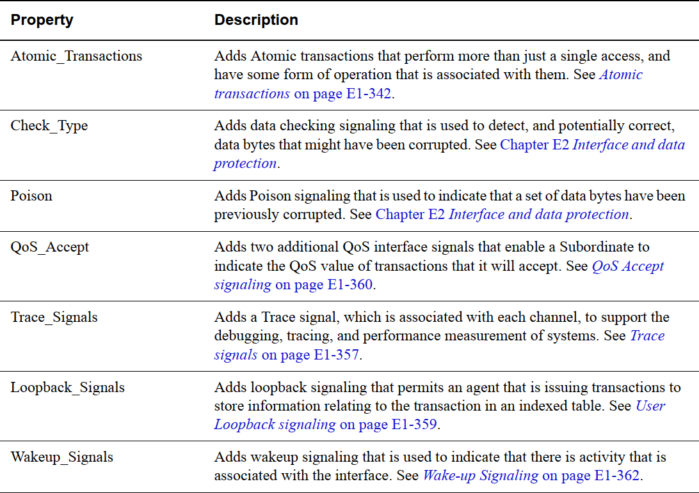

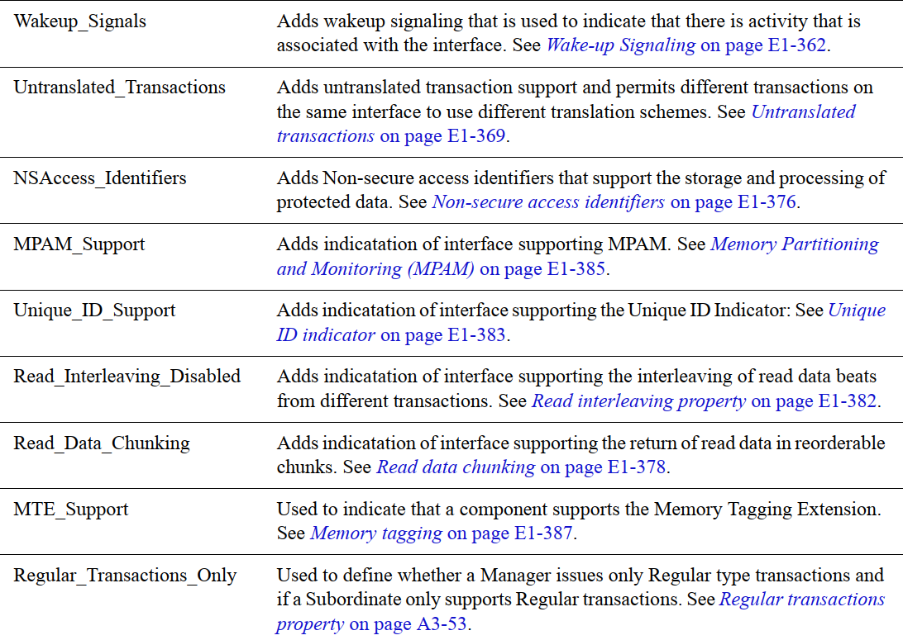

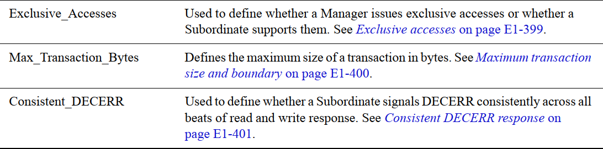

## 10 AXI-Lite

AXI-Lite是AXI协议的简化版，主要用于寄存器的配置。

### 10.1 AXI4-Lite

AXI4-Lite操作的关键功能是：

-   突发长度固定为1。（不支持突发）
-   AXI4-Lite的数据位宽固定为32位或64位。
-   不支持Non-modifiable和Non-bufferable。
-   不支持Exclusive传输。

简化了这么多，AXI4-Lite的信号列表就只剩下这些了：

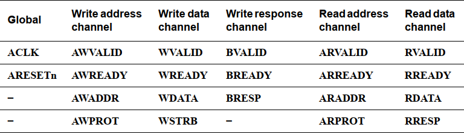

### 10.2 AXI5-Lite

AXI5-Lite协议稍稍做了升级，AXI5-Lite的数据位宽不固定，且支持响应的重排序。它们的对比如下所示：

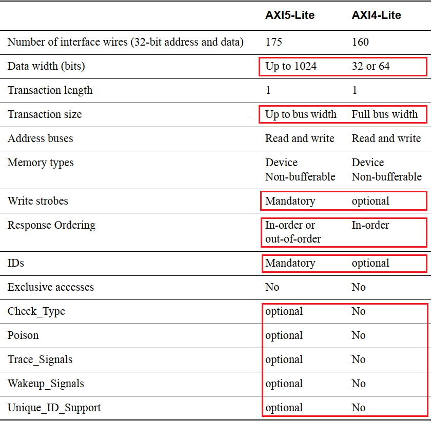

## 11 AXI-Stream

AXI-Stream也是AXI协议的简化版，主要用于高速的大数据量传输，例如Xilinx的ZYNQ异构系统中、视频数据处理等。

### 11.1 AXI4-Stream

AXI-Stream协议被用作连接希望交换数据的组件的标准接口，是一种点对点协议。

AXI-Stream可用于连接生成数据的单个Master和单个Slave，也可以使用互联来连接大量的Master和Slave组件。

AXI-Stream接口砍去了地址概念，自然也没有突发传输，所有数据都是点对点传输。

以前仔细阅读过，但因为实际工作没有用过，全都给忘了，以后用到再重看数据手册吧。

### 11.2 AXI5-Stream

AXI5-Stream继承了AXI4-Stream协议，同时扩展了两个新特性：

-   Wake-up信号。
-   使用奇偶校验的接口保护。

参考资料：

\[1\] ARM官方数据手册：[https://www.arm.com/architecture/system-architectures/amba/amba-specifications](https://www.arm.com/architecture/system-architectures/amba/amba-specifications)

\[2\] LogicJitterGibbs：[https://www.zhihu.com/column/c\_1251094110297509888](https://www.zhihu.com/column/c_1251094110297509888)

---

> 原文：[AMBA总线（3）—— AXI协议](https://www.cnblogs.com/xianyuIC/p/17372573.html)（博客园 · 咸鱼IC）
