ATB协议主要用于在SOC的Debug系统中，将数据流导出给CoreSight使用。

## 1 前言

ATB协议是AMBA协议家族的一部分。

-   ATBv1.0是作为AMBA3的一部分。
-   ATBv1.1是作为AMBA 4的一部分。
-   ATB-C是作为AMBA 5的一部分。

ATB协议定义了跟踪信息（Trace）如何在跟踪系统的组件之间传输。ATB是跟踪组件用来通过CoreSight系统传递与格式无关的跟踪数据的通用总线。ATB接口支持多种功能，包括：

-   使用valid和ready的响应，使得数据停止。
-   指示一个周期中有效字节数的控制信号
-   通过向每个数据包发送关联ID来标示原始组件。
-   支持任何跟踪协议信息、数据信息或数据格式要求
-   刷新。

ATB是一种公共总线，跟踪组件使用它在跟踪系统中以数据不可知的格式传递跟踪数据。ATB协议定义了总线行为，接口信号根据其功能命名。ATB与关联组件的一般关系如图所示。

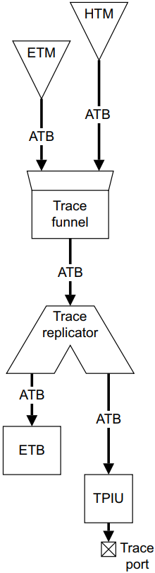

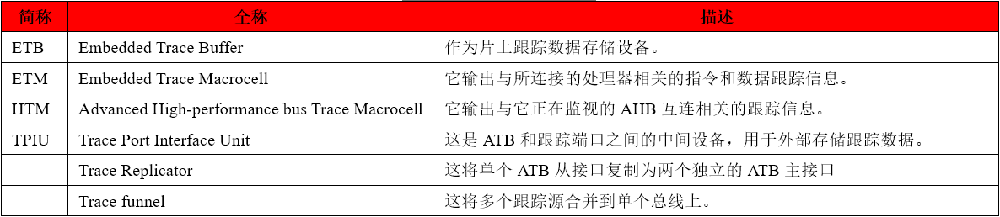

跟踪系统包括：

-   至少一个数据跟踪源，例如ETM或HTM。
-   至少一个数据跟踪接收器，例如ETB和TPIU。

在跟踪源和接收器之间可以有跟踪Link，帮助管理通过ATB接口（如Trace Funnel和Trace Replicator）的数据传递。跟踪源生成的ATB数据流量可以通过ATB路径上的跟踪Link进行管理。跟踪Link可以将信息重新传输到跟踪接收器。跟踪接收器Sink充当跟踪源生成的跟踪数据的接收器。

通常，跟踪接收器可以请求刷新跟踪结构，以确保在特定时间之前已接收到所有跟踪数据。这些刷新请求在ATB系统中从跟踪接收器向上传播到跟踪源。在接收到刷新请求时，跟踪源标记在刷新请求之前发生的所有数据，并在输出所有这些数据时指示完成。ATB系统中的任何跟踪环节必须：

-   将刷新请求向上传递到其连接的跟踪源。
-   确保只有在所有连接的跟踪源已确认完成后，它才确认刷新完成。

## 2 信号描述

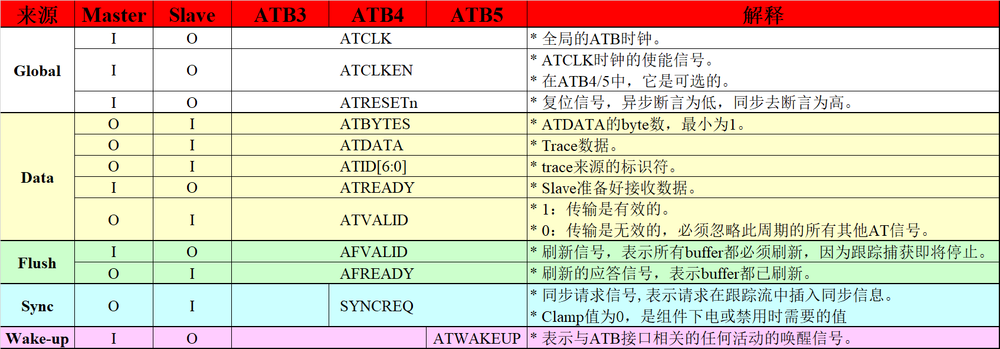

## 3 数据流控制

### 3.1 关于流控

这种机制是一种双向流控制，使Master和Slave能够控制数据和控制信息移动的速率。

-   主机拉高ATVALID信号表示何时数据或控制信息可用，必须保持住，直到ATREADY信号为高。
-   从机拉高ATREADY信号表示可以接受数据或控制信息。

数据传输只发生在ATVALID和ATREADY都为1时，且能在一个周期中为每个数据项分配特定的ID来识别流。

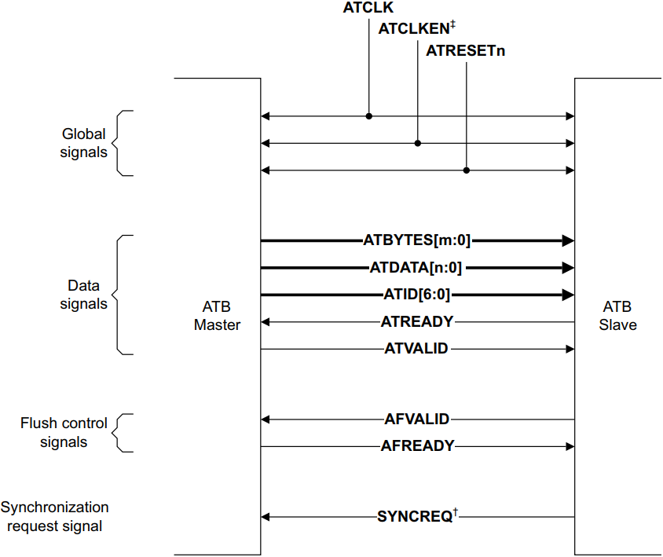

### 3.2 流控波形

相关波形如下所示：

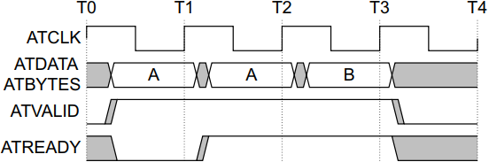

波形解析如下所示：

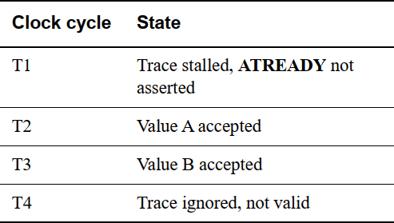

如果从机不能保证它在断言ATVALID的同一周期内能够响应ATREADY，那么建议从机实现足够的内部缓冲，必须足以存储一个或多个跟踪周期。当缓冲区中有空间可用时，即使ATVALID没有拉高，从机也可以拉高ATREADY。

### 3.3 主机和从机无法响应

<strong>（1）从机无法响应</strong>

如果ATB从机无法响应，那么它必须驱动ATREADY为1和AFVALID为0。例如：

-   从机未上电。
-   没有从机。
-   这个系统的程序是错误的。

<strong>注意：</strong>如果两个输出中的其中一个被禁用，这可确保复制器replicator不会因此阻塞。

<strong>（2）主机无法响应</strong>

如果ATB主机不能响应，那么它必须驱动AFREADY为1和ATVALID为0。例如：

-   主机下电。
-   没有主机。
-   这个系统的程序是错误的。

## 4 ATB信号说明

### 4.1 ATDATA和ATBYTES

ATBYTES\[m:0\]和ATDATA\[n:0\]，它们的关系如下所示：

  *<strong>m=log2(n+1)-4</strong>*  

下表更直接地表明了它们之间的关系：

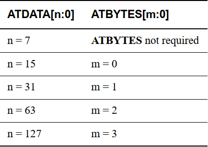

### 4.2 ATIDs

跟踪数据项使用单独的ID生成，大多数源使用单个的静态ID，这些单独的ID可以提供：

-   区分不同源的跟踪。
-   识别跟踪的高带宽和低带宽组件，因此跟踪源下游的组件可以执行选择性滤波。
-   通过在对齐同步点（如跟踪数据包的开头）更改ID来对齐同步信息。

ATB跟踪数据项可以使用：

-   0x01~0x6F范围内的任何ATID值。
-   在ATBv1.1（AMBA4）中，ATID值0x7D仅用于生成跟踪触发器。

<strong>注意：</strong>ATID值0x00、0x70-0x7C、0x7E、0x7F是保留给CoreSight架构使用的，不能用作ATB ID。

有两个选项可以确保不同的跟踪流使用唯一的ID值：

-   <strong>固定式ID</strong>
    -   所有ATB接口源的ID都是在系统设计时选择的，系统不导出ATB接口。
-   <strong>配置式ID</strong>
    -   每个ATB接口源的ID是由调试器可配置的，允许组件在更大的系统中重用。
    -   可重用的CoreSight组件必须实现配置式ID。

具体实现时，必须确保同时捕获ATID值和ATDATA值。

<strong>跟踪字节的顺序</strong>

ATB实现必须保持跟踪字节的顺序，即使在使用不同ATID的跟踪之间也是如此。虽然CoreSight跟踪funnel允许以任何顺序对来自不同源的跟踪进行排序，但当funnel放到单个总线上时，顺序不能更改。

<strong>注意：</strong>这与AXI接口中按ID信号排序的要求不同，在AXI接口中，顺序只在具有相同ID的事务之间保留。

### <strong>4.3 Flush</strong>

跟踪数据项的缓冲特性意味着：随着周期的进展，通常有必要从缓冲区中删除剩余数据，为新数据做准备。从缓冲区中删除数据的过程称为flushing（刷新）。在典型的跟踪源中，在“要跟踪的事件发生”和“该事件的跟踪生成”之间有固定的时间和pipeline阶段数量，例如由处理器执行的指令。

跟踪生成示例如下所示：

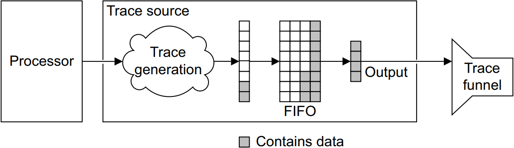

生成跟踪数据项时将其写入FIFO，数据从FIFO输出，每次由一个完整的数据字组成。ATDATA总线的宽度定义了数据字的大小。理论上，跟踪生成和输出之间的时间段是无限的，因为FIFO可能永远不会接收到足够的跟踪数据来填充整个输出数据字。生成和输出之间可能延长delay的一个例子是，跟踪源保留输出，直到它有一个完整的跟踪数据字可用于输出。在一个只有当整个数据字可用时才输出数据的系统中，有各种情况可能需要刷新缓冲区：

-   <strong>系统或系统的一部分即将下电或时钟即将停止。</strong>

在关闭电源或停止时钟之前，必须输出跟踪源中的buffer或FIFO内剩余的任何跟踪。因此AFVALID信号表示刷新。通常在发出刷新信号后不会再生成跟踪，因为处理器和内存活动已经停止。如果在刷新之后生成跟踪，则可以忽略它，例如来自处理器空闲循环的跟踪数据。

-   <strong>跟踪捕获设备即将停止捕获，通常是因为触发点。</strong>

跟踪捕获设备可以是off-chip跟踪端口分析器（*Trace Port Analyzer*，TPA）或on-chip嵌入式跟踪缓冲（*Embedded Trace Buffer*，ETB）。这种情况下的可能性包括：

  —— on-chip逻辑发出信号，表示捕获即将停止。（这个点发起刷新。）

  —— on-chip逻辑收到关于触发器的信号，但没有关于要捕获多少新增跟踪的任何信息。（可以在触发点发起刷新，这确保所有的跟踪在捕获触发之前生成，但对触发之后生成的跟踪没有影响。）

  —— 定期发起刷新。（必须选择刷新周期，以便在“触发出现”和“跟踪捕获停止”之间始终发生刷新。当刷新发生时，由AFVALID拉高来表示，协议期望funnel将最高优先级授予尚未拉高AFREADY的跟踪源。

<strong>注意：</strong>

-   在启动刷新序列后，接收器接口不能取消刷新序列，这意味着它不能被跟踪接收器取消。
-   实现时，必须确保ATB信号在ATCLK的上升沿上采样，AFVALID信号保持拉高状态，直到AFREADY拉低。

下图是ATB刷新的例子：

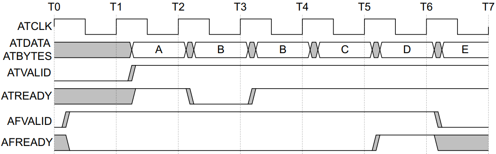

生成的所有跟踪在AFVALID拉高时开始输出，拉高AFREADY。拉高AFREADY并不表明FIFO是空的。在拉高AFVALID之后生成的跟踪存储在FIFO中，然后在拉高AFREADY之后输出此跟踪。当拉高AFVALID时，发送器必须立即开始输出缓冲的跟踪。

当发送方拉高AFREADY时如果不需要额外的刷新，则接收方必须在下一个周期中拉低AFVALID。

当拉高AFVALID时，变送器必须在“第一次拉高AFVALID的周期上缓冲的输出数据后”的一个周期拉高AFREADY，也就是说它必须在输出“AFVALID拉高要求它刷新的最后一个数据”后的一个周期拉高AFREADY。

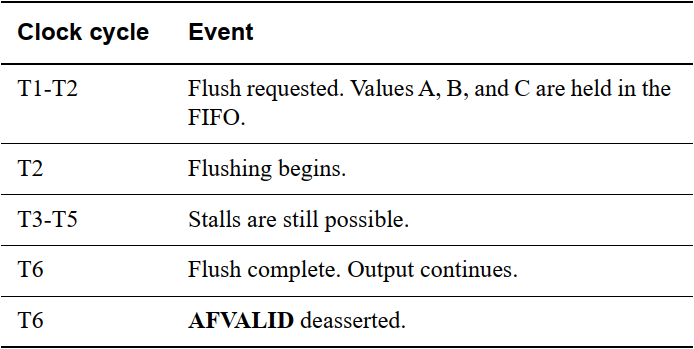

<strong>不在本地存储跟踪源的行为</strong>

如果发射器接口是一个不存储任何本地跟踪的跟踪源，下表显示了它如何控制AFREADY。

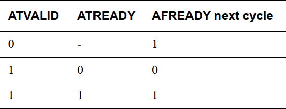

下图显示了没有在本地存储任何跟踪的发送器的AFREADY控制：

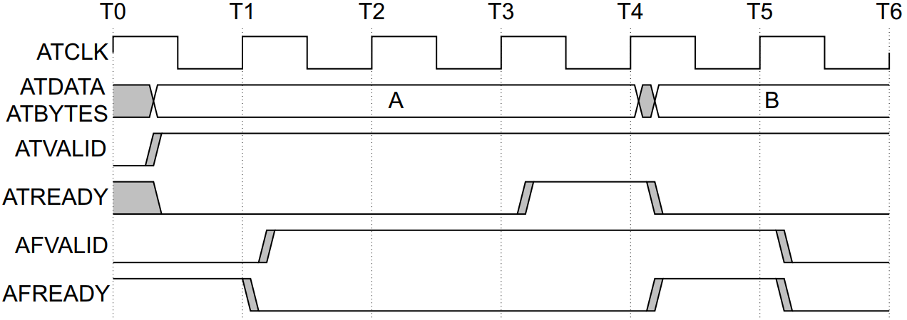

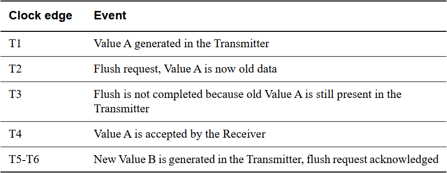

### 4.4 Trigger（ATB4/5）

跟踪触发信号是从跟踪源到跟踪接收器的自己定义的消息。通常可能用于指示发生了重要的情况，并且跟踪捕获应该准备停止。在ATBv1.1（ATB4）中，发送器可以向跟踪触发器发出如下信号：

-   “ATID”必须为“0x7D”。
-   ATBYTES表示在此周期中输出的跟踪触发器的数量，建议在可能的情况下，一次只生成一个跟踪触发器，在这种情况下：

  —— 只有1字节的数据。

  —— ATBYTES为0。

-   ATDATA表示每个信号跟踪触发器的源，如下所示：

  —— 每个字节的数据表示一个单独的跟踪触发器。

  —— 数据字节为0表示来自未知来源的触发器，建议跟踪源不要使用此值。

  —— 非零的数据字节表示生成跟踪触发器的跟踪源的ID。

例如：

-   使用ATID 0x10作为ATB的跟踪源可以通过生成一个字节的跟踪数据来指示其ATB接口上的触发器：

  —— ATID信号0x7D，表示跟踪触发器。

  —— ATBYTES信号0x0，表示单个数据字节。  
  —— ATDATA信号0x10，表示跟踪源ID。

-   使用AXID 0x10和0x12的跟踪流可以通过生成两个字节的跟踪数据来指示两个跟踪源上的同时跟踪触发器：

  —— ATID信号0x7D，表示跟踪触发器。

  —— ATBYTES信号0x1，表示两个数据字节。

  —— ATDATA信号0x1210，表示0x10和0x12的跟踪源ID。

### 4.5 Sync（ATB4/5）

ATBv1.1（ATB4）中可以选择性包括SYNCREQ同步请求信号。Slave通过拉高SYNCREQ 一个时钟周期来向 Master发出同步请求的信号。Master可以选择性实现SYNCREQ的输入，当该输入被断言为一个时钟周期时，可以识别来自Slave的同步请求。SYNCREQ信号与ATB接口上的任何其他信号没有任何关系，然而在ATBv1.1（ATB4）的具体实现时，协议期望：

-   SYNCREQ将与其他ATB信号一起通过系统路由。
-   任何跟踪Link（如跟踪funnel）都可以用于将Master接口的输入同步请求传递到上游跟踪源。

已启用的跟踪源必须尝试为接收到的每个同步请求在跟踪流中提供一次同步信息。跟踪源可以是：

-   同步信息的延迟输出，以避免任何内部buffer的溢出。
-   忽略在“跟踪源输出与前一个同步请求对应的同步信息之前”接收到的同步请求。

<strong>注意：</strong>ATB发射器必须意识到，SYNCREQ上的脉冲可能在任何时候被接收，并且必须确保它在需要时对SYNCREQ做出响应。

### 4.6 Wake-up（ATB5）

唤醒信号用于指示与ATB接口相关的活动，可以提供一个glitch-free的信号，可以路由到时钟控制器或类似的组件，可以用于唤醒连接组件的电源和时钟。Wakeup\_Signal属性用于指示组件是否支持唤醒信号：

-   True：存在唤醒信号。
-   False：没有唤醒信号。

如果未声明Wakeup\_Signal，则认为它为False，唤醒信号只能添加到ATB5的接口。

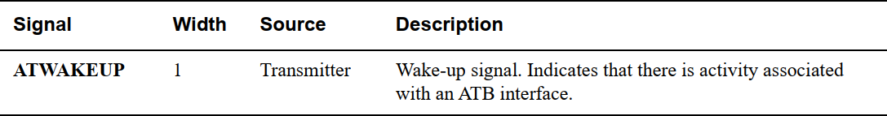

ATWAKEUP信号的规则是：

-   ATWAKEUP与ATCLK是同步的，但更适合于跨时钟域到控制器。
-   ATWAKEUP必须是glitch-free的，并且直接从寄存器生成。
-   允许在拉高ATVALID之前或之后的任何点拉高ATWAKEUP。
-   允许Slave在拉高ATREADY之前等待ATWAKEUP被拉高（这意味着如果ATWAKEUP存在却从未拉高，ATB接口可能会死锁。）
-   如果ATWAKEUP和ATVALID在同一周期内为高，则ATWAKEUP必须保持高电平，直到ATREADY被拉高。

建议：

-   在拉高ATVALID之前至少一个周期拉高ATWAKEUP，以防止延迟接受新事务。
-   当不需要进一步传输时拉低ATWAKEUP。（允许但不推荐在没有事务发生的情况下拉高ATWAKEUP然后拉低）

\[1\] ARM官方数据手册：[https://www.arm.com/architecture/system-architectures/amba/amba-specifications](https://www.arm.com/architecture/system-architectures/amba/amba-specifications)

---

> 原文：[AMBA总线（4）—— ATB协议](https://www.cnblogs.com/xianyuIC/p/17419076.html)（博客园 · 咸鱼IC）
