前面博客《[AMBA总线（3）—— AXI协议](https://www.cnblogs.com/xianyuIC/p/17372573.html)》大致过了一遍 AXI3 和 AXI4 协议，对于 AXI5 部分没有研究。本篇博客翻译一下 AXI5 中的新 feature，参考文档是《AMBA5 AXI and ACE Protocol Specification》。

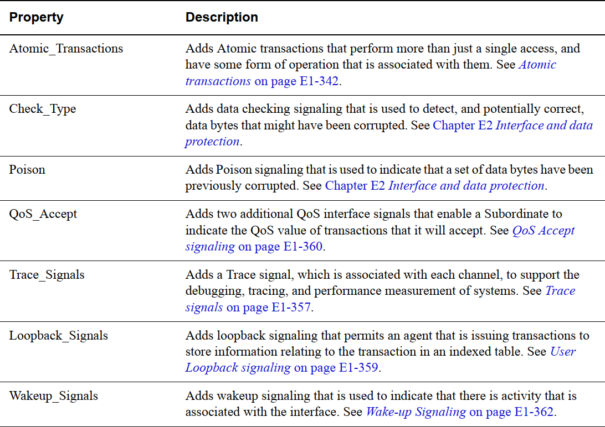

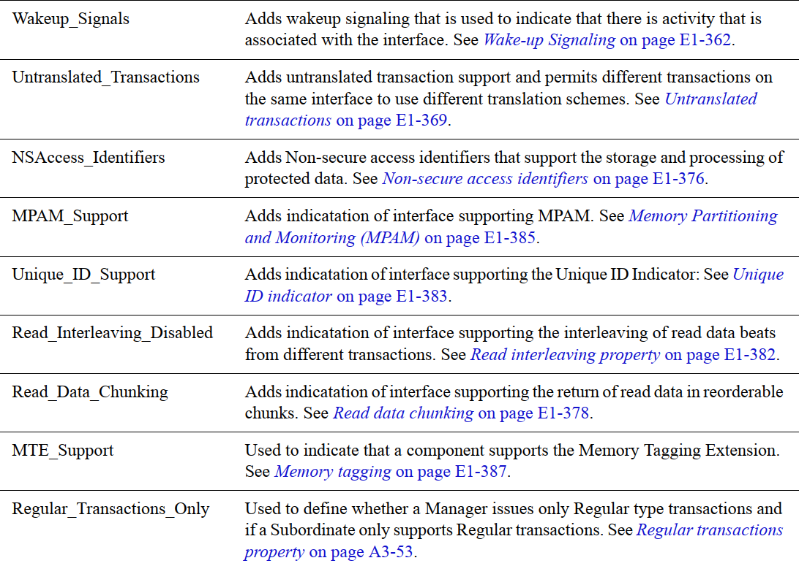

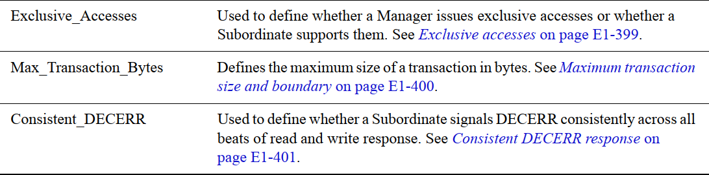

## 1 Atomic\_Transactions

AMBA5引入了Atomic事务，它不仅仅执行一次访问，而且具有与事务相关联的操作。原子事务允许将操作发送到数据，从而允许在数据所在的位置附近执行操作。原子事务适用于数据位于离必须执行操作的代理很远的位置的情况。与使用独占访问（Exclusive Accesses）相比，这种方法减少了系统中其他代理无法访问数据的时间。

Atomic\_Transactions属性用于指示组件是否支持Atomic事务：

-   <strong>True：</strong>支持原子事务。
-   <strong>False：</strong>不支持原子事务。如果未声明，则考虑Atomic\_Transactions属性为False。

Atomic\_Transactions 扩展在以下接口中得到支持：

-   AXI5
-   ACE5-Lite
-   ACE5-LiteDVM

如果从机或互连组件声明它支持原子事务，那么它必须支持所有操作的类型、sizes和大小端序。

### 1.1 总览

在原子事务中，主机发送地址、控制信息和出站数据。从机发送入站数据（AtomicStore除外）和响应。本规范支持四种形式的原子事务：

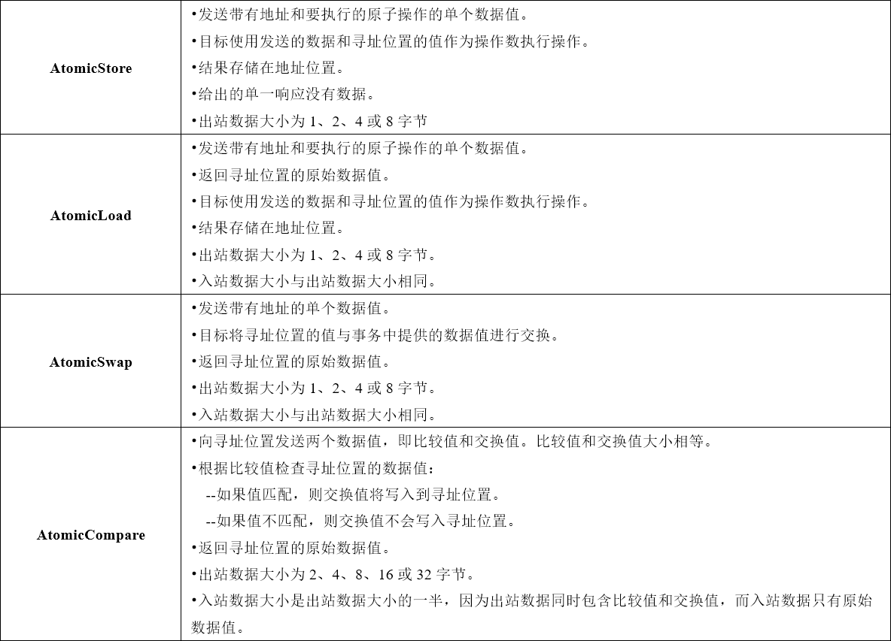

### 1.2 原子事务操作

此规范支持八种不同的操作，这些操作可以与AtomicStore和AtomicLoad事务一起使用。

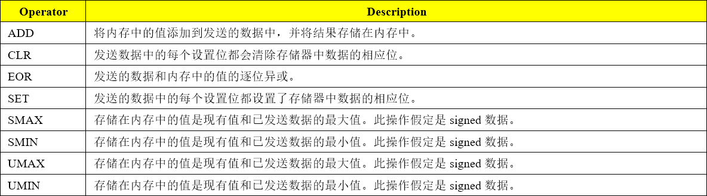

### 1.3 原子操作属性

原子事务规则：

-   AWLEN和AWSIZE指定事务中写入数据的字节数。对于AtomicCompare，字节数必须包括比较值和交换值。
-   如果AWLEN表示突发长度大于1，则要求AWSIZE为完整的数据总线宽度。
-   根据AWADDR和AWSIZE的规定，必须取消断言不在数据窗口内的写入选通。
-   必须断言数据窗口内的写入选通。

对于AtomicStore、AtomicLoad和AtomicSwap：

-   写入数据分别为1、2、4或8字节，读取数据分别为2、4、1或8字节。
-   AWADDR必须与数据大小保持一致。
-   AWBURST必须为INCR。

对于AtomicCompare：

-   写入数据为2、4、8、16或32字节，读取数据为1、2、4，8或16字节。
-   AWADDR必须与单个写入数据值对齐，即总写入数据大小的一半。
-   如果AWADDR指向事务的下半部分：
    -   首先发送比较值。比较值在单拍事务的较低字节中，或在多拍事务的第一拍中。
    -   AWBURST必须是INCR。

-   如果AWADDR指向事务的上半部分：
    -   首先发送交换值。交换值在单拍事务的较低字节中，或在多拍事务的第一拍中。
    -   AWBURST必须是WRAP。

对于AtomicCompare事务，WRAP类型的事务的常规规则有所放宽：

-   允许长度为1的突发，AWLEN=0
-   AWADDR不需要与传输大小对齐。示例E1-1显示了64位数据总线的一些允许的属性组合以及比较和交换数据值的位置。

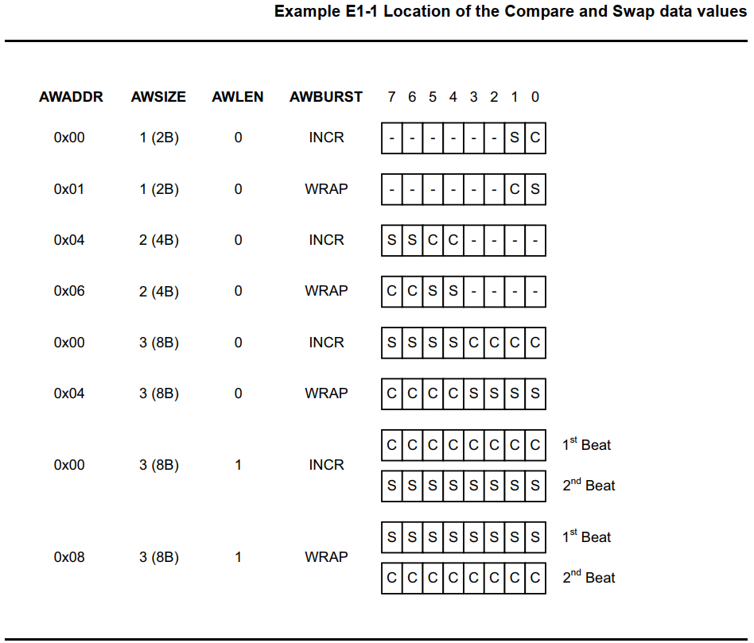

### 1.4 原子事务的ID使用

单个AXI ID用于原子事务。相同的AXI ID用于请求、写入响应和读取数据。这一要求意味着主机必须仅使用可以在AWID和RID信号上发出信号的ID值。

原子事务不得使用同时未完成的非原子事务所使用的AXI ID值。此规则适用于AR或AW通道上的事务。此规则确保原子事务和非原子事务之间没有排序约束。

如果一个事务在另一个事务发出之前已经完全完成，则原子事务和非原子事务可以使用相同的AXI ID值。

同时未完成的多个原子事务不能使用相同的AXI ID值。

### 1.5 原子事务的请求属性

对于Atomic事务，以下限制适用于请求属性：

-   AWCACHE和AWDOMAIN可以是对接口类型有效的任何组合。参见D3-177页的表D3-3。
-   AWSNOOP必须设置为全零。
-   AWLOCK必须为0b0，正常访问。

### 1.6 原子事务信号

接口中添加了一个额外的信号来支持Atomic事务。

信号是AW原子操作，AWATOP。下表显示了AWATOP编码。

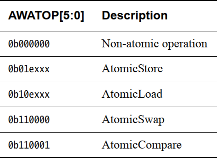

对于AtomicStore和AtomicLoad事务，AWATOP\[3\]表示原子操作所需的字节序：

-   当非断言时，此位表示操作为小端序。
-   当断言时，此位表示操作为大端序。

AWATOP\[3\]的值仅适用于算术运算，而对于逐位逻辑运算则被忽略。

对于AtomicStore和AtomicLoad事务，下表显示了低阶AWATOP\[2:0\]信号上的操作编码。

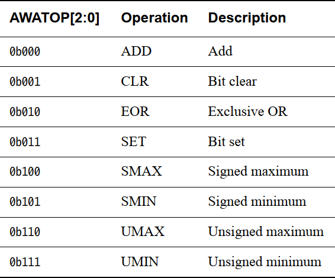

### 1.7 事务结构

对于AtomicLoad、AtomicSwap和AtomicCompare事务，事务结构如下：

-   请求在AW通道上发出。
-   相关事务数据在W通道上发送。
-   W通道上所需的写入数据传输次数由AWLEN信号决定。
-   未指定原子事务请求和原子事务写入数据的相对时间。
-   从机使用R通道返回原始数据值。
-   读取数据传输的数量由AWLEN和AWATOP信号决定。

<strong>——注意——</strong>

对于AtomicCompare操作，如果AWLEN指示突发长度大于1，则读取数据传输的数量是AWLEN指定的数量的一半。

<strong>——————</strong>

-   允许从机在发送读取数据之前等待所有写入数据。主机必须能够在不接收任何读取数据的情况下发送所有写入数据。
-   允许从机在接受任何写入数据之前发送所有读取数据。主机必须能够接受所有读取数据，而不接受任何写入数据。
-   在B通道上返回单个写入响应。只有在收到所有写入数据传输并且原子事务的结果是可观察的之后，从机才能给出写入响应。

下图显示了AtomicLoad、AtomicSwap和AtomicCompare事务的信息和数据流。

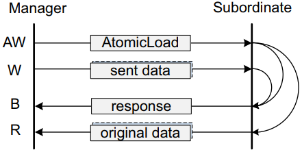

对于AtomicStore事务，事务结构如下：

-   请求在AW通道上发出。
-   相关事务数据在W通道上发送。
-   W通道上所需的写入数据传输次数由AWLEN信号决定。
-   未指定原子事务请求和原子事务写入数据的相对时间。
-   在B通道上返回单个写入响应。写入响应必须仅由从机在接收到所有写入数据传输并且原子事务的结果是可观察的之后给出。

下图显示了AtomicStore事务的信息和数据流。

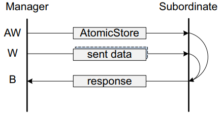

### 1.8 响应信号

原子事务需要写入响应。写入响应表示事务对所有必需的观察者都可见。

从接收第一个读取数据项开始，包括读取响应的原子事务对所有必需的观察者都是可见的。

<strong>——注意——</strong>

读响应和写响应都表示事务对所有必需的观察者都可见。允许主机使用任一响应。

<strong>——————</strong>

没有与操作相关联的错误的概念，例如溢出。为所有输入组合完全指定了一个操作。

对于事务，如AtomicCompare，如果事务有多个结果，则不会提供关于事务结果的指示。要确定“比较和交换”指令是否已更新内存位置，有必要检查作为事务一部分返回的原始数据值。

原子事务需要写入响应。写入响应表示事务对所有必需的观察者都可见。

从接收第一个读取数据项开始，包括读取响应的原子事务对所有必需的观察者都是可见的。

当事务到达不支持Atomic事务的组件时，允许向该事务提供错误响应。对于AtomicLoad、AtomicSwap和AtomicCompare事务：

-   即使写入响应为DECERR或SLVERR，从机也必须发送正确数量的读取数据节拍。
-   主机可能会忽略写入响应，而只使用读取数据附带的响应。

### 1.9 原子事务依赖项

对于AtomicLoad、AtomicSwap和AtomicCompare事务，下图显示了以下Atomic事务握手信号依赖关系：

-   在断言AWVALID或WVALID之前，主机不得等待从机断言AWREADY或WREADY。
-   在断言AWREADY之前，从机可以等待AWVALID或WVALID，或两者兼有。
-   从机可以在断言AWVALID或WVALID或两者之前断言AWREADY。
-   在断言WREADY之前，从机可以等待AWVALID或WVALID，或两者兼有。
-   从机可以在断言AWVALID或WVALID或两者之前断言WREADY。
-   在断言BVALID之前，从机必须等待AWVALID、AWREADY、WVALID和WREADY被断言。从机还必须等待WLAST被断言后再断言BVALID，因为写入响应BRESP必须仅在写入事务的最后一次数据传输后发出信号。
-   从机不得在断言BVALID之前等待主机断言BREADY。
-   主机可以在断言BREADY之前等待BVALID。
-   主机可以在断言BVALID之前断言BREADY。
-   从机必须等待AWVALID和AWREADY都被断言，然后才能断言RVALID以指示有效数据可用。
-   从机不得在断言RVALID之前等待主机断言RREADY。
-   主机可以等待RVALID被断言，然后再断言RREADY。
-   主机可以在断言RVALID之前断言RREADY。
-   主机不得在断言WVALID之前等待从机断言RVALID。
-   在断言RVALID之前，从机可以等待所有写入数据传输的WVALID被断言。
-   主机可以在断言RVALID之前断言WVALID。

在下图所示的依赖关系图中：

-   单箭头指向可以在箭头开始处的信号之前或之后断言的信号。

•双头箭头指向一个信号，该信号必须在箭头开始时断言信号之后才能断言。

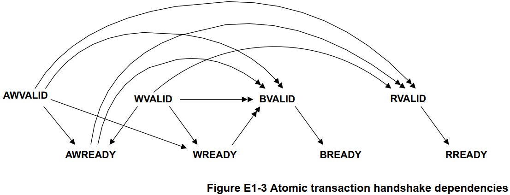

### 1.10 支持原子事务

<strong>主机支持</strong>

ACE主机不支持原子事务。ACE主机能够通过获得cacheline的唯一copy，并在其自己的cache内本地执行原子操作，来对Cacheable位置执行原子操作。ACE主机无法支持到Non-cacheable或Device位置的原子事务。

Snoop通道不需要对Atomic事务的特定支持，因此ACE主机不需要添加与其他组件执行的原子事务兼容的功能。

需要支持原子事务的主机组件来支持抑制生成原子事务的机制，以确保不支持原子事务系统中的兼容性。

指定了一个可选的BROADCASTATOMIC引脚。当引脚绑定为1时允许接口生成原子事务。当绑定为0时不得生成原子事务。

<strong>从机支持</strong>

从机组件支持原子事务是可选的。

如果从机组件仅支持特定内存类型或特定地址区域的原子事务，则该从机组件必须为其不支持的原子事务提供适当的错误响应。

<strong>互连支持</strong>

互连支持原子事务是可选的。

如果互连不支持原子事务，则必须将所有连接的主机组件配置为不生成原子事务。BROADCASTATOMIC引脚可用于此目的。

原子事务，可以在支持它们的互连内的任何点得到支持，包括将原子事务向下游传递到从机组件。

不要求每个地址位置都支持原子事务。如果给定的地址位置不支持原子事务，则可以为该事务提供适当的错误响应。

对于Device事务，原子事务必须传递给端点从机。如果从机指示它不支持原子事务，则互连必须为事务提供错误响应。不得将原子事务传递给不支持原子事务的组件。

对于Cacheable事务，互连可以：

-   在互连内执行原子操作。此方法要求互连执行适当的读、写和Snoop事务以完成操作。
-   如果适当的端点从机被配置为支持原子操作，则互连可以将原子操作传递给从机。

## 2 Check\_Type

### 2.1 AMBA中的Parity使用

对于安全关键应用，有必要检测并可能纠正SoC内单个导线上的瞬态和功能错误。

系统组件中的错误可能会在连接的组件中传播并导致多个错误。错误检测和校正（EDC）需要端到端操作，覆盖从源到目的地的所有逻辑和线路。

实现端到端保护的一种方法是在组件中使用定制的EDC方案，并在组件之间实现简单的错误检测方案。在这些组件之间没有逻辑，并且单个比特错误不会传播到多比特错误。本节描述了一种奇偶校验方案，用于检测组件之间AMBA接口上的单比特错误。如果多位错误出现在不同的奇偶校验信号组中，则可以检测到它们。下图显示了AMBA中可以使用奇偶校验的位置。

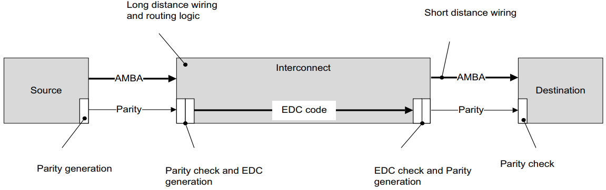

### 2.2 接口保护配置

接口上使用的保护方案由属性Check\_Type定义。定义了以下Check\_Type值：

-   <strong>False：</strong>接口上没有检查信号。如果未声明Check\_Type属性，则认为该属性为False。
-   <strong>Odd\_Parity\_Byte\_Data：</strong>奇数奇偶校验包括用于名称以Data结尾的数据信号。奇偶校验信号的每个比特正好覆盖8个比特。
-   <strong>Odd\_Parity\_Byte\_All：</strong>包括所有信号的奇数奇偶校验。奇偶校验信号的每个比特通常覆盖多达8个比特。然而，如果配置需要，奇偶校验位可以覆盖8个以上的位。

以下接口支持接口保护：

-   AXI5
-   AXI5-Lite
-   ACE5
-   ACE5-Lite
-   ACE5-LiteDVM
-   ACE5-LiteACP

### 2.3 字节奇偶校验信号

以从机性是为字节奇偶校验接口保护添加的所有校验信号的公共属性：

-   使用奇数奇偶校验。

奇偶校验意味着校验信号被添加到接口上的信号组中并被驱动，使得该组中总是有奇数个断言比特。

-   定义了覆盖数据和有效载荷的奇偶校验信号，使得在大多数情况下，每组不超过8位。

此限制假设在时序预算中最多有3个逻辑电平可用于生成每个奇偶校验位。

-   覆盖关键控制信号的奇偶校验信号可能具有较小的可用时序预算，由单个奇数奇偶校验位定义。该单个奇数奇偶比特是原始关键控制信号。
-   对于宽度大于1位的检查信号：
    -   校验比特\[n\]对应于有效载荷中的比特\[（8n+7）:8n\]。
    -   如果有效载荷不是整数字节，则校验信号的最高有效位覆盖有效载荷的最高有效部分中的少于8位。

-   在检查启用项为True的每个循环中，必须正确驱动检查信号，请参见下表。
-   奇偶校验信号必须驱动为适用于相关有效载荷中的所有比特，无论这些比特是否在传输中被积极使用。例如，当断言WVALID时，WDATACHK的所有位都必须正确驱动，即使没有使用某些字节通道也是如此。
-   如果接口上不存在检查信号覆盖的任何信号，则从接口中省略检查信号。
-   如果检查信号覆盖的某些信号不存在于接口上，则假定缺失信号为LOW。

### 2.4 错误检测

行为本规范未规定检测到奇偶校验错误时的组件或系统行为。

根据系统和受影响的信号，翻转位可能具有广泛的影响。它可能是无害的，会导致性能问题、数据损坏、安全冲突或死锁。事务响应与奇偶校验错误检测无关。

当检测到错误时，接收器可以执行以下任何操作：

-   终止或传播事务。终止可能符合协议，也可能不符合协议。
-   纠正奇偶校验信号或传播错误信号。
-   更新内存或保持原样。该位置可能被标记为Poison。
-   通过其他方式发出错误响应信号，例如中断。

### 2.5 奇偶校验信号

以下所有校验信号都与ACLK同步，并且必须在校验启用信号为高的每个周期正确驱动。

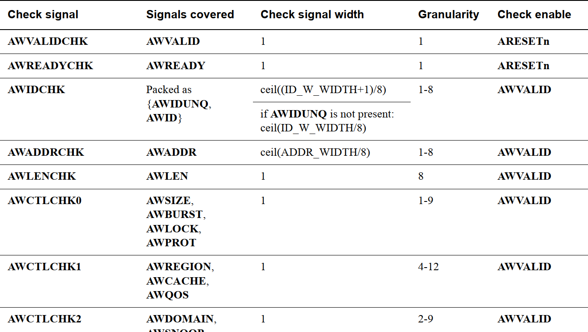

信号太多，略......

## 3 Poison

Poison信号用于指示一组数据字节先前已损坏。在数据旁边传递Poison信号允许数据的任何未来用户收到数据可能已损坏的通知。每64位数据支持1位粒度的Poison信号。

Poison属性用于指示组件是否支持Poison信号：

-   <strong>True：</strong>支持Poison信号。
-   <strong>False：</strong>不支持Poison信号。如果未声明Poison属性，则认为该属性为False。

以下接口支持毒药扩展：

-   AXI5
-   AXI5-Lite
-   ACE5
-   ACE5-Lite
-   ACE5-LiteDVM
-   ACE5-LiteACP

当断言Poison信号时，表示相关的64位数据颗粒已损坏。

下表显示了Poison信号。

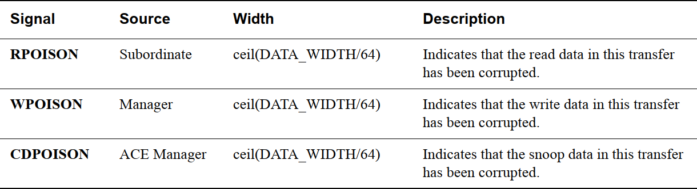

如果“Poison”属性为True，则必须为该接口上的所有数据通道提供相应的Poison信号。

Poison信号的有效性与相关数据的有效性相同。

Poison信号独立于错误响应信号：

-   允许在没有违反Poison规定的情况下发出错误信号。
-   允许发出Poison违规信号，而不发出错误响应信号。

64位颗粒被定义为与8字节边界对齐的8字节地址范围。

在事务大小（如AxSIZE所示）小于64位的情况下，则允许Poison位在每个数据节拍上不同。在这种情况下，接收部件必须检查所有数据节拍，以确定64位颗粒是否Poison。

可以为传输无效的数据通道设置Poison位。例如，128位总线上的64位传输可以同时设置两个Poison位。

## 4 QoS\_Accept

AXI4引入了两个接口信号来指示事务的QoS值。AMBA 5引入了两个额外的接口信号，使从机能够指示其接受的事务的最小QoS值。QoS\_Accept属性用于指示接口是否包括以下信号：

True：接口包括VARQOCSACCEPT和VAWQOSACCEPT信号。

False：接口不包括VARQOCSACCEPT或VAWQOSACCEPT。如果未声明QoS\_Accept，则将其视为False。

QoS\_Accept扩展适用于以下接口：

-   AXI5
-   ACE5
-   ACE5-Lite
-   ACE5-LiteDVM

QoS Accept信号适用于具有可用于不同QoS级别的不同资源的从机组件，这通常是内存控制器的情况。当可用于较低QoS级别的资源正在使用时，从机可以指示其仅接受特定QoS级别或更高级别的事务。

QoS Accept信号可以用作主机接口的输入，该主机接口可能有几个不同的事务可供选择。这允许主机接口只发布可能被接受的事务，从而避免了不必要的接口阻塞。通过防止可能停滞很长一段时间的事务的问题，该接口仍然可用于处理可能在稍后到达的优先级较高的事务。这两个信号如表所示：

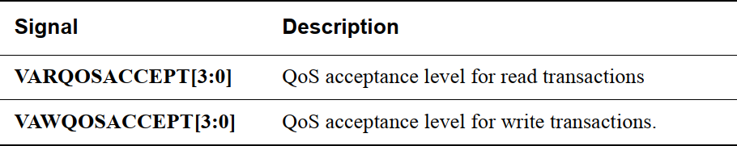

每个信号都是来自从机的输出和到主机的输入，该主机指示从机接受事务的QoS值。处于该QoS级别或更高级别的任何事务都被从机接受。低于此QoS级别的任何事务都可能会停滞很长一段时间。

<strong>——注意——</strong>

本规范未定义要求从机以所指示的QoS级别或以上级别接受事务的时间段。然而在考虑了诸如时钟域交叉比之类的实现方面之后，预计对于给定的从机，将存在用于接受事务的确定的最大时钟周期数。

<strong>——————</strong>

在本规范中，术语VAxQOSACCEPT统称为VARQOCSACCEPT和VAWQOSACCEPT信号。

允许主机接口发出低于VAxQOSACCEPT信号所指示的QoS级别的事务。然而，这样的事务可能会停滞很长一段时间。

允许从机接口接受低于由VAxQOSACCEPT信号指示的QoS级别的事务，但是预期该事务可能受到显著延迟。

虽然从机延迟优先级低于QoS接受级别的事务是可以接受的，但本规范建议此类事务不要无限期延迟。在接口上发布优先级较低的事务有几个原因，例如：

-   QoS Acceptance值的变化与组件适应该变化的能力之间的延迟。
-   要求在一项事务上取得进展，该事务是线路阻塞负责人的一项更高优先级的事务。
-   出于防止饥饿的原因，要求在事务中取得进展。

VAxQOSACCEPT信号与接口同步，但与任何其他AXI通道无关。

VAxQOSACCEPT信号的默认值为0。

## 5 Trace\_Signal

可选的Trace信号可以与每个通道相关联，以支持系统的调试、跟踪和性能测量。

Trace\_Signals属性用于指示组件是否支持Trace信号：

-   <strong>True：</strong>支持True Trace\_Signals。
-   <strong>False：</strong>不支持Trace\_Signals。如果未声明Trace\_Signals，则视为False。

Trace\_Signals扩展在以下接口中受支持：

-   AXI5
-   AXI5-Lite
-   ACE5
-   ACE5-Lite
-   ACE5-LiteDVM
-   ACE5-LiteACP

下表显示了与每个通道相关的Trace信号。

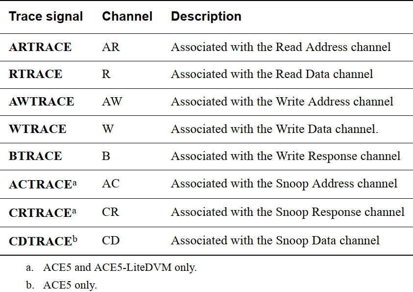

如果Trace\_Signals属性为True，则必须为所有存在的通道提供相应的Trace信号。

Trace信号的预期用途如下：

-   组件，如主机或互连，可以断言Trace信号以及应通过系统跟踪的事务的地址。
-   本规范预计，任何对请求中断言的Trace信号的事务提供响应的组件都会提供断言的跟踪信息的响应。
-   对于断言了Trace信号并生成额外相关事务的事务，如Snoop事务，本规范建议断言相关事务的Trace信号：
    -   任何使用相同地址的相关事务，如Snoop事务，都会向其传播Trace信号。
    -   对于可能具有不相关地址的其他事务，是否传播Trace信号是实现自定义的。

允许互连或从机组件使用Trace信号。

允许组件为请求中没有断言Trace信号的事务断言事务响应的Trace信号。在这种情况下，不需要为同一事务的所有响应断言Trace信号。

本规范建议采用与Trace信号传播相关的所有行为，但此建议不是必需的。因此，任何使用Trace信号的组件都不一定总是要求Trace信号正确传播。

本规范期望Trace信号的使用在整个系统中进行协调，并且在给定的时间内只发生一次Trace信号的用法。

对于写入事务，建议采取以下行为：

-   收到AWTRACE断言的写入请求的从机应在写入响应的同时断言BTRACE信号。
-   WTRACE应通过互连组件传播。
-   对于需要在读取通道上进行响应的原子事务，如果断言了AWTRACE，则应断言RTRACE信号。

对于读取事务，建议采取以下行为：

-   接收到具有断言的ARTRACE信号的读取请求的从机应在读取响应的每拍的同时断言RTRACE信号。

对于Snoop事务，建议采取以下行为：

-   接收到断言了ACTRACE信号的Snoop请求的主机应在Snoop响应的同时断言CRTRACE信号。主机还应在与Snoop事务相关联的Snoop数据的每个数据拍旁边断言CDTRACE。

## 6 Loopback\_Signals

User Loopback用户环回信号允许发出事务的主机将与事务相关的信息存储在索引表中。然后对事务的响应可以使用快速表索引来获得所需信息，而不需要使用事务AxID进行更复杂的查找。

Loopback\_Signals属性用于指示组件是否支持用户环回信号：

-   <strong>True：</strong>支持Loopback信号。
-   <strong>False：</strong>不支持环回信号。如果未声明Loopback\_Signals，则视为False。

以下接口支持Loopback\_Signals扩展：

-   AXI5
-   ACE5
-   ACE5-Lite
-   ACE5-LiteDVM

下表显示了用户环回信号。

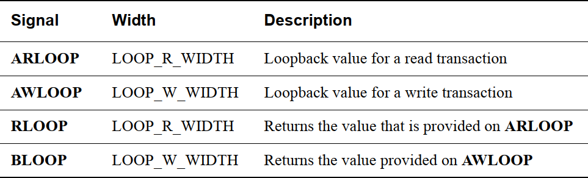

如果Loopback\_Signals属性为True，则必须存在所有环回信号。

使用规则和建议如下：

-   建议将LOOP\_R\_WIDTH和LOOP\_W\_WIDTH配置为8位宽。
-   RLOOP的值必须与ARLOOP信号上显示的值相同。
-   BLOOP的值必须与AWLOOP信号上显示的值相同。
-   如果接口包括BCOMP，则BLOOP可以为取消断言BCOMP的响应取任何值。
-   对于需要在读取通道上进行响应的原子事务，RLOOP的值必须与AWLOOP信号上显示的值相同。这一要求意味着主机必须使用可以在AWLOOP和RLOOP信号上发出信号的循环值。

此规范不要求环回值是唯一的。允许来自同一主机的多个未完成事务使用相同的值。

此规范不要求在事务通过系统时保留环回值。

允许中间组件存储其接收的事务的环回值，并将其自己的环回价值用于向下游传播的事务。当组件接收到对下游事务的响应时，它可以检索对原始事务的响应所需的环回值。

Snoop通道上不支持环回信号。所有Snoop事务响应都要求有序，这简化了将响应与请求关联的过程。

## 7 Wakeup\_Signals

唤醒信号用于指示存在与接口相关联的活动。这些是：

-   AWAKEUP
-   ACWAKEUP

Wakeup\_Signals属性用于指示组件是否支持唤醒信令：

-   <strong>True：</strong>支持Wake-up信号。
-   <strong>False：</strong>不支持Wake-up唤醒信号。如果未声明Wakeup\_Signals，则视为False。

信号可以被路由到时钟控制器或类似组件，以使能到所连接的组件的功率和时钟。唤醒信号必须是glitch-free的，并且直接从寄存器生成。它们与与其相关的接口同步，但适用于跨越时钟域到达控制器。

必须断言唤醒信号以保证事务可以被接受，但一旦事务正在进行，唤醒信号的断言或取消断言就被定义为执行。本规范建议但不要求在不需要进一步事务时取消唤醒信号的断言。

### 7.1 AWAKEUP规则和建议

AWAKEUP信号适用于以下接口：

-   AXI5
-   AXI5-Lite
-   ACE5
-   ACE5-Lite
-   ACE5-LiteDVM
-   ACE5-LiteACP

AWAKEUP是主机接口的输出信号，在事务开始时断言，表示有事务要处理：

-   本规范建议在断言ARVALID、AWVALID或WVALID之前至少一个周期断言AWAKEUP，以防止延迟接受新事务。
-   允许在断言ARVALID、AWVALID或WVALID之前或之后的任何时间断言AWAKEUP。
-   允许从机在断言ARREADY、AWREADY或WREADY之前等待断言AWAKEUP。
-   如果在AWVALID被断言且AWREADY被取消断言的循环中断言AWAKEUP，则AWAKEUP必须保持断言状态，直到AWREADY得到断言。
-   如果在ARVALID被断言且ARREADY被取消断言的周期中断言了AWAKEUP，则在AREADY被断言之前，AWAKUP必须保持断言状态。
-   ARVALID、ARREADY握手或AWVALID、AWREADY握手后，互连必须保持活动状态，直到事务完成。
-   要求断言AWAKEUP信号，以保证Coherency Connection信号上的转换进度。
    -   允许在SYSCOREQ断言之前或之后的任何点断言AWAKEUP。但是，它需要被断言，以保证SYSCOACK的相应断言。当在断言SYSCOREQ和取消断言SYSCOACK的情况下断言AWAKEUP时，它必须保持断言状态，直到断言SYSCOCK。
    -   允许在SYSCOREQ取消断言之前或之后的任何时间点断言AWAKEUP。但是它需要被断言，以保证SYSCOACK相应的取消断言。当在SYSCOREQ取消断言和SYSCOACK断言的情况下断言AWAKEUP时，它必须保持断言状态，直到SYSCOACK取消断言。

-   允许但不建议在不发生事务的情况下断言AWAKEUP，然后取消断言。

<strong>——注意——</strong>

相对于WVALID，没有与AWAKEUP断言相关的要求。然而，对于可以在AWVALID之前断言WVALID的组件，在WVALID之前至少一个周期断言AWAKEUP可以防止延迟接受新事务。

<strong>——————</strong>

如果主机有一个AWAKUP输入，但所附的主机没有AWAKUP输出，那么：

-   将AWAKEUP设为高电平，但这可能会阻止从机接口使用低功率状态。
-   从AxVALID和SYSCOREQ/ACK派生AWAKEUP。此方法使从机可以使用低功率状态，但在启用时钟时可能会引入延迟。

### 7.2 ACWAKEUP规则和建议

ACWAKEUP信号仅适用于：

-   ACE5
-   ACE5-LiteDVM

ACWAKEUP是来自互连接口的输出信号，在Snoop事务开始时断言，以指示有事务要处理。此规则适用于正常一致性Snoop事务或DVM Snoop事务：

-   本规范建议在断言ACVALID之前至少一个周期断言ACWAKEUP，以防止不必要地延迟接受新的Snoop事务。
-   ACWAKEUP必须保持断言状态，直到相关的ACVALID/ACRADY握手，以确保Snoop事务的进展。
-   在ACVALID/ACRADY握手之后，主机必须保持活动状态，直到Snoop事务完成。
-   允许在ACVALID断言之前或之后的任何时间断言ACWAKEUP。
-   允许但不建议断言ACWAKEUP，然后在没有断言ACVALID的情况下取消断言。

## 8 Untranslated\_Transactions

AMBA5通过提供识别Untranslated不译事务的方式来扩展对SMMU的支持。

Untranslated\_Transactions属性用于指示组件是否支持所需的信号。

-   <strong>v2版本：</strong>v2版本支持不译事务的信号。
-   <strong>v1版本：</strong>v1版本支持不译事务的信号。
-   <strong>True：</strong>v1版本支持不译事务的信号。
-   <strong>False：</strong>不支持不译事务的信号。如果未声明Untranslated\_Transactions，则视为False。

不译事务v1版本扩展适用于以下接口：

-   AXI5
-   ACE5
-   ACE5-Lite

不译事务v2版本扩展适用于以下接口：

-   AXI5
-   ACE5-Lite
-   ACE5支持仅适用于v1版本，并有其他限制。

地址转换是基于转换表中保存的地址映射和存储器属性信息将输入地址转换为输出地址的过程。这个过程允许系统中的主机使用他们自己的虚拟地址空间，但确保所有事务的地址最终被转换为整个系统的单个物理地址空间。

硬件一致性的正确操作需要使用单个物理地址空间，因此SMMU功能通常位于一致性互连之前。

本节中指定的附加信号为SMMU提供了足够的信息，以确定特定事务所需的转换，并允许同一接口上的不同事务使用不同的转换方案。

对于读取事务，Untranslated Transactions扩展中的所有信号都以ARMMU为前缀，对于写入事务，则以AWMMU为前缀。

在本规范中，AxMMU表示ARMMU或AWMMU。

### 8.1 不译事务信号

下表显示了支持不译事务的信号。

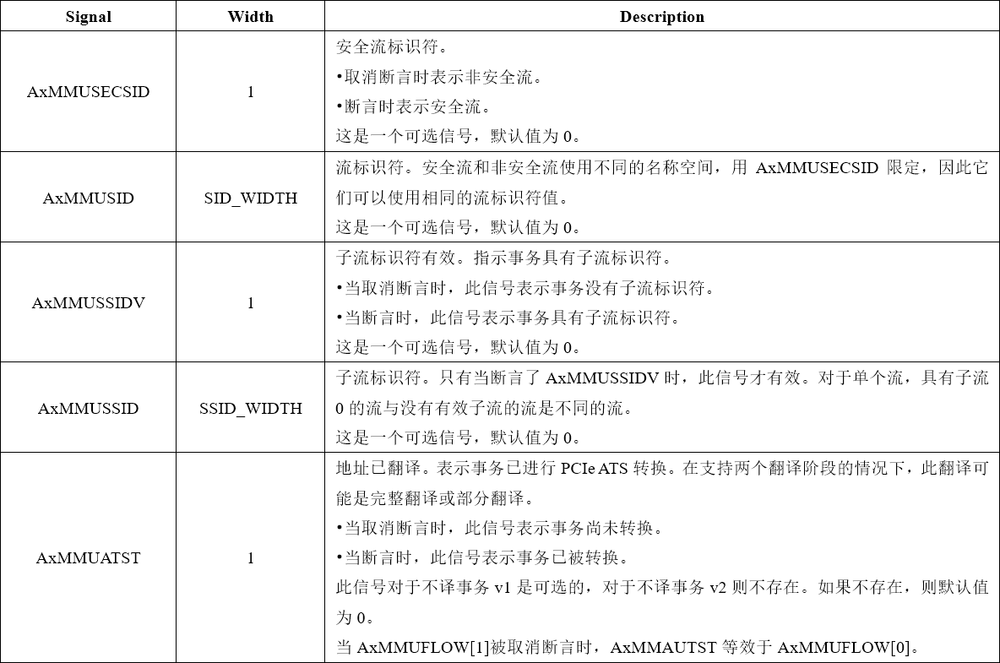

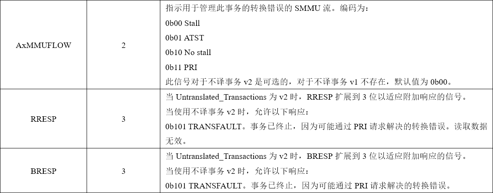

### 8.2 可选信号和默认值

在系统构建过程中，给定组件的流标识符可能具有由该组件提供的一些ID位和为该组件绑定的一些ID。这修复了该组件可以使用的流标识符名称空间中的值范围。通常，低阶比特由组件提供，而高阶比特被绑定。

AxMMUSID或AxMMUSSID的任何附加标识符字段位，如果不是由组件提供或由互连硬编码，则必须绑定为0。

所有信号都是可选的，具有定义的默认值，但有以下限制：

-   ARMMUSSID和ARMMUSSIDV必须同时在场或同时缺席。
-   AWMMUSSID和AWMMUSSIDV必须同时在场或同时缺席。

### 8.3 PCIe注意事项

当Untranslated\_Transactions信号用于连接PCIe Root Complex时，以下注意事项适用：

-   所有PCIe事务必须是非安全的。
    -   AxMMUSECSID必须不存在，或者必须绑定为0。

-   对于PCIe事务：
    -   AxMMUSID对应于PCIe请求者ID。
    -   AxMMUSSID对应于PCIe PASID。
    -   如果事务具有PASID前缀，则断言AxMMUSSIDV，否则将取消断言。

### 8.4 使用ACE5的不译事务

可以使用ACE5主机对不译事务进行地址转换。然而根据所翻译的事务类型，也有一些限制。

一般来说，翻译过程：

-   不得将“Shareable事务”转换为“Non-Shareable事务”，因为这可能会破坏一致性。
-   不得将“Allocating Shareable事务”转换为“Non-allocating Shareable事务”，因为这可能会误导下游Snoop过滤器。
-   必须确保在将写入事务从“Non-Shareable事务”转换为“Shareable事务”时，WriteUnique或WriteLineUnique事务不会与WriteBack、WriteClean或WriteEvict事务同时处于未决状态。

对于IO一致或Non-Shareable的事务，适用以下规则：

-   翻译过程用于保护检查，也可用于地址翻译。
-   保护检查可能导致任何权限组合。必须检查读取和写入事务。
-   主机不得允许Snoop命中使用IO一致或Non-Shareable事务获取的cacheline。
-   该组内的事务包括：
    -   ReadNoSnoop
    -   WriteNoSoop
    -   ReadOnce
    -   ReadOnceMakeInvalid
    -   ReadOnceCleanInvalid
    -   WriteUnique
    -   WriteLineUnique
    -   WriteBack to Non-shareable locations
    -   WriteClean to Non-shareable locations
    -   WriteEvict to Non-shareable locations

对于分配一致性的事务，适用以下规则：

-   翻译过程可用于保护检查，但必须始终导致完全读写访问或无访问。不支持只读或只读权限。
-   翻译过程必须在翻译后产生与翻译前相同的地址。
-   允许使用可共享的WriteBack、WriteClean、WriteEvict和Evict事务，但不需要检查。它们只能在事务的权限检查成功后发生，该事务允许在缓存中分配cacheline。
-   导致错误响应的事务不得在缓存中分配。
-   该组内的事务包括：
    -   ReadShared
    -   ReadClean
    -   ReadNotSharedDirty
    -   ReadUnique
    -   CleanUnique
    -   MakeUnique
    -   WriteBack to Shareable locations
    -   WriteClean to Shareable locations
    -   WriteEvict to Shareable locations
    -   Evict

### 8.5 SMMU流

本节描述了用于管理转换故障的不同SMMU流。

<strong>Stall流</strong>

当使用Stall流时，软件可以配置SMMU在发生转换故障时采取以下操作之一：

-   使用SLVERR响应终止事务。
-   通过OK响应终止事务，数据为RAZ/WI。
-   暂停翻译并通知软件翻译已暂停。然后软件可以指示SMMU终止事务，或者更新页面表并重试翻译。主机没有意识到stall。

此流程使软件能够在主机不知情的情况下管理转换故障并要求分页。

然而它也有一些局限性：

-   主机可以看到非常长的事务延迟，可能会触发超时。
-   由于软件活动的依赖性，stall流可能会在某些系统中导致死锁。

例如，不建议与PCIe一起使用，因为从CPU到PCIe的传出事务与通过SMMU从PCIe传入事务之间存在依赖关系。

当发生转换故障时，启用stall流并不一定会导致stall。只有在软件启用时才会出现暂停。软件通常不支持PCIe端点的安装。

<strong>ATST流</strong>

转换的地址转换服务（ATST）流指示事务已经被ATS转换。它仅由PCIe根端口使用。

当断言AxMMAUTST或AxMMUFLOW为0b01时，指示ATST流

当流是ATST时，根据SMMU的配置，事务可能仍会进行一些转换。有关SMMUv3体系结构的更多信息，请参阅Arm系统内存管理单元体系结构规范。如果发生转换错误，则必须使用SLVERR响应终止事务。

当流量为ATST时，将应用以下约束：

-   AxMMUSECSID必须为低。不支持安全转换的事务。
-   AxMMUSSIDV必须为低。不支持转换事务的子流ID。

<strong>NoStall流</strong>

NoStall流由无法停滞的主机使用，当AxMMUFLOW为0b10时指示。

如果在使用此流时发生转换故障，则主机必须使用SLVERR或OKAY响应终止事务，即使软件已将设备配置为在发生转换故障时停止。

建议将此流程用于PCIe Root Ports等主机，如果软件启用了安装，这些主机可能会死锁。

<strong>PRI流</strong>

PRI流设计用于PCIe集成端点。当AxMMUFLOW为0b11时显示。主机使用PRI流使软件能够在不存在死锁风险的情况下响应转换故障。

当流为PRI并且发生转换故障时，事务会在BRESP或RRESP上以TRANSFAULT响应终止。然后主机可以使用一个单独的机制来请求页面可用，然后再重试事务。此机制通常为PCIe PRI。

当使用该流程时，软件启用ATS，但硬件中不需要ATS功能。

如果由于PRI请求无法解决的原因（例如，由于SMMU配置不正确）导致转换失败，则使用该流的事务仍可能由具有SLVERR的SMMU终止。

### 8.6 协议规则

以下规则适用于不译事务信号。

-   对于未指定子流ID的事务，如AxMMUSSIDV所示，取消断言。AxMMUSSID必须被驱动为全零。
-   对于非安全流中的事务，如AxMMUSECSID，取消断言，AxPROT\[1\]必须为高，这表示非安全事务。
-   对于RRESP和BRESP，使用值0b101表示TRANSFAULT。
-   如果AWMMUFLOW不是PRI，则BRESP不得为TRANSFAULT。
-   如果ARMMUFLOW不是PRI，则RRESP不得为TRANSFAULT。
-   如果TRANSFAULT用于一个响应拍，则必须用于事务的所有响应拍。

### 8.7 StashTranslation

不译事务扩展也支持StashTranslate事务。这表明应该缓存给定事务地址的转换，因为这可能是需要的。

在以下任何情况下都必须支持StashTranslation事务：

-   Untranslated\_Transactions为True，Cache\_Stash\_Transactions为True
-   Untranslated\_Transactions为v1
-   Untranslated\_Transactions为v2

StashTranslation事务没有数据传输。在AW通道上提供地址和控制信息，在B通道上提供单个响应。只有在地址被接受后才能提供响应。

以下限制适用于StashTranslation事务：

-   不支持stash目标。如果存在，则必须将AWSTASHNID\[10:0\]、AWSTASHNIDEN、AWSTASHLPID\[4:0\]和AWSTASHLPIDEN驱动为低。
-   允许AxCACHE和AxDOMAIN值的任何合法组合。
-   StashTranslation事务不得使用与同时未完成的非StashTranslate事务所使用的AXI ID值相同的AXI标识值。此规则确保StashTranslation事务和其他事务之间没有排序约束，因此not stash翻译的从机可以立即响应。

## 9 NSAccess\_Identifiers

为了支持受保护数据的存储和处理，AMBA 5提供了一组信号，这些信号能够控制对特定非安全存储位置的访问。这些信号在事务请求的同时提供非安全访问标识符（NSAID）。可以检查NSAID以允许或拒绝访问内存位置。

NSAccess\_Identifiers属性用于指示组件是否支持这些附加信号：

-   <strong>True：</strong>接口上存在NSAID信号。
-   False：接口上不存在NSAID信号。如果未声明NSAccess\_Identifiers，则视为False。

非安全访问标识符扩展适用于以下接口：

-   AXI5
-   ACE5
-   ACE5-Lite
-   ACE5-LiteDVM

### 9.1 NSAID信号

下表显示了与每个通道相关联的信号。

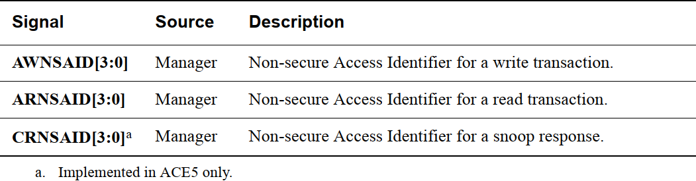

如果NSAccess\_Identifiers属性为True，则接口上必须同时存在AWNSAID和ARNSAID。CRNSAID只能包含在ACE5接口上，当NSAccess\_identifiers为True时是可选的。

AWNSAID和ARNSAID分别与写入和读取事务请求一起提供。CRNSAID与Snoop响应一起提供，用于指示NSAID值，该值最初用于提取保存在一致主机的缓存中的数据。CRNSAID仅用于可以提供数据以响应Snoop事务的ACE5主机。

4位NSAID值最多支持16个唯一标识符。对于每个NSAID，都定义了一组访问权限，用于确定如何允许访问内存中的位置。

访问权限可以是：

-   无法访问
-   只读访问
-   仅写访问
-   读/写访问用于定义每个NSAID的访问权限的机制是实现自定义的。

然而，该机制通常使用某种形式的存储器保护单元（MPU）来实现。

允许具有不同NSAID值的事务访问内存中的重叠位置。允许具有不同NSAID值的事务具有对内存中给定位置的任何访问权限组合。

支持默认的NSAID值为零。通常，主机在访问不受保护的数据时，或在没有分配NSAID值时，使用默认的NSAID 0值。

如果主机需要使用单个NSAID值，则允许将NSAID信号绑定到固定值。

NSAID信号仅用于Non-secure事务。

对于Secure事务，如AxPROT\[1\]=0所示，NSAID必须使用0值。

### 9.2 Caching和NSAID

如果在权限检查的上游执行缓存和系统一致性，则必须对具有不同NSAID值的访问进行权限检查，这些访问之间传递数据。与NSAID使用和一致性相关的规则如下：

-   当主机缓存使用特定NSAID值提取的数据行时，它必须确保对主内存的任何后续写入或对Snoop的任何响应都使用相同的NSAID数值。此规则可确保主机无法将数据的cacheline从一个受保护区域移动到另一个。
-   对于具有给定NSAID值的读取请求，如果使用Snoop来获取数据：
    -   如果Snoop响应的NSAID值与读取请求匹配，则可以直接提供数据。
    -   如果Snoop响应的NSAID值与读取请求不匹配，则必须首先使用经由Snoop响应获得的NSAIDs值将高速cacheline写入存储器，然后使用原始请求的NSAID值从存储器读取高速cacheline。

<strong>——注意——</strong>

写入和随后的读取只需要达到进行权限检查的点。

<strong>——————</strong>

-   如果使用内存保护，则不得使用使缓存副本无效的Snoop事务，如MakeInvalid。所有此类Snoop事务都必须替换为同时清理主内存cacheline的事务，例如CleanInvalid。
-   由于Snoop而发生的任何互连生成的对主存储器的写入都必须使用从Snoop响应中获得的NSAID值。
-   如果单个主机可以发出具有多个NSAID值的事务，则必须确保对缓存副本的内部访问使用最初用于获取cacheline的NSAID数值：

\--具有相同地址但不同NSAID值的cacheline命中的访问，在使用适当的NSAID数值重新蚀刻cacheline之前，必须清除cacheline并使其无效。此过程可确保执行保护检查。

\--如果保证主机从不使用不同的NSAID值访问同一cacheline，则不需要执行清除和无效操作。

这种保证可以通过设计来实现，也可以通过使用适当的缓存维护操作来实现。

-   更改NSAID值的访问权限时，必须执行适当的缓存维护。

<strong>——注意——</strong>

当主机没有对cacheline的写入权限时，允许该主机对cacheline进行写入。

还允许使用相同的NSAID值将更新的cacheline传递给其他主机。

但是，不允许更新传播到主存储器或使用不同NSAID值的访问。

<strong>——————</strong>

## 10 MPAM\_Support

MPAM是一种用于对物理机和虚拟机的内存系统资源进行分区和监控的技术。

完整的MPAM体系结构在Armv8.4扩展中进行了描述。

每个启用MPAM的主机都会将MPAM信息添加到其读写请求中。MPAM信息通过系统传播到存储器组件，在那里它可以用于影响资源分配决策。基于MPAM信息监控内存使用情况也可以实现机器之间的性能调整和准确成本计算。

MPAM\_Support属性用于指示接口是否支持MPAM：

-   <strong>MPAM\_9\_1：</strong>接口已启用用于分区和监视，它必须包括所有地址通道上的MPAM信号。PARTIT的宽度为9，PMG的宽度为1。
-   <strong>False：</strong>接口未启用MPAM。接口上不存在MPAM信号。如果未声明MPAM\_Support属性，则认为该属性为False。

以下接口支持MPAM扩展：

-   AXI5
-   ACE5
-   ACE5-Lite
-   ACE5-LiteDVM
-   ACE5-LiteACP

### 10.1 MPAM信号

当MPAM\_Support为MPAM\_9\_1时，MPAM信号如下表所示。

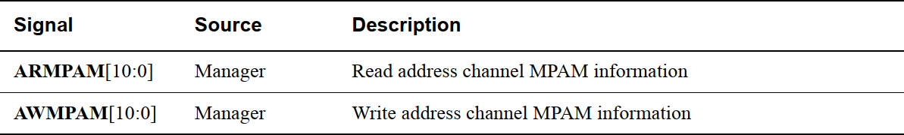

MPAM信息有三个字段。它们被映射到MPAM信号上，如下表所示。

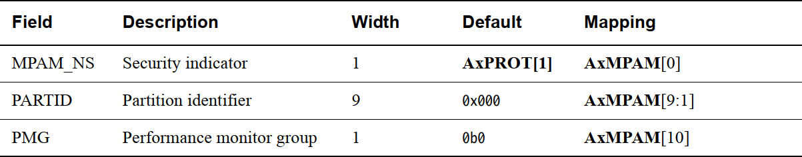

有关如何使用MPAM信息的详细信息，请参阅MPAM体系结构文档。

对于DVM操作，MPAM值不适用，ARMPAM信号可以取任何值。

### 10.2 MPAM组件交互

MPAM技术的实现会对以下方面产生影响：

-   主机组件
-   互连组件
-   从机组件

主机组件启用MPAM的主机组件必须在断言相应的AxVALID时驱动MPAM信号。所使用的值是为所有事务类型定义的实现。主机对读和写请求使用相同的值集是期望的，但不是必需的。主机可能不会使用AXI接口上可以发出信号的所有PARTIT或PMG值。

如果启用MPAM的系统中包括主机组件，但不支持MPAM信令，则系统必须添加MPAM信息。默认值如下表所示。如果要求主机以与AxPROT\[1\]不同的方式驱动MPAM\_NS，则它必须包括AxMPAM信号。

互连组件MPAM标识符具有全局范围。不要求互连组件使MPAM标识符唯一。当互连主机接口连接到启用MPAM的从机时，它可以使用传播的值或实现自定义的值。

从机组件启用MPAM的次级组件可以使用MPAM信息进行内存分区和监控。当断言相应的AxVALID时，对MPAM信号进行采样。

如果连接的主机不支持MPAM，则系统必须提供接口所需的MPAM信息的值。所使用的值是实现自定义的值。

## 11 Unique\_ID\_Support

UniqueID指示符是一个可选标志，用于指示读写地址通道上的请求何时使用对飞行中事务唯一的AXI标识符。相应的信号也在读和写响应通道上，以指示事务正在使用唯一ID。

UniqueID指示符可以在AXI主机的下游使用，以确定何时需要针对该主机的其他事务对事务进行排序。不需要顺序的事务可能不需要在下游组件中进行跟踪。不需要在跟踪器中查找带有指标集的响应。

Unique\_ID\_Support属性用于指示接口是否支持Unique ID Indicator：

-   <strong>True：</strong>接口在读写地址和响应通道上具有Unique ID指示器。
-   <strong>False：</strong>接口没有Unique ID指示器信号。如果未声明Unique\_ID\_Support属性，则认为该属性为False。

以下界面支持Unique ID指示符：

-   AXI5
-   AXI5 Lite
-   ACE5
-   ACE5-Lite
-   ACE5-LiteDVM
-   ACE5-LiteACP

下表显示了为提供Unique ID指示而添加的信号。

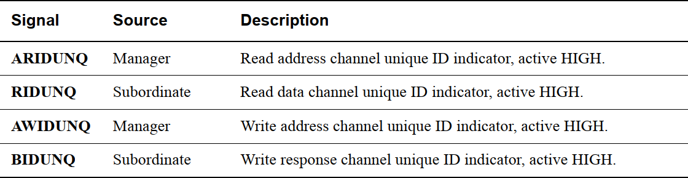

以下规则适用于Unique ID指示器：

-   当断言ARIDUNQ时，此主机中不得存在具有相同ARID值的未完成读取事务。
-   主机不得发出与断言ARIDUNQ的未完成读取事务具有相同ARID的读取请求。
-   如果请求的ARIDUNQ被取消断言，则必须为该事务的所有响应节拍取消相应的RIDUNQ信号的断言。
-   如果为请求断言ARIDUNQ，则必须为该事务的所有响应节拍断言相应的RIDUNQ信号。
-   当断言AWIDUNQ时，此主机中不得存在具有相同AWID值的未完成写入事务。
-   Manager不得发出与断言AWIDUNQ的未完成写入事务具有相同AWID的写入请求。
-   如果对请求取消断言AWIDUNQ，则必须对该事务的所有响应节拍取消断言相应的BIDUNQ信号。
-   如果为请求断言AWIDUNQ，则必须为该事务的所有响应节拍断言相应的BIDUNQ信号。

从断言AxVALID的周期到主机接受最终响应传输的周期，事务都是未完成的。如果接口包含BCOMP，则在收到断言BCOMP的响应之前，事务被视为未完成。

在主机接受写入和读取响应之前，Atomic事务一直处于未决状态。

某些事务类型指定需要断言AxIDUNQ（如果存在）。如果未指定，断言AxIDUNQ是可选的，即使没有使用相同AxID的未完成事务。

## 12 Read\_Interleaving\_Disabled

来自具有不同ARID值的事务的读取数据可以在AXI排序模型内交错。

如果在设计时确定所附的从机接口是否将交织来自不同事务的读取数据，则可以更有效地设计一些AXI主机和互连组件。

属性Read\_Interleaving\_Disabled用于指示接口是否支持对来自不同事务的读取数据节拍进行交织。

对于主机接口，Read\_Interleaving\_Disabled表示：

-   <strong>True：</strong>主机无法接收交错的读取数据。连接的从机项的属性必须为True。
-   <strong>False：</strong>主机可以接收交错的读取数据。这是遗留的AXI兼容行为。

对于从机接口，Read\_Interleaving\_Disabled表示：

-   <strong>True：</strong>保证从机不会交错读取数据。
-   <strong>False：</strong>从机可能会使用不同的ARID值交错读取事务中的数据。连接的主机的属性必须为False。

如果未声明Read\_Interleaving\_Disabled属性，则认为该属性为False。

对于某些接口，此属性可以用作配置控件，对于其他接口，它是功能指示器。所有发出具有不同ID的突发的主机都必须设计为接受交错数据。当附属从机支持禁用交织时，主机可能会使用配置选项来禁用交织作为优化。

Read\_Interleaving\_Disabled属性在以下接口中受支持：

-   AXI5
-   ACE5-Lite
-   ACE5-LiteDVM
-   ACE5-LiteACP

## 13 Read\_Data\_Chunking

读取数据chunking（分块）选项使从机接口能够使用128位颗粒以任何顺序发送事务的读取数据。起始地址可以用作确定首先发送哪个块的提示，但允许从机以任何顺序返回数据。

属性Read\_Data\_Chunking用于指示接口是否支持以可重新排序的块返回读取的数据：

-   <strong>True：</strong>支持读数据重新排序；该接口包括分块信号。
-   <strong>False：</strong>不支持读数据重新排序；接口不包括分块信号，读取数据必须按顺序发送。如果未声明Read\_Data\_Chucking，则视为False。

Read\_Data\_Chunking属性在以下接口中受支持：

-   AXI5
-   ACE5-Lite
-   ACE5-LiteDVM
-   ACE5-LiteACP为了启用读取数据分块，信号被添加到读取地址和数据通道。

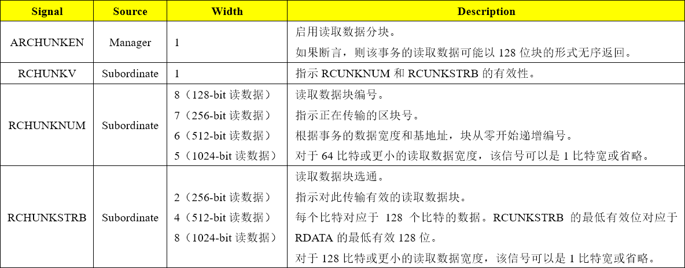

### 13.1 读数据分块协议规则

在读取数据分块协议中，应用以下所有规则：

-   只能为具有以从机性的事务断言ARCHUNKEN：
    -   ARSIZE等于数据总线宽度，或者ARLEN是一个节拍。
    -   ARSIZE是128位或更大。
    -   ARADDR与16个字节对齐。
    -   ARBURST是INCR或WRAP。
    -   ARSNOOP为ReadNoSnoop、ReadOnce、ReadOnceCleanInvalid或ReadOnceMakeInvalid。

-   ID值在飞行中必须是唯一的，这意味着：
    -   只有在没有使用相同ARID值的未完成读取事务的情况下，才能断言ARCHUNKEN。
    -   主机不得在读取通道上发出与已断言ARCHUNKEN的未决请求具有相同ARID的请求。
    -   如果接口上存在ARIDUNQ，则必须断言它。

-   如果取消断言ARCHUNKEN，则必须为事务的所有响应节拍取消断言RCHUNKV。
-   如果断言ARCHUNKEN，则可以针对事务的响应节拍断言RCHUNKV。
-   对于事务的每个响应节拍，RCHUNKV必须相同。
-   当断言RVALID和RCUNKV时，RCUNKNUM必须介于零和ARLEN之间。
-   当断言RVALID和RCUNKV时，RCUNKSTRB不得为零。
-   当断言RVALID和RCUNKV时，RLAST必须仅针对事务的最终响应节拍断言，而不考虑RCUNKNUM和RCUNKSTRB。
-   当RVALID被断言而RCUNKV被取消断言时，RCUNKNUM和RCUNKSTRB可以取任何值。
-   传输的数据块数量必须与ARLEN和ARSIZE一致，无论是否启用分块，突发中传输的字节数量都是相同的。对于未对齐的事务，不传输地址低于ARADDR的块。

### 13.2 互操作性

如果主机支持读取数据分块，那么如果下游互连和从机也支持分块，则可以减少缓冲。通过混合分块支持连接到组件的互连可以根据所附组件的能力驱动ARCHUNKEN和RCHUNKV。

当连接Read\_Data\_Chunking属性具有不同值的接口时，适用以下规则：

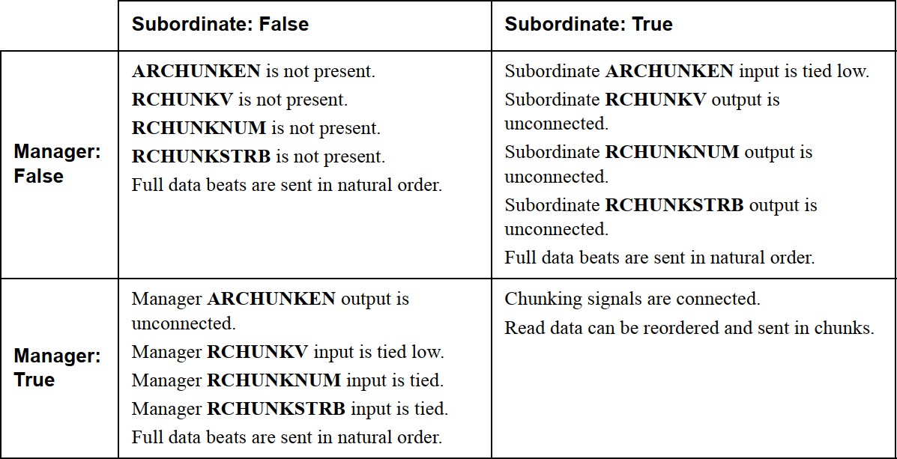

### 13.3 分块示例

在这些示例中，图中的每一行表示一个传输，阴影单元格表示未传输的字节。

下图显示了256位宽读取数据总线上的事务，其中：

-   ARADDR为0x00。
-   ARLEN为2拍。
-   ARSIZE为256位。
-   ARBURST为INCR。

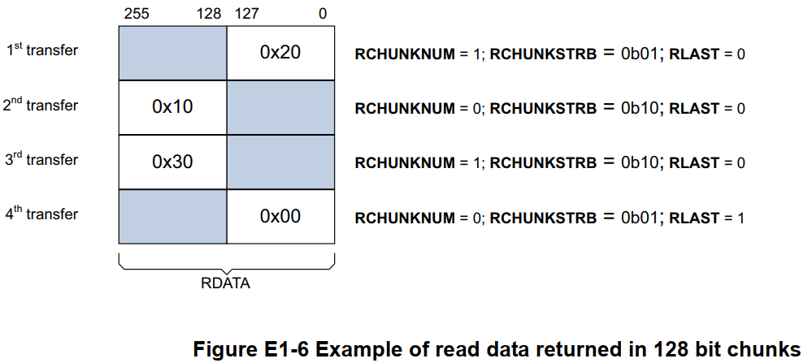

下图显示了256位宽数据读取总线上的事务，其中：

-   ARADDR为0x10。
-   ARLEN为2拍。
-   ARSIZE为256位。
-   ARBURST为INCR。

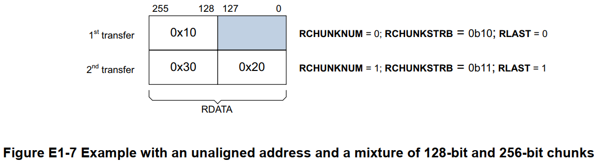

下图显示了128位宽数据读取总线上的事务，其中：

-   ARADDR为0x10。
-   ARLEN为4拍。
-   ARSIZE为128位。
-   ARBURST为WRAP。
-   RCUNKSTRB不存在。

从机使用起始地址作为提示，并首先在0x10处发送块。

RCUNKNUM编号不取决于突发是INCR还是WRAP

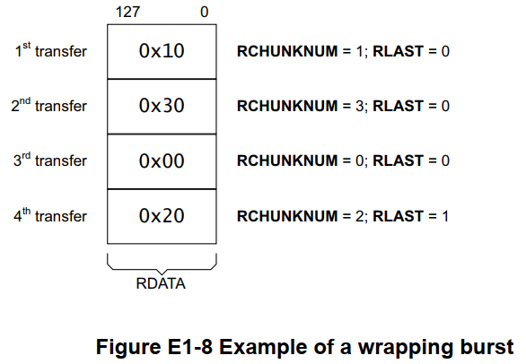

## 14 MTE\_Support

内存标记扩展（MTE）提供了一种可用于检测内存安全违规的机制。

当内存区域被分配用于特定用途时，它会被赋予一个分配标记值。当存储器随后被访问时，提供与访问的物理地址相对应的物理标记值。如果物理标记与分配标记不匹配，则会生成警告。

分配标签存储在内存系统中，并且可以以与数据相同的方式进行缓存。每个标签是4位，并且与16字节对齐的地址位置相关联。

支持以下操作：

-   使用写入事务更新分配标记值，无论是否更新相关数据值。
-   读取带有相关分配标签的数据。然后，请求者可以对照分配标签执行物理标签的检查。
-   使用物理标记写入内存，以便与分配标记进行比较。结果显示在事务响应中。

当系统中支持内存标记时，并不要求每个事务都使用内存标记。也不要求系统中的每个组件都支持内存标记。

内存标记扩展体系结构描述为体系结构参考手册v8.5的一部分。

### 14.1 MTE支持

MTE\_support属性用于指示组件支持内存标记扩展。

-   <strong>Standard：</strong>接口支持标准内存标记，所有MTE信号都存在。
-   <strong>Basic：</strong>基本内存标记在基本级别的界面上受支持。允许进行一组有限的标记操作。BTAGMATCH不存在。不需要BCOMP。
-   <strong>False：</strong>接口上不支持错误内存标记，并且不存在MTE信号。如果未声明MTE\_Support，则会将其视为False。

可以为以下接口类型设置MTE\_Support属性：

-   ACE5 Lite
-   ACE5 LiteDVM（仅限基本版）
-   AXI5

MTE\_Support在数据宽度小于32位的接口上必须为False。

下表根据MTE\_Support属性的值显示了主机和从机接口之间的兼容性。

### 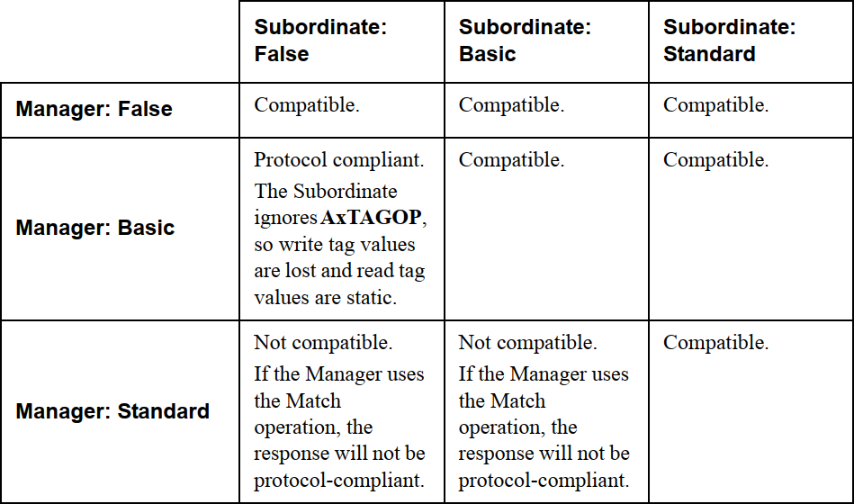

### 14.2 MTE信号

下表显示了支持MTE所需的信号。

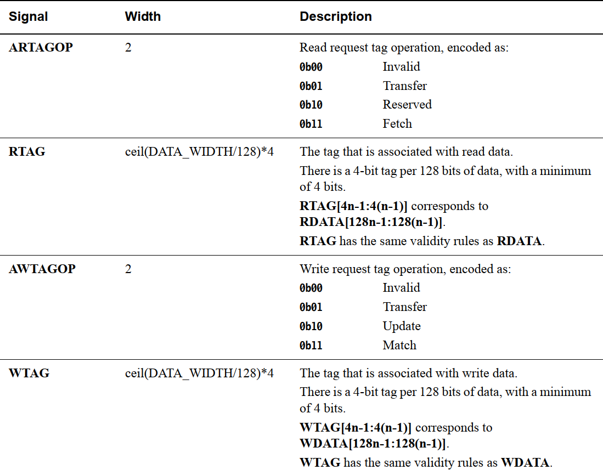

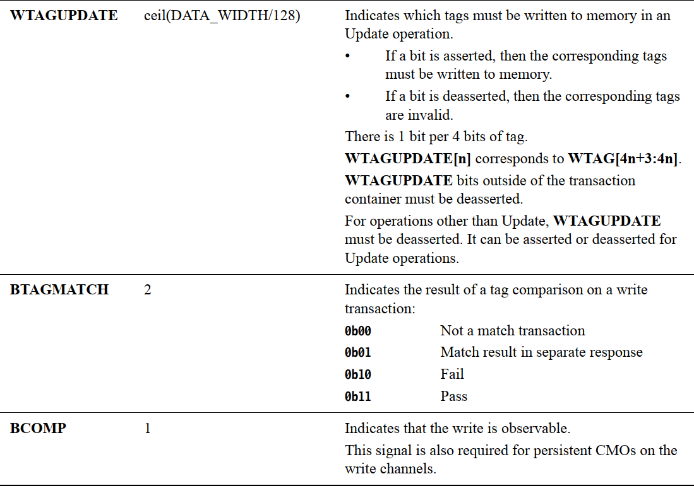

关于MTE，手册上还有很多内容，不翻译了，没有亲自使用，看了也看不懂。MTE目前已经在高通/联发科等高端手机SOC上使用，可以防止内存泄漏，提升性能。MTE需要开辟一片空间进行处理，处理后就不用再给总线传了。这个Feature比较复杂，除非专门研究，否则难以搞懂，懂了再写。

## 15 Regular\_Transactions\_Only

事务有许多突发、大小和长度选项。但是某些接口和事务类型可能只使用这些选项的一个子集。如果从机组件连接到仅使用事务选项子集的主机，则可以使用简化的解码逻辑进行设计。

定义了Regular属性，以标识符合以下条件的事务：

-   AxLEN为1、2、4、8或16。
-   如果AxLEN大于1，则AxSIZE与数据总线宽度相同。
-   AxBURST是INCR或WRAP，而不是FIXED。
-   AxADDR与INCR事务的事务容器对齐。
-   对于WRAP事务，AxADDR与AxSIZE一致。

<strong>常规事务属性</strong>

Regular\_transactions\_Only属性用于定义主机是否只发布常规类型的事务以及从机是否只支持常规交易：

-   True：仅支持常规事务。
-   False：支持AxBURST、AxSIZE和AxLEN的所有合法组合。如果未声明Regular\_Transactions\_Only，则视为False。

以下接口的Regular\_Transactions\_Only属性可以为True：

-   AXI5
-   ACE5
-   ACE5-Lite
-   ACE5-LiteDVM

<strong>互操作性</strong>

下表给出了适用于连接具有不同属性值的主机和从机组件的指南：

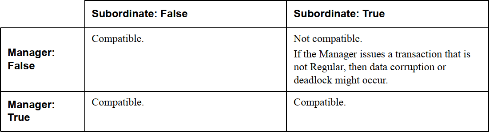

## 16 Exclusive\_Accesses

Exclusive独占访问用于信号量类型的访问，并且往往仅由主机和从机组件的有限子集使用。

Exclusive\_Accesses属性用于定义主机是否发出独占访问或从机是否支持独占访问：

-   <strong>True：</strong>支持独占访问。ARLOCK和AWLOCK出现在接口上。
-   <strong>False：</strong>不支持独占访问。ARLOCK和AWLOCK不在接口上。如果未声明Exclusive\_Accesses，则认为：
    -   <strong>False：</strong>对于AXI4 Lite、AXI5 Lite和ACE5 LiteACP接口。
    -   <strong>True：</strong>对于其他接口类型。

Exclusive\_Accesses属性对于以下接口可以为True：

-   AXI3
-   AXI4
-   AXI5
-   ACE
-   ACE-Lite
-   ACE5
-   ACE5-Lite
-   ACE5-LiteDVM

下表提供了在连接具有不同属性值的主机和从机组件时适用的指南：

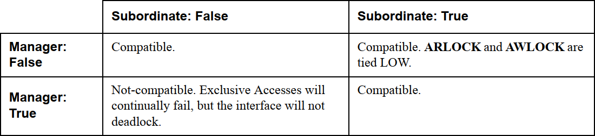

## 17 Max\_Transaction\_Bytes

事务的最大大小为4KB，不允许事务跨越4KB边界。然而，许多主机生成的事务量肯定会小于此事务量。

从机或互连可能会从这些信息中受益。例如，从机可能能够优化掉一些解码逻辑。如果知道事务不会越过条带边界，那么小于4KB的互连条带可能能够避免突发分裂。

属性Max\_Transaction\_Bytes定义了事务的最大大小（以字节为单位）。它可以采用以下值：

-   64
-   128
-   256
-   512
-   1024
-   2048
-   4096

如果未声明Max\_Transaction\_Bytes，则视为4096。

可以为主机和从机接口声明Max\_Transaction\_Bytes属性：

-   保证主机不会发出大于最大事务字节的事务，并且事务不会越过最大事务字节边界。
-   保证从机接受最大事务字节数的事务。

所有接口类型都支持Max\_Transaction\_Bytes属性。

下表给出了适用于连接具有不同属性值的主机和从机组件的指南：

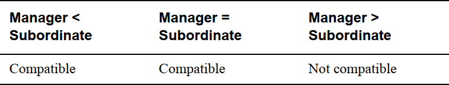

## 18 Consistent\_DECERR

读取事务具有多个数据节拍。RRESP的价值不受事务的限制，因此每个节拍都可以具有任何合法价值。当访问从机出现问题时，通常使用DECERR的响应，并且在这种情况下，在读取数据的每个节拍中一致地用信号通知DECERR。如果主机可以只检查读取数据的一个节拍来确定是否发生了DECERR，则可能会有好处。

Consistent\_DECERR属性用于定义从机是否在事务中一致地发出DECERR信号：

-   <strong>True：</strong>DECERR是针对读取数据的每一拍或在数据的每个高速cacheline内没有读取数据的拍而用信号通知的。例如，跨越高速cacheline边界的事务可以接收针对一个高速cacheline上的每个读取数据节拍的DECERR响应，而在下一个高速缓冲存储器线上没有数据节拍。
-   <strong>False：</strong>DECERR可以在任何数量的读取数据节拍上用信号通知。

如果未声明Consistent\_DECERR，则认为它是：

-   <strong>True：</strong>适用于AXI4-Lite和AXI5-Lite接口，因为它们不支持多拍数据。
-   <strong>False：</strong>对于所有其他接口。

对于以下接口，Consistent\_DECERR属性可以为True：

-   AXI3
-   AXI4
-   ACE
-   ACE-Lite
-   ACE5
-   ACE5-LiteDVM
-   ACE5-Lite
-   ACE5-LiteACP
-   AXI5

不使用DECERR响应的从机接口可以将Consistent\_DECERR属性设置为True。

当在AXI和CHI之间桥接时，将此属性设置为True可能会有所帮助，其中DECERR转换为非数据错误。

Consistent\_DECERR设置为True的主机可以检查单个数据节拍，以确定是否发生了DECERR。

下表显示了连接具有不同属性值的主机和从机组件时的互操作性指南：

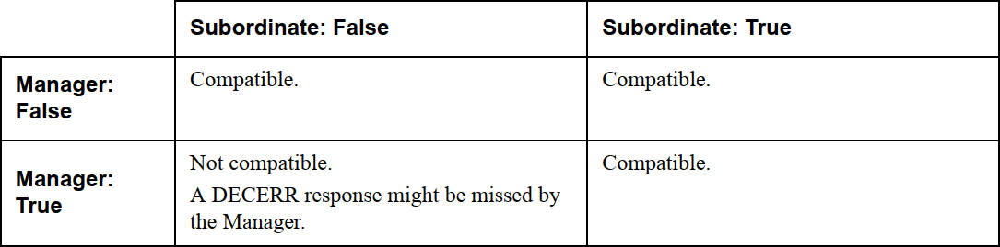

参考资料：AMBA5 AXI and ACE Protocol Specification

---

> 原文：[AMBA总线（5）—— AXI5新feature](https://www.cnblogs.com/xianyuIC/p/17937602)（博客园 · 咸鱼IC）
