AXI3/4 中出现了用于时钟和功耗的 C-channel，该协议有缺陷。后来新出的协议，更多的是采用 Q-channel 和 P-channel，这三个协议是怎么回事呢？

## 0 关于低功耗接口

本文档描述了可用于控制设备的时钟和电源状态的接口。接口为：

-   <strong>Q-Channel：</strong>适用于简单的运行-停止-静止语义。Q-Channel是AXI低功耗接口（C-Channel）的演变，其命名反映了接口的目的是控制设备静止的事实。
-   <strong>P-Channel：</strong>用于管理具有多个转换的复杂电源场景。这些转换可以在不将设备返回到公共可操作状态的情况下进行。它的命名反映了这样一个事实，即接口的目的是控制电源状态转换。

<strong>——注意——</strong>

每个接口都有可选的接口奇偶校验保护。接口奇偶校验保护提供了检测、诊断和安全缓解接口上潜在故障的能力。

<strong>——————</strong>

### 0.1 共同特性

Q-Channel和P-Channel接口具有以下共同特性：

-   控制器管理的设备状态之间的转换。
-   设备可以：
    -   指示它必须退出较低功率状态并进入较高功能状态。
    -   提示它可能会接受进入低功耗状态的请求。

-   设备可以拒绝状态更改请求（可选）。
-   时钟域交叉语义是健壮的，支持异步接口。

尽管接口用于时钟和电源状态控制，但对接口管理的状态的特定特性没有限制。

### 0.2 接口差异和选择

这两个接口的设计是相辅相成的。接口的选择取决于实施的需要。

-   <strong>Q-Channel：</strong>Q-Channel的简单运行-停止-静止语义是时钟控制或简单功率控制场景的理想选择。进入的静态状态可以变化，但仅根据进入静态状态之前设备和控制器的共同配置。静态状态退出转换始终是到一个公共的可操作运行状态，在设备可以进入不同的静态状态之前，必须进入该状态。
-   <strong>P-Channel：</strong>P-Channel可以处理更复杂的场景。可以进行多次转换，而无需将设备或设备分区返回到连续节能状态之间的公共可操作状态。控制器在每次转换时提供明确的状态请求，因此不需要控制器和设备的通用配置。

仅当Q-Channel功能不足时，才应使用P-Channel接口。

## 1 C-Channel

C-Channel是AXI协议的低功耗接口，是一种可选扩展，针对两种不同类型的外设：

-   任何没有电源关闭顺序的外设，并且可以指示其时钟何时可以关闭。
-   任何需要断电顺序的外设，并且只在进入低功耗状态后才能关闭时钟。外设需要来自系统时钟控制器的指示，以表明何时启动断电序列，并且必须在进入低功耗状态时发出信号。

### 1.1 低功耗接口

在工作中，我们习惯把AXI的低功耗接口信号称之为C-channel信号。

-   对于具有上下电顺序的外设，时钟控制器发出请求后才会进入低功耗状态，协议提供了请求/确认握手信号。
-   对于没有上下电顺序的外设，CACTIVE是所需要的唯一的时钟控制信号。

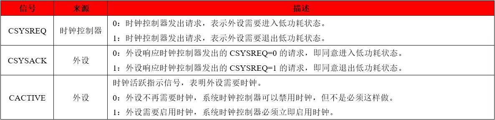

### 1.2 低功耗时钟控制

<strong>（1）时钟控制器发起退出低功耗状态</strong>

-   进入时：时钟控制器拉低CSYSREQ，外设执行下电序列，顺序拉低CACTIVE和CSYSACK。
-   退出时：时钟控制器拉高CSYSREQ，外设执行上电序列，顺序拉高CACTIVE和CSYSACK。

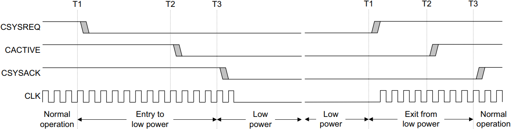

时钟控制器拉低CSYSREQ信号请求进入低功耗状态，但是外设通过保持CACTIVE信号为高来拒绝请求：

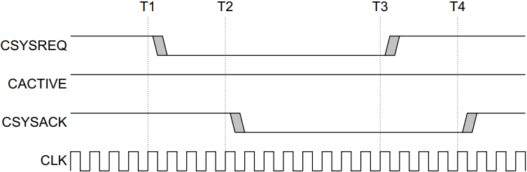

<strong>（2）外设发起退出低功耗状态</strong>

-   进入时：外设拉低CACTIVE，然后时钟控制器拉低CSYSREQ，最后外设拉低CSYSACK。
-   退出时：外设拉高CACTIVE，然后时钟控制器拉高CSYSREQ，最后外设拉高CSYSACK。

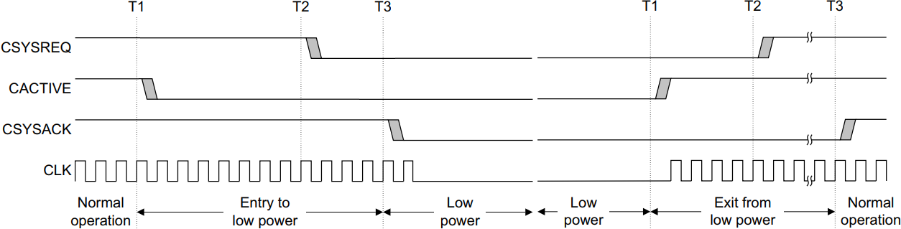

外设拉低CACTIVE信号请求进入低功耗状态，但是时钟控制器通过保持CSYSREQ信号为高来拒绝请求：

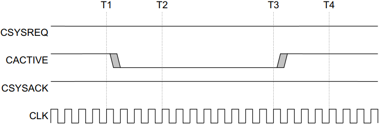

### 1.3 低功耗域的组合外设

系统时钟控制器可以将多个不同的外设组合到同一个低功耗时钟域中。然后如果遵循以下规则，它可以像处理单个外设一样处理时钟域：

-   时钟域CACTIVE信号是时钟域内所有外设CACTIVE信号的逻辑或，这意味着只有当所有外设都指示可以禁用时钟时，系统时钟控制器才能禁用时钟。
-   系统时钟控制器必须使用单个CSYSREQ信号，该信号被路由到时钟域中的所有外设。
-   产生时钟域CSYSACK信号的过程如下：
    -   CSYSACK的下降沿发生在域中最后一个外设的CSYSACK信号的下降沿上。
    -   CSYSACK的上升沿发生在域中最后一个外设的CSYSACK信号的上升沿上。

（如果路径上有多个不同时钟域，时钟的唤醒跟随数据顺序，得一层层向下传递，那么会造成时钟开启的时间大于数据到来的时间，从而造成数据的delay，这时可以用上游的时钟唤醒信号，直接唤醒下游时钟。）

### 1.4 AXI5的低功耗信号

AXI5中取消了上面说的C-channel信号，但是存在AWAKEUP唤醒信号，感觉比较像是可以用作低功耗设计的信号。AWAKEUP信号用于指示有与接口相关的活动，由Master发出，在事务开始时拉高，表示有一个事务要处理。其属性用于指示组件是否支持唤醒信号：

-   True：支持唤醒信号。
-   False：不支持唤醒信号。

如果未声明Wakeup\_Signals，则认为它为False。信号可以路由到时钟控制器或类似的使电源和时钟连接的组件。唤醒信号必须是无故障的，并且直接从寄存器生成。它们与与之相关的接口是同步的，但适用于跨时钟域到控制器。必须拉高唤醒信号以保证可以接受事务，但是一旦事务正在进行中，则唤醒信号的断言或撤销是实现定义的。协议建议（但不要求）在不需要进一步事务时解除唤醒信号。

## 2 Q-Channel

### 2.1 Q-Channel 接口规范

Q-Channel是AXI低功耗接口的发展，在大多数情况下都是向后兼容的。Q-Channel通过使握手机制独立于设备活动指示来简化时钟域交叉。

#### 2.1.1 Q-Channel信号

下图显示了设备与时钟或电源控制器之间的信号：

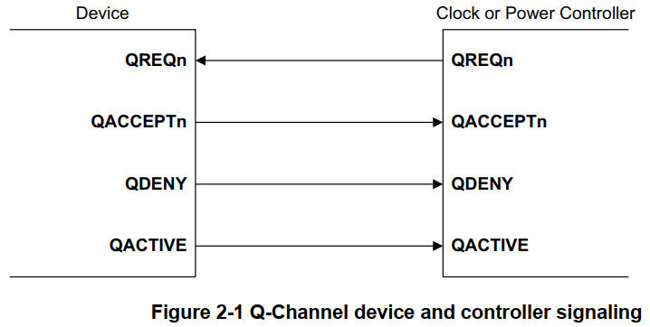

Q-Channel接口具有以下独立的信号组。

<strong>设备活动指示</strong>

此组包括单个信号QACTIVE，在任何状态下，设备都可以将其驱动为高电平，以指示其有操作要执行。当设备将QACTIVE驱动为低电平时，这是一个提示，而不是保证设备可以接受静止请求。

来自设备的QACTIVE信号可以由多个源信号组成。为了提供唤醒能力，这些源信号可以包括设备输入信号。最终的QACTIVE信号由寄存器直接驱动，或者由一个或多个寄存器和其输出被逻辑组合的输入信号驱动。后面Q-Channel实现给出了QACTIVE组合逻辑的实现建议。

如果在没有根据接口管理的时钟或电源的情况下，设备本身无法断言QACTIVE HIGH，则必须有一种依赖于系统的方法来促进设备外部的唤醒。这可以是来自在控制器处与设备QACTIVE组合的另一设备的QACTIVE。

<strong>握手机制</strong>

该组管理设备静止并保证安全的状态转换。握手接口具有：

-   由控制器驱动的静止请求信号QREQn。
-   确认信号对，QACCEPTn和QDENY，由设备驱动回控制器，以指示接受或拒绝请求。确认信号被组织为使得在每次握手转换中它们中只有一个改变。这确保了接口可以跨异步边界安全地实现。

QACCEPTn用于接受请求。QDENY用于拒绝请求。

来自设备的QACCEPTn和QDENY信号以及来自控制器的QREQn信号都必须由寄存器驱动。

拒绝机制的目的是使设备能够保持操作状态，同时还具有能够迅速完成握手的机制。

握手信号的极性被组织以提供静态状态，其中所有接口信号都是LOW。这方便了简单的默认隔离规则。

握手信号的状态与QACTIVE的状态无关。因此，QACTIVE上的转换不受QREQn或QACCEPTn和QDENY输出对上的值的限制。

控制器可以根据握手接口状态来保证时钟供应或电源可用性。Q-Channel握手描述了这些保证。

假设所有信号都是异步的。

#### 2.1.2 Q-Channel握手

本节描述了Q-Channel接口握手的允许变化。

已接受的静止请求下图显示了已接受静止请求的握手序列。它包括根据接口语义管理的可选控制器提供的时钟的保证活动。

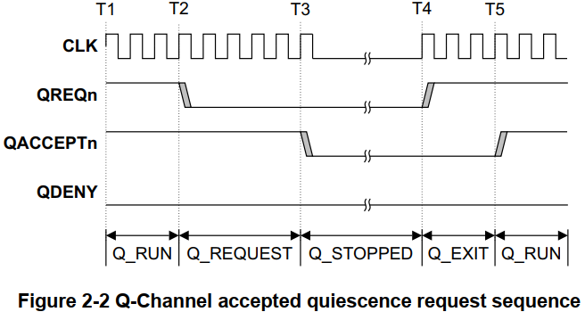

图中省略了QACTIVE，因为尽管QACTIVE可以作为控制器改变接口状态的激励，但它与握手无关。所有接口状态的改变都可以由控制器单独启动。

控制器策略和QACTIVE在后文描述了QACTIVE的使用。

图中所示的过渡是：

-   在T1时，QREQn和QACCEPTn均为HIGH。这种状态被称为Q\_RUN，并且设备是可操作的。Q\_RUN中的QDENY为LOW。在这种状态下，控制器保证接口管理的任何时钟或电源的可用性。
-   在T2，控制器将QREQn驱动为LOW，请求进入静止状态。这种状态被称为Q\_REQUEST。该设备仍在运行。在这种状态下，控制器保证接口管理的任何时钟或电源的可用性。
-   在T3，设备通过驱动QACCEPTn LOW来响应静止请求。QDENY保持低位。

这种状态被称为Q\_STOPPED。设备无法运行。在这种状态下，控制器不保证接口管理的任何时钟或电源的可用性。

-   在T4，控制器驱动QREQn HIGH。两个确认信号都保持低电平。这种状态被称为Q\_EXIT。由接口管理的任何时钟或电源在依赖于实现的延迟之后得到保证，但一旦提供，就保证提供。
-   在T5，设备以QACCEPTn HIGH（高）响应控制器，QDENY保持LOW（低）。该接口已经返回到T1时的状态Q\_RUN。

<strong>拒绝静止请求</strong>

下图显示了拒绝静止请求的握手序列。它包括根据接口语义管理的可选控制器提供的时钟的保证活动。

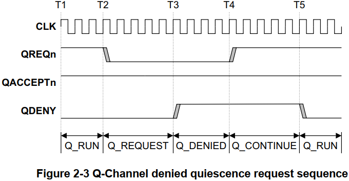

图中所示的过渡是：

-   从T1到T2的顺序与接受的静止请求中描述的顺序相同。
-   在T3，设备驱动QDENY HIGH，而QACCEPTn保持HIGH。此状态称为Q\_DENIED。设备保持运行，控制器必须保证接口管理的任何时钟或电源。
-   在T4，控制器驱动QREQn HIGH。该状态被称为Q\_CONTINUE，并且是对T3处的静止请求拒绝的响应。设备保持运行，控制器必须保证接口管理的任何时钟或电源。
-   在T5，设备驱动QDENY LOW。接口已返回到状态Q\_RUN，如在T1。

<strong>设备复位</strong>

在复位断言时，设备必须同时驱动QACCEPTn和QDENY LOW。QACTIVE可以复位为LOW（低）或HIGH（高）。

如果设备必须在退出复位时执行启动操作，则可以将QACTIVE复位为HIGH，否则建议将QACTIVE复位为LOW。

控制器可以通过以下任一方式解除设备的复位：

-   QREQn LOW，接口处于Q\_STOPPED状态。
-   QREQn HIGH，接口处于Q\_EXIT状态，前提是满足任何时钟或电源保证。

只有当接口处于Q\_STOPPED状态或控制器和设备同时复位时，控制器才能断言设备复位。这与在功率边界处隔离所有信号LOW的建议一致。

下图显示了在QREQn低的情况下进入Q\_STOPPED状态的复位退出序列。在复位取消断言后的某个时间，接口前进到Q\_RUN，可能是对QACTIVE断言的响应。然后，它在重新进入静态Q\_STOPPED状态之前保持激活一段时间，之后断言复位。

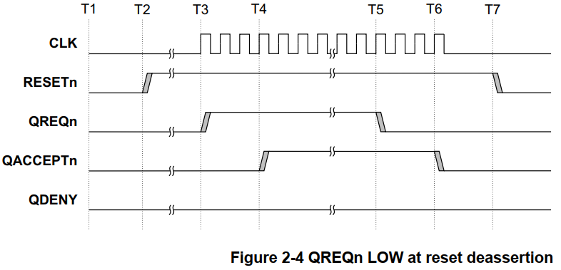

下图显示了在QREQn为HIGH的情况下，复位退出序列进入Q\_exit状态。一旦复位被释放，接口就对QREQn HIGH信号作出响应，并前进到Q\_RUN。然后，它在重新进入静态Q\_STOPPED状态之前保持激活一段时间，之后断言复位。

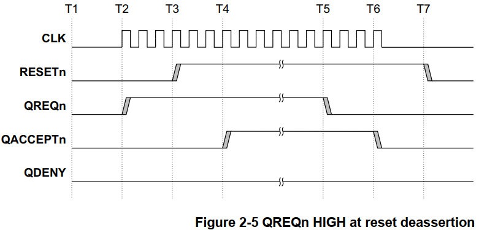

<strong>接口状态</strong>

下表总结了接口状态和设备可用性。如果设备没有实现拒绝机制，那么QDENY被绑定为LOW或不存在，并且前四个状态表示完整的集合。

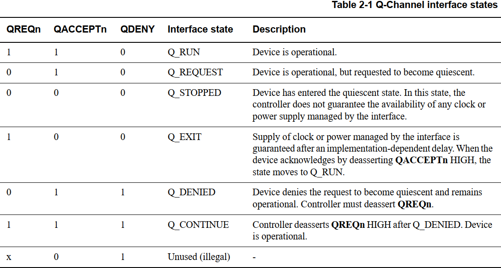

下图是根据信号状态和接口状态显示可能的握手序列的状态图。

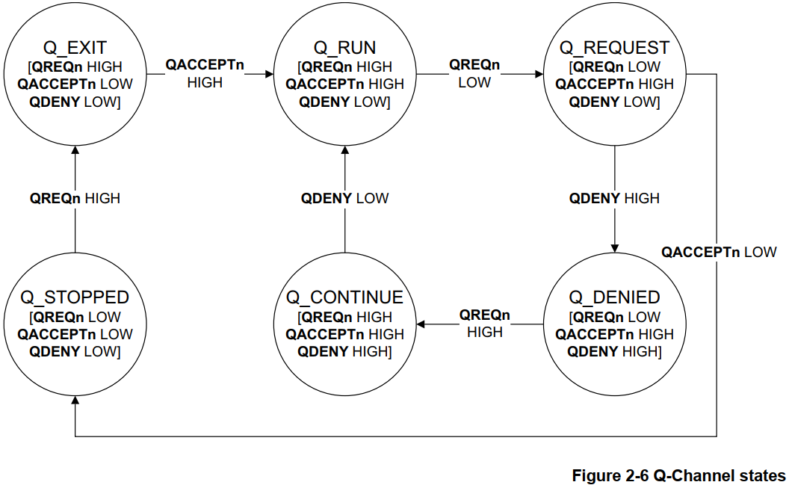

<strong>握手规则</strong>

握手信号规则包括：

-   当QACCEPTn为HIGH且QDENY为LOW时，QREQn只能从HIGH转换为LOW。
-   QREQn只能在以下任一情况下从LOW（低）转换为HIGH（高）：
    -   QACCEPTn和QDENY均为LOW。
    -   QACCEPTn和QDENY均为高电平。

-   当QREQn为LOW且QDENY为LOW时，QACCEPTn只能从HIGH转换为LOW。
-   当QREQn为HIGH且QDENY为LOW时，QACCEPTn只能从LOW转换为HIGH。
-   当QREQn为HIGH且QACCEPTn为HIGHT时，QDENY只能从HIGH转换为LOW。
-   当QREQn为LOW且QACCEPTn为HIGH时，QDENY只能从LOW转换为HIGH。

#### 2.1.3 控制器策略和QACTIVE

无论QACTIVE上的任何活动如何，控制器都可以就其QREQn的管理做出任何政策决定。但是，本节介绍了提供有用解决方案的Q-Channel策略。

断言QACTIVE HIGH可以用作控制器退出Q\_STOPPED状态的激励。控制器通过驱动QREQn HIGH退出静止状态来作出响应。

<strong>——注意——</strong>

在正常操作中，这是允许设备执行操作所必需的。未能实现策略可能会导致系统死锁。

<strong>——————</strong>

检测QACTIVE LOW可以由处于Q\_RUN状态的控制器用作启动静止请求的标准。然而，当控制器处于Q\_RUN状态时，它可以随时将QREQn的状态从HIGH改变为LOW。

一旦QREQn被驱动为LOW，控制器就不必考虑QACTIVE的状态，因为在设备以接受或拒绝响应完成握手之前，QREQn不能被驱动为HIGH。

<strong>QACTIVE策略示例</strong>

下图显示了由QACTIVE上的设备转换引导的控制器策略。当接口处于Q\_STOPPED状态时，QACTIVE上的高电平会刺激退出静态。当接口处于Q\_RUN状态时，QACTIVE上的LOW电平导致控制器发出静止请求。

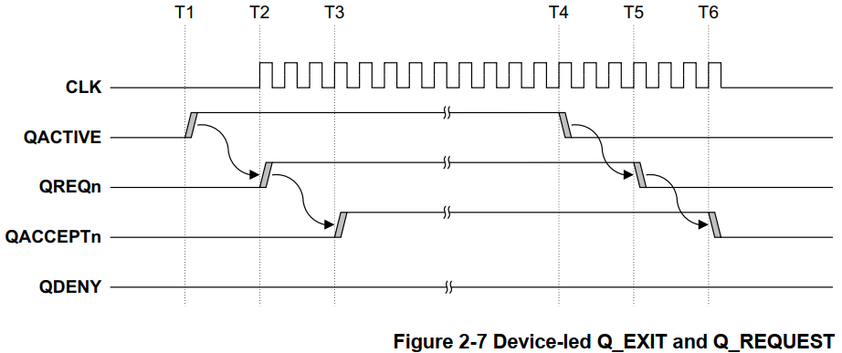

#### 2.1.4 信号子集

本节描述了允许的信号子集。

<strong>未使用接口</strong>

如果设备要运行，未使用的接口必须将QREQn输入绑定为HIGH。系统全权负责通过接口控制之外的方式管理设备的可用性。

<strong>省略QDENY</strong>

不需要拒绝静止请求的设备可以省略QDENY。该子集还为无需拒绝静止请求的设备提供了与AXI低功耗接口规范的向后兼容性。后文Q-Channel向后兼容性描述了这种向后兼容性。在这种情况下，QDENY必须在控制器处连接为LOW。

<strong>省略QACTIVE</strong>

在某些应用程序中，设备静止的启动或退出可能不需要设备提供任何信息。在这种情况下，设备可以省略QACTIVE。控制器上的QACTIVE必须连接为LOW。

<strong>仅QACTIVE接口</strong>

设备可以呈现仅包括QACTIVE的最小接口，以指示在没有任何相关握手的情况下执行操作的要求。通常，该最小接口可以用于提供初始唤醒指示。然而，它不提供任何手段来保证任何时钟或电源的可用性。

QACTIVE单独提供的指示必须与硬件、软件或两者的其他安排相结合，以提供有效的解决方案。一种安排可能是允许通过仅限QACTIVE的接口连接到控制器的设备唤醒第二设备，第二设备本身具有到用于保证时钟或电源可用性的同一控制器的Q-Channel接口。

### 2.2 奇偶校验扩展

Q-Channel接口奇偶校验扩展的Q-Channel接口是Q-Channel接口的可选添加，允许检测和缓解接口上的单比特故障。

#### 2.2.1 奇偶性扩展Q-Channel信号

在奇偶性扩展的Q-Channel中，标准Q-Channel接口中的每个信号都有一个相关的检查信号。

下表显示了每个标准Q-Channel信号的检查信号。

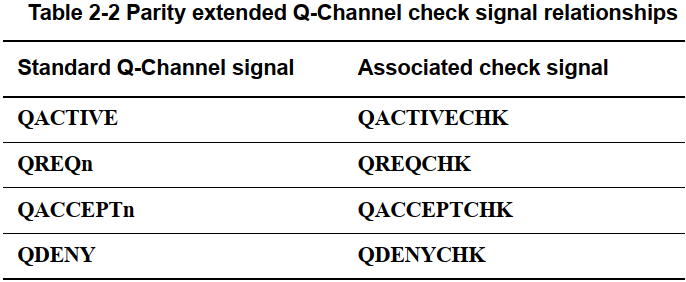

每个校验信号为其相关信号提供奇数奇偶校验。下图显示了奇偶扩展Q-Channel的信号方向。

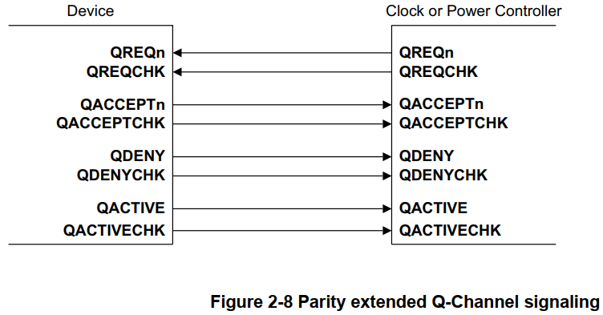

在Q-Channel信号的到达与其相关联的检查信号之间不存在定时要求。然而，到达时间应该由一种实现来限定，以提供用于信号的故障检查的窗口。

此窗口的大小是实现自定义的。

#### 2.2.2 奇偶扩展Q-Channel握手

本节描述奇偶扩展Q-Channel接口握手。

本节中的图表显示了每个Q-Channel信号和相关的检查信号同时变化。

然而，这并不是一项要求，仅为了示意图的方便而显示。每个Q-Channel信号及其相关联的检查信号可以在不同的时间改变。直到Q-Channel信号和相关联的检查信号都处于它们所需的状态，Q-Channel状态才会进展。

<strong>接受的静止请求</strong>

下图显示了接受的静止要求的握手序列，然后退出静止。

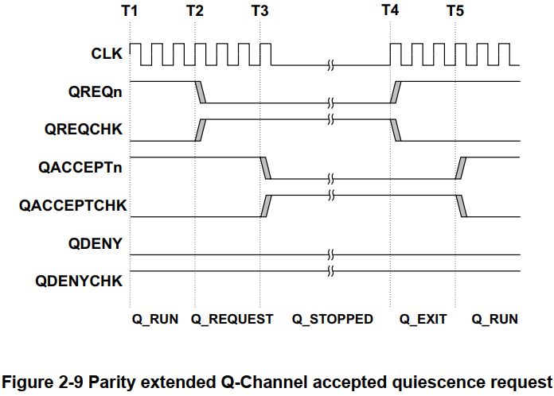

图中省略了QACTIVE和QACTIVECHK，因为它们独立于握手。这些信号可以作为控制器改变接口状态的激励。然而，所有接口状态的改变都可以由控制器单独启动。

图中所示的过渡是：

-   T1：Q-Channel处于Q\_RUN，并且设备可操作。
-   T2：控制器驱动QREQn LOW和QREQCHK HIGH以请求进入静止状态，Q-Channel进入Q\_request。该设备仍在运行。
-   T3：设备通过驱动QACCEPTn LOW和QACCEPTCHK HIGH来响应静止请求，Q-Channel前进到Q\_STOPPED。设备无法运行。在这种状态下，控制器不保证接口管理的任何资源的可用性。
-   T4：控制器驱动QREQn HIGH和QREQCHK LOW请求退出静止状态，Q-Channel进入Q\_exit。接口管理的任何资源都会在实现相关延迟之后得到保证。
-   T5：设备通过驱动QACCEPTn HIGH和QACCEPTCHK LOW来响应静态退出请求，Q-Channel进入Q\_RUN。接口已返回到T1时的状态。

<strong>设备复位</strong>

在复位断言时，设备必须驱动：

-   QACCEPTn LOW和QACCEPTCHK HIGH。
-   QDENY LOW和QDENYCHK HIGH。

建议将QACTIVE LOW和QACTIVECK HIGH复位。如果设备必须在退出复位时执行启动操作，则可以复位QACTIVE HIGH和QACTIVECK LOW。控制器可以通过以下任一方式解除设备的复位：

-   QREQn LOW和QREQCHK HIGH，接口处于Q\_STOPPED状态。
-   QREQn HIGH和QREQCHK LOW，接口处于Q\_EXIT状态，前提是满足任何资源保证。

只有当接口处于Q\_STOPPED状态或控制器和设备同时复位时，控制器才能断言设备复位。

<strong>接口状态</strong>

下表总结了接口状态和设备可用性。如果设备没有实现拒绝机制，则可以存在或省略QDENY和QDENYCHK。

如果存在且拒绝未实现，则QDENY必须绑定为LOW，QDENYCHK必须绑定为HIGH。

如果未实现拒绝，则表中具有QDENY HIGH或QDENYCHK LOW的行是非法的。

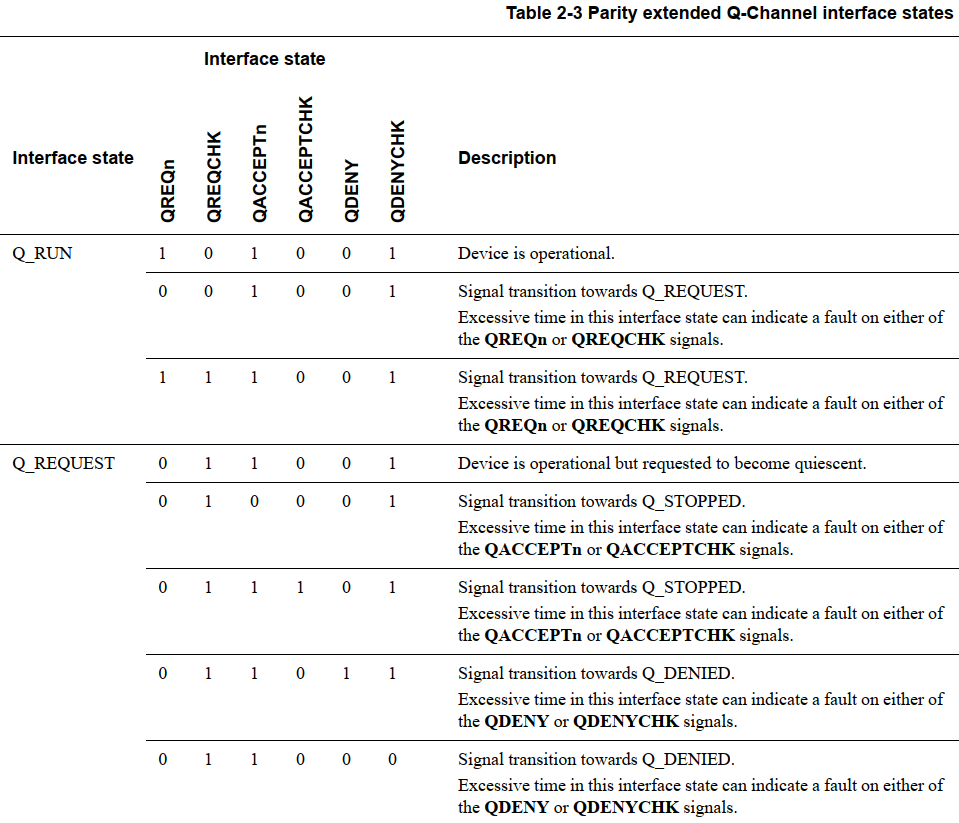

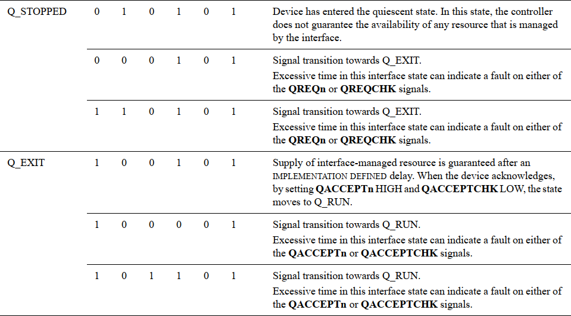

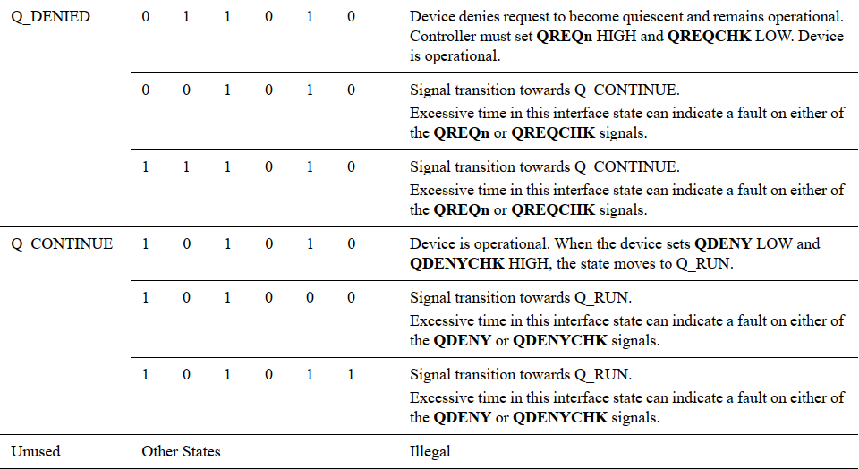

下图是根据信号状态和接口状态显示可能的握手序列的状态图。

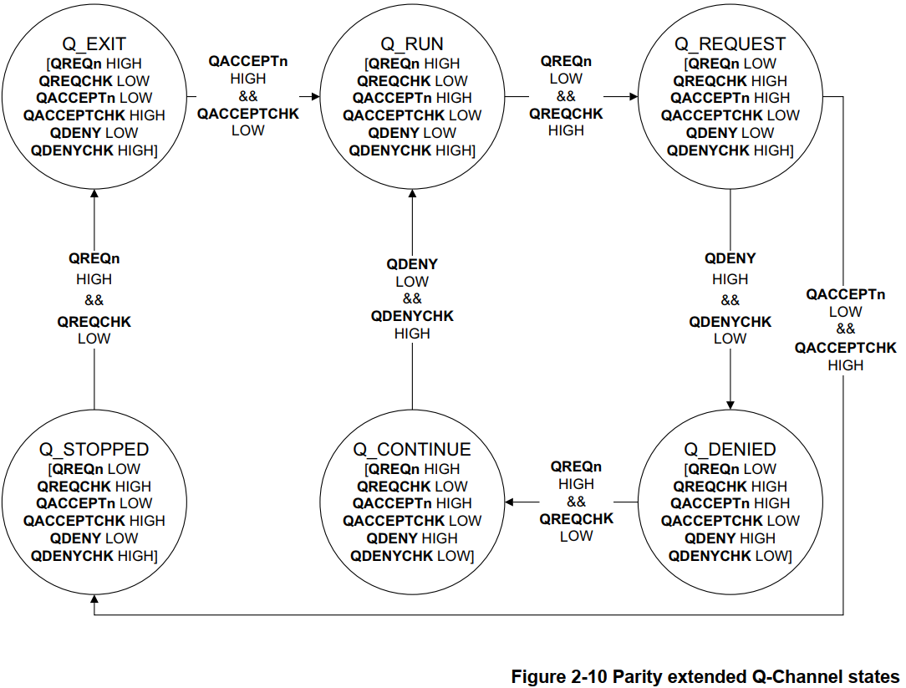

<strong>握手规则</strong>

握手规则包括：

-   QREQn只能从HIGH转换到LOW，QREQCHK只能从LOW转换到HIGH，当两者都：
    -   QACCEPTn为HIGH，而QACCEPTCHK为LOW。
    -   QDENY为LOW，QDENYCHK为HIGH。

-   QREQn只能从LOW转换到HIGH，QREQCHK只能在以下情况之一时从HIGH转换到LOW：
    -    以下所有条件均成立：
        -   QACCEPTn是LOW并且QACCEPTCHK是HIGH。
        -   QDENY为LOW，QDENYCHK为HIGH。
    -   或者以下所有条件都成立：
        -   QACCEPTn为HIGH，而QACCEPTCHK为LOW。
        -   QDENY为HIGH，QDENYCHK为LOW。

-   QACCEPTn只能从HIGH转换到LOW，而QACCEPTCHK只能从LOW转换到HIGH，当两者都：
    -   QREQn是LOW并且QREQCHK是HIGH。
    -   QDENY为LOW，QDENYCHK为HIGH。

-   QACCEPTn只能从LOW（低）转换到HIGH（高），QACCEPTCHK只能从HIGH（高时）转换到LOW（高时）：
    -   QREQn为HIGH且QREQCHK为LOW。
    -   QDENY为LOW，QDENYCHK为HIGH。

-   QDENY只能从HIGH转换到LOW，QDENYCHK只能从LOW转换到HIGH，当两者都：
    -   QREQn为HIGH且QREQCHK为LOW。
    -   QACCEPTn为HIGH，而QACCEPTCHK为LOW。

-   QDENY只能从LOW转换到HIGH，QDENYCHK只能从HIGH转换到LOW，当两者都：
    -   QREQn是LOW并且QREQCHK是HIGH。
    -   QACCEPTn为HIGH，而QACCEPTCHK为LOW。

<strong>信号子集</strong>

支持的信号子集与标准Q-Channel的信号子集对齐。在不存在信号的情况下，其相关联的检查信号也被去除。

如果设备要运行，未使用的设备接口必须具有绑定为HIGH的QREQn和绑定为LOW的QREQCHK。系统全权负责通过接口控制之外的方式管理设备的可用性。

### 2.3  Q-Channel实现

通常，设备和控制器是用异步时钟实现的。这些可以由相同的源时钟驱动，但具有显著的相位差。下图显示了在这种情况下重新同步的建议实现方式。

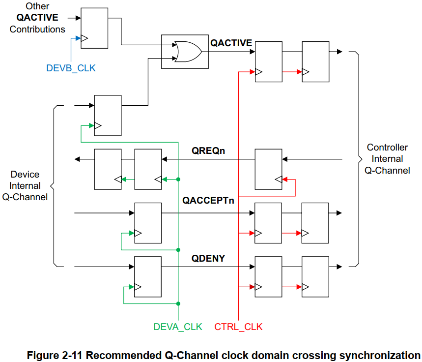

对于异步Q-Channel实现，建议向实现者提供以下指导：

-   使用前，在目的地重新同步所有信号。
-   只有当接口处于Q\_STOPPED状态时，才能移除时钟或电源。
-   为了确保四相握手的操作，请寄存所有QREQn、QACCEPTn和QDENY输出。
-   QACTIVE信号由寄存器直接驱动，或由多个寄存器驱动，这些寄存器的贡献在逻辑上是组合的。建议在可能的情况下将这种组合逻辑限制为逻辑OR，并使用实例化的门来实现。
-   当实现其他逻辑时，必须仔细考虑QACTIVE源寄存器变化对输出QACTIVE信号的影响。尽管握手协议在不考虑QACTIVE活动的情况下都能保证功能正确的行为，但建议实现尽可能简单的逻辑，以最大限度地减少在QACTIVE输出处引入故障的可能性。

<strong>——注意——</strong>

尽管下图显示了典型的两阶段同步，但必须针对所使用的技术库和所需的频率目标适当地实现重新同步。

<strong>——————</strong>

### 2.4 奇偶校验保护

在某些情况下，可能需要连接控制器和设备，其中一个具有奇偶校验保护，另一个没有。以下各节介绍了这些类型连接的集成要求。

当连接奇偶校验保护和非奇偶校验保护的控制器和设备时，接口没有或有有限的故障保护。

#### 2.4.1 非奇偶校验连接到奇偶校验

下图显示了非奇偶校验防护Q-Channel控制器与奇偶校验保护Q-Channel设备之间所需的集成。

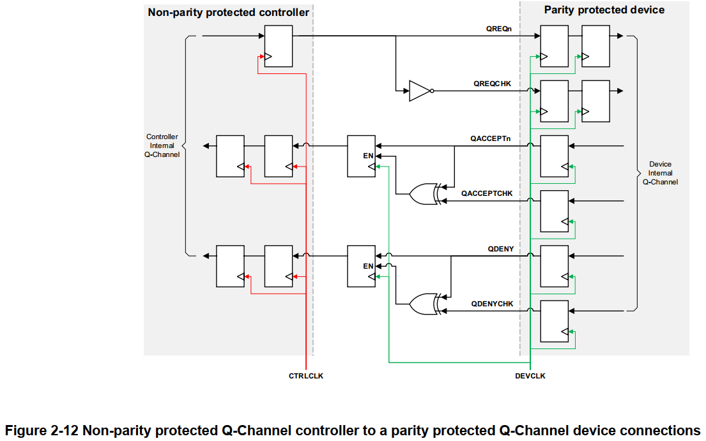

如果奇偶校验保护检查信号是在与标准Q-Channel信号不同的时钟上生成的，则必须额外考虑。如果是这样，则在将这些信号用于图中所示的QACCEPTn和QDENY集成逻辑之前，必须使用设备时钟对其进行重新同步。

<strong>QACTIVE</strong>

设备QACTIVE输出可以直接连接到控制器QACTIVE输入，设备QACTIVECHK输出保持未连接。这可能具有在两个信号在设备侧指示该要求之前在控制器处指示高电平或低电平的效果。

在这种情况下，Q-Channel握手确保设备根据设备请求保持状态。

但是，这种行为可能会导致不必要的转换。

在标准信号和检查信号都发生变化之前，可以使用其他集成选项来防止QACTIVE的传播。然而，通常需要将QACTIVE的传播保持为组合路径，以确保例如在本地时钟不可用时可以发出请求。

向QACTIVE路径添加大量的逻辑可能会导致故障。虽然这些故障不会由于如上所述的握手保证而导致故障，但它们可能会导致不必要的转换。

<strong>QREQn</strong>

QREQCHK信号是非奇偶校验保护控制器输出的QREQn的反相。

<strong>QACCEPTn和QDENY</strong>

要求对输入到非奇偶校验保护控制器的QACCEPTn进行调节，使得其仅在QACCEPTn和QACCEPTCHK都已更新到新值时才更新。

如果不存在这种条件，并且直接连接了QACCEPTn，那么当QACCEPTCHK没有改变时，对QACCEPTn的改变可能导致对QREQn的改变，这可能导致奇偶校验保护设备处的协议违反。

仅当QACCEPTn和QACCEPTCHK不同时，可以通过传播QACCEPTn值来提供这种调节。需要寄存器来保持最后的值，因为当在转换中时，无论它们转换到什么值，QACCEPTn和QACCEPTCHK信号都可以是HIGH或LOW。

对于从奇偶校验保护设备到非奇偶校验保护控制器的QDENY和QDENYCHK信号也必须做出相同的规定。

#### 2.4.2 奇偶校验连接到非奇偶校验

下图显示了奇偶校验保护Q-Channel控制器与非奇偶校验防护Q-Channel设备之间所需的集成。

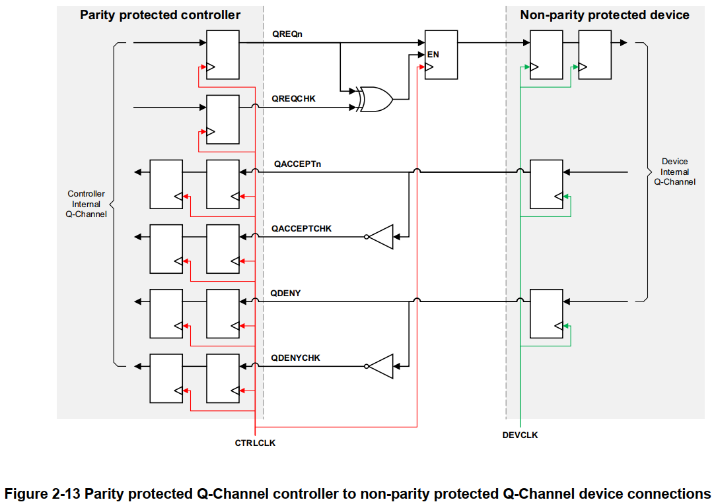

如果奇偶保护检查信号是在与标准Q-Channel信号不同的时钟上产生的，则必须考虑额外的因素。如果是这样，则在将这些信号用于图中所示的QREQn集成逻辑之前，必须将其重新同步到控制器时钟。

<strong>QREQn</strong>

要求对输入到非奇偶校验保护设备的QREQn进行调节，使得其仅在QREQn和QREQCHK都已更新到新值时才更新。

如果该条件不存在并且QREQn是直接连接的，则当QREQCHK没有改变时QREQn上的改变可能导致QACCEPTn或QDENY上的改变，这可能导致奇偶校验保护控制器处的协议冲突。

当QREQn和QREQCHK不同时，可以通过仅传播QREQn值来提供这种调节。需要寄存器来保持最后的值，因为当在转换中QREQn和QREQCHK信号可以都是HIGH或都是LOW，而不管它们转换到什么值。

<strong>QACCEPTn, QACTIVE, and QDENY</strong>

奇偶校验保护控制器的QACTIVECHK、QACCEPTCHK和QDENYCHK输入分别由QACTIVE、QACCEPTn和QDENY信号的反相产生。

### 2.5  Q-Channel应用示例

本节描述了Q-Channel接口的一些应用。

#### 2.5.1 多接口设备中的时钟依赖性

有些设备可能需要多个Q-Channel和P-Channel接口来管理设备的多个时钟、电源或功能域。具有多个接口的设备的设计和使用必须考虑每个接口的状态之间以及每个接口提供的保证之间的任何依赖性。

当设备通电时，最常见的依赖性是向设备提供时钟，因为处理任何操作或状态变化都需要时钟。

下图显示了一个具有两个接口的设备示例。

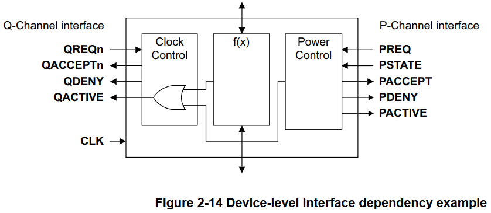

图中的设备具有Q-Channel时钟控制接口和P-Channel功率控制接口。

设备的正常功能，标记为功能块f（x），将对QACTIVE的活动提出要求，以确保CLK的可用性，从而可以处理其操作。

当功能块f（x）不活动时，在CLK不活动且时钟控制接口处于Q\_STOPPED的情况下，仍然可以发生使用PREQ和PSTATE的功率状态转换请求。然而，CLK必须是活动的，以便在电源状态转换之前在设备中执行所需的管理操作，并在电源控制接口上用PACCEPT或PDENY进行响应。

这意味着电源和时钟控制接口之间存在依赖关系。在该示例中，如来自功率控制接口逻辑的QACTIVE贡献所示，依赖性可以被解决，每当P-Channel转换需要CLK是活动的时，该功率控制接口电路是活动的。该QACTIVE贡献必须是功率P-Channel输入的组合组合，使得当CLK不存在时可以请求CLK。

用于其他目的的接口之间的依赖关系无法严格定义，可能会根据应用程序（设备设计或使用要求）进行解决。

#### 2.5.2 时钟控制的接口组合

将单个时钟域内多个设备的Q-Channel接口组合为一个控制器的所有权具有以下潜在优势：

-   从时钟控制器到多个同步设备的单一时钟插入路径简化了物理实现，降低了功耗。
-   当设备之间存在分层关系时，例如在流量方面，可以减轻第一个设备下游设备的握手延迟开销。

来自每个设备的Q-Channel接口可以在控制器处合并，也可以在中间功能块处合并为单个接口，然后将其呈现给控制器。

在所有情况下，解决方案必须在每个设备和控制器或组合功能块之间保留专用且独立的握手接口。这种握手非常重要，因为它可以确保在具有共享时钟的设备之间存在相互依赖关系的情况下，可以避免性能限制或潜在的死锁情况。

在图中所示的示例中，设备接口连接到控制器内的专用功能块，唯一共享的信号是控制器提供给两个设备的CLK信号。

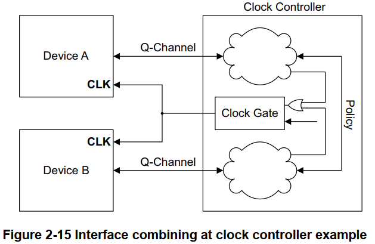

### 2.6 Q-Channel向后兼容性

本节介绍连接映射，以确保与AXI低功率接口设备和控制器的向后兼容性。

图中显示了不依赖于拒绝机制的支持AXI低功率接口的设备如何直接连接到不存在或绑定LOW QDENY信号的Q-Channel控制器。

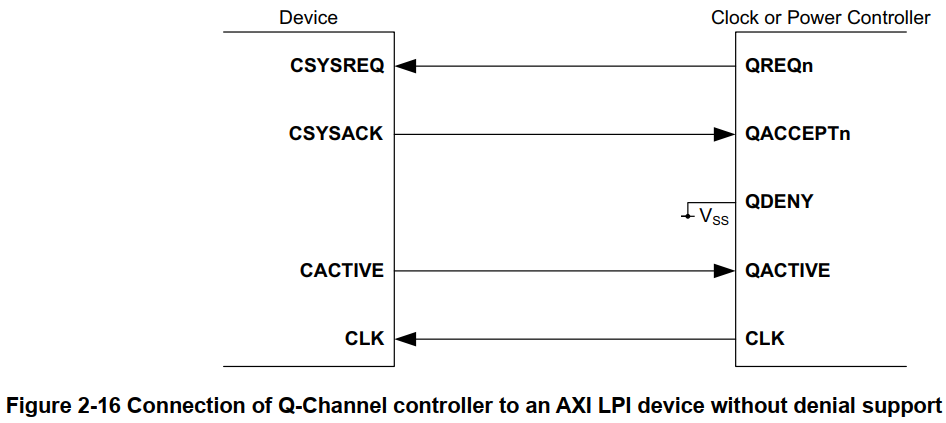

下图显示了AXI低功率接口控制器组件如何连接到Q-Channel设备，其中QDENY输出不存在或连接为低电平。在这种情况下，AXI低功率接口控制器不得解释拒绝条件，因为QACTIVE上的活动不受限制。

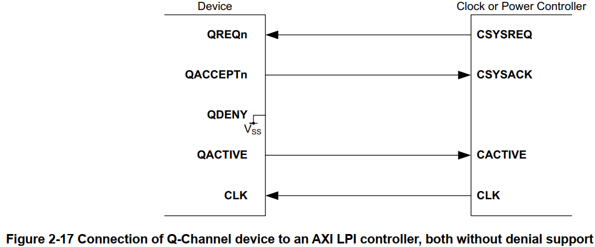

对于支持使用拒绝机制的AXI低功耗接口的设备，解决方案仅限于所有接口信号都限制在单个同步时钟域的情况。在这些限制范围内，可以实现生成Q-Channel确认信号的简单适配器组件，如图所示。该组件具有顺序要求，以确保在控制器处进行正确的无故障握手。

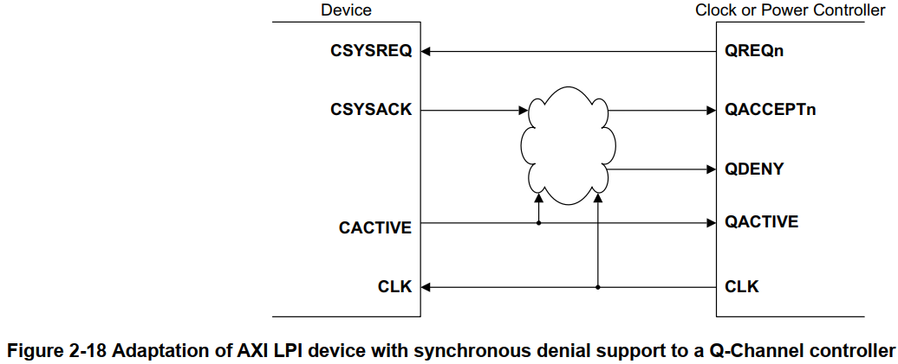

任何其他安排的成功整合都无法保证，需要对时间关系进行个案分析，特别是CACTIVE和CSYSACK之间的时间关系。

## 3 P-Channel

### 3.1 P-Channel接口规范

本节描述了控制电源状态转换的P-Channel接口。就本规范而言：

<strong>低功率状态</strong>

通常是这样一种状态：

-   功耗更低。
-   与较高的状态相比，设备的功能、性能或状态保持率较低。

<strong>较高功率状态</strong>

通常是指以下状态：

-   功耗更高。
-   与较低的状态相比，该设备具有更多的功能、性能或状态保持能力。

#### 3.1.1 P-Channel信号

下图显示了设备和功率控制器之间的P-Channel信号。

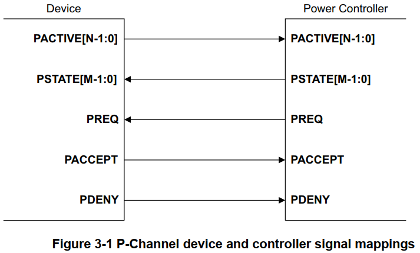

P-Channel接口包括以下信号组。

<strong>设备活动指示</strong>

该组包括N位信号PACTIVE\[N-1:0\]：

-   控制器上的每个PACTIVE位都可以由多个源信号组成。为了提供唤醒能力，这些源信号可以包括设备输入信号。每个PACTIVE位由寄存器直接驱动，或者由一个或多个寄存器和其输出逻辑组合的输入信号驱动。后文就P-Channel实现给出了PACTIVE组合逻辑的实现建议。
-   PACTIVE的所有位相互独立，可能来自各种异步源。

<strong>握手机制</strong>

此组管理设备电源状态转换。该组具有以下信号：

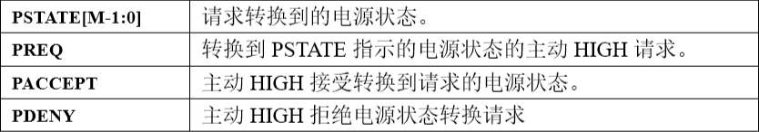

PREQ、PACCEPT和PDENY形成了一个握手接口，用于管理和保证安全的状态转换。握手接口具有由控制器驱动的转换请求信号PREQ和由设备驱动的用于指示接受或拒绝请求的确认信号对PACCEPT和PDENY。

P-Channel规范要求在单个握手转换中只有PACCEPT或PDENY中的一个改变。这确保了接口可以跨异步边界安全地实现。PACCEPT用于接受请求，PDENY用于拒绝请求。

来自设备的PACCEPT和PDENY信号以及来自控制器的PREQ和PSTATE信号都必须直接由寄存器驱动。PSTATE枚举是由实现定义的。建议使用“电源策略单元规范”中定义的值以实现兼容性。

拒绝机制的目的是使设备能够保持其当前状态，同时还具有一种可以迅速完成握手的机制。这意味着，如果系统条件发生变化，控制器可以发出另一个请求，可能是到不同的状态。

握手信号的极性被组织为使得它们在LOW状态下开始和结束每个转变。这方便了简单的默认隔离规则。

握手信号状态与PACTIVE位无关。PACTIVE位上的转换不受PREQ、PACCEPT和PDENY上的值的限制。

P-Channel接口还具有与设备或设备分区复位的协议关系。对于具有多个复位的设备，此处指定的复位关系用于与设备P-Channel逻辑相关联的复位。在本说明书中，名称RESETn用于表示该复位信号。然而，实际的复位命名和极性不在本规范的范围内，并且不受本规范的限制，前提是遵守所描述的关系。后文设备复位和初始化描述了复位和初始化转换。

#### 3.1.2 P-Channel握手

本节描述了P-Channel接口握手的允许变化。

接受状态转换图中显示了设备接受的从状态A到状态B的转换请求。

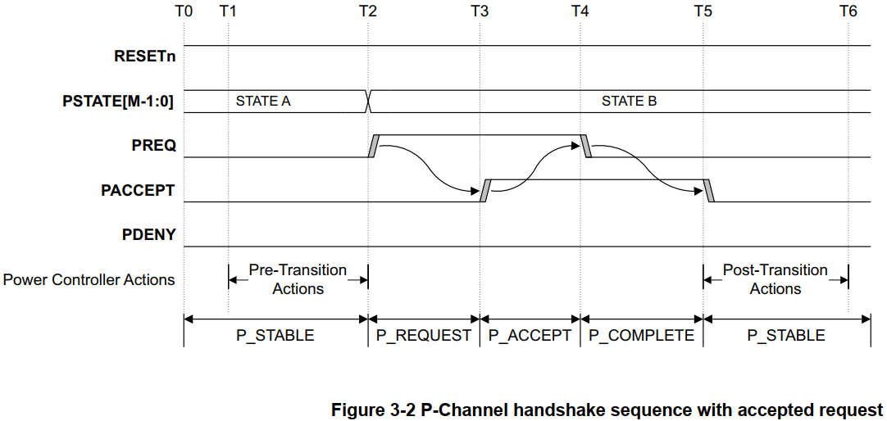

图中省略了PACTIVE，因为尽管PACTIVE可以作为控制器启动转换请求的激励，但它与握手无关。所有转换请求都可以由控制器单独发起。

图中所示的过渡是：

-   在T0，接口空闲，所有信号为LOW。接口状态为P\_STABLE，设备保持当前状态。
-   在T1，意识到需要握手请求，电源控制器必须在请求新状态之前采取任何必要的转换前行动。这些动作通常与向更高功率状态的转换相关联。这可能包括为域通电或使RAM脱离保留状态。

接口状态保持为P\_STABLE。

-   在T2，电源控制器将所需的电源状态值置于PSTATE上，并将PREQ设置为HIGH。接口状态现在为P\_REQUEST。当在设备处检测到PREQ变高时，该协议要求PSTATE是稳定的。这通常是通过将PREQ重新同步到设备时钟域并使用它来捕获PSTATE来实现的。
    -   控制器必须仅显示支持的PSTATE值并转换到设备。

-   在T3，设备通过驱动PACCEPT HIGH来接受转换。PDENY必须保持在LOW（低）。该设备现在可以使用任何更高状态的功能。接口状态现在为P\_ACCEPT。
-   在T4，功率控制器对PACCEPT HIGH进行采样，并设置PREQ LOW。接口状态为P\_COMPLETE。
-   在T5，设备对PREQ LOW进行采样，并设置PACCEPT LOW。一旦控制器对PACCEPT LOW进行采样，它就可以采取所需的任何转换后动作。这些动作通常与转换到较低功率状态相关联。这可能包括从电源域中移除电源或将RAM置于保留状态。转换现在完成，接口状态返回到P\_STABLE。

当在设置PACCEPT LOW之后移动到较低功率状态时，设备不能假设先前较高功率状态的任何属性的可用性。

<strong>——注意——</strong>

如果P-Channel转换到较低功率状态，则可以删除先前较高功率状态的任何属性的可用性。但是，不能保证移除，因此设备操作不应依赖于它或其他相关操作，例如设备复位。

<strong>——————</strong>

<strong>拒绝状态转换</strong>

下图显示了被设备拒绝的转换请求。

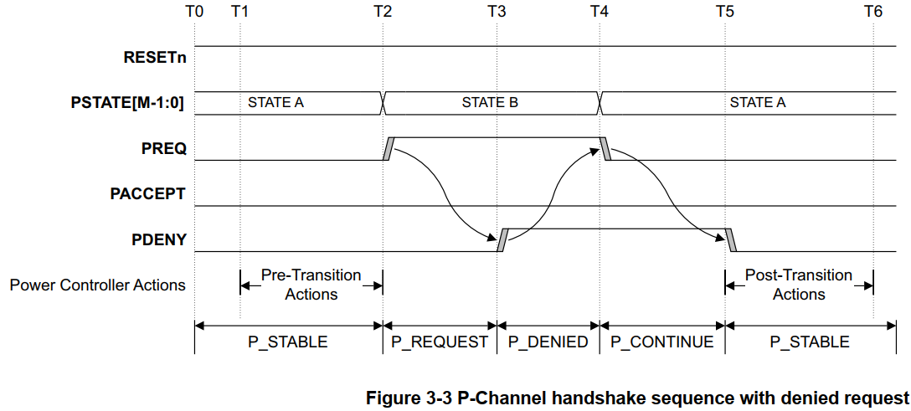

图中所示的过渡是：

-   T0、T1和T2遵循接受状态转换中所述的相同顺序。
-   在T3，设备通过设置PDENY HIGH来拒绝请求。PACCEPT必须保持LOW（低）。接口状态为P\_DENIED。
-   在T4，功率控制器对PDENY HIGH进行采样并设置PREQ LOW，并将PSTATE返回到当前状态A的值。当在设备上检测到PREQ变低时，协议要求PSTATE稳定并具有原始状态的值。接口状态为P\_CONTINUE。
-   在T5，设备采样PREQ LOW并设置PDENY LOW。一旦功率控制器对PDENY LOW进行采样，它就可以采取所需的任何转换后动作。在拒绝的情况下，这通常需要逆转在T1和T2之间采取的任何过渡前动作。被拒绝的转换序列完成，并且接口状态再次为P\_STABLE。

<strong>——注意——</strong>

在拒绝序列中，设备保留与其当前状态相关的所有操作能力。因此，设备的操作不会被转换请求中断。

<strong>——————</strong>

<strong>设备复位和初始化</strong>

在复位断言时，设备必须同时设置PACCEPT和PDENY LOW。PACTIVE位可以复位为LOW或HIGH。如果设备必须进入特定电源状态才能处理启动操作，则相关的PACTIVE位可以复位为HIGH。建议将所有PACTIVE位复位为LOW（低）。

控制器的设备复位断言必须仅在接口处于P\_STABLE状态或控制器和设备同时复位时发生。这与在功率边界处隔离所有信号LOW的建议一致。

为了便于设备在复位解除断言时初始化到所需状态，控制器提供PSTATE值，设备在采取适当的初始化动作之前必须对该值进行采样。当在设备上检测到复位解除断言时，该协议要求PSTATE是稳定的。

设备必须指定初始化周期tinit，这是在保证为所有可能的复位状态捕获PSTATE值之前，复位解除断言后所需的设备时钟周期数。设备电源状态和转换支持定义规定了此初始化期的要求。

在初始化期间，设备必须支持以下所有有效的控制器行为。

-   复位解除断言时PREQ为LOW。控制器在请求转换到新状态之前等待直到tinit过期。控制器必须确保适当的时钟在最短的时间内运行，以允许对PSTATE进行采样。此方法始终应用于未使用的接口，请参阅Unused接口。
-   在复位解除断言之前，控制器断言PREQ HIGH，然后等待，直到P-Channel转换完成，然后请求转换到新状态。对于主动管理的接口，建议优先使用此方法，而不是PREQ LOW行为。
-   复位解除断言时PREQ为LOW。在复位解除断言之后但在tinit过去之前，控制器保持PSTATE的值并断言PREQ HIGH。设备是否将其解释为第二次转换是由实现定义的。控制器在请求转换到新状态之前等待，直到P-Channel转换已经完成。

在复位退出或微调期间对PREQ HIGH进行采样时，设备只有在准备好接收另一个P-Channel请求时才能完成P-Channel转换。设备必须接受在复位出口或微调期间发出的第一个请求。

下图显示了控制器在发出新转换之前等待直到tinit过期，然后断言复位的情况。

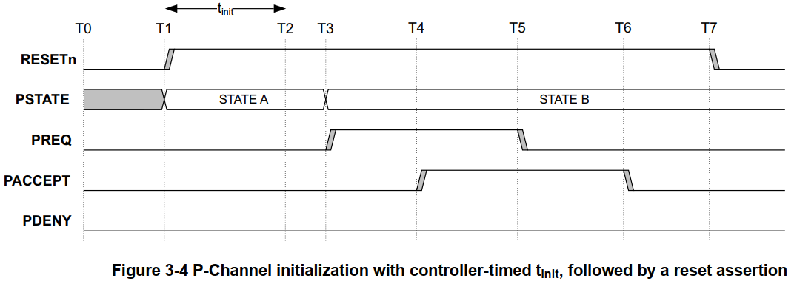

图中所示的过渡是：

-   T0时，接口空闲，设备处于复位状态。
-   在T0和T1之间，电源控制器必须在取消断言复位之前采取任何所需的预转换操作，例如通电域。
-   在T1，电源控制器将当前电源状态置于PSTATE，并释放复位。设备必须在tinit内捕获PSTATE值。当设备检测到复位无效时，控制器必须确保PSTATE稳定。对不同于其默认状态的初始PSTATE进行采样的设备将导致设备执行到该状态的内部转换。它应该延迟对后续P-Channel请求的响应，直到内部转换完成。
-   在T2，tinit完成，可以转换到新的状态。
-   在T3，控制器请求将设备置于状态B，从该状态可以安全返回复位。
-   在T3和T6之间，设备完成转换。
-   在T7，复位被断言。

图中显示了控制器在复位取消断言之前将PREQ设置为HIGH，然后等待P-Channel转换完成后再发出进一步请求的情况。当第一次转换完成时，即使在很短的时间内完成，设备也保证准备好接收另一个P-Channel请求。

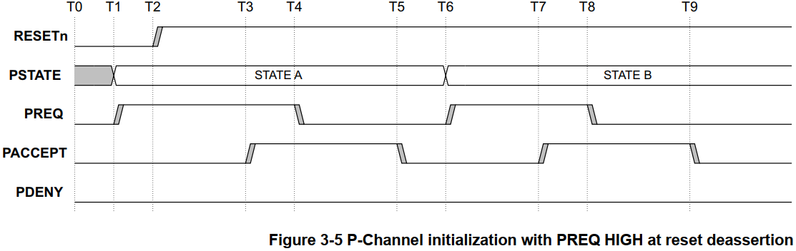

图中显示了控制器在复位取消断言后设置PREQ HIGH的情况，其PSTATE值与复位取消断言时相同。在发出进一步的请求之前，控制器等待直到P-Channel转换完成。当第一次转换完成时，即使在tnit时间内完成，设备也保证准备好接收另一个P-Channel请求。

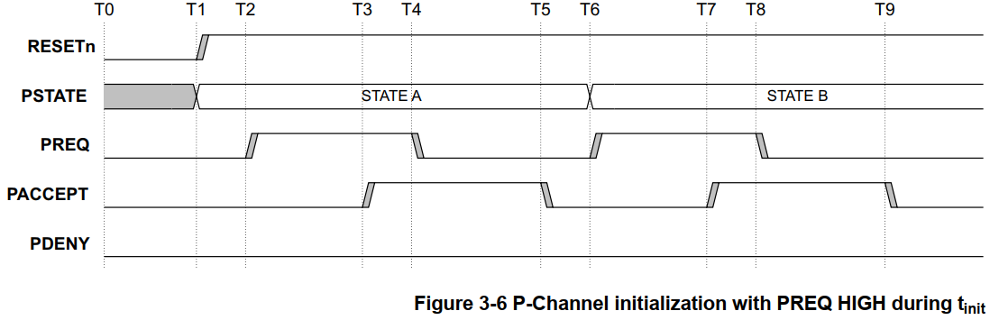

<strong>多电源状态转换</strong>

P-Channel接口可用于在多个电源状态之间转换，而无需通过公共操作状态。

图中显示了P-Channel接口如何从状态A转换到状态B，然后再转换到状态C，而不必返回到状态A。

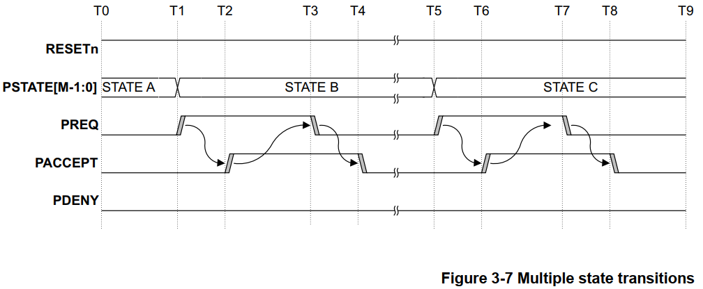

图中所示的过渡是：

-   在T0，接口处于P\_STABLE状态。
-   在T1和T4之间，接口从状态A转换到状态B，在T4返回到P\_STABLE接口状态。
-   在T5和T8之间，接口从状态B转换到状态C，而不必首先返回到状态A。

<strong>接口状态</strong>

下表显示了接口状态。如果设备没有实现拒绝机制，则PDENY被绑定为LOW或不存在，并且前五个状态构成完整集合。

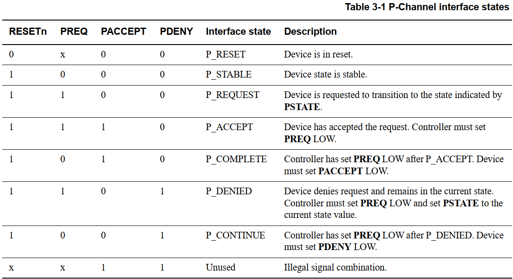

下图是根据每个状态变化的信号状态和接口状态显示可能的握手序列的状态图。

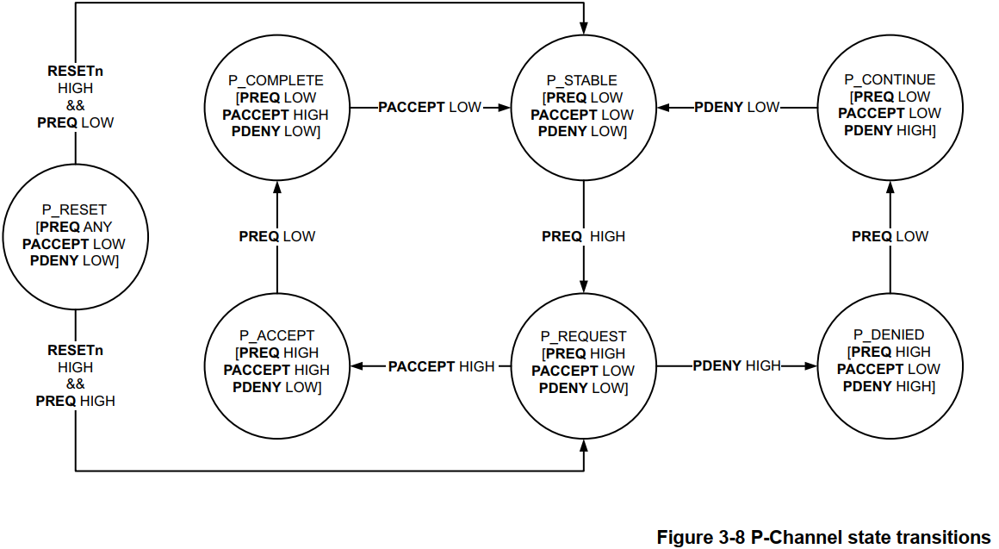

<strong>握手规则</strong>

握手信号规则为：

-   只有当PACCEPT和PDENY均为LOW时，PREQ才能从LOW转换为HIGH。
-   PREQ只能在以下任一情况下从HIGH（高）转换为LOW（低）：
    -   PACCEPT为高，PDENY为低。
    -   PACCEPT为LOW，PDENY为HIGH。

-   PSTATE只能在以下任一情况下转换：
    -   PREQ、PACCEPT和PDENY均为LOW。
    -   PREQ和PDENY均为高，PACCEPT为低。

-   PACCEPT只能在PREQ为HIGH且PDENY为LOW时从LOW转换为HIGH。
-   PACCEPT只能在PREQ为LOW且PDENY为LOW时从HIGH转换为LOW。
-   PDENY只能在PREQ为HIGH且PACCEPT为LOW时从LOW转换为HIGH。
-   PDENY只能在PREQ为LOW且PACCEPT为LOW时从HIGH转换为LOW

#### 3.1.3 PACTIVE操作

PACTIVE输出位用于向功率控制器指示设备要求，每个位表示不同的要求。PACTIVE位为HIGH表示应提供该要求以允许操作进行。PACTIVE位为LOW表示不再需要该要求。

P-Channel握手独立于PACTIVE，并且控制器可以做出任何策略决策，而与PACTIVE上的任何转换无关。但是，设备可以拒绝任何不合适的请求。

PACTIVE比特的排列不受限制。然而，设备支持的每个功率状态的典型PACTIVE布置是具有相关联的PACTIVE输出位，从最低有效位（LSB）上的最低状态到最高有效位（MSB）上的最高状态排序。断言的最高PACTIVE位指示设备进行操作所需的最小功率状态。在本例中，P-Channel控制器转换请求的行为如下：

-   如果电源控制器的状态低于设置为HIGH的最高PACTIVE位对应的状态，则控制器请求转换到该状态或任何更高的支持状态，以允许操作进行。

电源控制器未能响应更高状态的请求可能会导致系统死锁。

-   如果功率控制器处于比对应于设置为HIGH的最高PACTIVE位的状态更高的状态，则控制器可以请求转换到所请求的最小值或以上的任何状态。
-   设备可能不会使用所有PACTIVE位来明确请求相应的状态。在这种情况下，以下规则适用：
    -   未使用的PACTIVE位必须省略或绑定为LOW。
    -   当未使用的PACTIVE比特高于驱动的PACTIVE比特所请求的最小值时，进入对应于该比特的状态是一个执行定义的系统决策。

由PACTIVE位表示的状态从最低有效位到最高有效位的排序是IMPLEMENTATION DEFINED，但通常对应于增加的功能和功耗。

另请参阅PACTIVE用法。

<strong>控制器策略和PACTIVE</strong>

图中显示了基于不断变化的PACTIVE值的设备主导的功率转换示例。

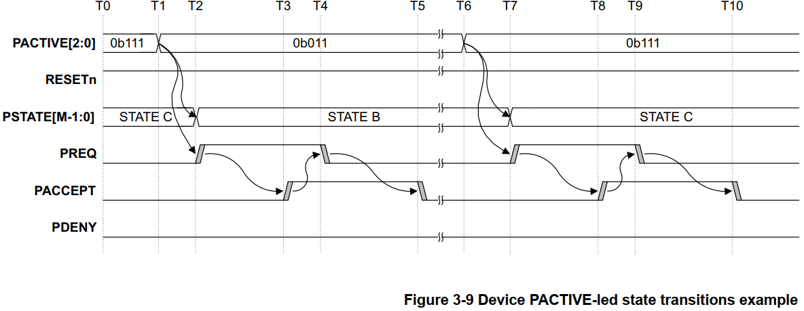

在这个例子中，PACTIVE比特被映射到如下的功率状态：

-   PACTIVE\[2\]：状态C
-   PACTIVE\[1\]：状态B
-   PACTIVE\[0\]：状态A

图中所示的转换为：

-   在T1，PACTIVE\[2\]变为LOW，使状态B成为新的最小值，因为PACTIVE\[1:0\]仍然为HIGH。
-   在T2和T5之间，接口转换到状态B。
-   在T6，PACTIVE\[2\]变为HIGH，表示需要状态C。
-   在T7和T10之间，接口转换到状态C。

#### 3.1.4 设备电源状态和过渡支持定义

为了允许正确的控制器设计，设备文档必须包括其电源状态的完整列举以及它们之间允许的转换，并指定以下内容：

-   所有支持的设备电源状态，包括：
    -   PSTATE定义和编码。
    -   设备要求的PACTIVE位分配。
    -   建议使用PACTIVE输出来启动状态转换。
    -   绑定为LOW或被省略的PACTIVE位。

-   支持设备电源状态之间的转换，包括：
    -   如果控制器请求转换到当前设备状态，则设备所采取的任何操作。
    -   可以有条件地拒绝哪些支持的设备电源状态转换。

-   设备状态初始化复位解除断言时支持的PSTATE值。
-   复位解除断言后的设备时钟周期中的周期tinit，在此之后，设备保证已对所有可能的有效复位状态的PSTATE进行采样。如果一个设备有多个时钟，它还必须指定与此周期相关的时钟。
    -   定义的周期通常取决于从复位退出起时钟可用性的任何延迟。如果时钟可用性定时取决于系统，则必须将其考虑在内。

#### 3.1.5 信号子集

本节描述了允许省略某些接口信号的信号子集的要求。

<strong>Unused接口</strong>

未使用的接口必须将PREQ输入信号绑定为LOW，将PSTATE输入绑定到与复位被取消断言时设备需要进入的状态对应的值。

此外，该PSTATE值必须与功能状态绑定，并且设备必须支持从复位直接进入该状态才能操作。

<strong>省略PDENY</strong>

不需要拒绝转换请求的设备可以省略PDENY。

在这种情况下，PDENY必须在控制器处连接为LOW。

### 3.2 奇偶校验扩展P-Channel接口

奇偶校验扩展P-Channel接口是对P-Channel接口的补充，允许检测和减轻接口上的单比特故障。

#### 3.2.1 奇偶扩展P-Channel信号

在奇偶扩展P-Channel中，标准P-Channel接口中的每个信号都有一个相关的校验信号。

下表显示了每个标准P-Channel信号的检查信号。

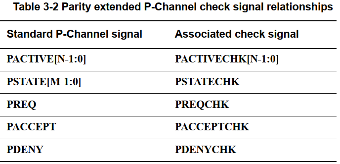

每个校验信号为其相关信号提供奇数奇偶校验。PSTATECHK是一个比特，而与PSTATE的宽度无关。每比特PACTIVE有一比特PACTIVECHK。下图显示了奇偶校验扩展P-Channel的信号方向。

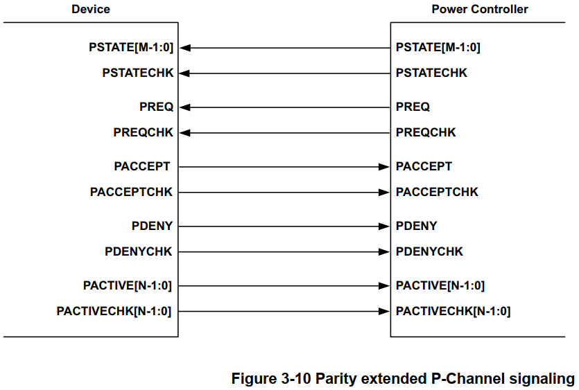

该协议要求当在设备上检测到PREQ或PREQCHK的变化时，PSTATE和PSTATECHK都是稳定的。

在P-Channel信号的到达与其相关联的检查信号之间不存在定时要求。然而，到达时间应该由一种实现来限定，以提供用于信号的故障检查的窗口。

此窗口的大小是实现自定义的。

#### 3.2.2 奇偶校验扩展P-Channel握手

本节介绍奇偶校验扩展P-Channel接口握手。

本节中的图表显示了每个P-Channel信号和相关的检查信号同时发生变化。

然而，这并不是一项要求，仅为了示意图的方便而显示。直到P-Channel信号和相关的检查信号都处于其所需状态，P-Channel状态才会进展。

<strong>接受的状态转换</strong>

下图显示了接受的转换请求的握手序列。

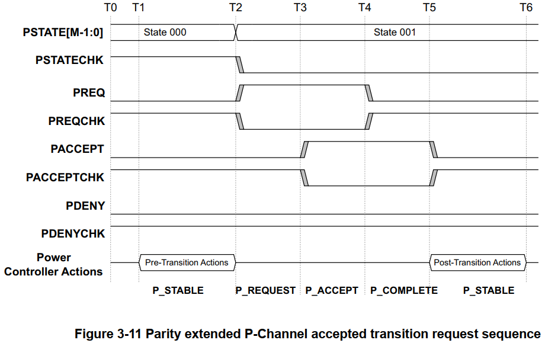

图中省略了PACTIVE和PACTIVECHK，因为它们独立于握手。这些信号可以作为控制器改变接口状态的激励。然而，所有接口状态的改变都可以由控制器单独启动。有关更多信息，请参阅PACTIVE操作。

这里显示的PSTATE编码是示例，用于说明PSTATE和PSTATECHK之间的关系。

图中所示的过渡是：

-   T0：P-Channel处于P\_STABLE状态，状态为0b000。设备保持当前状态。
-   T1：认识到需要转换请求，功率控制器必须在请求新状态之前采取任何必要的转换前动作。这些动作通常与向更高功率状态的转换相关联。这可能包括打开域电源或使RAM脱离保留状态。接口状态保持为P\_STABLE。
-   T2：功率控制器将所需的功率状态值置于PSTATE和PSTATECHK上，并设置PREQ HIGH和PREQCHK LOW。接口进入P\_REQUEST。当在设备上检测到PREQ和PREQCHK的变化时，协议要求PSTATE和PSTATECHK是稳定的。这通常是通过将PREQ和PREQCHK重新同步到设备时钟域并使用两者上的变化来生成用于捕获PSTATE的选通来实现的。
-   T3：设备通过设置PACCEPT HIGH和PACCEPTCHK LOW来接受转换。PDENY必须保持为LOW（低），PDENYCHK必须保持为HIGH（高）。该设备现在可以利用任何更高状态的功能。接口状态现在为P\_ACCEPT。
-   T4：功率控制器已对PACCEPT HIGH和PACCEPTCHK LOW进行采样，并设置PREQ LOW和PREQCHK HIGH。接口状态为P\_COMPLETE。
-   T5：设备已对PREQ LOW和PREQCHK HIGH进行采样，并设置PACCEPT LOW和PACCEPTCHK HIGH。一旦控制器对PACCEPT LOW和PACCEPTCHK HIGH进行采样，它就可以采取所需的任何转换后动作。这些动作通常与转换到较低功率状态相关联。这可能包括从电源域中移除电源或将RAM置于保留状态。转换现在完成，接口状态返回到P\_STABLE。当在设置PACCEPT LOW和PACCEPTCHK HIGH之后移动到较低功率状态时，设备不能假设先前较高功率状态的任何属性的可用性。

<strong>设备复位和初始化</strong>

在复位断言时，设备必须驱动：

-   PACCEPT LOW和PACCEPTCHK HIGH。
-   PDENY LOW和PDENYCHK HIGH。

强烈建议将所有PACTIVE位复位为LOW（低）和所有PACTIVECK位复位为HIGH（高）。只有当接口处于P\_STABLE状态或控制器和设备同时被复位时，控制器才能断言设备复位。初始化过程的其余部分与设备复位和初始化中所述的相同，只是在检查信号上添加了相关电平。

下表总结了接口状态和设备可用性。

如果设备没有实现拒绝机制，则可以存在或省略PDENY和PDENYCHK信号。如果存在且拒绝未实现，则PDENY必须绑定为LOW，PDENYCHK必须绑定为HIGH。

如果未实现拒绝，则表中PDENY HIGH或PDENYCHK LOW的行是非法的。

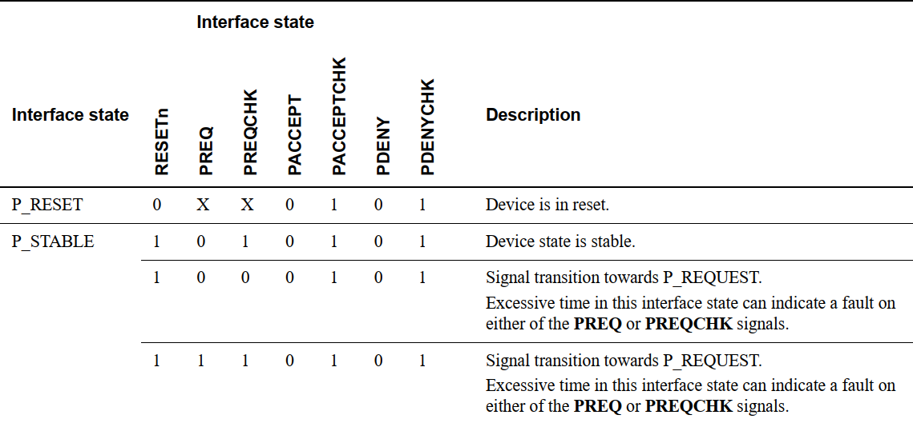

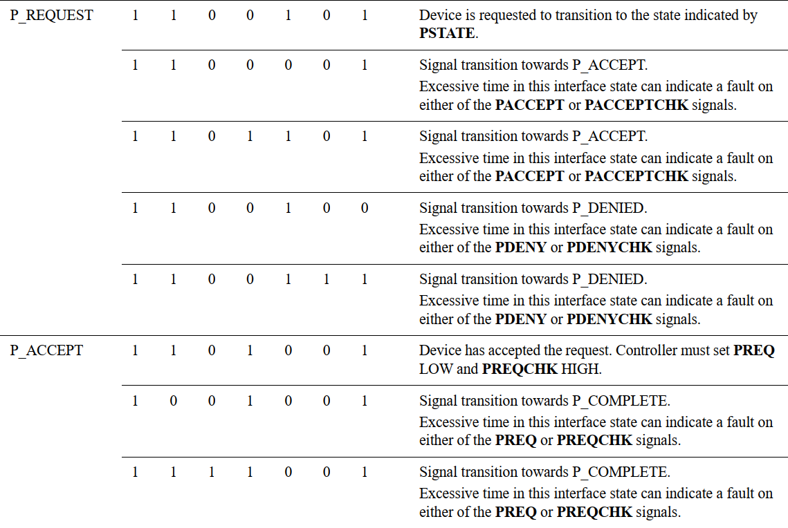

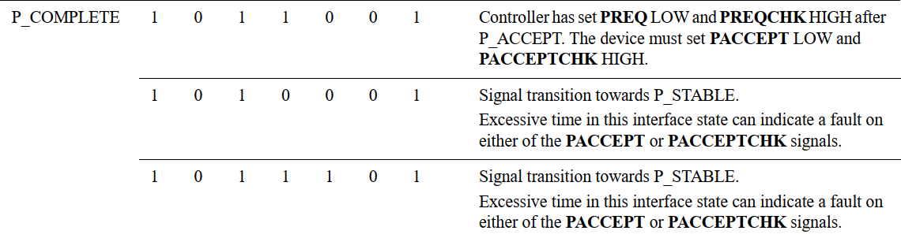

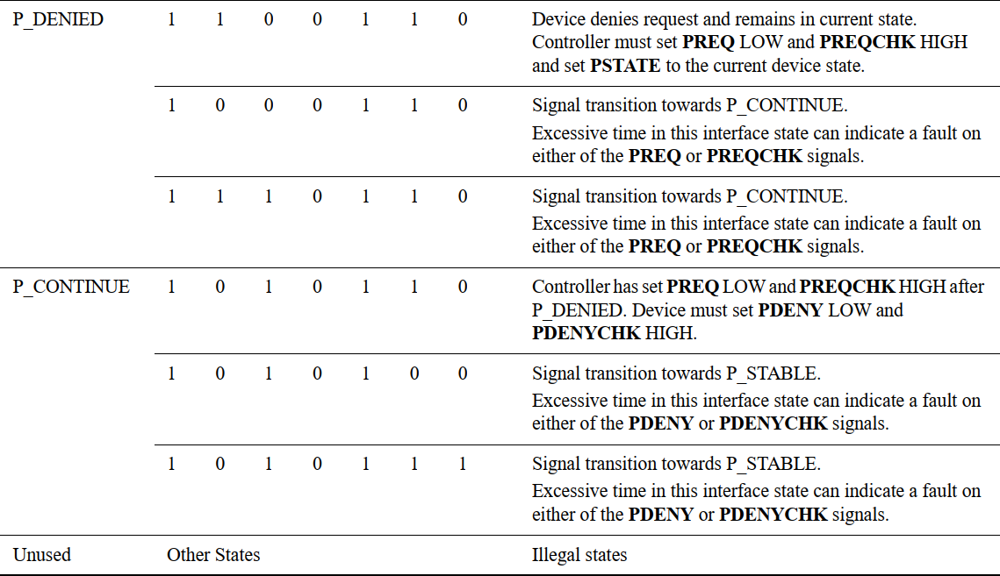

下图是一个状态图，显示了根据信号状态和接口状态可能的握手序列。

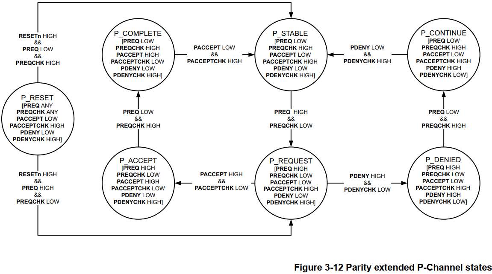

<strong>握手规则</strong>

握手规则是：

-   当以下所有条件都成立时，PREQ只能从LOW转换到HIGH，PREQCHK可以从HIGH转换到LOW：
    -   PACCEPT为LOW，PACCEPTCHK为HIGH。
    -   PDENY为LOW，PDENYCHK为HIGH。

-   PREQ只能从HIGH转换到LOW，PREQCHK可以从LOW转换到HIGH，当：
    -   以下所有条件均成立：
        -   PACCEPT为HIGH，PACCEPTCHK为LOW。
        -   PDENY为LOW，PDENYCHK为HIGH。
    -   或者以下所有条件都成立：
        -   PACCEPT为LOW，PACCEPTCHK为HIGH。
        -   PDENY为高，PDENYCHK为低。

-   PSTATE和PSTATECHK只能在以下任一情况下转换：
    -   以下所有条件均成立：
        -   PREQ为LOW，PREQCHK为HIGH。
        -   PACCEPT为LOW，PACCEPTCHK为HIGH。
        -   PDENY为LOW，PDENYCHK为HIGH。
    -   或者以下所有条件都成立：
        -   PREQ为高，PREQCHK为低。
        -   PACCEPT为LOW，PACCEPTCHK为HIGH。
        -   PDENY为高，PDENYCHK为低。

-   当以下所有条件都成立时，PACCEPT只能从LOW转换到HIGH，PACCEPTCHK可以从HIGH转换到LOW：
    -   PREQ为高，PREQCHK为低。
    -   PDENY为LOW，PDENYCHK为HIGH。

-   当以下所有条件都成立时，PACCEPT只能从HIGH转换到LOW，PACCEPTCHK可以从LOW转换到HIGH：
    -   PREQ为LOW，PREQCHK为HIGH。
    -   PDENY为LOW，PDENYCHK为HIGH。

-   当以下所有条件都成立时，PDENY只能从LOW转换到HIGH，PDENYCHK可以从HIGH转换到LOW：
    -   PREQ为高，PREQCHK为低。
    -   PACCEPT为LOW，PACCEPTCHK为LOW。

-   当以下所有条件都成立时，PDENY只能从HIGH转换到LOW，PDENYCHK可以从LOW转换到HIGH：
    -   PREQ为LOW，PREQCHK为HIGH。
    -   PACCEPT为LOW，PACCEPTCHK为HIGH。

<strong>PACTIVE操作</strong>

任何未使用的PACTIVE位及其相关的PACTIVECHK位应：

-   省略两个信号。
-   将PACTIVE位绑定为LOW，将PACTIVECK位绑定为HIGH。有关更多信息，请参阅PACTIVE操作。

<strong>信号子集</strong>

所支持的信号子集与标准P-Channel的信号子集对齐。在不存在信号的情况下，其相关联的检查信号也被去除。未使用的接口必须具有绑定为LOW的PREQ输入信号和绑定为HIGH的PREQCHK输入信号。

PSTATE和PSTATECHK输入值必须与功能状态绑定，并且设备必须支持从复位直接进入该状态才能操作。

<strong>PDENY省略</strong>

不要求拒绝转换请求的设备可以省略PDENY和PDENYCHK。在这种情况下，PDENY必须在控制器处被绑定为LOW，而PDENYCHK必须被绑定为HIGH。

### 3.3 P-Channel实现

通常，设备和控制器是用异步时钟实现的。下图显示了在这种情况下重新同步的建议实施方式。此图未显示复位取消断言时捕获PSTATE的机制。

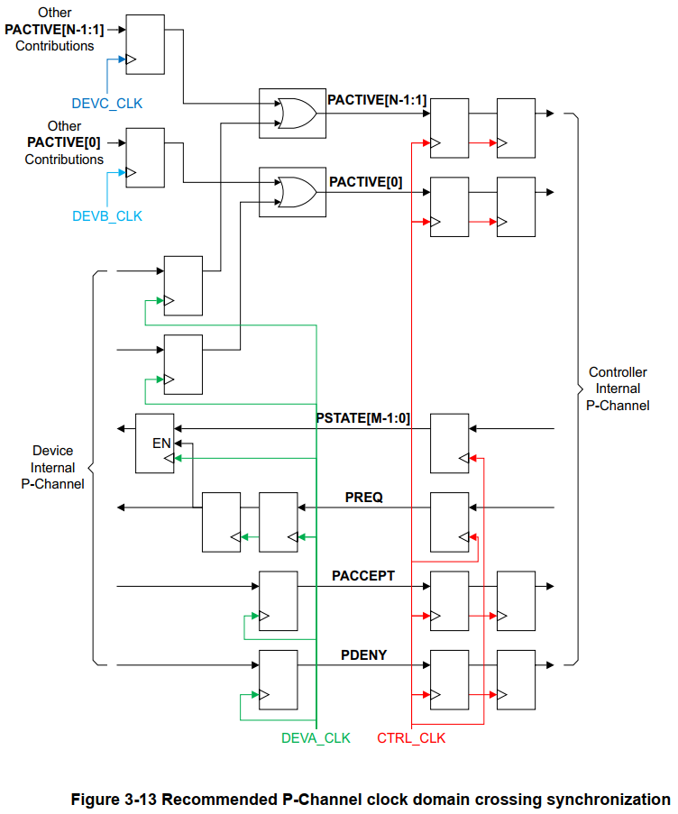

对于异步P-Channel实现，建议向实现者提供以下指导：

-   在使用前重新同步所有信号，但目的地的PSTATE除外。
-   寄存PSTATE输出，以确保其不会出现故障。
-   为了确保四相握手的操作，请寄存所有PREQ、PACCEPT和PDENY输出。
-   PACTIVE的每一位都由一个寄存器直接驱动，或者由多个寄存器驱动，这些寄存器的贡献在逻辑上是组合的。建议在可能的情况下将这种组合逻辑限制为逻辑OR，并使用实例化的门来实现。
-   当实现其他逻辑时，必须仔细考虑PACTIVE源寄存器变化对PACTIVE输出位的影响。尽管握手协议在不考虑PACTIVE活动的情况下都能保证功能正确的行为，但建议实现尽可能简单的逻辑，以最大限度地减少在PACTIVE输出处引入故障的可能性。

<strong>——注意——</strong>

尽管图中显示了典型的两阶段同步，但必须针对所使用的技术库和所需的频率目标适当实施重新同步。

<strong>——————</strong>

#### 3.3.1 捕获PSTATE

PSTATE值可在几种不同的情况下获取：

-   PSTATE必须在复位解除断言时捕获。因此，设备必须具有用于在此时捕获PSTATE的机制。
-   当设备采样PREQ HIGH时，必须捕捉PSTATE。这可以通过将PREQ重新同步到设备时钟域并使用它来捕获PSTATE来实现，如图所示。
-   当请求被拒绝时，可以捕获PSTATE。设备可以在P-Channel请求期间保留其当前状态的知识，或者在PREQ变为LOW时在拒绝之后再次采样PSTATE值。

因此，当设备以PDENY HIGH采样PREQ LOW时，可以捕获PSTATE值。

实现器可以对PSTATE信号施加最大延迟时序约束，以确保它在PREQ同步之前到达其捕获寄存器。

如果PSTATE需要额外的时间裕度，则在设置所需PSTATE值和设置PREQ HIGH之间的控制器上添加时钟周期。

图中显示了一个示例，其中在PREQ被驱动为HIGH之前设置PSTATE。

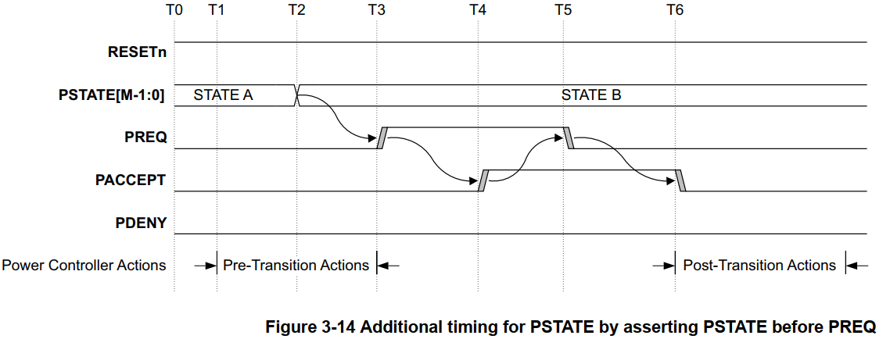

在T2，PSTATE被设置为下一状态所需的值。然后存在延迟，直到当PREQ被断言时的T3。

<strong>——注意——</strong>

电源控制器可以执行预转换操作，直到PREQ设置为HIGH，因为设备在采样PREQ HIGH之前不得采取任何操作。

<strong>——————</strong>

#### 3.3.2 支持的PSTATE初始化值

强烈建议设备至少支持一个PSTATE初始化值，以便于从复位直接退出到功能状态。

### 3.4 奇偶校验保护连接到非奇偶校验

在某些情况下，可能需要连接控制器和设备，其中一个具有奇偶校验保护，而另一个没有。以下各节介绍了这些类型连接的集成要求。

当连接奇偶校验保护和非奇偶校验保护的控制器和设备时，接口没有或有有限的故障保护。

#### 3.4.1 非奇偶校验连接到奇偶校验保护

下图显示了非奇偶校验保护P-Channel控制器与奇偶校验保护的P-Channel设备之间所需的集成。

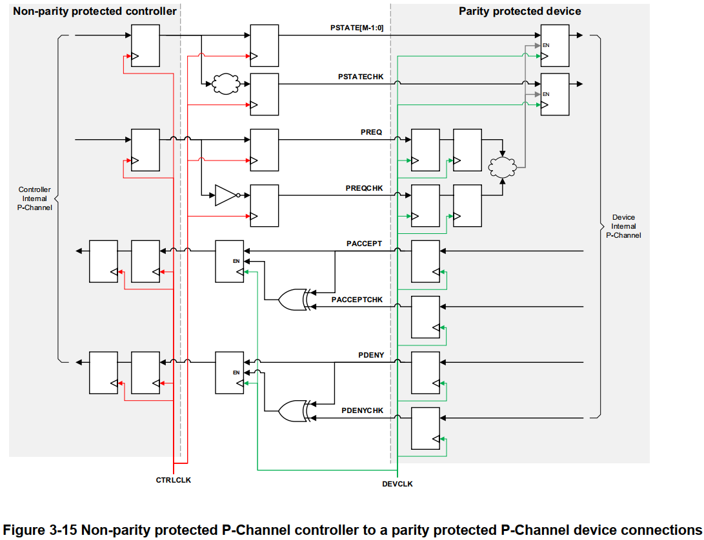

如果奇偶校验保护检查信号是在与标准P-Channel信号不同的时钟上生成的，则必须额外考虑。如果是这样，这些信号在用于PACCEPT和PDENY集成逻辑之前必须与设备时钟重新同步，如图所示。

<strong>PACTIVE</strong>

每个PACTIVE位必须单独调节，因为每个都是功率模式要求的独立指示。每个设备PACTIVE输出位可以直接连接到相应的控制器PACTIVE输入位，并且相应的设备PACTIVECHK输出位不连接。

这可能具有在两个信号在设备侧指示该要求之前在控制器处指示高电平或低电平的效果。在这种情况下，P-Channel握手确保设备保持适合设备请求的电源模式。但是，这种行为可能会导致不必要的P-Channel请求。

在标准信号和校验信号都发生变化之前，可以使用替代的积分选项来防止PACTIVE比特的传播。然而，通常需要将每个PACTIVE比特的传播保持为组合路径，以确保例如当本地时钟不可用时可以进行请求。

在PACTIVE位路径中添加大量的逻辑可能会导致故障。虽然这些小故障不会由于如上所述的握手保证而导致故障，但它们可能会导致不必要的转换。

<strong>PSTATE</strong>

设备PSTATECHK输入必须由PSTATE值生成。PSTATECHK值被计算为PSTATE值的奇数奇偶校验。该信号在被计算之后必须被寄存到控制器时钟，以确保其适合于在设备时钟域中捕获。

<strong>PREQ</strong>

PREQCHK信号应该由非奇偶校验保护的PREQ控制器输出产生。这可以通过简单的反演来完成。PREQ和PREQCHK应在生成后额外寄存，以确保它们的传播延迟与必须在生成后寄存的PREQCHK一致。

<strong>PACCEPT和PDENY</strong>

要求对非奇偶校验保护控制器的PACCEPT输入进行调节，使得其仅在PACCEPT和PACCEPTCHK都已更新到新值时才更新。

如果不存在这种条件，并且PACCEPT是直接连接的，那么当PACCEPTCHK没有改变时，PACCEPT上的改变可能会导致PREQ或PREQCHK上的改变，这可能会导致奇偶校验保护设备上的协议冲突。

只有当PACCEPT和PACCEPTCHK不同时，才能通过传播PACCEPT值来提供这种调节。需要寄存器来保持最后一个值，因为在转换中PACCEPT和PACCEPTCHK信号可以都是HIGH或都是LOW，而不管它们转换到什么值。

对于从奇偶校验保护设备到非奇偶校验保护控制器的PDENY和PDENYCHK信号也必须做出相同的规定。

#### 3.4.2 奇偶校验保护连接到非奇偶校验

下图显示了奇偶校验保护的P-Channel控制器与非奇偶校验保护P-Channel设备之间所需的集成。

如果奇偶校验保护检查信号是在与标准P-Channel信号不同的时钟上生成的，则必须额外考虑。如果是这样，则在将这些信号用于图中所示的PREQ集成逻辑之前，必须使用控制器时钟对其进行重新同步。

<strong>PSTATE</strong>

PSTATE值应直接连接。PREQ上的条件可确保握手以正确的顺序进行。

<strong>PREQ</strong>

要求对非奇偶校验保护设备的PREQ输入进行调节，使得其仅在PREQ和PREQCHK都已更新到新值时才更新。

如果不存在此条件，并且PREQ是直接连接的，那么当PREQCHK没有改变时，PREQ上的改变可能会导致PACCEPT或PDENY上的改变，这可能会在奇偶校验保护的控制器上导致协议冲突。

当PREQ和PREQCHK不同时，可以通过仅传播PREQ值来提供这种调节。需要寄存器来保持最后的值，因为当在转换中PREQ和PREQCHK信号可以都是HIGH或都是LOW，而不管它们转换到什么值。

<strong>PACTIVE, PACCEPT和PDENY</strong>

奇偶校验保护控制器的PACTIVECHK、PACCEPTCHK和PDENYCHK输入应分别由PACTIVE、PACCEPT和PDENY信号的反相产生。

### <strong>3.5 P-Channel应用示例</strong>

本节说明了P-Channel接口的一些应用。

#### <strong>3.5.1 电源域管理</strong>

可以支持P-Channel设备控制逻辑：

-   在管理电源域内。
-   在支持嵌套子电源域的父电源域内。

图中显示了一个简单的示例，其中跨两个设备的三个电源域。

在图中，设备0完全位于一个电源域中，而设备1包含两个电源域。每个功率域都有一个P-Channel接口，并且在所有情况下，P-Channel控制逻辑都包含在该功率域中。

在这种安排中，每个功率域只能在具有相应P-Channel响应的状态之间进行转换，如果该域中的逻辑功能当时可用的话。这样的设备不能从没有可操作逻辑的状态使用PACTIVE来创建唤醒信号。在这种状态下，系统负责唤醒信号。

由于至少需要一些逻辑功能来响应P-Channel请求，因此这种安排不能支持仅RAM的电源域。

图中显示了具有多个电源域的设备示例，其中主域和两个辅助域之间存在父子关系。

在图中，电源域0是父域，与子电源域、电源域1和电源域2具有先开后关的关系。所有P-Channel接口逻辑和控制逻辑均位于电源域0内。

在这种情况下，设备能力可以包括父域检测和代表次级功率域使用PACTIVE的唤醒条件的信号，以引起向更高状态的转换。例如，这可以实现对次级功率域的机会主义功率状态控制，否则可能很复杂或不可能在系统级实现。

次级电源域也可以在没有任何可操作逻辑的情况下在任一状态下的接口上的状态之间转换。此示例既可以支持在不同级别的非操作电源状态之间增加状态管理灵活性，也可以支持使用不包含逻辑功能的域，例如仅RAM的电源域。

#### 3.5.2 PACTIVE用法示例

图中显示了设备电源状态和支持转换的示例。

表中显示了设备的电源状态和相关的P-Channel行为。

PACTIVE\[0\]表示OFF状态。它可以被设备省略，因为这是当所有其他比特都为低时的隐含的最小状态要求。如果支持作为输入，则应在控制器处将其连接为LOW。

如果PACTIVE\[2\]为HIGH，则设备正在请求ON状态。

如果在设备处于ON状态时，PACTIVE\[2\]转变为LOW，但PACTIVE\[1\]为HIGH，则该设备请求将RETENTION状态作为最小状态。控制器可以根据其配置选择保持在ON状态或请求转换到RETENTION状态。

如果没有PACTIVE位为HIGH，则设备可以处于任何状态，但这表示设备可能接受进入OFF状态的请求。

如果设备仅驱动PACTIVE\[2\]，则当其为LOW时，控制器可能会请求任何ON、RETENTION或OFF状态。这可以例如通过功率控制器策略的软件配置来定义。

参考资料：

\[1\] AMBA3 AXI Protocol Specification

\[2\] AMBA4 AXI and ACE Protocol Specification

\[3\] AMBA5 Low Power Interface Specification

---

> 原文：[AMBA总线（6）—— C-channel、Q-channel、P-channel](https://www.cnblogs.com/xianyuIC/p/17937628)（博客园 · 咸鱼IC）
