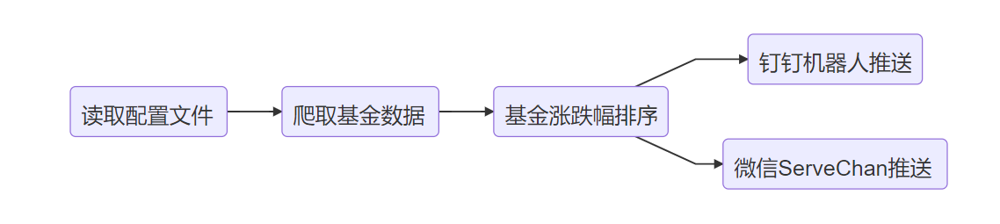
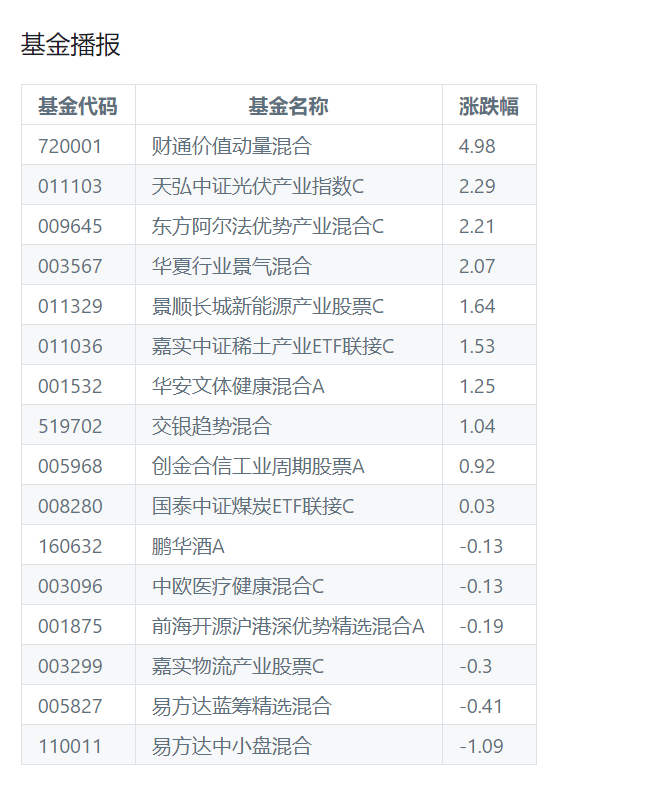
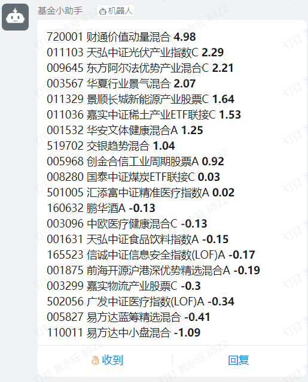

最近玩基金，上班期间看支付宝估值太麻烦，于是花点时间用Python做了个基金涨跌幅播报,

主要使用 ServerChan 和 钉钉群机器人进行推送  

 [源码地址](https://github.com/hyw-zero/fund_report.git)

## 1.实现原理



<!--more-->

## 2.定时执行脚本

```sh
#!/bin/bash

while true
do
    TODA=`date '+%u'`      			
    TIME=`date '+%H:%M'`    		
    CLOCK="14:40"                   
    if [ $(($TODA)) -lt 6 ] && [ $TIME = $CLOCK ];then 
        echo /dev/null > fund_log                   
        echo "---------RUN------------"
        echo $DATE
        python3 ./main.py
        sleep 60
	else
		echo "--NO RUN--"
        echo `date`
		sleep 30
    fi
done
```

## 3.json配置

```json
{
  "user_info": [
    {
      "push_mode": "wechat",
      "phone": "*********",
      "wechat_api": "*******************************",
      "ding_token":"",
      "fund_num": [
        "001875",
        "011329",
        "001532",
        "005968",
        "011103",
        "720001",
        "011036",
        "008280"
      ]
    },
    {
      "push_mode": "DingDing",
      "phone": "*********",
      "wechat_api": "",
      "ding_token":"*******************************************************",
      "fund_num": [
        "005827",
        "160632",
        "519702",
        "003096",
        "009645",
        "003299",
        "003567",
        "110011",
        "001875",
        "011329",
        "001532",
      ]
    }
  ]
}
```

## 4.功能实现代码

```python
# -*- coding: UTF-8 -*-
#  Author：hyw—zero
#  time：2021-8-29

import requests
import json


def dingtalk_push(user_data):
    headers = {
        "Content-Type": "application/json"
    }
    data = {
        "msgtype": "markdown",
        "at": {
            "atMobiles": [
                user_data["phone"]
            ],
            "isAtAll": "true"
        },
        "markdown": {
            "title": "基金播报",
            "text": user_data["fund_num"]
        }
    }
    json_data = json.dumps(data)
    print(json_data)
    try:
        requests.post(
            url='https://oapi.dingtalk.com/robot/send?access_token='+user_data["ding_token"],
            data=json_data,headers=headers
        )
    except:
        print("[ERROR:]DINGDING SEND ERROR !")
        
        
def wechat_push(user_data):
    print(user_data)
    data = {
        "text": '基金播报',
        "desp": user_data["fund_num"]
     }
    url = 'https://sctapi.ftqq.com/'+user_data["wechat_api"]+'.send'
    try:
        req = requests.post(url, data=data)
        print(req)
    except:
        print("[ERROR:]WECHAT SEND ERROR !")
        
def fund_parse(user):
    dict = {}
    for fund_num in user["fund_num"]:
        url = "http://fundgz.1234567.com.cn/js/%s.js" % fund_num
        headers = {
            'content-type': 'application/json',
            'User-Agent': 'Mozilla/5.0 (X11; Ubuntu; Linux x86_64; rv:22.0) Gecko/20100101 Firefox/22.0'
        }
        r = requests.get(url, headers=headers)
        content = r.text
        search = content[8:-2]
        fund_info = json.loads(search)
        key = fund_info["fundcode"] + "," + fund_info["name"]
        value = float(fund_info["gszzl"])
        dict[key] = value
    list = sorted(dict.items(), key=lambda item: item[1], reverse=True)  # sort by value
    if user["push_mode"] == "wechat":
         # weichat markdown table push
        tmp_table = ''
        table_head = '|基金代码|基金名称|涨跌幅|\n' \
                     '|-|-|-|\n'
        for li in list:
            tmp_arr = li[0].split(',', 1)
            tmp_table = tmp_table + '|' + tmp_arr[0] + '|' + tmp_arr[1] + '|' + str(li[1]) + '\n'
        user["fund_num"] = table_head + tmp_table
    elif user["push_mode"] == "DingDing":
     	#Dingding robot not support markdown table
        tmp_md = ''
        for li in list:
            tmp_arr = li[0].split(',', 1)
            tmp_md = tmp_md + tmp_arr[0] + ' ' + tmp_arr[1] + '  ' + '**'+str(li[1])+'**' + ' \n\n'
        user["fund_num"] = tmp_md
        print(user["fund_num"])
    return user


def read_json(config_file):
    with open(config_file, "r") as f:
        json_dic = json.load(f)
        json_data = json_dic["user_info"]
    return json_data

if __name__ == '__main__':
    print("[NOTICES:]PYTHON IS WORK !")
    config_name = 'fund_list.json'
    user_info = read_json(config_name)
    for user in user_info:
        ret = fund_parse(user)
        if ret["push_mode"] == "wechat":
            ret["ding_api"] = ''
            ret["phone"] = ''
            wechat_push(ret)
        elif ret["push_mode"] == "DingDing":
            ret["wechat_api"] = ''
            dingtalk_push(ret)
        else:
            print("[ERROR]PUSH  ERROR !!")
```

## 5.功能实现效果图

### 5.1 微信 ServerChan




### 5.2 钉钉群机器人


