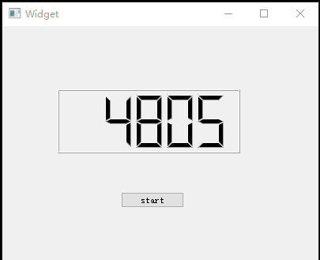
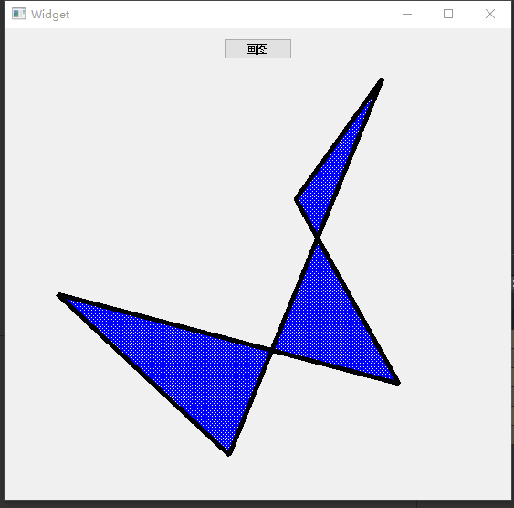

## 1. 多线程

通常情况下，应用程序都是在一个线程中执行操作。 但是，当调用一个耗时操作（例如，大批量I/O或大量矩阵变换等CPU密集操作）时，用户界面常常会冻结。而使用多线程可以解决这一问题。

<!-- more --> 

多线程有以下几个优势：

1. <strong>提高应用程序响应速度。</strong>

   这对于图形界面开发的程序尤为重要，当一个操作耗时很长时，整个系统都会等待这个操作，程序就不能响应键盘、鼠标、菜单等操作，而使用多线程技术可将耗时长的操作置于一个新的线程，避免以上问题。

2. <strong>使多CPU系统更加有效。</strong>

   当前线程数不大于CPU数目时，操作系统可以调度不同的线程运行于不同的CPU上。

3. <strong>改善程序结构。</strong>

   一个既长又复杂的进程可以考虑分为多个线程，成为独立或半独立的运行部分，这样有利于代码的理解和维护。

多线程程序有以下几个特点：

- 多线程程序的行为无法预期，当多次执行程序时，每一次的结果都可能不同。
- 多线程的执行顺序无法保证，它与操作系统的调度策略和线程优先级等因素有关。
- 多线程的切换可能发生在任何时刻、任何地点。
- 多线程对代码的敏感度高，对代码的细微修改都可能产生意想不到的结果。

基于以上这些特点，为了有效的使用线程，开发人员必须对其进行控制。

### 1.1 线程介绍

在Qt中使用QThread 来管理线程。下面来看一个简单的例子:

```c++
MainWindow::MainWindow(QWidget *parent)
  : QMainWindow(parent)
{
  QWidget *widget = new QWidget(this);
  QVBoxLayout *layout = new QVBoxLayout;
  widget->setLayout(layout);
  QLCDNumber *lcdNu///mber = new QLCDNumber(this);
  layout->addWidget(lcdNumber);
  QPushButton *button = new QPushButton(tr("Start"), this);
  layout->addWidget(button);
  setCentralWidget(widget);
  QTimer *timer = new QTimer(this);
  connect(timer, &QTimer::timeout, 
          [=]() 
          {
               static int sec = 0;
               lcdNumber->display(QString::number(sec++));
  		  }
  );
  connect(button, &QPushButton::clicked, 
          [=]() 
          {
              timer->start(1);
              for (int i = 0; i < 2000000000; i++);
              timer->stop();
          }
  );
}
```

我们的主界面有一个用于显示时间的 LCD 数字面板还有一个用于启动任务的按钮。程序的目的是用户点击按钮，开始一个非常耗时的运算（程序中我们以一个 2000000000 次的循环来替代这个非常耗时的工作，在真实的程序中，这可能是一个网络访问，可能是需要复制一个很大的文件或者其它任务），同时 LCD 开始显示逝去的毫秒数。毫秒数通过一个计时器QTimer进行更新。计算完成后，计时器停止。这是一个很简单的应用，也看不出有任何问题。但是当我们开始运行程序时，问题就来了：点击按钮之后，程序界面直接停止响应，直到循环结束才开始重新更新。

有经验的开发者立即指出，这里需要使用线程。这是因为 Qt 中所有界面都是在 UI 线程中（也被称为主线程，就是执行了QApplication::exec()的线程），在这个线程中执行耗时的操作（比如那个循环），就会阻塞 UI 线程，从而让界面停止响应。界面停止响应，用户体验自然不好，不过更严重的是，有些窗口管理程序会检测到你的程序已经失去响应，可能会建议用户强制停止程序，这样一来你的程序可能就此终止，任务再也无法完成。所以，为了避免这一问题，我们要使用 QThread 开启一个新的线程：



```c++
/******************* mythread.hpp *******************************/
#include <QThread>
class mythread : public QThread
{
    Q_OBJECT
public:
    explicit mythread(QObject *parent = 0);
signals:
    void isDone();
protected:
    void run()  //QThread的虚函数,线程处理函数不能直接调用，通过 start（）间接调用
    {
        sleep(5);
    	emit isDone();
    }
public slots:
};
```
```c++
/******************* widget.cpp *******************************/
#include "widget.h"
#include "ui_widget.h"
#include <QThread>
#include <QDebug>
Widget::Widget(QWidget *parent) :
    QWidget(parent),
    ui(new Ui::Widget)
{
    ui->setupUi(this);
    timer = new QTimer(this);
    thread = new mythread(this);
#if 1
    connect(thread,&mythread::isDone,this,&Widget::timerstop);
    connect(timer,&QTimer::timeout,this,&Widget::ledshow);
#else
    connect(thread,&mythread::isDone,  //使用lambda表达式会出现以下提示
           							   //Timers cannot be stopped from another thread
            [=]()
            {
               timer->stop();
            }
    );
    connect(timer,&QTimer::timeout,
            [=]()
            {
                static int i = 0;
                i++;
                ui->lcdNumber->display(i);
            }
    );
#endif
     connect(this,&Widget::destroyed,this,&Widget::threadclose);//线程关闭函数
}
Widget::~Widget()
{
    delete ui;
}
void Widget::on_pushButton_clicked()
{
    if(!timer->isActive())
    {
        timer->start(1);
    }
    thread->start();
}
void Widget::ledshow()
{
    static int i = 0;
    i++;
    ui->lcdNumber->display(i);
}
void Widget::timerstop()
{
 timer->stop();
}
void Widget::threadclose()
{
    thread->quit();
    thread->wait();
    qDebug()<<"Thread close";
}
```
```c++
/******************* widget.h *******************************/
#ifndef WIDGET_H
#define WIDGET_H
#include <QWidget>
#include <QTimer>
#include "mythread.hpp"
namespace Ui {
class Widget;
}
class Widget : public QWidget
{
    Q_OBJECT
public:
    explicit Widget(QWidget *parent = 0);
    ~Widget();
private slots:
    void on_pushButton_clicked();
    void ledshow();
    void timerstop();
    void threadclose()
private:
    Ui::Widget *ui;
    QTimer * timer;
    mythread * thread;
};
#endif // WIDGET_H
```

注意，我们增加了一个mythread类。mythread继承自QThread类，重写了其run()函数。我们可以认为，<strong>run()函数就是新的线程需要执行的代码</strong>。在这里就是要执行这个循环，然后发出计算完成的信号。<strong>run()是线程的入口，就像main()对于应用程序的作用，使用QThread::start()函数启动一个线程</strong>（注意，这里不是run()函数）。再次运行程序，你会发现现在界面已经不会被阻塞了。
这是 Qt 线程的最基本的使用方式之一（确切的说，这种方式已经不大推荐使用，不过因为看起来很清晰，而且简单使用起来也没有什么问题，所以还是有必要介绍）。代码看起来很简单，不过，如果你认为 Qt 的多线程编程也很简单，那就大错特错了。Qt 多线程的优势设计使得它使用起来变得容易，但是坑很多，稍不留神就会被绊住，尤其是涉及到与 QObject 交互的情况。稍懂多线程开发的童鞋都会知道，调试多线程开发简直就是煎熬。

### 1.2 多线程的使用

在Qt4.7及以后版本推荐使用以下的工作方式。其主要特点就是利用Qt的事件驱动特性，将<strong>需要在次线程中处理的业务放在独立的模块（类）中，由主线程创建完该对象后，将其移交给指定的线程，且可以将多个类似的对象移交给同一个线程。</strong>在这个例子中，信号由主线程的QTimer对象发出，之后Qt会将关联的事件放到worker所属线程的事件队列。由于队列连接的作用，在不同线程间连接信号和槽是很安全的。

示例代码如下：

```c++
class Worker : public QObject
{
  Q_OBJECT
private slots:
  void onTimeout()
  {
  qDebug()<<"Worker::onTimeout get called from?:"<<QThread::currentThreadId();
  }
};
int main(int argc, char *argv[])
{

  QApplication a(argc, argv);
  qDebug()<<"From main thread: "<<QThread::currentThreadId();
  QThread t;
  QTimer timer;
  Worker worker;
  QObject::connect(&timer, SIGNAL(timeout()), &worker, SLOT(onTimeout()));
  // 启动定时器
  timer.start(1000);
  // 将类对象移交个线程
  worker.moveToThread(&t);
  // 启动线程
  t.start();
  return a.exec();
}
```

<strong>关于Qobject类的connect函数最后一个参数（connect的第五个参数）⭐⭐</strong>

连接类型：

1. <strong>自动连接(AutoConnection)，默认的连接方式。</strong>

   -  如果信号与槽，也就是发送者与接受者在同一线程，等同于直接连接；

   -  如果发送者与接受者处在不同线程，等同于队列连接。

2.  <strong>直接连接(DirectConnection)</strong>

   当信号发射时，槽函数立即直接调用。<strong>无论槽函数所属对象在哪个线程，槽函数总在发送者所在线程执行。</strong>

3. <strong>队列连接(QueuedConnection)</strong>

   当控制权回到接受者所在线程的事件循环时，槽函数被调用。<strong>槽函数在接受者所在线程执行。</strong>

> <strong>总结：</strong>
>
> <strong>队列连接：槽函数在接受者所在线程执行</strong>。
>
> <strong>直接连接：槽函数在发送者所在线程执行</strong>。
>
> <strong>自动连接：二者不在同一线程时，等同于队列连接</strong>

> <strong>多线程使用过程中注意事项：</strong>
>
> -  <strong>线程不能操作UI对象（从Qwidget直接或间接派生的窗口对象）</strong>
>
>
> - <strong>需要移动到子线程中处理的模块类，创建的对象的时候不能指定父对象。</strong>
>


### 1.3 使用线程绘图

根据前面讲过的知识,实现以下案例:

在窗口中有一个按钮,当点击按钮之后,在线程中绘制一张图片,然后将绘制好的图片显示到当前窗口中。



实现步骤：

将需要画图线程中的操作放入单独的一个类中去处理：

```c++
/******************* MyThread.h *******************************/
#ifndef MYTHREAD_H
#define MYTHREAD_H
#include <QObject>
#include <QImage>
#include <QPainter>
class MyThread : public QObject
{
    Q_OBJECT
public:
    explicit MyThread(QObject *parent = 0);
    void drawing(); //线程处理函数

signals:
    void updateimg(QImage);//更新绘图信号
public slots:
};
#endif // MYTHREAD_H
```


```c++
/******************* MyThread.cpp *******************************/
#include "mythread.h"
#include <QPen>
#include <QBrush>
MyThread::MyThread(QObject *parent) : QObject(parent)
{
}
void MyThread::drawing()
{
    //定义QImage绘图设备;
    QImage image(600,600,QImage::Format_ARGB32);
    //定义画家
    QPainter  p(&image);
    //定义画笔
    QPen pen;
    pen.setWidth(5); //画笔宽度；
    p.setPen(pen);  //画笔交给画家

    QBrush brush;
    brush.setStyle(Qt::Dense2Pattern);
    brush.setColor(Qt::blue);
    p.setBrush(brush);
    //定义5个点
    QPoint a[]=
    {
        QPoint(qrand()%500,qrand()%500),
        QPoint(qrand()%500,qrand()%500),
        QPoint(qrand()%500,qrand()%500),
        QPoint(qrand()%500,qrand()%500),
        QPoint(qrand()%500,qrand()%500)
    };
    p.drawPolygon(a,5);
    emit updateimg(image);//发送绘图完成信号
}
```

在UI线程中(主线程)中创建Work类对象, 并调用moveToThread函数将操作移入到子线程中取处理.

```c++
/******************* widget.h *******************************/
#ifndef WIDGET_H
#define WIDGET_H

#include <QWidget>
#include <QThread>
#include "mythread.h"
namespace Ui {
class Widget;
}
class Widget : public QWidget
{
    Q_OBJECT
public:
    explicit Widget(QWidget *parent = 0);
    ~Widget();
    void paintEvent(QPaintEvent *event);
    void getimage(QImage ); //槽函数
    void threadclose();//线程关闭槽函数
private:
    Ui::Widget *ui;
    QImage image;
    MyThread * mythread; //自定义线程
    QThread * thread;
};
#endif // WIDGET_H
```

 

```c++
/******************* widget.cpp *******************************/
#include "widget.h"
#include "ui_widget.h"
Widget::Widget(QWidget *parent) :
    QWidget(parent),
    ui(new Ui::Widget)
{
    ui->setupUi(this);
    //自定义类对象，分配空间，不可以指定父对象
    mythread = new MyThread;
    //创建子线程
    thread = new QThread(this);
    //把子线程添加到线程中
    mythread->moveToThread(thread);
    //启动子线程，未启动线程处理函数
    thread->start();
    //线程处理函数必须通过single slot调用
    connect(ui->pushButton,&QPushButton::clicked,mythread,&MyThread::drawing);//按钮点击触发绘图线程
    connect(mythread,&MyThread::updateimg,this,&Widget::getimage); //加载绘图线程结果
    connect(this,&Widget::destroyed,this,&Widget::threadclose); //线程销毁
}
Widget::~Widget()
{
    delete ui;
}
void Widget::paintEvent(QPaintEvent *event)
{
    QPainter p(this); //创建画家，指定画图设备为窗口
    p.drawImage(20,20,image);
}
void Widget::getimage(QImage temp)
{
    image = temp;
    update();//更新窗口，间接调用paintEvent
}
void Widget::threadclose()
{
    //退出子线程
    thread->quit();
    //回收资源
    thread->wait();
}

```

如果需要在窗口中绘制图形,那么就需要重写paintEvent事件处理函数。通过QPainter对象将子线程中绘制的图片画到当前窗口中。如果需要刷新窗口可以调用update（）函数，时间处理器会自动被调用。

```c++
void Widget::paintEvent(QPaintEvent *event)
{
    QPainter p(this); //创建画家，指定画图设备为窗口
    p.drawImage(20,20,image);
}
```
