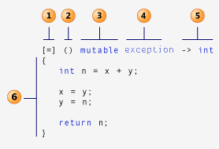

> 下述内容为个人学习笔记及查询资料总结，跳跃性较大，仅供参考。

## 1.项目介绍

在使用Qt向导生成的应用程序.pro文件格式如下：

<!-- more --> 

```properties
QT += core gui  //模块的名字

greaterThan(QT_MAJOR_VERSION, 4): QT += widgets

TARGET = test //应用程序名

TEMPLATE = app //生成的makefile的模板类型

//源文件
SOURCES += main.cpp\
			 mainwindow.cpp
 //头文件
HEADERS += mainwindow.h

//窗口设计文件
FORMS  += mainwindow.ui
```

<strong>源文件中以.pro为结尾的就是工程文件(project)，它是qmake自动生成的用于生产makefile的配置文件</strong>

<strong>pro文件的写法如下：</strong>

- 注释

  ​	从“#”开始，到这一行结束。

- 模板变量告诉qmake为这个应用程序生成哪种makefile。下面是可供使用的

  选择：<strong>TEMPLATE</strong> =app

  - <strong>app</strong> -建立一个应用程序的makefile。这是默认值，所以如果模板没有被指定，这个将被使用。

  - <strong>lib</strong> - 建立一个库的makefile。

  - <strong>vcapp</strong> - 建立一个应用程序的VisualStudio项目文件。

  - <strong>vclib</strong> - 建立一个库的VisualStudio项目文件。

  - <strong>subdirs</strong> -这是一个特殊的模板，它可以创建一个能够进入特定目录并且为一个项目文件生成makefile并且为它调用make的makefile。

- #指定生成的应用程序名： 

  <strong>TARGET</strong> = QtDemo

- #工程中包含的头文件

  <strong>HEADERS</strong> += include/painter.h

- #工程中包含的.ui设计文件

  <strong>FORMS</strong> += forms/painter.ui

- #工程中包含的源文件

  <strong>SOURCES</strong> += sources/main.cpp sources/painter.cpp

- #工程中包含的资源文件

  <strong>RESOURCES</strong> += qrc/painter.qrc

- <strong>greaterThan(QT_MAJOR_VERSION, 4): QT += widgets</strong>

  这条语句的含义是，如果QT_MAJOR_VERSION大于4（也就是当前使用的Qt5及更高版本）需要增加widgets模块。如果项目仅需支持Qt5，也可以直接添加“QT += widgets”一句。不过为了保持代码兼容，最好还是按照QtCreator生成的语句编写。

- #配置信息
  CONFIG用来告诉qmake关于应用程序的配置信息。
  <strong>CONFIG += c++11  //使用c++11的特性</strong>
  在这里使用“+=”，是因为我们添加我们的配置选项到任何一个已经存在中。这样做比使用“=”那样替换已经指定的所有选项更安全。
> 一般在Qt源文件中以<strong>.pro.user</strong>为结尾为用户配置文件，需要使用此项目时，最好删除掉。编译后会重新创建。

## 2.Qt应用程序介绍

```c++
#include <QApplication>  //QApplication应用程序类
#include <QWidget>
int main(int argc, char *argv[])
{
	QApplication a(argc, argv);
	QWidget w;
	w.show();
	return a.exec();
}
```

<strong>解释：</strong>

- Qt头文件没有.h后缀

- Qt一个类对应一个头文件，类名就是头文件名

- QApplication应用程序类
  - 管理图形用户界面应用程序的控制流和主要设置。
  - 是Qt的整个后台管理的命脉它<strong>包含主事件循环</strong>，在其中来自窗口系统和其它资源的<strong>所有事件处理和调度</strong>。它也处理<strong>应用程序的初始化和结束</strong>，并且<strong>提供对话管理</strong>。
  - 对于任何一个使用Qt的图形用户界面应用程序，都正好存在一个QApplication 对象，而不论这个应用程序在同一时间内是不是有0、1、2或更多个窗口。

- a.exec()

  程序进入消息循环，等待对用户输入进行响应。这里main()把控制权转交给Qt，Qt完成事件处理工作，当应用程序退出的时候exec()的值就会返回。

  <strong>在exec()中，Qt接受并处理用户和系统的事件并且把它们传递给适当的窗口部件。</strong>

  > 在创建项目后，最好不要修改主函数，建议在主窗口文件的构造函数中进行代码创建。

## 3.信号与槽机制  ★★

​        所谓信号与槽，实际就是观察者模式。<strong>当某个事件发生之后</strong>，比如，按钮检测到自己被点击了一下，<strong>它就会发出一个信号（signal）</strong>。这种发出是没有目的的，类似广播。<strong>如果有对象对这个信号感兴趣，它就会使用连接（connect）函数</strong>，意思是，<strong>将想要处理的信号和自己的一个函数（称为槽（slot））绑定来处理这个信号</strong>。也就是说，<strong>当信号发出时，被连接的槽函数会自动被回调</strong>。这就类似观察者模式：当发生了感兴趣的事件，某一个操作就会被自动触发。

### 3.1 信号和槽

使用connect()可以让我们连接系统提供的信号和槽。connect()函数最常用的一般形式：

```c++
 connect(sender, signal, receiver, slot);
```

<strong>参数：</strong>

- sender：发出信号的对象
-  signal：发送对象发出的信号
-  receiver：接收信号的对象
-  slot：接收对象在接收到信号之后所需要调用的函数

<strong>信号槽要求信号和槽的参数一致，所谓一致，是参数类型一致。如果不一致，允许的情况是，槽函数的参数可以比信号的少，即便如此，槽函数存在的那些参数的顺序也必须和信号的前面几个一致起来。这是因为，你可以在槽函数中选择忽略信号传来的数据（也就是槽函数的参数比信号的少），但是不能说信号根本没有这个数据，你就要在槽函数中使用（就是槽函数的参数比信号的多，这是不允许的）。</strong>

### 3.2 信号与槽常规写法

使用系统提供的信号与槽函数

```c++
QPushButton b1;
b1.setParent(this);
connect(&b1,&QPushButton::pressed,this,&MainWidget::close);
 /*
  *    &b1                      信号发出者
  *    &QPushButton::pressed    处理的信号,&发送者类名::动作
  *    this                     信号接收者
  *    &MainWidget::close       槽函数-信号处理函数,&接收者类名::槽函数类名
  */
```

### 3.3 自定义信号与槽

Qt 的信号槽机制并不仅仅是使用系统提供的那部分，还会允许我们自己设计自己的信号和槽。

<strong>1.自定义信号与槽(无参数)</strong>

```C++
/*
   * 自定义信号必须有signals 关键字来声明
   * 信号没有返回值，但可以有参数
   * 信号就是函数的声明，只需声明，无需定义
   * 使用：emit mysigna1（）；
*/
class subwidget:: public QWidget
{
  Q_OBJECT
public:
  explicit SubWidget(QWidget *parent = 0);
signals：      //信号声明
 void mySignal();
public slots:   //槽函数声明
 void mySlot();
}
//槽函数实现：
void MainWindow::mySlot()
{ //发送信号：
	emit mySignal();
} 
//信号槽：1.传统写法
  connect(&s,&subwidget::mySignal(),this,&subwidget::mySlot());
//信号槽：2.用Qt4信号连接  SIGNAL() 和SLOTS(); 
/*	
  	注意：SIGNAKL()需和SLOT()组合使用，
  		信号需要在定义时用 signals：关键字声明，槽函数需要用public slots:关键字声明
  	缺点:SIGNAL() 和SLOTS() 将函数名字转换成字符串，不进行错误检查
*/ 
  connect(&s,SIGNAL(mySignal()),this,SLOT(mySlot()));
//信号槽：3. Qt5 Lambda表达式 匿名函数对象
  // C++11的新特性 使用需要在项目文件 pro中加入 CONFIG += C++11；
  // Qt配合信号一起使用
 connect(&s,&subwidget::mySignal(),
          [=]() mutable
          {
              i+=10;
              s->setText("Lambda");
              s->move(i,i); 
          }
  );
 // =    :把外部所有变量,类，以值传递方式传进来值传递方式默认为只读，不可修改
          // this :把类中所有变量，以值传递方式传进来值传递方式
          // &    :把外部所有局部变量引用
          // mutab :将默认只读，改为可读可写
```

### 3.3 自定义信号与槽(有参数)

```c++
//信号：
void mySignal(int a, float b);
//槽：
void MainWindow::mySlot(int b)
{
	qDebug()<< b;
}
//信号槽：
connect(this, SIGNAL(mySignal(int, float)), this, SLOT(mySLot(int)));
//发送信号：
emit mySignal(5, 2.2)

```

### 3.4 自定义信号与槽(有参数，函数重载)

```c++
#include "mainwidget.h"
#include <QPushButton>
#include <QDebug>
MainWidget::MainWidget(QWidget *parent)
  : QWidget(parent)
{
  //当信号发生重载时 my_signal(),my_signal(int,QString,QString) 调用my_signal需要用以下方法
  // 1.用函数指针
  void (SubWidget:: *none_para_signal)() = &SubWidget::my_signal;
  void (SubWidget:: *para_signal)(int,QString,QString) = &SubWidget::my_signal;
  connect(&s,none_para_signal,this,&MainWidget::s_b_slot);
  connect(&s,para_signal,this,&MainWidget::my_slot);
  // 2.用Qt4信号连接  SIGNAL() 和SLOTS(); SIGNAKL()需和SLOT()组合使用
  // 缺点 SIGNAL() 和SLOTS() 将函数名字转换成字符串，不进行错误检查
  connect(&s,SIGNAL(my_signal()),this,SLOT(s_b_slot()));
  connect(&s,SIGNAL(my_signal(int,QString,QString)),this,SLOT(my_slot(int,QString,QString)));
void MainWidget::s_b_slot()
{
  this->show();
  s.hide();
}
void MainWidget::my_slot(int a,QString str1,QString str2)
{
  this->setWindowTitle(str1);
  m_b->setText(str2);
  qDebug()<<a<< str1 <<str2;
}
MainWidget::~MainWidget()
{

}

```

### 3.5 Lambda表达式  ★★★

C++11中的Lambda表达式<strong>用于定义并创建匿名的函数对象</strong>，以简化编程工作。



<strong>[ </strong>函数对象参数 <strong>] </strong> <strong>( </strong> 操作符重载函数参数  <strong>) mutable </strong>或 <strong>exception</strong> -> 返回值 {函数体}

<strong>① 函数对象参数；</strong>

<strong>[]</strong>，标识一个<strong>Lambda的开始</strong>，这部分必须存在，<strong>不能省略</strong>。函数对象参数是传递给编译器自动生成的函数对象类的构造函数的。函数对象参数只能使用那些到定义Lambda为止时Lambda所在作用范围内可见的局部变量（包括Lambda所在类的this）。函数对象参数有以下形式：

- 空。没有使用任何函数对象参数。


- <strong>=</strong> 函数体内可以使用Lambda所在作用范围内所有可见的局部变量（包括Lambda所在类的this），并且是<strong>值传递方式</strong>（相当于编译器自动为我们按值传递了所有局部变量）。

- <strong>&</strong> 函数体内可以使用Lambda所在作用范围内所有可见的局部变量（包括Lambda所在类的this），并且是<strong>引用传递方式</strong>（相当于编译器自动为我们按引用传递了所有局部变量）。

- <strong>this</strong> 函数体内可以使用Lambda所在类中的成员变量。

- <strong>a</strong>  将a按值进行传递。按值进行传递时，函数体内不能修改传递进来的a的拷贝，因为默认情况下函数是const的。要修改传递进来的a的拷贝，可以添加mutable修饰符。

- <strong>&a</strong>  将a按引用进行传递。

- <strong>a, &b</strong>  将a按值进行传递，b按引用进行传递。

- <strong>=，&a, &b</strong>  除a和b按引用进行传递外，其他参数都按值进行传递。

- <strong>&, a, b</strong>  除a和b按值进行传递外，其他参数都按引用进行传递。

```c++
int m = 0, n = 0;
    [=] (int a) mutable { m = ++n + a; };
    [&] (int a) { m = ++n + a; }(4);
    [=,&m] (int a) mutable { m = ++n + a; };
    [&,m] (int a) mutable { m = ++n + a; };
    [m,n] (int a) mutable { m = ++n + a; };
    [&m,&n] (int a) { m = ++n + a; };
```

<strong>② 操作符重载函数参数；</strong>

标识重载的()操作符的参数，没有参数时，这部分可以省略。参数可以通过按值（如：(a,b)）和按引用（如：(&a,&b)）两种方式进行传递。

<strong>③ 可修改标示符；</strong>

mutable声明，这部分可以省略。按值传递函数对象参数时，加上mutable修饰符后，可以修改按值传递进来的拷贝（注意是能修改拷贝，而不是值本身）。

<strong>④ 错误抛出标示符；</strong>

exception声明，这部分也可以省略。exception声明用于指定函数抛出的异常，如抛出整数类型的异常，可以使用throw(int)

<strong>⑤ 函数返回值；</strong>

<strong>-></strong>返回值类型，标识函数返回值的类型，当返回值为void，或者函数体中只有一处return的地方（此时编译器可以自动推断出返回值类型）时，这部分可以省略。

<strong>⑥ 是函数体；</strong>

  {}，标识函数的实现，这部分不能省略，但函数体可以为空。

> <strong>自定义信号槽需要注意的事项</strong>
>
> - 发送者和接收者都需要是QObject的子类（当然，槽函数是全局函数、Lambda 表达式等无需接收者的时候除外）；
> - 使用 signals 标记信号函数，信号是一个函数声明，返回 void，不需要实现函数代码；
> - 槽函数是普通的成员函数，作为成员函数，会受到 public、private、protected 的影响；
> -  使用 emit 在恰当的位置发送信号；
> - 使用QObject::connect()函数连接信号和槽。
> - 任何成员函数、static 函数、全局函数和 Lambda 表达式都可以作为槽函数
>
> <strong>信号槽的更多用法</strong>
>
> - 一个信号可以和多个槽相连
>
> 如果是这种情况，这些槽会一个接一个的被调用，但是它们的<strong>调用顺序是不确定的。</strong>
>
> - 多个信号可以连接到一个槽
>
>
> 只要任意一个信号发出，这个槽就会被调用。
>
> - 一个信号可以连接到另外的一个信号
>
>
> 当第一个信号发出时，第二个信号被发出。除此之外，这种信号-信号的形式和信号-槽的形式没有什么区别。
>
> - 槽可以被取消链接
>
>
> 这种情况并不经常出现，因为<strong>当一个对象delete之后，Qt自动取消所有连接到这个对象上面的槽</strong>。
