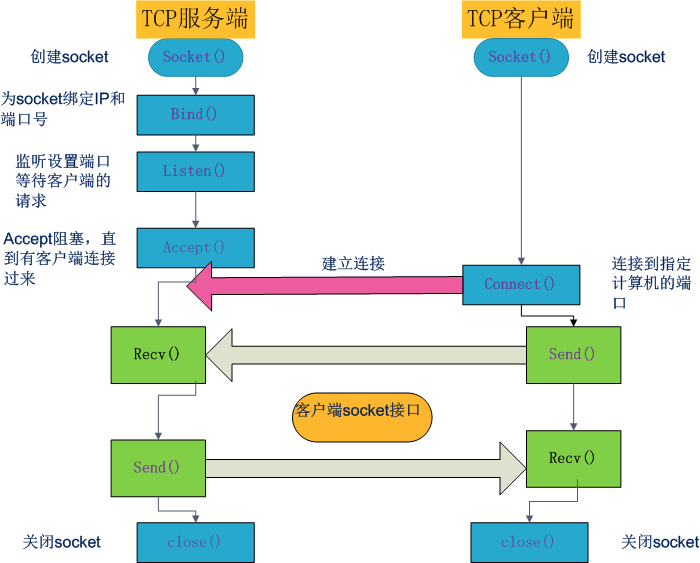
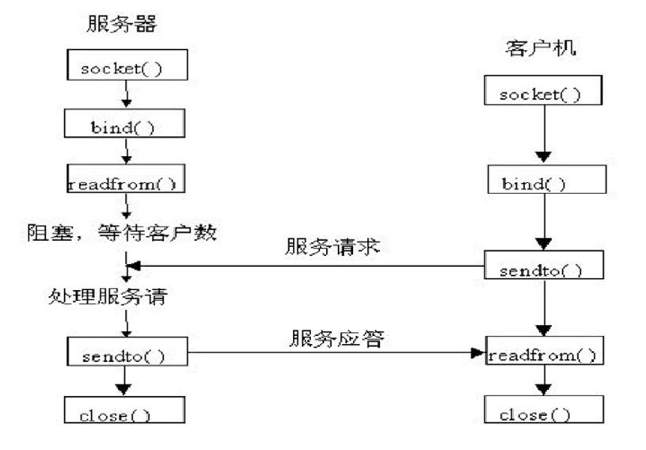
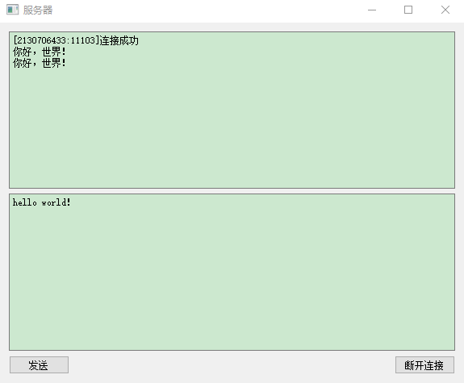
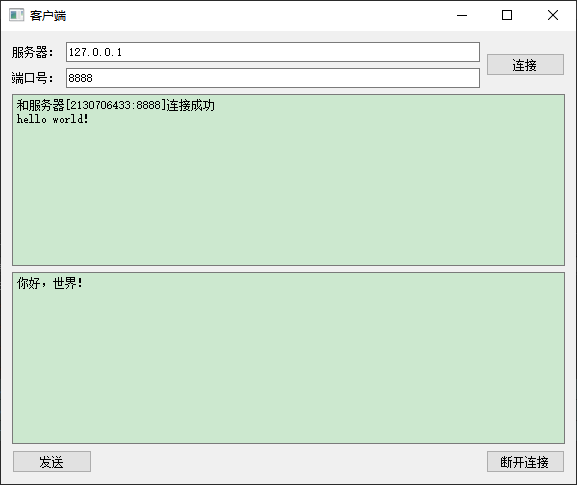
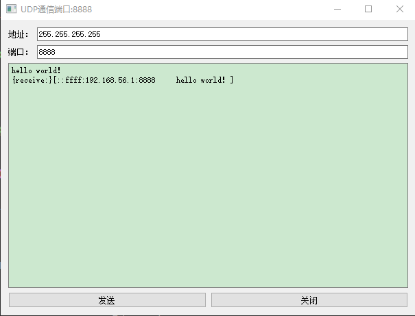

## 1 liunx socket通信流程

### 1.1 TCP/IP通信流程图



<!-- more --> 

### 1.2 UDP通信流程图




## 2 Qt中的Socket通信

Qt中提供的所有的Socket类都是非阻塞的。

Qt中常用的用于socket通信的套接字类:
```c++
QTcpServer  //用于TCP/IP通信, 作为服务器端套接字使用
QTcpSocket  //用于TCP/IP通信，作为客户端套接字使用。
    
QUdpSocket  //用于UDP通信，服务器，客户端均使用此套接字。
```
> 注意：在Qt中使用上述类时需要在.pro文件中写入 QT += network

### 2.1 TCP/IP

#### 2.1.1 服务器端通信流程

1. <strong>创建套接字</strong>
2. <strong>将套接字设置为监听模式</strong>
3. <strong>等待并接受客户端请求</strong>
可以通过QTcpServer提供的void <strong>newConnection()信号</strong>来检测是否有连接请求，如果有可以在对应的槽函数中调用<strong>nextPendingConnection</strong>函数获取到客户端的Socket信息（返回值为QTcpSocket*类型指针），通过此套接字与客户端之间进行通信。
4. <strong>接收或者向客户端发送数据</strong>
	- 接收数据：使用read（）或者readAll（）函数
	- 发送数据：使用write（）函数
#### 2.1.2 服务器端代码实现

通过Qt提供的QTcpServer类实现服务器端的socket通信:



```c++
/*---------- serverwidget.h ------------*/

#ifndef SERVERWIDGET_H
#define SERVERWIDGET_H
#include <QWidget>
#include <QTcpServer> //监听套接字
#include <QTcpSocket> //通信套接字
namespace Ui {
  class ServerWidget;
}
class ServerWidget : public QWidget
{
  Q_OBJECT
public:
  explicit ServerWidget(QWidget *parent = 0);
  ~ServerWidget();
private slots:
  void on_sendButton_clicked();
  void on_closeButton_clicked();
private:
  Ui::ServerWidget *ui;
  QTcpServer * tcpserver;  // 负责监听的套接字
  QTcpSocket * tcpsocket;  // 负责通信的套接字
};
#endif // SERVERWIDGET_H

```

```c++
/*---------- serverwidget.c-----------*/

#include "serverwidget.h"
#include "ui_serverwidget.h"
ServerWidget::ServerWidget(QWidget *parent) :
  QWidget(parent),
  ui(new Ui::ServerWidget)
{
  ui->setupUi(this);
  setWindowTitle("服务器");
  tcpserver = NULL;
  tcpsocket = NULL;
  tcpserver = new QTcpServer(this);             //1.创建套接字对象
  tcpserver->listen(QHostAddress::Any,8888);    //2.将套接字设置为监听模式
  
  connect(tcpserver,&QTcpServer::newConnection,  //3.接收客户端请求，连接成功会触发newConnection
          [=]()
          {
             tcpsocket = tcpserver->nextPendingConnection();//处理客户端的连接请求
             qint32 ip = tcpsocket->peerAddress().toIPv4Address();
             qint16 port = tcpsocket->peerPort();
             QString temp = QString("[%1:%2]连接成功").arg(ip).arg(port);
             ui->showBrowser->setText(temp);
             connect(tcpsocket,&QTcpSocket::readyRead,  //传输成功会触发readyRead
                     [=]()
                     { 
                       QByteArray array = tcpsocket->readAll(); //4.接收数据
                       ui->showBrowser->append(array);  //显示数据
                     }
             );
          }
  );
}
void ServerWidget::on_sendButton_clicked()
{
  if(NULL == tcpsocket)
  {
      return;
  }
  QString str = ui->sendBrowser->toPlainText();//获取发送内容
  tcpsocket->write(str.toUtf8().data());       //4.发送数据
}

void ServerWidget::on_closeButton_clicked()
{
  if(NULL == tcpsocket)
  {
      return;
  }
  tcpsocket->disconnectFromHost();
  tcpsocket->close();
  ui->showBrowser->append("已断开连接");
  tcpsocket = NULL;
}
ServerWidget::~ServerWidget()
{
  delete ui;
}
```

#### 2.1.3客户端通信流程

1. <strong>创建套接字</strong>

2. <strong>连接服务器</strong>

   可以使用QTcpSocket类的<strong>connectToHost（）</strong>函数来连接服务器。

3. <strong>向服务器发送或者接受数据</strong>

#### 2.1.4 客户端代码实现

客户端通过使用Qt提供的QTcpSocket类可以方便的实现与服务器端的通信。



```c++
/*---------- clientwidget.h-----------*/
#ifndef CLIENTWIDGET_H
#define CLIENTWIDGET_H
#include <QWidget>
#include <QTcpSocket>
namespace Ui {
  class ClientWidget;
}
class ClientWidget : public QWidget
{
  Q_OBJECT
public:
  explicit ClientWidget(QWidget *parent = 0);
  ~ClientWidget();
private slots:
  void on_connectButton_clicked();    //连接按钮槽函数
  void on_sendButton_clicked();       //发送按钮槽函数
  void on_disconnectButton_clicked(); //断开连接按钮槽函数
private:
  Ui::ClientWidget *ui;
  QTcpSocket * tcpsocket;   // 负责通信的套接字
};
#endif // CLIENTWIDGET_H
```

```c++
 /*---------- clientwidget.c-----------*/

#include "clientwidget.h"
#include "ui_clientwidget.h"
#include <QHostAddress>
#define Debug qDebug()<<"["<<__FILE__<<":"<<__LINE__<<"]"
ClientWidget::ClientWidget(QWidget *parent) :
  QWidget(parent),
  ui(new Ui::ClientWidget)
{
  ui->setupUi(this);
  setWindowTitle("客户端");
  tcpsocket = NULL;
  tcpsocket = new QTcpSocket(this);  //创建套接字
  connect(tcpsocket,&QTcpSocket::connected,
          [=]()
          {
            qint32 ip = tcpsocket->peerAddress().toIPv4Address();
            qint16 port = tcpsocket->peerPort();
            QString temp = QString("和服务器[%1:%2]连接成功").arg(ip).arg(port);
            ui->textshow->setText(temp);
          }
  );
  connect(tcpsocket,&QTcpSocket::readyRead, //通过信号接收服务器数据
          [=]()
          {
            QByteArray array = tcpsocket->readAll();//接收数据
            ui->textshow->append(array);
          }
   );
}
void ClientWidget::on_connectButton_clicked()
{
   QString ip = ui->ip->text();
   qint16 port = ui->port->text().toInt();
   Debug<<QHostAddress(ip)<<port;
   tcpsocket->connectToHost(QHostAddress(ip),port);  //连接服务器
}
void ClientWidget::on_sendButton_clicked()
{
  if(NULL == tcpsocket)
    {
        return;
    }
    QString str = ui->textsend->toPlainText();
    tcpsocket->write(str.toUtf8().data());       //发送数据
}
void ClientWidget::on_disconnectButton_clicked()
{
  if(NULL == tcpsocket)
    {
        return;
    }
    tcpsocket->disconnectFromHost();
    tcpsocket->close();
    ui->textshow->append("已断开连接");
    tcpsocket =NULL;
}
ClientWidget::~ClientWidget()
{
  delete ui;
}
```

### 2.2 UDP

使用Qt提供的QUdpSocket进行UDP通信。<strong>在UDP方式下，客户端并不与服务器建立连接，它只负责调用发送函数向服务器发送数据</strong>。类似的<strong>服务器也不从客户端接收连接，只负责调用接收函数，等待来自客户端的数据的到达</strong>。

#### 2.2.1UDP通信流程

在UDP通信中，服务器端和客户端的概念已经显得有些淡化，两部分做的工作都大致相同：

1. <strong>创建套接字</strong>

2. <strong>绑定套接字</strong>

   在UDP中如果需要<strong>接收数据</strong>则<strong>需要对套接字进行绑定</strong>，<strong>发送数据</strong>则<strong>不需要对套接字进行绑定</strong>。

   通过调用<strong>bind（）</strong>函数将套接字绑定到指定端口上。

3. <strong>接收或者发送数据</strong>

- <strong>接收数据：使用readDatagram()函数</strong>

  接收数据函数声明如下:

```c++
qint64 readDatagram(char* data,qint64 maxSize,QHostAddress* address = 0,quint16 * port = 0)
 
//data:      接收数据的缓存地址
//maxSize:   缓存接收的最大字节数
//address:   数据发送方的地址（一般使用提供的默认值）
//port:      数据发送方的端口号（一般使用提供的默认值）
```

使用<strong>pendingDatagramSize()可以获取到将要接收的数据的大小</strong>，根据该函数返回值来准备对应大小的内存空间存放将要接收的数据。

- <strong>发送数据: 使用writeDatagram()函数</strong>
- 发送数据函数声明如下：

```c++
qint64 writeDatagram(const QByteArray & datagram,const QHostAddress & host, quint16 port)

// datagram： 要发送的字符串
// host：     数据接收方的地址
// port：     数据接收方的端口号
```

#### 2.2.2UDP通信代码实现

在UDP通信中，服务器和客服端基本没什么区别，在这里进行局域网广播的方式进行自己发数据，自己接受数据



```c++
 /*---------- udpwidget.h-----------*/

#ifndef UDPWIDGET_H
#define UDPWIDGET_H
#include <QWidget>
#include <QUdpSocket>
namespace Ui {
  class UDPWidget;
}
class UDPWidget : public QWidget
{
  Q_OBJECT
public:
  explicit UDPWidget(QWidget *parent = 0);
  ~UDPWidget();
private slots:
  void on_sendButton_clicked();
private:
  Ui::UDPWidget *ui;
  QUdpSocket * udpsocket;
};
#endif // UDPWIDGET_H
```

```c++
 /*---------- udpwidget.c-----------*/

#include "udpwidget.h"
#include "ui_udpwidget.h"
#include <QHostAddress>
UDPWidget::UDPWidget(QWidget *parent) :
  QWidget(parent),
  ui(new Ui::UDPWidget)
{
  ui->setupUi(this);
  setWindowTitle("UDP通信端口:8888");
  udpsocket = new QUdpSocket(this);   //1.创建套接字

#if 0    //加入组播
  udpsocket->joinMulticastGroup(QHostAddress("224.0.0.1"));
  udpsocket->bind(QHostAddress::AnyIPv4,8888);
#elif 0  //离开组播
  udpsocket->leaveMulticastGroup(QHostAddress("224.0.0.1"));
#else
    udpsocket->bind(8888);            //2.将套接字绑定到指定端口上   
#endif
  connect(udpsocket,&QUdpSocket::readyRead, //3.接收数据
          [=]()
          {
            char  buff[1024] = {0};
            QHostAddress ip;
            quint16 port;
            qint64 len = udpsocket->readDatagram(buff,sizeof(buff),&ip,&port);
            if(len>0)
            {
              QString str = QString("[%1:%2\t%3]")
                                    .arg(ip.toString())
                                    .arg(port)
                                    .arg(buff);
              ui->textEdit->append("{receive:}"+str+"\n");
            }
          }
  );
}
void UDPWidget::on_sendButton_clicked()
{
    QString ip = ui->ip->text();               //获取ip
    quint16 port = ui->port->text().toInt();   //获取端口
    if(NULL == ip)
      {
        return;
      }
    QString str = ui->textEdit->toPlainText();
    udpsocket->writeDatagram(str.toUtf8(),QHostAddress(ip),port);//3.发送数据
}
UDPWidget::~UDPWidget()
{
  delete ui;
}
```

#### 2.2.3 广播

​         在使用QUdpSocket类的writeDatagram()函数发送数据的时候，其中第二个参数host应该指定为广播地址：QHostAddress：：Broadcast此设置相当于QHostAddress("255.255.255.255")

<strong>使用UDP广播的的特点：</strong>

- 使用UDP进行广播，局域网内的其他的UDP用户全部可以收到广播的消息


- UDP广播只能在局域网范围内使用


#### 2.2.4组播

​        我们再使用广播发送消息的时候会发送给所有用户，但是有些用户是不想接受消息的，这时候我们就应该使用组播，接收方只有先注册到组播地址中才能收到组播消息，否则则接受不到消息。另外组播是可以在Internet中使用的。

在使用QUdpSocket类的writeDatagram()函数发送数据的时候，其中第二个参数host应该指定为组播地址，关于组播地址的分类：

- 224.0.0.0～224.0.0.255为预留的组播地址（永久组地址），地址224.0.0.0保留不做分配，其它地址供路由协议使用；

- 224.0.1.0～224.0.1.255是公用组播地址，可以用于Internet；

- 224.0.2.0～238.255.255.255为用户可用的组播地址（临时组地址），全网范围内有效；

- 239.0.0.0～239.255.255.255为本地管理组播地址，仅在特定的本地范围内有效。

注册加入到组播地址需要使用QUdpSocket类的成员函数：

```c++
bool  joinMulticastGroup(const QHostAddress & groupAddress);   //加入组播
bool  leaveMulticastGroup(const QHostAddress & groupAddress); //离开组播
```

### 2.3 TCP/IP 和 UDP的区别

|            | <strong>TCP/IP</strong> | <strong>UDP</strong>    |
| ---------- | ---------- | ---------- |
| 是否连接   | 面向连接   | 无连接     |
| 传输方式   | 基于流     | 基于数据报 |
| 传输可靠性 | 可靠       | 不可靠     |
| 传输效率   | 效率低     | 效率高     |
| 能否广播   | 不能       | 能         |
