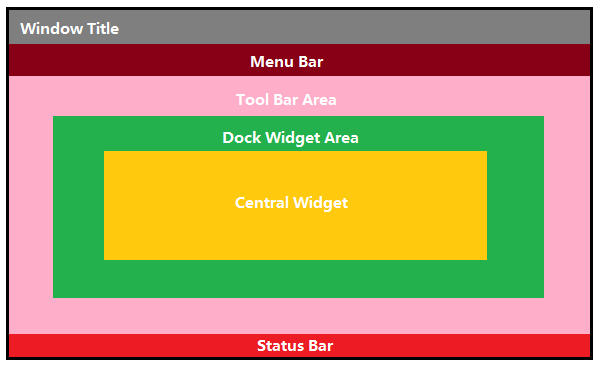
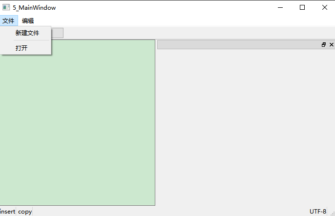
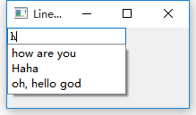
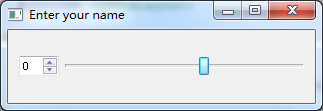

## 1 Qt窗口坐标体系

### 1.1坐标体系

1. 以窗口左上角为原点，X向右增加，Y向下增加。

2. 对于嵌套窗口，其坐标是<strong>相对于父窗口</strong>来说的。

## 2 QWidget

<!-- more --> 

所有窗口及窗口控件都是从QWidget直接或间接派生出来的。

### 2.1 对象模型

在Qt中创建对象的时候会提供一个Parent对象指针，下面来解释这个parent到底是干什么的。

- <strong>QObject</strong> 是以<strong>对象树</strong>的形式组织起来的。
- 当你创建一个QObject对象时，会看到QObject的构造函数接收一个QObject 指针作为参数，这个参数就是 parent，也就是父对象指针。这相当于，<strong>在创建QObject对象时，可以提供一个其父对象，我们创建的这个QObject对象会自动添加到其父对象的children()列表。</strong>
  
- <strong>当父对象析构的时候，这个列表中的所有对象也会被析构。（注意，这里的父对象并不是继承意义上的父类！）</strong>
  
- 这种机制在 GUI 程序设计中相当有用。例如，一个按钮有一个QShortcut（快捷键）对象作为其子对象。当我们删除按钮的时候，这个快捷键理应被删除。这是合理的。
  
- <strong>QWidget</strong>是能够在屏幕上显示的一切组件的父类。

  - <strong>QWidget</strong><strong>继承自QObject，因此也继承了这种对象树关系。一个孩子自动地成为父组件的一个子组件</strong>。因此，它会显示在父组件的坐标系统中，被父组件的边界剪裁。例如，当用户关闭一个对话框的时候，应用程序将其删除，那么，我们希望属于这个对话框的按钮、图标等应该一起被删除。事实就是如此，因为这些都是对话框的子组件。

  - 当然，<strong>我们也可以自己删除子对象，它们会自动从其父对象列表中删除。</strong>比如，当我们删除了一个工具栏时，其所在的主窗口会自动将该工具栏从其子对象列表中删除，并且自动调整屏幕显示。

<strong>Qt 引入对象树的概念，在一定程度上解决了内存问题。</strong>

- 当一个QObject对象在堆上创建的时候，Qt 会同时为其创建一个对象树。不过，对象树中对象的顺序是没有定义的。这意味着，销毁这些对象的顺序也是未定义的。


-  任何对象树中的 QObject对象 delete 的时候，如果这个对象有 parent，则自动将其从 parent 的children()列表中删除；如果有孩子，则自动 delete 每一个孩子。Qt 保证没有QObject会被 delete 两次，这是由析构顺序决定的。


如果QObject在栈上创建，Qt 保持同样的行为。正常情况下，这也不会发生什么问题。来看下下面的代码片段：

```C++
{
  QWidget window;
  QPushButton quit("Quit", &window);
}
```

作为父组件的 window 和作为子组件的 quit 都是QObject的子类（事实上，它们都是QWidget的子类，而QWidget是QObject的子类）。这段代码是正确的，quit 的析构函数不会被调用两次，因为标准 C++要求，<strong>局部对象的析构顺序应该按照其创建顺序的相反过程</strong>。因此，这段代码在超出作用域时，会先调用 quit 的析构函数，将其从父对象 window 的子对象列表中删除，然后才会再调用 window 的析构函数。

但是，如果我们使用下面的代码：

```C++
{
  QPushButton quit("Quit");
  QWidget window;
  quit.setParent(&window);
}
```

情况又有所不同，析构顺序就有了问题。我们看到，在上面的代码中，作为父对象的 window 会首先被析构，因为它是最后一个创建的对象。在析构过程中，它会调用子对象列表中每一个对象的析构函数，也就是说， quit 此时就被析构了。然后，代码继续执行，在 window 析构之后，quit 也会被析构，因为 quit 也是一个局部变量，在超出作用域的时候当然也需要析构。但是，这时候已经是第二次调用 quit 的析构函数了，C++ 不允许调用两次析构函数，因此，程序崩溃了。

由此我们看到，Qt 的对象树机制虽然帮助我们在一定程度上解决了内存问题，但是也引入了一些值得注意的事情。这些细节在今后的开发过程中很可能时不时跳出来烦扰一下，所以，我们最好从开始就养成良好习惯，在 Qt 中，尽量在构造的时候就指定 parent 对象，并且大胆在堆上创建。

## 3 QMainWindow

<strong>QMainWindow</strong>是一个为用户提供主窗口程序的类，包含<strong>一个菜单栏（menu bar）、多个工具栏(tool bars)、多个锚接部件(dock widgets)、一个状态栏(status bar)及一个中心部件(central widget)，</strong>是许多应用程序的基础，如文本编辑器，图片编辑器等。



### 3.1 菜单栏

一个主窗口最多只有一个菜单栏。位于主窗口顶部、主窗口标题栏下面。

-  创建菜单栏，通过<strong>QMainWindow</strong>类的<strong>menubar（）</strong>函数获取主窗口菜单栏指针


```C++
QMenuBar * menuBar() const
```

- 创建菜单，调用<strong>QMenu</strong>的成员函数<strong>addMenu</strong>来添加菜单


```C++
QAction* addMenu(QMenu * menu)
QMenu* addMenu(const QString & title)
QMenu* addMenu(const QIcon & icon, const QString & title)
```

- l创建菜单项，调用<strong>QMenu的</strong>成员函数<strong>addAction</strong>来添加菜单项


```C++
QAction* activeAction() const
QAction* addAction(const QString & text)
QAction* addAction(const QIcon & icon, const QString & text)
QAction* addAction(const QString & text, const QObject * receiver,
const char * member, const QKeySequence & shortcut = 0)
QAction* addAction(const QIcon & icon, const QString & text, 
const QObject * receiver, const char * member, 
const QKeySequence & shortcut = 0)
```
Qt 并没有专门的菜单项类，只是使用一个QAction类，抽象出公共的动作。当我们把QAction对象添加到菜单，就显示成一个菜单项，添加到工具栏，就显示成一个工具按钮。用户可以通过点击菜单项、点击工具栏按钮、点击快捷键来激活这个动作。

### 3.2 工具栏

主窗口的工具栏上可以有多个工具条，通常采用一个菜单对应一个工具条的的方式，也可根据需要进行工具条的划分。

- 直接调用QMainWindow类的addToolBar（）函数获取主窗口的工具条对象，每增加一个工具条都需要调用一次该函数。


- 插入属于工具条的动作，即在工具条上添加操作。


通过QToolBar类的addAction函数添加。

- 工具条是一个可移动的窗口，它的停靠区域由QToolBar的allowAreas决定，包括：

  -  Qt::LeftToolBarArea    停靠在左侧

  -  Qt::RightToolBarArea    停靠在右侧

  -  Qt::TopToolBarArea     停靠在顶部

  -  Qt::BottomToolBarArea   停靠在底部

  -  Qt::AllToolBarAreas          以上四个位置都可停靠

<strong>使用setAllowedAreas（）函数指定停靠区域：</strong>

```c++
setAllowedAreas（Qt::LeftToolBarArea | Qt::RightToolBarArea）
```

<strong>使用setMoveable（）函数设定工具栏的可移动性：</strong>

```c++
setMoveable（false）//工具条不可移动, 只能停靠在初始化的位置上
```

### 3.3 状态栏

- 派生自QWidget类，使用方法与QWidget类似，QStatusBar类常用成员函数：


```c++
//添加小部件
void addWidget(QWidget * widget, int stretch = 0)
//插入小部件
int insertWidget(int index, QWidget * widget, int stretch = 0)
//删除小部件
void removeWidget(QWidget * widget)
```

## 菜单栏代码示例



```c++
#include "mainwindow.h"
#include <QMenuBar>
#include <QMenu>
#include <QAction>
#include <QToolBar>
#include <QPushButton>
#include <QStatusBar>
#include <QLabel>
#include <QDebug>
#include <QTextEdit>
#include <QDockWidget>
MainWindow::MainWindow(QWidget *parent)
  : QMainWindow(parent)
{
  //菜单栏
  QMenuBar * bar = menuBar();
  //添加菜单
  QMenu * p_file =  bar->addMenu("文件");
  //添加菜单项,添加动作
  QAction * p_new = p_file->addAction("新建文件");
  connect(p_new,&QAction::triggered,
          [=]() mutable
          {
              qDebug()<<"NEW IS PRESSED";
          }
  );
  p_file->addSeparator(); //添加分割线
  QAction * p_open = p_file->addAction("打开");
  connect(p_open,&QAction::triggered,
          [=]() mutable
          {
              qDebug()<<"OPEN IS PRESSED";
          }
  );
  QMenu * p_edit =  bar->addMenu("编辑");
  QAction * p_copy = p_edit->addAction("复制");
  connect(p_copy,&QAction::triggered,
          [=]() mutable
          {
          qDebug()<<"COPY IS PRESSED";
          }
  );
  //工具栏: 菜单项的快捷键
  QToolBar * tool_bar = addToolBar("tool bar");
  tool_bar->addAction(p_open);
  tool_bar->addSeparator();
  //添加小控件
  QPushButton * bar_button = new QPushButton(this);
  bar_button->setText("^_^");
  tool_bar->addWidget(bar_button);
  connect(bar_button,&QPushButton::clicked,
          [=]()
          {
            bar_button->setText("!_!");
          }
          );
  //状态栏
  QStatusBar * status_bar = statusBar();
  QLabel * label = new QLabel("insert",this);
  status_bar->addWidget(label); //addWidget 从左往右添加

  status_bar->addWidget(new QLabel("copy",this));
  status_bar->addPermanentWidget(new QLabel("UTF-8",this));//addPermanentWidget 从右往左添加
  //核心控件
  QTextEdit * text_edit = new QTextEdit(this);
  setCentralWidget(text_edit);
  //浮动窗口
  QDockWidget * dock = new QDockWidget(this);
  addDockWidget(Qt::RightDockWidgetArea,dock);
}
MainWindow::~MainWindow()
{
}
```

## 5 对话框QDialog

### 5.1 基本概念

对话框是 GUI 程序中不可或缺的组成部分。很多不能或者不适合放入主窗口的功能组件都必须放在对话框中设置。对话框通常会是一个顶层窗口，出现在程序最上层，用于实现短期任务或者简洁的用户交互。

Qt 中使用QDialog类实现对话框。就像主窗口一样，我们通常会设计一个类继承QDialog。QDialog（及其子类，以及所有Qt::Dialog类型的类）的对于其 parent 指针都有额外的解释：<strong>如果 parent 为 NULL，则该对话框会作为一个顶层窗口，否则则作为其父组件的子对话框（此时，其默认出现的位置是 parent 的中心）。顶层窗口与非顶层窗口的区别在于，顶层窗口在任务栏会有自己的位置，而非顶层窗口则会共享其父组件的位置。</strong>

<strong>对话框分为模态对话框和非模态对话框。</strong>

-  <strong>模态对话框，就是会阻塞同一应用程序中其它窗口的输入。</strong>

  模态对话框很常见，比如“打开文件”功能。你可以尝试一下记事本的打开文件，当打开文件对话框出现时，我们是不能对除此对话框之外的窗口部分进行操作的。

- <strong>非模态对话框，不会发送阻塞，同一应用程序中其它窗口也可以自由输入</strong>

  例如查找对话框，我们可以在显示着查找对话框的同时，继续对记事本的内容进行编辑。

### 5.2 标准对话框

所谓标准对话框，是 Qt 内置的一系列对话框，用于简化开发。事实上，有很多对话框都是通用的，比如打开文件、设置颜色、打印设置等。这些对话框在所有程序中几乎相同，因此没有必要在每一个程序中都自己实现这么一个对话框。

Qt 的内置对话框大致分为以下几类：

- QColorDialog：    选择颜色；

- QFileDialog：      选择文件或者目录；

- QFontDialog：    选择字体；

- QInputDialog：   允许用户输入一个值，并将其值返回；

- QMessageBox：  模态对话框，用于显示信息、询问问题等；

- QPageSetupDialog： 为打印机提供纸张相关的选项；

- QPrintDialog：   打印机配置；

- QPrintPreviewDialog：打印预览；

- QProgressDialog：  显示操作过程。


### 5.3 自定义消息框

Qt 支持模态对话框和非模态对话框。

模态与非模态的实现：

- 使用QDialog::exec()  实现应用程序级别的模态对话框

- 使用QDialog::open()  实现窗口级别的模态对话框

- 使用QDialog::show() 实现非模态对话框。


#### 模态对话框

Qt 有两种级别的模态对话框：

- 应用程序级别的模态

  当该种模态的对话框出现时，用户必须首先对对话框进行交互，直到关闭对话框，然后才能访问程序中其他的窗口。

- 窗口级别的模态

  该模态仅仅阻塞与对话框关联的窗口，但是依然允许用户与程序中其它窗口交互。窗口级别的模态尤其适用于多窗口模式。

<strong>一般默认是应用程序级别的模态。</strong>

在下面的示例中，我们调用了exec()将对话框显示出来，因此这就是一个模态对话框。当对话框出现时，我们不能与主窗口进行任何交互，直到我们关闭了该对话框。

```c++
void MainWindow::open()
{
   	QDialog dialog;
   	dialog.setWindowTitle(tr("Hello, dialog!"));
	dialog.exec();
}
```

#### 非模态对话框

下面我们试着将exec()修改为show()，看看非模态对话框：

```c++
void MainWindow::open()
{
  QDialog dialog(this);
  dialog.setWindowTitle(tr("Hello, dialog!"));
  dialog.show();
}
```

是不是事与愿违？对话框竟然一闪而过！这是因为，<strong>show()函数不会阻塞当前线程，对话框会显示出来，然后函数立即返回，代码继续执行。</strong>注意，dialog 是建立在栈上的，show()函数返回，MainWindow::open()函数结束，dialog 超出作用域被析构，因此对话框消失了。知道了原因就好改了，我们将 dialog 改成堆上建立，当然就没有这个问题了：

```c++
void MainWindow::open()
{
  QDialog *dialog = new QDialog;
  dialog->setWindowTitle(tr("Hello, dialog!"));
  dialog->show();
}
```

如果你足够细心，应该发现上面的代码是有问题的：dialog 存在内存泄露！dialog 使用 new 在堆上分配空间，却一直没有 delete。解决方案也很简单：将 MainWindow 的指针赋给 dialog 即可。

不过，这样做有一个问题：如果我们的对话框不是在一个界面类中出现呢？由于QWidget的 parent 必须是QWidget指针，那就限制了我们不能将一个普通的 C++ 类指针传给 Qt 对话框。另外，如果对内存占用有严格限制的话，当我们将主窗口作为 parent 时，主窗口不关闭，对话框就不会被销毁，所以会一直占用内存。在这种情景下，我们可以设置 dialog 的WindowAttribute：

```c++c++
void MainWindow::open()
{
  QDialog *dialog = new QDialog;
  dialog->setAttribute(Qt::WA_DeleteOnClose);
  dialog->setWindowTitle(tr("Hello, dialog!"));
  dialog->show();

}
```

> <strong>setAttribute ()</strong>函数设置对话框关闭时，自动销毁对话框。

### 5.4 消息对话框

QMessageBox用于显示消息提示。我们一般会使用其提供的几个 static 函数：

- <strong>显示关于对话框</strong>

```c++
void about(QWidget * parent, const QString & title, const QString & text)
```

这是一个最简单的对话框，其标题是 title，内容是 text，父窗口是 parent。对话框只有一个 OK 按钮。

- <strong>显示关于 Qt 对话框。该对话框用于显示有关 Qt 的信息。</strong>

```c++
void aboutQt(QWidget * parent, const QString & title = QString())： 
```

- <strong>显示严重错误对话框</strong>

```c++
StandardButton critical(QWidget * parent, 
                        const QString & title, 
                        const QString & text, 
                        StandardButtons buttons = Ok, 
                        StandardButton defaultButton = NoButton
                       );
```

这个对话框将显示一个红色的错误符号。我们可以通过 buttons 参数指明其显示的按钮。默认情况下只有一个 Ok 按钮，我们可以使用StandardButtons类型指定多种按钮。

-  <strong>与QMessageBox::critical()类似，不同之处在于这个对话框提供一个普通信息图标</strong>


```c++
StandardButton information(QWidget * parent, 
                           const QString & title, 
                           const QString & text, 
                           StandardButtons buttons = Ok, 
                           StandardButton defaultButton = NoButton
                          );
```

- <strong>与QMessageBox::critical()类似，不同之处在于这个对话框提供一个问号图标，并且其显示的按钮是“是”和“否”。</strong>

```c++
StandardButton question(QWidget * parent,
                        const QString & title, 
                        const QString & text,
                        StandardButtons buttons = StandardButtons( Yes | No ),
                        StandardButton defaultButton = NoButton
                       ) ;
```

- <strong>与QMessageBox::critical()类似，不同之处在于这个对话框提供一个黄色叹号图标。</strong>

```c++
StandardButton warning(QWidget * parent, 
                       const QString & title,
                       const QString & text, 
                       StandardButtons buttons = Ok, 
                       StandardButton defaultButton = NoButton
                      );
```

### 5.5 标准文件对话框

QFileDialog就是文件对话框。在本节中，我们将尝试编写一个简单的文本文件编辑器，我们将使用QFileDialog来打开一个文本文件，并将修改过的文件保存到硬盘。

首先，我们需要创建一个带有文本编辑功能的窗口。借用我们前面的程序代码，应该可以很方便地完成：

```c++
openAction = new QAction(QIcon(":/images/file-open"), tr("&Open..."), this);
openAction->setShortcuts(QKeySequence::Open);
openAction->setStatusTip(tr("Open an existing file")
saveAction = new QAction(QIcon(":/images/file-save"), tr("&Save..."), this);
saveAction->setShortcuts(QKeySequence::Save);
saveAction->setStatusTip(tr("Save a new file"));

QMenu *file = menuBar()->addMenu(tr("&File"));
file->addAction(openAction);
file->addAction(saveAction);
QToolBar *toolBar = addToolBar(tr("&File"));
toolBar->addAction(openAction);
toolBar->addAction(saveAction);
textEdit = new QTextEdit(this);
setCentralWidget(textEdit);
```

我们在菜单和工具栏添加了两个动作：打开和保存。接下来是一个QTextEdit类，这个类用于显示富文本文件。也就是说，它不仅仅用于显示文本，还可以显示图片、表格等等。不过，我们现在只用它显示纯文本文件。QMainWindow有一个setCentralWidget()函数，可以将一个组件作为窗口的中心组件，放在窗口中央显示区。显然，在一个文本编辑器中，文本编辑区就是这个中心组件，因此我们将QTextEdit作为这种组件。

我们使用connect()函数，为这两个QAction对象添加响应的动作：

```c++
connect(openAction, &QAction::triggered, this, &MainWindow::openFile);
connect(saveAction, &QAction::triggered, this, &MainWindow::saveFile);
下面是最主要的openFile()和saveFile()这两个函数的代码：
//打开文件
void MainWindow::openFile()
{
  QString path = QFileDialog::getOpenFileName(this,
                                              tr("Open File"), 
                                              ".", 
                                              tr("Text Files(*.txt)")
                                             );

  if(!path.isEmpty()) 
  {
      QFile file(path);
      if (!file.open(QIODevice::ReadOnly | QIODevice::Text)) 
      {
          QMessageBox::warning(this, 
                               tr("Read File"),
                               tr("Cannot open file:\n%1").arg(path)
                              );
          return;
      }
      QTextStream in(&file);
      textEdit->setText(in.readAll());
      file.close();
  } 
  else {
      QMessageBox::warning(this, tr("Path"),tr("You did not select any file."));
   }
}
//保存文件
void MainWindow::saveFile()
{
  QString path = QFileDialog::getSaveFileName(this,tr("Open File"), ".", tr("Text Files(*.txt)"));
  if(!path.isEmpty()) 
  {
      QFile file(path);
      if (!file.open(QIODevice::WriteOnly | QIODevice::Text))
      {
          QMessageBox::warning(this, tr("Write File"),tr("Cannot open file:\n%1").arg(path));
          return;
      }
      QTextStream out(&file);
      out << textEdit->toPlainText();
      file.close();
  } 
    else {
        QMessageBox::warning(this, tr("Path"),tr("You did not select any file."));
  }
}
```

在openFile()函数中，我们使用QFileDialog::getOpenFileName()来获取需要打开的文件的路径。这个函数原型如下：

```c++
QString getOpenFileName(QWidget * parent = 0,
                        const QString & caption = QString(),
                        const QString & dir = QString(),
                        const QString & filter = QString(),
                        QString * selectedFilter = 0,
                        Options options = 0
                       )
```

不过注意，它的所有参数都是可选的，因此在一定程度上说，这个函数也是简单的。这六个参数分别是：

- <strong>parent：父窗口</strong>

  Qt 的标准对话框提供静态函数，用于返回一个模态对话框；

- <strong>caption：对话框标题</strong>

-  <strong>dir：对话框打开时的默认目录</strong>

  -  “.” 代表程序运行目录

  - “/” 代表当前盘符的根目录（特指 Windows 平台；Linux 平台当然就是根目录），这个参数也可以是平台相关的，比如“C:\\”等；

- <strong>filter：过滤器</strong>

  我们使用文件对话框可以浏览很多类型的文件，但是，很多时候我们仅希望打开特定类型的文件。比如，文本编辑器希望打开文本文件，图片浏览器希望打开图片文件。<strong>过滤器就是用于过滤特定的后缀名</strong>。如果我们使用“Image Files(*.jpg *.png)”，则只能显示后缀名是 jpg 或者 png 的文件。<strong>如果需要多个过滤器，使用“;;”分割</strong>，比如“JPEG Files(*.jpg);;PNG Files(*.png)”；

- <strong>selectedFilter：默认选择的过滤器；</strong>


- <strong>options：对话框的一些参数设定</strong>

  比如只显示文件夹等等，它的取值是enum QFileDialog::Option，每个选项可以使用 | 运算组合起来。

<strong>QFileDialog::getOpenFileName()返回值是选择的文件路径。</strong>我们将其赋值给 path。通过判断 path 是否为空，可以确定用户是否选择了某一文件。只有当用户选择了一个文件时，我们才执行下面的操作。

在saveFile()中使用的QFileDialog::getSaveFileName()也是类似的。使用这种静态函数，在 Windows、Mac OS 上面都是直接调用本地对话框，但是 Linux 上则是QFileDialog自己的模拟。这暗示了，如果你不使用这些静态函数，而是直接使用QFileDialog进行设置，那么得到的对话框很可能与系统对话框的外观不一致。这一点是需要注意的。
### 对话框代码示例：

```c++
#include "mainwindow.h"
#include <QMenu>
#include <QMenuBar>
#include <QAction>
#include <QDialog>
#include <QMessageBox>
#include <QFileDialog>
#include <QDebug>
MainWindow::MainWindow(QWidget *parent)
  : QMainWindow(parent)
{
  QMenuBar * menu_bar = menuBar();
  QMenu * p_file = menu_bar->addMenu("模态框");
  p_file ->addSeparator();
  QAction * p_new_file = p_file->addAction("阻塞模态框");
  QAction * p_open_file = p_file->addAction("非阻塞模态框");
  connect(p_new_file,&QAction::triggered,
          [=]()
          {
            QDialog * dlg = new QDialog(this);
            dlg->exec();//会阻塞
            qDebug()<<123456;
          }
  );
  connect(p_open_file,&QAction::triggered,
        [=]()
        {
          QDialog * dlg = new QDialog(this);
          dlg->setAttribute(Qt::WA_DeleteOnClose); //关闭释放内存，防止内存泄漏
          dlg->show();
        }
  );
  QMenu * p_edit = menu_bar->addMenu("对话框");
  p_edit->addSeparator();
  QAction * p_copy = p_edit->addAction("关于对话框");
  QAction * p_paste = p_edit->addAction("问题对话框");
  connect(p_copy,&QAction::triggered,
          [=]()
          {
            QMessageBox::about(this,"关于","关于Qt");
            QMessageBox::aboutQt(this,"关于");
          }
  );
  connect(p_paste,&QAction::triggered,
          [=]()
          {
            int ret = QMessageBox::question(this,"问题对话框",
                                            "Are you OK?"
#if 0 //自定义按钮
                                            ,QMessageBox::Ok | QMessageBox::Yes
#endif
         );
            switch(ret)
            {
              case QMessageBox::Yes:
                qDebug()<<"I am OK!";
                break;
              case QMessageBox::No:
                qDebug()<<"no";
                break;
              default:
                break;
            }
          }
  );
  QAction * p_files = p_edit->addAction("文件对话框");
  connect(p_files,&QAction::triggered,
          [=]()
          {
            QString file_path =  QFileDialog::getOpenFileName(this,
                                                              "打开文件",
                                                              "."  //打开后的文件路径
#if 1  //过滤打开的文件格式
                                                              ,"Images (*.png *.xpm *.jpg);;"
                                                               "Text files (*.txt);;"
                                                               "XML files (*.xml);;"
                                                               "all(*.*)"
#endif
          );
            qDebug()<< file_path;

          }
  );
}
MainWindow::~MainWindow()
{

}
```

## 6 常用控件

Qt为我们应用程序界面开发提供的一系列的控件，下面我们介绍两种最常用的两种，所有控件的使用方法我们都可以通过帮助文档获取。

### 6.1 QLabel控件使用

QLabel是我们最常用的控件之一，其功能很强大，我们可以用来显示文本，图片和动画等。

#### 显示文字 （普通文本、html）

通过QLabel类的setText函数设置显示的内容:

```c++
void  setText(const QString &)
```

- <strong>可以显示普通文本字符串</strong>

```c++
QLable *label = new QLable;
label->setText(“Hello, World!”);
```

- <strong>可以显示HTML格式的字符串</strong>

  比如显示一个链接:	

```c++
QLabel * label = new QLabel(this);
label ->setText("Hello, World");
label ->setText("<h1><a href=\"https://www.baidu.com\">百度一下</a></h1>");
label ->setOpenExternalLinks(true);	
```

> 其中setOpenExternalLinks()函数是用来设置用户点击链接之后是否自动打开链接，如果参数指定为true则会自动打开，如果设置为false，想要打开链接只能通过捕捉linkActivated()信号，在自定义的槽函数中使用QDesktopServices::openUrl()打开链接，该函数参数默认值为false
>

```c++
QLabel * label = new QLabel(this);
label ->setText("Hello, World");
label ->setText("<h1><a href=\"https://www.baidu.com\">百度一下</a></h1>");
// label->setOpenExternalLinks(true);
connect(label, &QLabel::linkActivated, this, &MyWidget::slotOpenUrl);
//槽函数  
void MyWidget::slotOpenUrl(const QString &link)
{
  QDesktopServices::openUrl(QUrl(link));
}
```

#### 显示图片

可以使用QLabel的成员函数setPixmap设置图片

```c++
void  setPixmap(const QPixmap &)
```

```c++

//首先定义QPixmap对象
QPixmap pixmap;
//然后加载图片
pixmap.load(":/Image/boat.jpg");
//最后将图片设置到QLabel中
QLabel *label = new QLabel;
label.setPixmap(pixmap);
```

#### 显示动画

可以使用QLabel 的成员函数setMovie加载动画，可以播放gif格式的文件

```c++
void  setMovie(QMovie * movie)
```

```c++
//首先定义QMovied对象，并初始化:
QMovie *movie = new QMovie(":/Mario.gif");
//播放加载的动画：
movie->start();
//将动画设置到QLabel中：
QLabel *label = new QLabel；
label->setMovie(movie);
```

### 6.2 QLineEdit

Qt提供的单行文本编辑框。

#### 设置/获取内容

- 获取编辑框内容使用text（），函数声明如下：


```c++
QString  text() const
```

- 设置编辑框内容


```c++
void  setText(const QString &)
```

#### 设置显示模式

使用QLineEdit类的setEchoMode () 函数设置文本的显示模式,函数声明:

```c++
void  setEchoMode(EchoMode mode)
```

EchoMode是一个枚举类型,一共定义了四种显示模式:

- QLineEdit::Normal  模式显示方式，按照输入的内容显示。

- QLineEdit::NoEcho 不显示任何内容，此模式下无法看到用户的输入。

- QLineEdit::Password 密码模式，输入的字符会根据平台转换为特殊字符。

- QLineEdit::PasswordEchoOnEdit  编辑时显示字符否则显示字符作为密码。


另外，我们再使用QLineEdit显示文本的时候，希望在左侧留出一段空白的区域，那么，就可以使用QLineEdit给我们提供的setTextMargins函数：

```c++
void setTextMargins(int left, int top, int right, int bottom)
```

用此函数可以指定显示的文本与输入框上下左右边界的间隔的像素数。

#### 设置输入提示

如果我们想实现一个与百度的搜索框类似的功能：输入一个或几个字符，下边会列出几个跟输入的字符相匹配的字符串，QLineEdit要实现这样的功能可以使用该类的成员函数setComleter()函数来实现:

```c++
void  setCompleter(QCompleter * c)
```

```c++
//创建QCompleter对象，并初始化
QStringList tipList;
tipList<< “Hello” << “how are you” << “Haha” << “oh, hello”;
// 不区分大小写
completer->setCaseSensitivity(Qt::CaseInsensitive);
QCompleter *completer = new QCompleter(tipList, this);
```

QCompleter类的setCaseSensitivity()函数可以设置是否区分大小写，它的参数是一个枚举类型：

- Qt::CaseInsensitive 不区分大小写

- Qt::CaseSensitive  区分大小写


如果不设置该属性，默认匹配字符串时是区分大小写的。

另外我们还可以设置字符串其中某一部分匹配，此功能可通过QCompleter类的setFilterMode函数来实现,函数声明如下:

```c++
void  setFilterMode(Qt::MatchFlags filterMode)
```

其参数为Qt定义的宏,有多重类型,具体可参考Qt帮助稳定，要实现我们上边提到的功能，参数可以使用 Qt::MatchContains：

```c++
completer->setFilterMode(Qt::MatchContains);
```

属性设置完成之后，将QCompleter对象设置到QLineEdit中：

```c++
QLineEdit *edit = new QLineEdit(this);
edit->setCompleter(completer);
```



## 7 布局管理器

所谓 GUI 界面，归根结底，就是一堆组件的叠加。我们创建一个窗口，把按钮放上面，把图标放上面，这样就成了一个界面。在放置时，组件的位置尤其重要。我们必须要指定组件放在哪里，以便窗口能够按照我们需要的方式进行渲染。这就涉及到组件定位的机制。

<strong>Qt</strong> <strong>提供了两种组件定位机制：绝对定位和布局定位。</strong>

- 绝对定位是一种最原始的定位方法：给出这个组件的坐标和长宽值。


这样，Qt 就知道该把组件放在哪里以及如何设置组件的大小。但是这样做带来的一个问题是，如果用户改变了窗口大小，比如点击最大化按钮或者使用鼠标拖动窗口边缘，采用绝对定位的组件是不会有任何响应的。这也很自然，因为你并没有告诉 Qt，在窗口变化时，组件是否要更新自己以及如何更新。或者，还有更简单的方法：禁止用户改变窗口大小。但这总不是长远之计。

- 布局定位：你只要把组件放入某一种布局，布局由专门的布局管理器进行管理。当需要调整大小或者位置的时候，Qt 使用对应的布局管理器进行调整。


布局定位完美的解决了使用绝对定位的缺陷。

Qt 提供的布局中以下三种是我们最常用的：

- QHBoxLayout：按照水平方向从左到右布局；

- QVBoxLayout：按照竖直方向从上到下布局；

- QGridLayout：在一个网格中进行布局，类似于 HTML 的 table；


### 7.1 水平/垂直/网格布局

下面我们通过一个例子来学习以下水平布局管理器的使用方法：

```c++
#include "smallwidget.h"
#include <QSpinBox>
#include <QSlider>
#include <QHBoxLayout>

SmallWidget::SmallWidget(QWidget *parent) : QWidget(parent)
{
  QSpinBox * spin = new QSpinBox(this);
  QSlider * slider = new QSlider(Qt::Horizontal,this);
  //设置布局
  QHBoxLayout * h_layout = new QHBoxLayout(this);
  h_layout->addWidget(spin);
  h_layout->addWidget(slider);

  connect(spin,static_cast<void(QSpinBox::*)(int)>(&QSpinBox::valueChanged),
            [=](int i)
            {
              slider->setValue(i);
            }
  );
  connect(slider,&QSlider::valueChanged,
            [=](int i)
            {
              spin->setValue(i);
            }
  );
}

```

### 4.7.2 自定义控件

在搭建Qt窗口界面的时候，在一个项目中很多窗口，或者是窗口中的某个模块会被经常性的重复使用。一般遇到这种情况我们都会将这个窗口或者模块拿出来做成一个独立的窗口类，以备以后重复使用。

在使用Qt的ui文件搭建界面的时候，工具栏栏中只为我们提供了标准的窗口控件，如果我们想使用自定义控件怎么办？

例如：我们从QWidget派生出一个类SmallWidget，实现了一个自定窗口，

```c++
#include "smallwidget.h"
#include <QSpinBox>
#include <QSlider>
#include <QHBoxLayout>
SmallWidget::SmallWidget(QWidget *parent) : QWidget(parent)
{
  QSpinBox * spin = new QSpinBox(this);
  QSlider * slider = new QSlider(Qt::Horizontal,this);

  QHBoxLayout * h_layout = new QHBoxLayout(this);
  h_layout->addWidget(spin);
  h_layout->addWidget(slider);
  connect(spin,static_cast<void(QSpinBox::*)(int)>(&QSpinBox::valueChanged),
            [=](int i)
            {
              slider->setValue(i);
            }
  );
  connect(slider,&QSlider::valueChanged,
            [=](int i)
            {
              spin->setValue(i);
            }
  );
}

```



那么这个SmallWidget可以作为独立的窗口显示,也可以作为一个控件来使用。
